# Passo 3: specials de setor em concorrência estruturada

- Branch: `atmos`
- Referência de equivalência: tag `passo1` (a mesma do passo 2; nenhum
  subpasso muda o comportamento)
- Linhas citadas como "antes": tag `passo2`
- Resultado: tag `passo3` (ao fim de todos os subpassos)

Este registro cresce a cada commit do passo 3: uma seção por subpasso, na
ordem em que foram feitos.

| Subpasso | Commit | Situação |
|---|---|---|
| 0. Ponto do evento `:game.specials` | `fc557ad` | concluído |
| 3a. Luzes | `9dd1641` | concluído |
| 3e. Botões | `e7c956a` | concluído |
| 3b. Portas | `6c6f439` | concluído |
| 3c. Elevadores | (este commit) | concluído |
| 3d. Pisos, tetos, esmagadores, escadas, donut | – | próximo |

Ordem e justificativa: luzes primeiro porque só nascem ao montar o nível e o
save não as grava; botões em seguida porque são o caso mais simples criado
pelo Lua (`spawn_in`) e o primeiro com save; depois portas, elevadores e o
resto. Diferente do plano original, **o save de cada tipo é feito no mesmo
subpasso** (e não num 3f no fim): o roteiro `fluxo` salva e carrega no E1M4,
e uma porta em movimento sumiria no load assim que as portas virassem tasks.

---

## Subpasso 0: o ponto do evento `:game.specials`

### Resumo

Antes de migrar qualquer special, o tic de nível foi dividido para que as
tasks de setor possam acordar **no mesmo ponto** em que `specials_mod.tick`
rodava. Nada foi migrado neste subpasso; o replay continua idêntico.

### Situação antes (tag `passo2`)

`G.tic_view` (`game.lua:779`) fazia o tic inteiro e chamava
`specials_mod.tick(game.specials)` (`game.lua:808`) de dentro do Lua, entre
`thinker.tick` (mobjs) e `res:update_anims`.

### Solução

`G.tic_view` virou três funções, chamadas em ordem pela task `Nivel`:

```
loop on :game.tic {
    val antes = G.tic_view_antes()        ;; etapas 1-6: automapa ... mobjs
    val fim = ifs {
        (antes == :segue) => {
            emit :game.specials           ;; etapa 7: specials de setor
            G.tic_view_depois()           ;; etapas 8-11: texturas ... status
        }
        (antes == :morte) => :morte
        else => nil                       ;; "parado": fora da vista
    }
    ...
}
```

O que ainda é Lua roda numa task transparente do `Nivel`:

```
spawn {
    loop on :game.specials { G.specials_resto() }   ;; = specials_mod.tick
}
```

A cada subpasso, uma parte sai de `G.specials_resto` e ganha uma pool
declarada **antes** (luzes) ou **depois** (botões) dessa task. Pela
propriedade P7 (`tests/atmos_semantica.atm`), a ordem de declaração é a ordem
em que acordam, então a ordem do antigo `M.tick` (luzes → scroll → thinkers
→ botões) se mantém durante toda a migração.

O alcance padrão de um `emit` é a task corrente: `:game.specials` só alcança
a subárvore do `Nivel`, que é onde estão as pools.

### Validação

- `make test-drivers`: idêntico ao `passo1` nos 3 roteiros da época.
- Mutação nova `specials-no-fim-do-tic` (emitir `:game.specials` depois de
  `tic_view_depois`): **sobreviveu**, mas não é equivalente. Um esmagador
  fere o jogador dentro dos specials (`move_plane` → `change_sector`), e a
  barra de status leria a vida um tic antes. Nenhum roteiro passa por um
  esmagador. Para registrar isso sem esconder, `tools/mutacoes.py` ganhou a
  categoria `PENDENTES` (sobrevive sem falhar o teste, com o motivo e o
  roteiro que deve detectá-la, o de esmagadores do 3d). Discussão em
  `docs/NOTAS_MONOGRAFIA.md`, seção 3.

---

## Subpasso 3a: luzes

### Resumo

As quatro luzes animadas do Doom (pisca, estroboscópica, pulsante e fogo)
deixaram de ser itens de uma lista com `kind` e contador, despachados por um
`if` a cada tic, e viraram quatro tasks lineares em `setores.atm`. O
`specials.lua` só calcula a geometria (luz mínima dos vizinhos) e cria a
task com `spawn_in`. A lista `self.lights` e a função `tick_lights` sumiram.

### Situação antes (tag `passo2`)

- `M.new` criava `lights = {}` (`specials.lua:289`).
- `spawn_light_flash`, `spawn_strobe`, `spawn_glow` e `spawn_fire`
  (`specials.lua:309-369`) montavam uma tabela por luz e a acrescentavam a
  `self.lights`. `spawn_light_flash` e `spawn_strobe` consumiam `P_Random`
  na criação.
- `tick_lights` (`specials.lua:499`) percorria a lista a cada tic e
  despachava por `light.kind`: `glow` com `direction`; os outros com
  `count`, decrementado a cada tic, e uma ação quando chegava a zero.
- `M.spawn_specials` (`specials.lua:464`) cria as luzes na ordem dos setores
  do mapa, durante `game.build_level`, logo depois de `rng.clear()`.

### Solução

**Onde as tasks nascem.** As luzes nascem dentro de `game.build_level`, e o
`P_Random` da criação precisa ser consumido nesse mesmo ponto. Por isso a
pool existe **antes** de o nível ser montado:

```
task Nivel (save) {
    pin luzes = tasks()                   ;; 3a: luzes (setores.atm)
    G.set_pools([luzes=luzes])            ;; specials.lua cria as tasks nelas
    defer {
        G.set_pools(nil)
    }
    if save { G.load_level(save) } else { G.start_level() }
    ...
```

`build_level` passa `game.pools` a `specials_mod.new`, e cada `spawn_*`
chama `spawn_in(self.pools.luzes, T, ...)`. O `spawn_in` é síncrono (P8): a
task roda até o primeiro `await` antes de o Lua continuar, então o
`P_Random` do começo da task acontece exatamente onde o Lua o chamava. A
ordem da pool é a ordem dos setores, a mesma de `self.lights`.

**Fim do nível.** Quando o `Nivel` termina (saída, morte, `idclev`, load,
End Game), a pool e todas as luzes terminam juntas, e o `defer` limpa
`game.pools`. Antes, a lista era simplesmente recriada no nível seguinte.

**Testes unitários.** Sem `main.atm`, `pools` é `nil` e as luzes ficam
paradas (o mesmo padrão dos ramos "caminho antigo" do passo 2). O
`make test` não mudou.

### Comparação de código: a luz que pisca

Antes (`specials.lua`, tag `passo2`; criação e um ramo do despacho):

```lua
local function spawn_light_flash(self, sector)
  sector.special = 0
  local flash = {
    sector = sector, kind = "flash",
    maxlight = sector.lightlevel,
    minlight = min_surrounding_light(sector, sector.lightlevel),
    maxtime = 64, mintime = 7, count = 0,
  }
  flash.count = band(rng.p_random(), flash.maxtime) + 1
  self.lights[#self.lights + 1] = flash
  mark(self)
end

-- em tick_lights, a cada tic, para cada luz:
light.count = light.count - 1
if light.count == 0 then
  if light.kind == "flash" then
    if light.sector.lightlevel == light.maxlight then
      light.sector.lightlevel = light.minlight
      light.count = band(rng.p_random(), light.mintime) + 1
    else
      light.sector.lightlevel = light.maxlight
      light.count = band(rng.p_random(), light.maxtime) + 1
    end
  elseif light.kind == "strobe" then
  ...
```

Depois (`setores.atm`):

```
val task Pisca (setor, maxl, minl) {
    espera(band(rng.p_random(), 64) + 1)
    loop {
        if setor.lightlevel == maxl {
            set setor.lightlevel = minl
            espera(band(rng.p_random(), 7) + 1)
        } else {
            set setor.lightlevel = maxl
            espera(band(rng.p_random(), 64) + 1)
        }
    }
}
```

e no `specials.lua` sobra só a geometria e a criação:

```lua
local function spawn_light_flash(self, sector)
  sector.special = 0
  spawn_luz(self, "Pisca", sector, sector.lightlevel,
    min_surrounding_light(sector, sector.lightlevel))
end
```

O que mudou na leitura:

- O contador `count` deixou de ser um campo decrementado por um laço externo
  e virou o argumento de `espera(n)` (`loop in n { await :game.specials }`).
  "Esperar n tics e então trocar a luz" está escrito literalmente.
- O despacho por `kind` desapareceu: cada tipo é um programa. O glow, que
  antes guardava `direction`, virou dois laços em sequência (escurecer até o
  mínimo, clarear até o máximo):

```
val task Brilho (setor, maxl, minl) {
    loop {
        loop {                                ;; escurece ate o minimo
            await :game.specials
            set setor.lightlevel = setor.lightlevel - GLOWSPEED
            until (setor.lightlevel <= minl)
        }
        set setor.lightlevel = setor.lightlevel + GLOWSPEED
        loop {                                ;; clareia ate o maximo
            await :game.specials
            set setor.lightlevel = setor.lightlevel + GLOWSPEED
            until (setor.lightlevel >= maxl)
        }
        set setor.lightlevel = setor.lightlevel - GLOWSPEED
    }
}
```

- Constantes que eram campos por luz (`maxtime = 64`, `mintime = 7`,
  `brighttime`) voltaram a ser constantes no texto da task.

### Diagramas

**Fluxo em Lua, antes (tag `passo2`).** As luzes eram criadas uma vez e
percorridas por um despachante a cada tic:

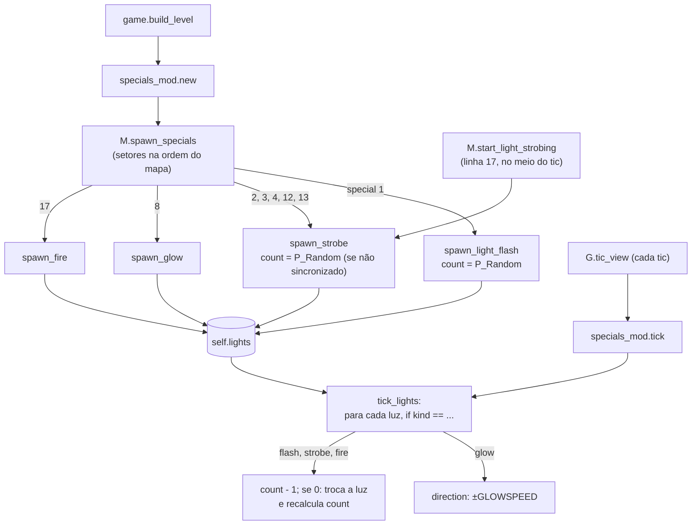

**Fluxo em Lua, depois.** O Lua só calcula a geometria e cria a task; o
`Nivel` emite o tic dos specials:

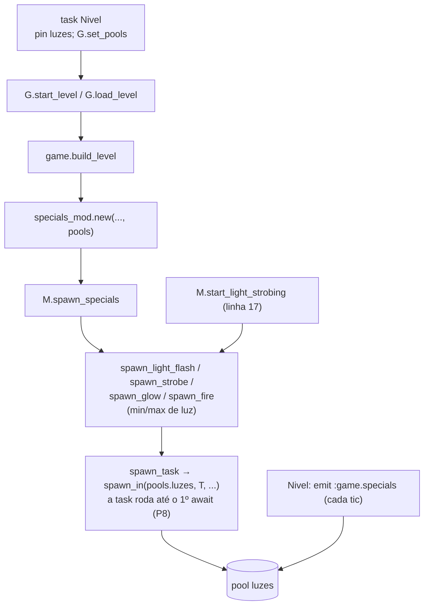

**Máquinas de estados das tasks** (`setores.atm`). Cada estado é um ponto
de espera no código; as transições acontecem em `:game.specials`:

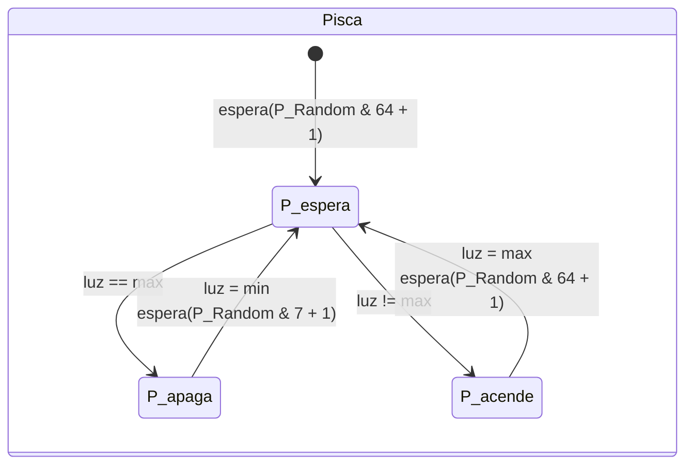

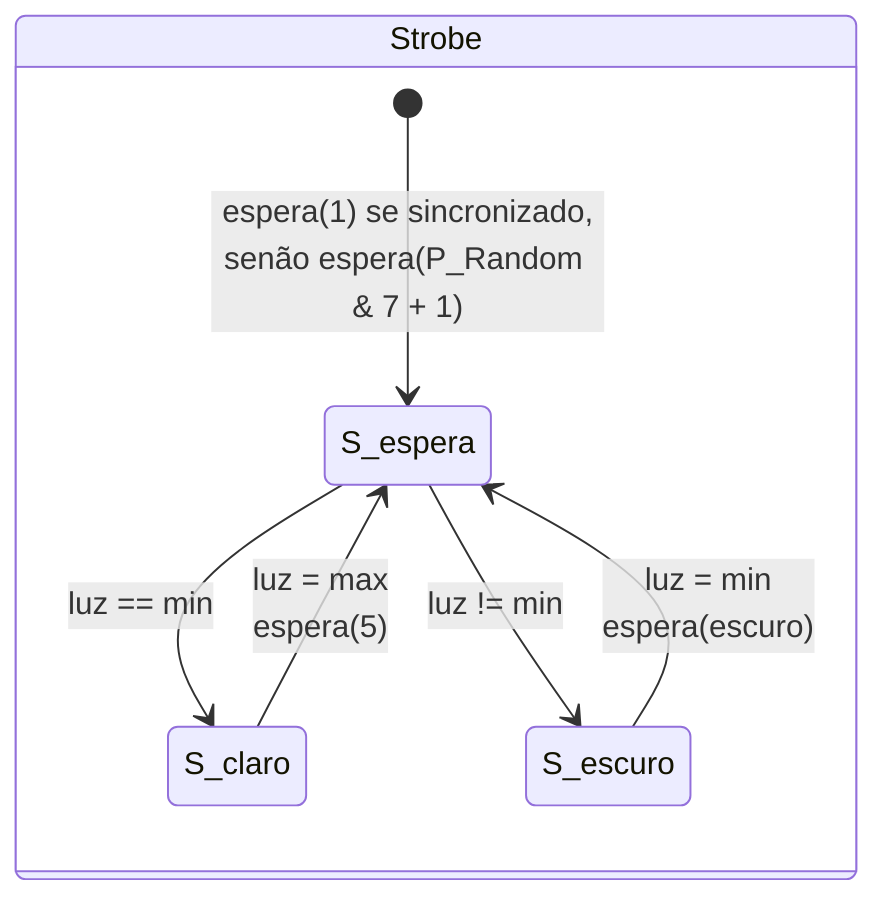

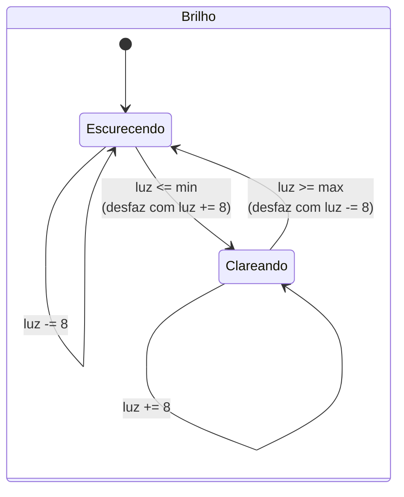

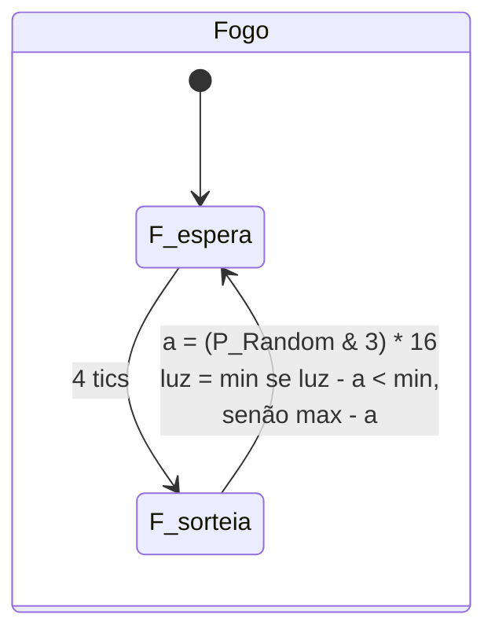

Em todas, o fim do `Nivel` aborta a task em qualquer estado (a pool é
fechada); não há estado final.

### Validação

**Equivalência.** `make test-drivers`, idêntico à tag `passo1`:

| Roteiro | Quadros | Estados distintos | Cobre |
|---|---|---|---|
| `fluxo` | 4.478 | 1.680 | todas as transições; luzes de E1M1, E1M2, E1M9, E1M4, E2M1 |
| semente 1 | 4.000 | 2.707 | jogo pseudoaleatório, 4 níveis |
| semente 2, `exits` | 6.000 | 1.437 | E1M8, finale |
| **`luzes`** (novo) | 2.619 | 1.964 | E4M1 (12 fogos, 1 pisca) e E1M2 (13 glows, 3 piscas, 10 strobes de todos os tipos) |

O hash de estado já inclui a luz de **todos** os setores a cada quadro,
olhando ou não para eles. Por isso nenhum campo novo entrou no
`G.state_string`: qualquer diferença de tempo numa luz aparece no
`lightlevel` em no máximo 64 tics (a maior espera, a do pisca).

**Roteiro `luzes`** (`tools/make_replay.lua <saida> 1200 1 luzes`, rodado
com `-warp 4 1`). Contagem por script dos setores com luz nos mapas dos
roteiros antigos mostrou que **nenhum tinha fogo** (o tipo 17 só existe no
episódio 4: E4M1, E4M2, E4M5, E4M6, E4M7, E4M8). O roteiro novo fica parado
(`iddqd`, girando de vez em quando) no E4M1 e, depois de `idclev12`, no
E1M2. Os monstros continuam atacando e consumindo `P_Random` entre as luzes,
o que testa a ordem dentro do tic. `tests/test_drivers.sh` confere que os
dois mapas foram visitados ("cobertura das luzes").

**Mutações.** `tools/mutacoes.py` passou a aceitar mutações em qualquer
arquivo e em qualquer roteiro (cada roteiro tem o seu log de referência,
`build/drivers/ref_<roteiro>.log`). Mutações do 3a, no roteiro `luzes`:

| Mutação | Arquivo | Erro simulado | 1º quadro | Quadros dif. |
|---|---|---|---|---|
| `pisca-sem-espera-inicial` | `setores.atm` | a luz age no tic em que nasce | 1 | 2.619 |
| `fogo-intervalo-3` | `setores.atm` | fogo a cada 3 tics em vez de 4 | 3 | 1.290 |
| `strobe-sincronizado-sorteia` | `setores.atm` | strobe sincronizado consome `P_Random` | 1.309 | 1.311 |
| `brilho-nao-volta` | `setores.atm` | glow inverte sem desfazer o último passo | 1.309 | 1.311 |
| `luzes-ordem-inversa` | `specials.lua` | pool criada na ordem inversa dos setores | 4 | 1.881 |
| `luzes-depois-do-resto` | `main.atm` | pool de luzes acorda depois do resto em Lua | – | 0 (equivalente) |

Resultado geral de `make test-mutacoes`: **15/16 mutações não equivalentes
detectadas**, 3 equivalentes justificadas, 1 pendente
(`specials-no-fim-do-tic`, do subpasso 0).

**Mutante equivalente `luzes-depois-do-resto`.** As luzes só escrevem
`lightlevel` e consomem `P_Random`. O resto ainda em Lua (scroll, portas,
elevadores, pisos, botões) não lê `lightlevel` e não consome `P_Random` no
tick: conferido nas funções `tick_*` e em `collision.change_sector`, que no
esmagamento só tira vida. No Doom original, `P_ChangeSector` solta sangue
com `P_Random` durante o esmagamento; num port fiel, esse mutante deixaria
de ser equivalente. Isso também é um resultado: a ordem entre luzes e
movimentadores só importa através do gerador aleatório compartilhado.

**Propriedades do runtime** (`tests/atmos_semantica.atm`, antes deste
subpasso): P7 (ordem das pools), P8 (`spawn_in` síncrono a partir do Lua) e
P9 (uma task criada no evento A acorda no evento B seguinte). P7 e P9 foram
conferidas com mutantes do próprio teste.

### Problemas encontrados

1. **Um mutante mal construído.** A primeira versão de
   `luzes-depois-do-resto` inseria uma segunda task do resto em vez de mover
   a existente, o que rodaria os specials Lua duas vezes por tic e testaria
   outra coisa. O trecho agora é extraído do `main.atm` e movido inteiro.
2. **Script de custo com caminho relativo.** `tools/custo_drivers.py` passava
   o roteiro com caminho relativo para um processo rodando em outra pasta, e
   a referência falhava. O caminho agora é absoluto.
3. **Linha 17 (strobe por linha) sem cobertura possível.**
   `M.start_light_strobing` também cria luzes (pelo mesmo `spawn_strobe`),
   mas nenhum mapa do `doom.wad` usa a linha 17. O caminho está migrado, mas
   não é exercitado por nenhum roteiro.

### Métricas

`python3 tools/metricas_passo3.py` (tag `passo2` × árvore atual; funções de
luz em `specials.lua` e `setores.atm`):

| Métrica | Antes | Depois |
|---|---|---|
| Linhas de código (Lua) | 109 | 33 |
| Linhas de código (Atmos) | – | 53 |
| Linhas de código (total) | 109 | 86 |
| Estado por entidade (campos da tabela × parâmetros da task) | 10 | 5 |
| Ramos de despacho por tipo (`kind ==`) | 4 | 0 |
| Contadores manuais (`.count`) | 9 | 0 |
| Decrementos de contador (`x.c = x.c - 1`) | 1 | 0 |
| Referências à lista (`self.lights`, `specials.lua` inteiro, sem comentários) | 10 | 0 |

No commit do 3a, a tabela dizia 30/83 linhas. No 3e, `spawn_luz` foi
generalizado em `spawn_task` (usado também pelos botões), e o script passou
a contar `spawn_task` no 3a: 33/86. As linhas de uso geral ficam no 3a, onde
apareceram.

Os campos antes: `sector`, `kind`, `maxlight`, `minlight`, `maxtime`,
`mintime`, `count`, `darktime`, `brighttime`, `direction`. Depois:
`setor`, `maxl`, `minl`, `escuro`, `sincronizado`. Nenhuma local das tasks
atravessa um `await`; a fase (`direction`, `count`) está na posição do
código.

### Custo

`python3 tools/custo_drivers.py 5 [roteiro]` (mínimo de 5 execuções, pastas
limpas, inicialização descontada; o script ganhou o driver `passo2-atm`,
num worktree em `build/ref-passo2`):

| Driver | `fluxo` (ms/quadro) | `luzes` (ms/quadro) |
|---|---|---|
| `passo1` `main.lua` (imperativo) | 0,733 | 0,904 |
| `passo1` `main.atm` | 0,790 | 0,959 |
| `passo2` `main.atm` | 0,826 | 0,996 |
| atual (3a) | 0,864 | 1,089 |

O 3a custa +0,038 ms por quadro no `fluxo` e +0,093 ms no `luzes`, que tem
13 luzes no E4M1 e 26 no E1M2. São 0,3% de um tic (28,6 ms). Nesta máquina,
nesta sessão, o `passo1` imperativo mediu 0,733 ms (no registro do passo 2,
0,836 ms): compare sempre drivers medidos na mesma execução.

### Diferenças conhecidas

Nenhuma no comportamento. Fora do jogo (testes unitários com `game` falso),
as luzes não são animadas.

### Como reproduzir

```sh
make
make test-drivers                  # P1-P9 + 4 roteiros contra a tag passo1
make test-mutacoes                 # inclui as mutacoes do 3a (roteiro luzes)
python3 tools/metricas_passo3.py
sh tests/test_drivers.sh 0 1 fluxo >/dev/null
python3 tools/custo_drivers.py 5
sh tests/test_drivers.sh 1200 1 luzes -warp 4 1 >/dev/null
python3 tools/custo_drivers.py 5 build/drivers/replay_1luzes.txt -warp 4 1
```

### Arquivos alterados

| Arquivo | Mudança |
|---|---|
| `setores.atm` (novo) | tasks `Pisca`, `Strobe`, `Brilho`, `Fogo` e `espera(n)` |
| `specials.lua` | `M.new` recebe `pools`; `spawn_*` de luz criam tasks com `spawn_in`; saíram `self.lights`, `tick_lights`, `GLOWSPEED`, `STROBEBRIGHT` |
| `game.lua` | `G.set_pools`; `build_level` passa `game.pools` a `specials_mod.new` |
| `main.atm` | `Nivel` declara a pool `luzes` antes de montar o nível, com `defer` |
| `tools/make_replay.lua` | roteiro `luzes` |
| `tests/test_drivers.sh` | cópia `ref_<roteiro>.log`; cobertura do roteiro `luzes` |
| `tools/mutacoes.py` | mutações em qualquer arquivo e roteiro; 6 mutações do 3a |
| `tools/metricas_passo3.py` (novo) | métricas por subpasso |
| `tools/custo_drivers.py` | driver `passo2-atm`; argumentos do jogo; caminho absoluto |
| `Makefile` | roteiro `luzes` em `test-drivers` e `test-mutacoes` |

---

## Subpasso 3e: botões

### Resumo

Um switch repetível troca a textura do lado da linha e, depois de 35 tics
(`BUTTONTIME`), a devolve. Antes, cada botão era um item de `self.buttons`
decrementado e removido da lista dentro de `M.tick`. Agora é uma task
`Botao` em `setores.atm`, na pool `botoes` do `Nivel`. É o primeiro tipo
**criado pelo Lua no meio do tic** (`spawn_in` a partir de `change_switch`)
e o primeiro **gravado no save**.

### Situação antes (tag `passo2`)

- `M.new` criava `buttons = {}` (`specials.lua:291`).
- `change_switch` (`specials.lua:1215`) acrescentava
  `{ line, attr, texture, timer = BUTTONTIME }` a `self.buttons` quando o
  switch era repetível.
- O fim de `M.tick` (`specials.lua:715-729`) decrementava `timer`, devolvia
  a textura quando chegava a zero e reconstruía a lista (`keep`).
- `saveg.lua` gravava `specials.buttons` campo a campo (`saveg.lua:467-482`)
  e o load os recriava na lista (`saveg.lua:734-748`).

### Solução

**A task.**

```
val task Botao (linha, attr, textura, timer) {
    set pub = [linha=linha, attr=attr, textura=textura, timer=timer]
    loop {
        await :game.specials
        set pub.timer = pub.timer - 1
        until (pub.timer <= 0)
    }
    val lado = linha.sides@1
    if lado {
        set lado@attr = textura
    }
}
```

**A ordem no tic.** Os botões eram a última fase de `M.tick`, então a pool
`botoes` é declarada **depois** da task do resto em Lua (P7). Como o load
recria botões dentro de `G.load_level`, as três declarações (luzes, resto,
botões) passaram a vir **antes** de montar o nível:

```
pin luzes = tasks()                   ;; 3a
spawn {                               ;; ainda em Lua: scroll e
    loop on :game.specials {          ;; portas/elevadores/pisos
        G.specials_resto()
    }
}
pin botoes = tasks()                  ;; 3e
G.set_pools([luzes=luzes, botoes=botoes])
```

**Criação a partir do Lua.** `change_switch` roda no "use" do jogador
(etapa 3 do tic) e chama `M.start_button`, que faz
`spawn_in(self.pools.botoes, Botao, ...)`. A task nasce durante o
`:game.tic` e conta o primeiro tic no `:game.specials` do **mesmo** tic
(P9), como o item novo em `self.buttons` era decrementado no mesmo
`M.tick`.

**Save e load pelo `pub`.** O save percorre a pool (`pairs` numa pool
devolve as tasks em ordem de criação) e grava `t.pub`. O load chama
`M.start_button(..., timer_gravado)`, e a task recomeça com o timer que
restava. O botão tem uma fase só, então não há código de retomada: o
"estado reintroduzido" é exatamente o `pub.timer`.

### Comparação de código

Antes (`specials.lua`, tag `passo2`, fim de `M.tick`):

```lua
local keep = {}
for i = 1, #self.buttons do
  local btn = self.buttons[i]
  btn.timer = btn.timer - 1
  if btn.timer <= 0 then
    local side = btn.line.sides[1]
    if side then
      side[btn.attr] = btn.texture
      mark(self)
    end
  else
    keep[#keep + 1] = btn
  end
end
self.buttons = keep
```

Depois: a task acima, e em `change_switch` só
`M.start_button(self, line, attr, tex, BUTTONTIME)`.

O que mudou na leitura:

- A remoção da lista (`keep`, `self.buttons = keep`) desapareceu: a task
  termina, e a pool a recolhe.
- **O contador não desapareceu.** Sem o save, a task seria
  `espera(timer)` seguida da troca de textura, como nas luzes. O save
  precisa ler quanto falta, e a task não expõe a posição dentro de um
  `espera`: por isso `pub.timer` é decrementado à mão. É a primeira
  medida concreta do custo do save previsto em `NOTAS_MONOGRAFIA.md`
  (seções 1 e 4): **num tipo de uma fase só, o save devolve exatamente o
  contador que a task eliminaria**.

### Diagramas

**Fluxo em Lua, antes (tag `passo2`).**

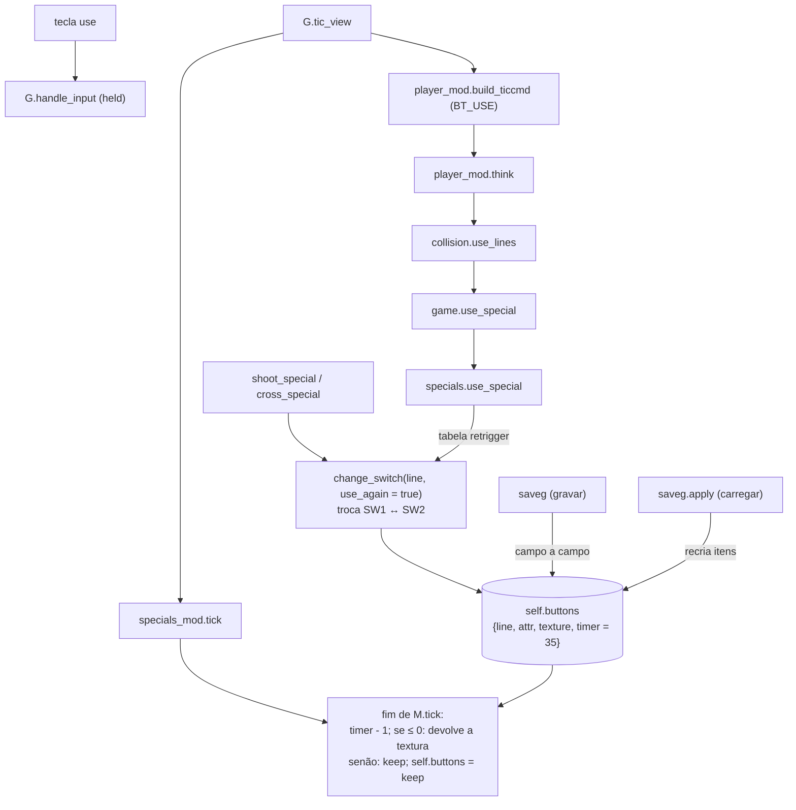

**Fluxo em Lua, depois.**

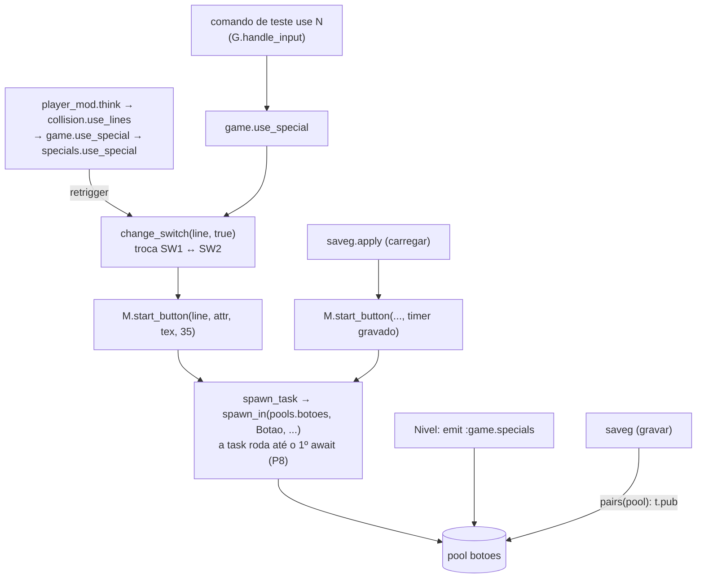

**Máquina de estados da task `Botao`:**

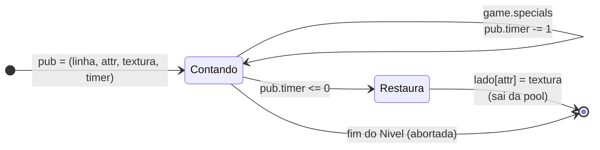

O `pub.timer` é o contador que o save lê. Sem o save, o estado
"Contando" seria só `espera(timer)`.

### Validação

**Comando de teste `use <linha>`.** Os roteiros de teclas dificilmente
acertam um switch repetível. O replay ganhou o comando `use N`, que aciona a
linha N do WAD como o "use" do jogador (`video.lua`, `game.lua`), como já
faziam `exit` e `die`. A referência não o tinha: ele entrou no
`tests/ref-passo1.patch` (que agora tem 58 linhas e foi conferido aplicando
num checkout limpo da tag `passo1`).

**Roteiro `botoes`** (`-warp 1 1`). Contagem por script dos switches
repetíveis (tipos 42, 43, 45, 60-70, 114-116, 120, 123, 132) com textura de
switch no lado da frente: E1M1 linha 136 (porta), E1M4 linhas 394 e 694
(elevadores). O roteiro aperta a linha 136, aperta de novo com o botão
ativo (dois botões na mesma linha), **salva com um botão no meio do timer**,
carrega esse save e vai ao E1M4. `tests/test_drivers.sh` confere que o save
das duas versões tem um botão ativo (os dois gravaram
`{"line":136,"where":"bottomtexture","texture":107,"timer":29}`), que houve
o load e que o E1M4 foi visitado.

**Hash de estado ampliado.** O `G.state_string` não incluía os lados das
linhas, e um botão só muda uma textura de lado. O hash ganhou textura de
cima, do meio, de baixo e deslocamento de cada lado, também na referência
(pelo patch). Isso foi **necessário**: nas cinco mutações de botão, a imagem
não diverge em nenhum quadro (o switch não está na tela) e só o estado
diverge:

| Mutação | Arquivo | Erro simulado | 1º quadro | Quadros dif. (estado) | Imagem |
|---|---|---|---|---|---|
| `botao-sem-espera-inicial` | `setores.atm` | conta o primeiro tic no spawn | 109 | 10 | 0 |
| `botao-um-tic-a-mais` | `setores.atm` | `timer < 0` em vez de `<= 0` | 110 | 6 | 0 |
| `botao-nao-restaura` | `setores.atm` | não devolve a textura | 110 | 480 | 0 |
| `save-esquece-botoes` | `saveg.lua` | save não grava os botões | 440 | 96 | 0 |
| `load-reinicia-timer` | `saveg.lua` | load usa timer cheio (35) | 440 | 5 | 0 |
| `botoes-antes-do-resto` | `main.atm` | pool de botões antes do resto em Lua | – | 0 (equivalente) | – |

Sem os lados no hash, as cinco teriam sobrevivido. O hash dos lados custa
caro (milhares de `string.format` por quadro), então só é calculado com
`DOOM_REPLAY_SIDES=1`, que `tests/test_drivers.sh` e `tools/mutacoes.py`
ligam e `tools/custo_drivers.py` não liga.

**Mutante equivalente `botoes-antes-do-resto`.** Os botões só escrevem a
textura do lado do switch. O resto em Lua escreve `textureoffset` (linhas
com scroll) e alturas de setor, não lê texturas de lado e não consome
`P_Random` no tick. Campos disjuntos, sem dependência de leitura.

**Equivalência.** `make test-drivers`, idêntico à tag `passo1` nos 5
roteiros (`fluxo`, semente 1, semente 2 `exits`, `luzes`, `botoes`: 851
quadros, 587 estados distintos). `make test-mutacoes`: **20/21 mutações não
equivalentes detectadas**, 4 equivalentes justificadas, 1 pendente
(`specials-no-fim-do-tic`).

### Problemas encontrados

1. **O hash não via o que o botão muda.** Descoberto ao planejar as
   mutações: sem os lados, os testes do 3e seriam verdes sem testar nada.
   Lição para o método: a cada tipo migrado, perguntar **o que ele escreve**
   e conferir que isso está no hash.
2. **O hash novo falseou a medição de custo.** A primeira medição depois de
   ampliar o hash deu o `passo1` e o atual 50% mais lentos que o `passo2`:
   eram os `string.format` dos lados, que o `passo2` não calcula. Daí a
   variável `DOOM_REPLAY_SIDES`.
3. **Mais uma mutação de ordem mal construída.** A primeira versão de
   `botoes-antes-do-resto` apagava a declaração da pool (o que deixaria
   `botoes` indefinida) em vez de movê-la. Agora o trecho é extraído do
   `main.atm`, como no 3a; a mutação do 3a foi regerada para o `Nivel`
   novo.

### Métricas

`python3 tools/metricas_passo3.py` (o script passou a medir trechos de
funções; nos botões, o código estava espalhado entre `M.tick`,
`change_switch` e `saveg.lua`):

| Métrica | Antes | Depois |
|---|---|---|
| Linhas de código (Lua) | 55 | 37 |
| Linhas de código (Atmos) | – | 12 |
| Linhas de código (total) | 55 | 49 |
| Estado por entidade (campos × parâmetros) | 4 | 4 |
| Decrementos de contador (`x.c = x.c - 1`) | 1 | 1 |
| Referências à lista (`self.buttons`, `specials.buttons`; sem comentários) | 10 | 0 |

O estado não diminuiu (`line`, `attr`, `texture`, `timer` × `linha`,
`attr`, `textura`, `timer`) e o decremento continua: é o custo do save
discutido acima. O ganho está na lista que sumiu (10 referências → 0) e na
limpeza automática.

### Custo

`python3 tools/custo_drivers.py 5 [roteiro]` (sem `DOOM_REPLAY_SIDES`):

| Driver | `fluxo` | `luzes` | `botoes` |
|---|---|---|---|
| `passo1` `main.lua` | 0,735 | 0,903 | 1,557 |
| `passo1` `main.atm` | 0,790 | 0,961 | 1,651 |
| `passo2` `main.atm` | 0,830 | 1,001 | (não comparável) |
| atual (3e) | 0,863 | 1,096 | 1,721 |

(ms por quadro). No `fluxo` e no `luzes`, o atual mediu o mesmo que no 3a
(0,864 e 1,089), dentro do ruído: os botões vivem poucos tics e há no
máximo dois de cada vez. No `botoes`, o `passo2` não conhece o comando
`use`, então não aciona os switches; sem os `use`, o mesmo roteiro cai de
1,54 s para 0,91 s no driver atual. O custo extra desse roteiro é das
portas e elevadores que os switches disparam (ainda thinkers Lua:
`move_plane` → `change_sector` percorre todos os mobjs a cada tic), não dos
botões.

### Diferenças conhecidas

Nenhuma no comportamento. A peculiaridade de dois botões na mesma linha
(apertar de novo antes de o primeiro voltar cria um segundo botão, que
devolve a textura trocada depois) existe na referência e foi preservada; o
Doom original evita isso em `P_StartButton`. Fora do jogo (testes unitários
com `game` falso), os botões não são criados.

### Como reproduzir

```sh
make test-drivers                  # P1-P9 + 5 roteiros contra a tag passo1
make test-mutacoes                 # inclui as mutacoes do 3e (roteiro botoes)
python3 tools/metricas_passo3.py
sh tests/test_drivers.sh 0 1 botoes -warp 1 1 >/dev/null
python3 tools/custo_drivers.py 5 build/drivers/replay_1botoes.txt -warp 1 1
```

Na primeira execução depois de atualizar o patch, apague o worktree antigo
da referência (`git worktree remove --force build/ref-passo1`): o script só
aplica o patch num worktree limpo.

### Arquivos alterados

| Arquivo | Mudança |
|---|---|
| `setores.atm` | task `Botao` |
| `specials.lua` | `spawn_luz` generalizado em `spawn_task`; `M.start_button`; saíram `self.buttons` e a fase de botões de `M.tick` |
| `saveg.lua` | save percorre a pool `botoes` e grava `t.pub`; load chama `M.start_button` |
| `main.atm` | `Nivel` declara luzes, resto e botões antes de montar o nível |
| `game.lua` | comando de teste `use`; lados no `G.state_string` (com `DOOM_REPLAY_SIDES`) |
| `video.lua` | comando `use <linha>` no roteiro |
| `tests/ref-passo1.patch` | `use` e lados no hash, também na referência |
| `tools/make_replay.lua` | roteiro `botoes` |
| `tests/test_drivers.sh` | `DOOM_REPLAY_SIDES=1`; cobertura do roteiro `botoes` |
| `tools/mutacoes.py` | roteiro `botoes`; 6 mutações do 3e; mutação de ordem do 3a regerada |
| `tools/metricas_passo3.py` | medição por trechos; `spawn_task` no 3a; sem comentários nas listas |
| `Makefile` | roteiro `botoes` em `test-drivers` e `test-mutacoes` |

---

## Subpasso 3b: portas

### Resumo

As portas viraram a task `Porta` (`setores.atm`). Portas, elevadores, pisos
e tetos ficam agora numa **pool única `movers`**, na ordem de criação; os
que ainda não migraram entram embrulhados na task genérica `ThinkerLua`, que
só chama o tick antigo. A lista `self.thinkers` sumiu. O "use" numa porta
em movimento continua sendo uma escrita do Lua no registro da porta (o
**recado**), lida pela task na sua fase. O save grava o mesmo formato de
antes, e os arquivos `.dsg` saem **byte a byte iguais** aos da referência.

O resultado de expressividade é **misto** e está registrado como tal: o
estado da porta não diminuiu e o código cresceu; o ganho foi a lista que
sumiu, a limpeza num `defer` e a ordem garantida por construção.

### Situação antes (tag `passo2`)

- `spawn_door` (`specials.lua:371`): se o setor já tem uma porta comum,
  inverte `door.direction`; senão monta a tabela da porta, marca
  `sector.specialdata` e acrescenta a `self.thinkers`.
- `spawn_door_close_in_30` e `spawn_door_raise_in_5` (`specials.lua:424`,
  `444`): portas nascidas do setor (tipos 10 e 14), em `spawn_specials`.
- `tick_door` (`specials.lua:551`): máquina de estados em `direction`
  (1, 0, −1) e `topcountdown`; ao terminar, `specialdata = nil` e
  `dead = true`.
- `M.tick` (`specials.lua:696-714`): percorre `self.thinkers`, despacha por
  `kind` (door, plat, floor, ceiling) e reconstrói a lista sem os mortos.
- `saveg.lua`: `dump_thinker` (`saveg.lua:375`) grava cada thinker campo a
  campo (`saveg.lua:455`), e o load os recria na lista (`saveg.lua:705`).

### Três descobertas que mudaram o desenho

1. **Neste port, a porta não reabre ao bater em alguém.** Quando
   `move_plane` devolve "esmagou", `tick_door` só tenta de novo no tic
   seguinte. O Doom original (`T_VerticalDoor`) reabriria. O comportamento
   do port foi preservado.
2. **O recado tem de ser a própria direção, não um booleano.** Dois "use" no
   mesmo tic (jogador e monstro, ou o comando de teste duas vezes) invertem
   duas vezes, e o resultado depende da direção atual (esperando →
   fechando → abrindo). Um `inverter = true` perderia isso. Por isso o Lua
   continua escrevendo `porta.direction` no registro da porta, e a task lê
   na fase de specials.
3. **A ordem entre portas e outros movimentadores importa, num caso
   raro.** Um mobj com o centro no setor de uma porta e o corpo no setor de
   um elevador tem chão e teto calculados pelos dois setores
   (`thing_height_clip`). Se a porta e o elevador andam no mesmo tic, a
   ordem decide se o mobj vê a altura velha ou nova do vizinho. Para não
   depender de nenhum roteiro, a ordem é mantida **por construção**: uma
   pool só, e os thinkers ainda Lua embrulhados em `ThinkerLua`.

### Solução

**Pools do `Nivel`:**

```
pin luzes = tasks()                   ;; 3a
spawn {                               ;; ainda em Lua: linhas com scroll
    loop on :game.specials { G.specials_resto() }
}
pin movers = tasks()                  ;; 3b: portas (Porta) e, ainda Lua,
                                      ;; elevadores/pisos (ThinkerLua)
pin botoes = tasks()                  ;; 3e
G.set_pools([luzes=luzes, movers=movers, botoes=botoes])
```

**A porta.** A fase é `porta.direction` (1 abrindo, 0 esperando, −1
fechando), guardada no registro da porta, que é o `pub` da task e o
`sector.specialdata`. Ela fica no registro por dois motivos: o recado (o Lua
precisa escrevê-la) e o save (o formato grava `direction` e
`topcountdown`). Cada fase é uma função que devolve como terminou:

```
val func mover (sp, porta, dir, direto) {     ;; :chegou | :troca
    var espera = !direto
    loop {
        if espera { await :game.specials }
        set espera = true
        until (porta.direction != dir, :troca)          ;; o recado
        val destino = if dir == 1 => porta.topheight => porta.sector.floorheight
        val r = S.move_plane(sp.world, porta.sector, porta.speed, destino, 1, dir, false)
        until (r == S.RESULT_PASTDEST, :chegou)
    }
}

val func esperar_porta (porta) {               ;; :fim | :troca
    loop {
        await :game.specials
        until (porta.direction != 0, :troca)
        set porta.topcountdown = porta.topcountdown - 1
        until (porta.topcountdown <= 0, :fim)
    }
}
```

e a task decide a fase seguinte conforme o tipo da porta:

```
val task Porta (sp, porta) {
    set pub = porta
    set porta.sector.specialdata = porta  ;; setor ocupado
    defer {                               ;; ao terminar ou ser abortada
        set porta.sector.specialdata = nil
        set porta.dead = true
    }
    var direto = false
    loop {
        val d = porta.direction
        val r = if d == 0 => esperar_porta(porta) => mover(sp, porta, d, direto)
        set direto = (r == :troca)
        ifs {
            (r == :troca) => {}           ;; recado: segue na direção nova
            (r == :fim) => { ... }        ;; fim da espera: fecha ou abre, com som
            (d == 1) => {                 ;; chegou em cima
                until ((porta.type != V.NORMAL) && (porta.type != V.BLAZERAISE))
                set porta.direction = 0
                set porta.topcountdown = porta.topwait
            }
            else => {                     ;; chegou embaixo
                until (porta.type != V.CLOSE30)
                set porta.direction = 0
                set porta.topcountdown = S.TICRATE * 30
            }
        }
    }
}
```

`direto`: quando o recado chega, a fase nova age **já nesse tic**, como o
`tick_door` lia a direção nova no mesmo `M.tick`.

**Save e load.** O save percorre a pool `movers` em ordem e grava
`dump_thinker(t.pub)`, o mesmo registro e o mesmo formato. O load chama
`M.start_door` para portas e `M.add_thinker` para elevadores e pisos, na
ordem gravada. **Não há código de retomada separado**: a task começa na fase
do `porta.direction` gravado (o laço da `Porta` já é um despachante por
fase). Isso responde, para a porta, a pergunta do custo do save
(`NOTAS_MONOGRAFIA.md`, seção 1): o custo não aparece como um `ifs` de
retomada, porque a fase já precisava estar no registro por causa do recado.

### Diagramas

**Fluxo em Lua, antes (tag `passo2`):**

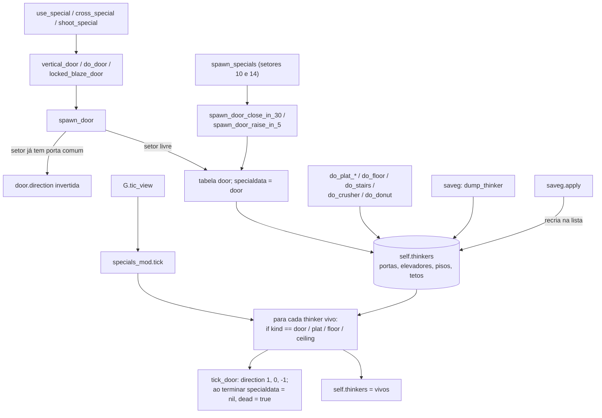

**Fluxo em Lua, depois:**

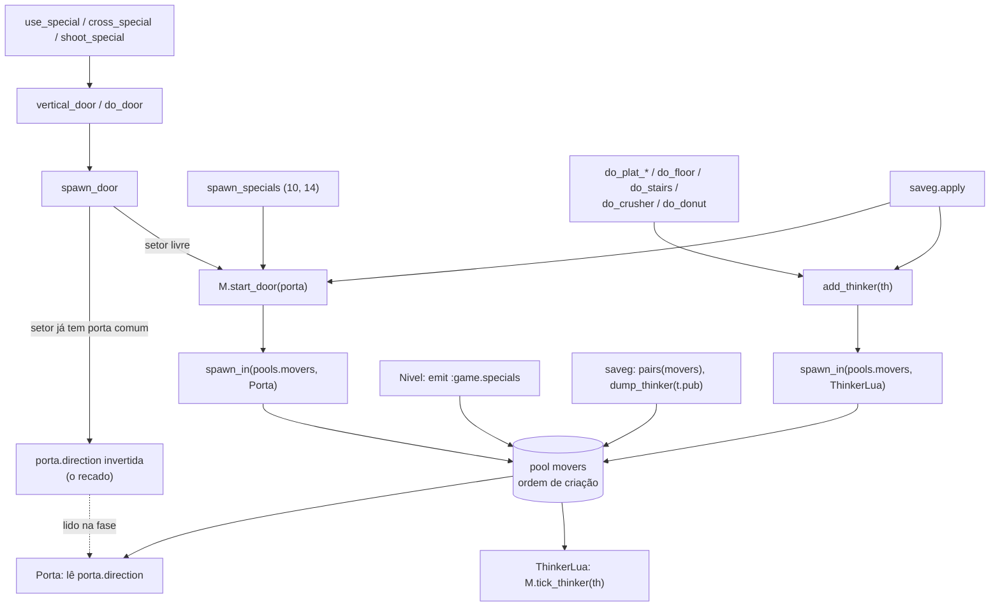

**O recado dentro de um tic:**

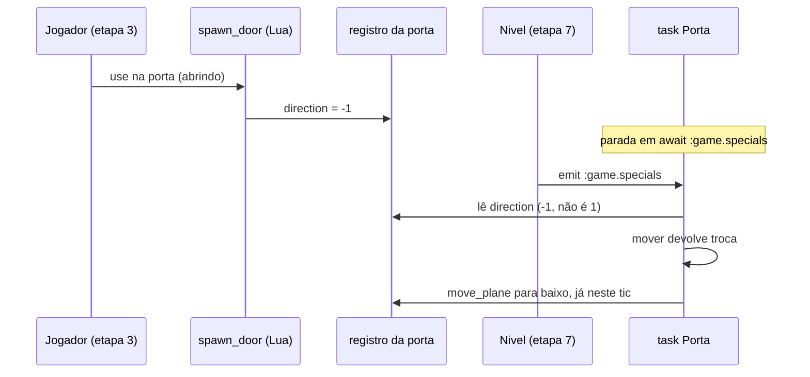

**Máquina de estados da task `Porta`** (a fase é `porta.direction`):

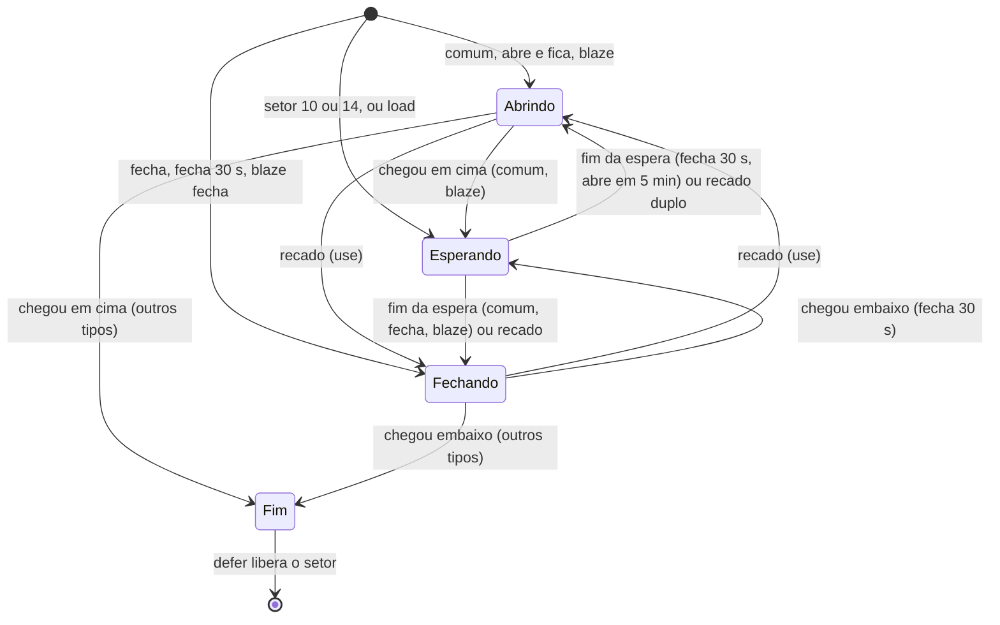

O fim do `Nivel` aborta a porta em qualquer estado; o `defer` roda também
nesse caso.

**Máquina de estados da task `ThinkerLua`** (elevadores, pisos e tetos até o
3c e o 3d):

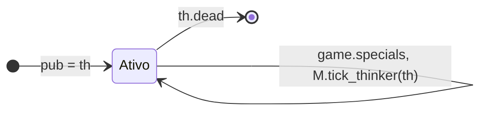

### Comparação de código

Antes, a mudança de fase estava espalhada entre três lugares: o `if` sobre
`direction` em `tick_door`, a inversão em `spawn_door` e a remoção em
`M.tick`. Depois, a inversão continua em `spawn_door` (é o recado), e o
resto está na task. O que de fato saiu:

- `dead = true` e `sector.specialdata = nil` em dois lugares de
  `tick_door` → um `defer`, que roda também quando o `Nivel` aborta a porta;
- a lista e sua reconstrução a cada tic (`alive`, `self.thinkers = alive`)
  e o despacho `kind == "door"` em `M.tick`;
- o contador de espera virou uma função (`esperar_porta`), mas continua no
  registro, porque o save e o recado precisam dele.

O que **não** ficou mais simples: a porta, que pode ser interrompida a
qualquer momento por um evento externo e precisa salvar a fase, continua
sendo uma máquina de estados de três estados. Em Atmos, ela é um laço com um
despachante por fase, de tamanho parecido com o `tick_door`.

### Validação

**Comando de teste `cross <linha>`** (cruzar uma linha pela frente), para as
portas de 30 s, criadas ao cruzar (tipos 16 e 76). Entrou também no
`tests/ref-passo1.patch` (72 linhas, conferido num checkout limpo da tag).

**Roteiro `portas`** (`-warp 1 1`). Contagem por script das portas nos
mapas: E1M1 tem 8 portas comuns (tipo 1); E1M2, portas que abrem e ficam
(31) e vermelhas (28); portas de 30 s só por linha, no E1M6, E2M2 e E2M7.
**Nenhum mapa do WAD tem setores 10 ou 14** (portas nascidas do setor): esse
caminho foi migrado, mas não é exercitado. O roteiro:

1. E1M1, linha 148: usar de novo abrindo, fechando e esperando, e duas vezes
   no mesmo quadro;
2. save e load em cada fase, em slots diferentes;
3. E1M6, linha 602: cruzar (fecha, espera 30 s, reabre);
4. E1M2: linhas 497 (abre e fica) e 527 (vermelha, com `idkfa`).

Os três saves gravaram a porta exatamente na fase pretendida, iguais nas
duas versões:

| Slot | `direction` | `topcountdown` | Referência × atual |
|---|---|---|---|
| 5 | 1 (abrindo) | 0 | idênticos |
| 4 | 0 (esperando) | 33 | idênticos |
| 3 | −1 (fechando) | 72 | idênticos |

**Saves comparados byte a byte.** `tests/test_drivers.sh` passou a comparar
todos os `.dsg` gravados pela referência e pela versão atual, em todos os
roteiros. Como o formato do save não mudou na migração, qualquer diferença
no save é uma divergência.

**Equivalência.** `make test-drivers`, idêntico à tag `passo1` nos 6
roteiros (incluindo `portas`: 2.958 quadros, 2.161 estados distintos).

**Mutações do 3b** (roteiro `portas`):

| Mutação | Arquivo | Erro simulado | 1º quadro | Quadros dif. |
|---|---|---|---|---|
| `porta-sem-espera-inicial` | `setores.atm` | porta anda no próprio spawn | 76 | 412 |
| `recado-ignorado-movendo` | `setores.atm` | outro use durante o movimento não inverte | 88 | 35 |
| `recado-ignorado-esperando` | `setores.atm` | outro use no topo não fecha | 196 | 186 |
| `recado-um-tic-depois` | `setores.atm` | depois do recado, só anda no tic seguinte | 88 | 103 |
| `recado-vira-evento` | `specials.lua` | o use emite `:game.specials` na hora | 87 | 98 |
| `porta-nao-libera-setor` | `setores.atm` | `defer` não libera o setor | 361 | 312 |
| `load-perde-contagem` | `saveg.lua` | load zera o `topcountdown` | 607 | 66 |
| `portas-fora-de-movers` | 3 arquivos | portas numa pool própria, depois dos outros | – | 0 (pendente) |
| `portas-fora-de-movers-fluxo` | 3 arquivos | o mesmo, no roteiro `fluxo` | – | 0 (pendente) |

`recado-vira-evento` demonstra o argumento da `NOTAS_MONOGRAFIA.md`
(seção 5): um evento imediato, em vez do recado lido na fase, muda o jogo
logo no quadro seguinte ao "use".

**Pendente `portas-fora-de-movers`.** Não é equivalente (descoberta 3), mas
exige uma porta e um elevador vizinhos andando no mesmo tic com um mobj na
fronteira, e nenhum roteiro passa por isso. A primeira versão dessa mutação
mudava só um arquivo e quebrava o save (o save procurava `timer` numa
porta): "detectada" por erro, o que não testava a ordem. `tools/mutacoes.py`
passou a aceitar mutações em vários arquivos, e a versão correta cria a pool
no `Nivel`, muda `start_door` e faz o save percorrer as duas pools.

`make test-mutacoes` (todas as mutações do projeto): **27/30 não equivalentes detectadas**, 4 equivalentes justificadas, 3 pendentes (`specials-no-fim-do-tic` e as duas `portas-fora-de-movers`).

### Problemas encontrados

1. **A decisão 3 do plano não se aplicava** (porta que reabre ao esmagar):
   este port não faz isso. Descoberto ao ler o `tick_door`, antes de codar.
2. **O recado booleano perderia o duplo "use"** (descoberta 2).
3. **Mutação "detectada" por erro** (`portas-fora-de-movers`, acima).
   Lição: conferir que a execução mutada **terminou** (o número de quadros
   na saída do script) antes de aceitar uma detecção.
4. **Mutações de ordem antigas deixaram de aplicar** quando o texto do
   `Nivel` mudou. Os trechos agora são extraídos do `main.atm` na hora.

### Métricas

`python3 tools/metricas_passo3.py` (o estado passou a contar também os
campos do registro compartilhado que a task lê ou escreve, `porta.x`;
para a porta, só as partes da porta entram no estado):

| Métrica | Antes | Depois |
|---|---|---|
| Linhas de código (Lua) | 208 | 160 |
| Linhas de código (Atmos) | – | 74 |
| Linhas de código (total) | 208 | 234 |
| Estado da porta (campos) | 9 | 8 |
| Ramos de despacho por tipo (`kind ==`) | 9 | 8 |
| Referências à lista (`self.thinkers`, `specials.thinkers`; sem comentários) | 32 | 0 |

Os campos antes: `dead`, `direction`, `kind`, `sector`, `speed`,
`topcountdown`, `topheight`, `topwait`, `type`. Depois, os mesmos sem
`kind` (que só o Lua usa). Os despachos `kind ==` que sobraram são de
elevadores e pisos (`M.tick_thinker`, `stop_plat`, `dump_thinker`) e saem no
3c e no 3d.

**Leitura honesta:** a porta é o primeiro caso em que o código **cresceu**
(+26 linhas) e o estado **não diminuiu**. A porta pode ser interrompida a
qualquer momento por um evento de fora (o "use") e precisa salvar a fase:
nas duas versões, a fase é um dado. Os ganhos são estruturais (a lista e sua
reconstrução sumiram; a liberação do setor está num `defer`; a ordem entre
movimentadores está garantida por construção), não de tamanho.

### Custo

`python3 tools/custo_drivers.py 5 [roteiro]` (ms por quadro; a máquina
estava mais carregada nesta medição do que no 3e, então só vale comparar
drivers da mesma coluna):

| Driver | `fluxo` | `luzes` | `portas` |
|---|---|---|---|
| `passo1` `main.lua` | 1,000 | 1,311 | 2,260 |
| `passo1` `main.atm` | 1,087 | 1,390 | 2,513 |
| `passo2` `main.atm` | 1,127 | 1,444 | (não comparável) |
| atual (3b) | 1,192 | 1,609 | 2,668 |

Em relação ao `passo2`, o atual custa +5,8% no `fluxo` (no 3e: +4,0%) e
+11,4% no `luzes` (no 3e: +9,5%). Em relação ao `passo1` imperativo: +19,2%
no `fluxo` (no 3e: +17,5%). O 3b acrescenta uma task por porta e por
thinker em movimento (`ThinkerLua`). No `portas`, o `passo2` não conhece
`use` nem `cross`; contra o `passo1` `main.atm`, que conhece, o atual custa
+6,2%.

### Diferenças conhecidas

Nenhuma no comportamento. A porta deste port não reabre ao esmagar (o Doom
original reabre); preservado. Portas nascidas do setor (tipos 10 e 14) não
existem nos mapas do `doom.wad` e não são exercitadas. Fora do jogo (testes
unitários com `game` falso), portas, elevadores e pisos não são criados.

### Como reproduzir

```sh
make test-drivers                  # P1-P9 + 6 roteiros; saves comparados byte a byte
make test-mutacoes
python3 tools/metricas_passo3.py
sh tests/test_drivers.sh 0 1 portas -warp 1 1 >/dev/null
python3 tools/custo_drivers.py 5 build/drivers/replay_1portas.txt -warp 1 1
python3 tools/diagramas.py         # confere a sintaxe dos diagramas desta pagina
```

### Arquivos alterados

| Arquivo | Mudança |
|---|---|
| `setores.atm` | tasks `Porta` e `ThinkerLua`; funções `mover` e `esperar_porta` |
| `specials.lua` | `add_thinker`, `M.start_door`, `M.tick_thinker`; exporta `RESULT_PASTDEST`, `TICRATE`, `VLD`, `play`; saíram `self.thinkers`, `tick_door` e o laço de thinkers de `M.tick`; `stop_plat` percorre a pool |
| `saveg.lua` | save percorre a pool `movers`; load chama `start_door` e `add_thinker` |
| `main.atm` | pool `movers` entre o resto em Lua e os botões |
| `game.lua`, `video.lua` | comando de teste `cross` |
| `tests/ref-passo1.patch` | `cross` também na referência |
| `tests/test_drivers.sh` | saves comparados byte a byte; cobertura do roteiro `portas` |
| `tools/make_replay.lua` | roteiro `portas` |
| `tools/mutacoes.py` | mutações em vários arquivos; trechos do `Nivel` extraídos na hora; 9 mutações do 3b |
| `tools/metricas_passo3.py` | 3b; estado com campos de registro; estado só das partes da porta |
| `tools/diagramas.py` (novo) | página para conferir os diagramas Mermaid |
| `Makefile` | roteiro `portas` |

---

## Subpasso 3c: elevadores

### Resumo

Os elevadores viraram a task `Elevador` (`setores.atm`), na mesma pool
`movers` das portas (a ordem entre movimentadores continua garantida por
construção). O desenho repete o das portas: a fase é `plat.status`, no
registro do elevador, e parar um elevador (`stop_plat`) continua sendo uma
escrita do Lua nesse registro, lida pela task na sua fase. A hipótese do
plano, parar com `toggle`, foi testada como mutação e **não é equivalente**:
o elevador parado do original continua descontando um contador, e isso
aparece no save.

### Situação antes (tag `passo2`)

- `tick_plat` (`specials.lua:598`): máquina de estados em `status`
  (`PLAT_DOWN` 0, `PLAT_UP` 1, `PLAT_WAITING` 2) e `count`; ao chegar em
  cima, o desce-sobe termina (`specialdata = nil`, `dead = true`); o
  perpétuo volta a esperar.
- `do_plat_dwus` (`specials.lua:810`, desce, espera e sobe; também o
  rápido), `do_plat_perpetual` (`specials.lua:1030`, sobe e desce para
  sempre; status inicial sorteado com `P_Random`) e `do_plat_raise`
  (`specials.lua:1065`, sobe e troca a textura do piso) montam a tabela,
  marcam `specialdata` e acrescentam a `self.thinkers`.
- `stop_plat` (`specials.lua:1107`): para os elevadores com a tag da linha
  escrevendo `status = PLAT_WAITING` e `count = 2147483647`. O elevador
  "congela" porque passa a esperar por um tempo enorme, e **continua
  descontando** esse contador a cada tic. Este port nunca o reativa
  (`docs/DIFERENCAS_DOOM.md`).

### Solução

```
val func mover_plat (sp, plat, st, direto) {  ;; :chegou | :troca
    var espera = !direto
    loop {
        if espera { await :game.specials }
        set espera = true
        until (plat.status != st, :troca)              ;; o recado (stop_plat)
        val destino = if st == P.UP => plat.high => plat.low
        val dir = if st == P.UP => 1 => -1
        val r = S.move_plane(sp.world, plat.sector, plat.speed, destino, 0, dir, false)
        until (r == S.RESULT_PASTDEST, :chegou)
    }
}

val func esperar_plat (plat, direto) {        ;; :fim | :troca
    ...                                       ;; desconta plat.count a cada tic
}

val task Elevador (sp, plat) {
    set pub = plat
    set plat.sector.specialdata = plat
    defer {
        set plat.sector.specialdata = nil
        set plat.dead = true
    }
    var direto = false
    loop {
        val st = plat.status
        val r = if st == P.WAITING => esperar_plat(plat, direto) => mover_plat(sp, plat, st, direto)
        set direto = (r == :troca)
        ifs {
            (r == :troca) => {}           ;; recado: segue no status novo
            (r == :fim) => {              ;; acabou a espera: sobe ou desce
                set plat.status = if plat.sector.floorheight <= plat.low => P.UP => P.DOWN
                S.play(sp, "pstart")
            }
            else => {                     ;; chegou ao destino
                S.play(sp, "pstop")
                until ((st != P.DOWN) && (plat.type != P.PERPETUAL))   ;; subiu: acabou
                set plat.status = P.WAITING
                set plat.count = plat.wait
            }
        }
    }
}
```

`stop_plat` não mudou: escreve `status` e `count` no registro. Quando o
elevador está andando, a task percebe a troca de fase e passa a esperar **já
nesse tic** (`direto`), descontando o contador, como fazia o `tick_plat`. O
save grava o mesmo registro e o load chama `M.start_plat`; os `.dsg` saem
byte a byte iguais aos da referência.

**Por que não `toggle`.** O plano previa parar o elevador com
`toggle t(false)`, o que deixaria a task viva e surda a eventos. Testado
como mutação (`parar-com-toggle`: o recado continua, e o `toggle` é
acrescentado), o jogo fica idêntico em **todos os quadros**, mas o save do
elevador parado difere: o original grava `count = 2147483647 − k` (o
contador continua sendo descontado), e com `toggle` grava
`2147483647`. Só a comparação de saves, acrescentada neste subpasso a
`tools/mutacoes.py`, detectou isso. Lição para a monografia: um mecanismo
estruturado que "parece" equivalente pode diferir no estado serializado,
mesmo sem nenhuma diferença visível.

### Diagramas

**Fluxo em Lua, antes (tag `passo2`):**

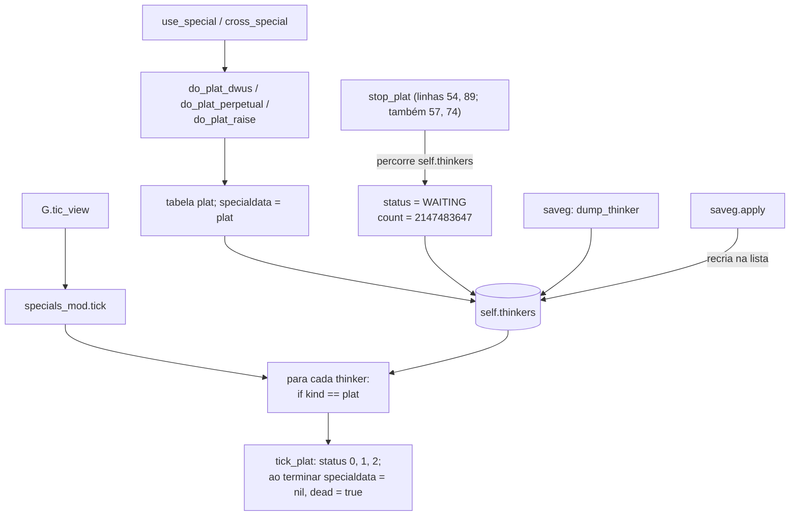

**Fluxo em Lua, depois:**

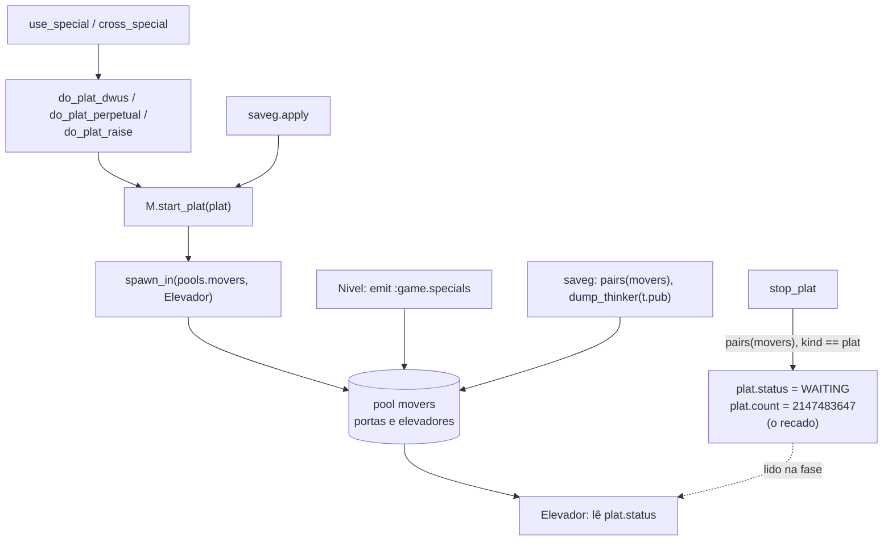

**Máquina de estados da task `Elevador`** (a fase é `plat.status`):

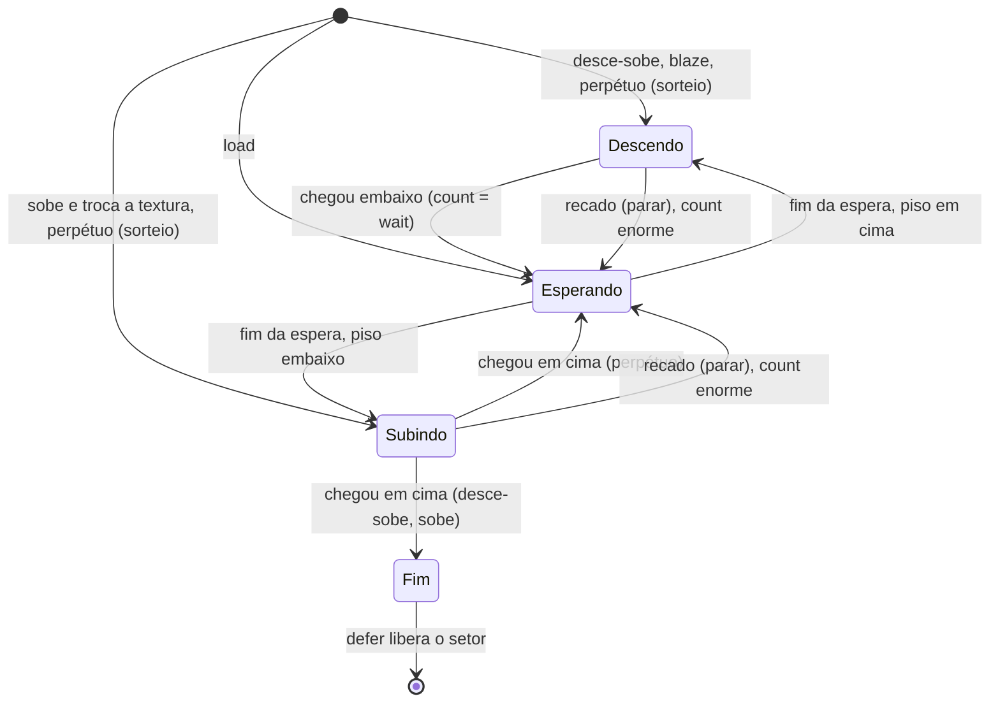

Um elevador parado fica em "Esperando" com um contador enorme, descontado a
cada tic, até o fim do nível.

### Validação

**Roteiro `elevadores`** (`-warp 1 3`). Contagem por script dos elevadores
nos mapas: o desce-sobe repetível aparece no E1M1 a E1M4; o perpétuo e a
linha de parar só no E2M2 e no E2M3. O roteiro:

1. E1M3, linha 178 (desce, espera, sobe): save e load em cada fase;
2. E1M3, linha 360 (sobe e troca a textura);
3. E2M3, linha 114 (cruzar: 12 elevadores perpétuos), linha 324 (cruzar:
   parar), save e load com os elevadores parados, e a linha 114 de novo
   (não reativa).

| Slot | Elevador | `status` | `count` | Referência × atual |
|---|---|---|---|---|
| 5 | E1M3, setor 168 | 0 (descendo) | 0 | idênticos |
| 4 | E1M3, setor 168 | 2 (esperando) | 36 | idênticos |
| 3 | E1M3, setor 168 | 1 (subindo) | 0 | idênticos |
| 2 | E2M3, 12 setores | 2 (parados) | 2147483647 − k | idênticos |

Os tempos do roteiro foram ajustados olhando as fases gravadas: com a
primeira espera, o slot 4 saía ainda descendo. Com o elevador parado 400
tics depois de começar, os 12 estavam **esperando** no momento do recado,
que então não trocava de fase, e `parar-ignorado` e `parar-um-tic-depois`
sobreviviam. Com 330 tics, eles estão andando, e as duas são detectadas.

**Saves nas mutações.** `tests/test_drivers.sh` guarda os saves da
referência de cada roteiro (`build/drivers/saves_<roteiro>/`), e
`tools/mutacoes.py` passou a compará-los com os da execução mutada. Uma
mutação que só muda o save conta como detectada ("save difere").

**Equivalência.** `make test-drivers`, idêntico à tag `passo1` nos 7
roteiros (incluindo `elevadores`: 2.098 quadros, 1.615 estados distintos).

**Mutações do 3c** (roteiro `elevadores`):

| Mutação | Erro simulado | 1º quadro | Quadros dif. | Save |
|---|---|---|---|---|
| `elevador-sem-espera-inicial` | anda no próprio spawn | 116 | 1.281 | difere |
| `parar-ignorado` | o recado de parar é ignorado em movimento | 1.636 | 463 | – |
| `parar-um-tic-depois` | depois do recado, só espera no tic seguinte | – | 0 | **só o save difere** |
| `parar-com-toggle` | `toggle(t, false)` além do recado | – | 0 | **só o save difere** |
| `perpetuo-para-no-topo` | perpétuo termina ao chegar em cima | 1.419 | 680 | difere |
| `espera-um-tic-a-menos` | `count = wait - 1` | 447 | 806 | difere |
| `load-perde-status` | load recria sempre descendo | 447 | 779 | difere |

Com as mutações do 3c, duas mutações de porta deixaram de aplicar (os
trechos `var espera = !direto` e `set direto = ...` passaram a aparecer
também no elevador); os trechos agora incluem o cabeçalho da função.

`make test-mutacoes` (todas as mutações do projeto): **34/37 não
equivalentes detectadas**, 4 equivalentes justificadas, 3 pendentes.

### Problemas encontrados

1. **Fase errada no roteiro**, corrigida olhando os saves (slot 4 ainda
   descendo).
2. **Recado sem efeito no roteiro**: todos os elevadores esperando no
   momento de parar. A mutação sobrevivente apontou que o roteiro não
   exercitava o caso, e não que fosse equivalente.
3. **`toggle` não equivalente**, descoberto só pelo save.
4. **Trechos de mutação deixaram de ser únicos** com código parecido entre
   porta e elevador.

### Métricas

`python3 tools/metricas_passo3.py` (o script passou a contar `plat.x` como
campo de registro e a excluir parâmetros de função dos campos):

| Métrica | Antes | Depois |
|---|---|---|
| Linhas de código (Lua) | 157 | 125 |
| Linhas de código (Atmos) | – | 55 |
| Linhas de código (total) | 157 | 180 |
| Estado do elevador (campos) | 10 | 9 |
| Referências a `tick_plat` | 2 | 0 |

Os campos antes: `count`, `dead`, `high`, `kind`, `low`, `sector`, `speed`,
`status`, `type`, `wait`; depois, os mesmos sem `kind`. O mesmo resultado
misto das portas, pelo mesmo motivo: o elevador é interrompível (parar) e
serializável, então a fase continua sendo um dado.

### Custo

`python3 tools/custo_drivers.py 5 [roteiro]` (ms por quadro):

| Driver | `fluxo` | `elevadores` |
|---|---|---|
| `passo1` `main.lua` | 0,741 | 3,473 |
| `passo1` `main.atm` | 0,800 | 3,493 |
| `passo2` `main.atm` | 0,846 | (não comparável) |
| atual (3c) | 0,879 | 3,760 |

No `fluxo`, o atual custa +3,9% em relação ao `passo2`. No `elevadores`, o
`passo2` não conhece `use` nem `cross`; contra o `passo1` `main.atm`, o
atual custa +7,6%. O custo alto desse roteiro (3,5 ms por quadro em todos os
drivers) vem dos 12 elevadores perpétuos: cada um chama `move_plane` →
`change_sector`, que percorre todos os mobjs a cada tic.

### Diferenças conhecidas

Nenhuma no comportamento. Do Doom original, preservadas: o elevador parado
nunca é reativado (o original guarda o status antigo, `oldstatus`, e
`P_ActivateInStasis` o retoma); um elevador que sobe e bate em algo não
volta a descer (o original volta, em `T_PlatRaise`). Registradas em
`docs/DIFERENCAS_DOOM.md`.

### Como reproduzir

```sh
make test-drivers                  # P1-P9 + 7 roteiros; saves comparados byte a byte
make test-mutacoes                 # inclui a comparacao de saves das mutacoes
python3 tools/metricas_passo3.py
sh tests/test_drivers.sh 0 1 elevadores -warp 1 3 >/dev/null
python3 tools/custo_drivers.py 5 build/drivers/replay_1elevadores.txt -warp 1 3
python3 tools/diagramas.py
```

### Arquivos alterados

| Arquivo | Mudança |
|---|---|
| `setores.atm` | task `Elevador`; funções `mover_plat` e `esperar_plat` |
| `specials.lua` | `M.start_plat`, `M.PLAT`; saíram `tick_plat` e o ramo de elevador de `M.tick_thinker` |
| `saveg.lua` | load chama `start_plat` |
| `tools/make_replay.lua` | roteiro `elevadores` |
| `tests/test_drivers.sh` | saves da referência por roteiro; cobertura do roteiro `elevadores` |
| `tools/mutacoes.py` | compara saves; 7 mutações do 3c; trechos de porta únicos |
| `tools/metricas_passo3.py` | 3c; `plat.x`; parâmetros de função fora dos campos |
| `Makefile` | roteiro `elevadores` |
