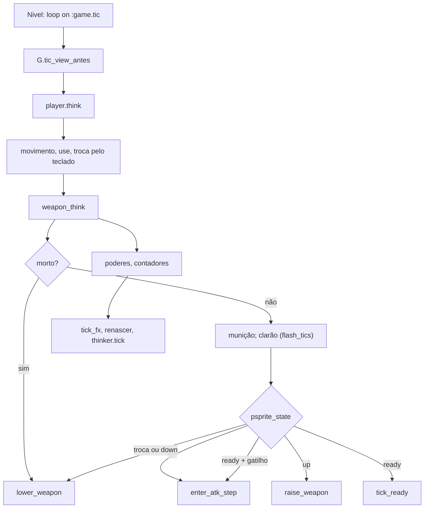
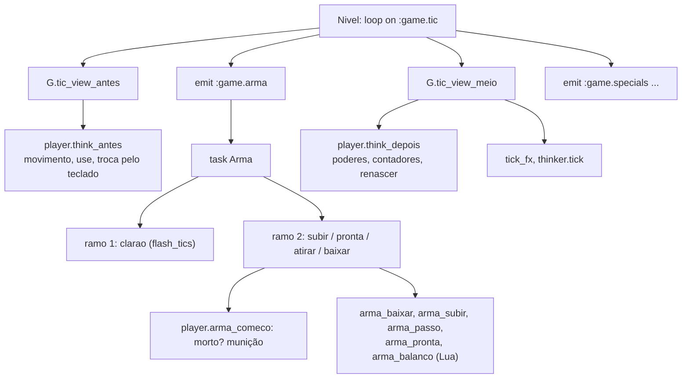
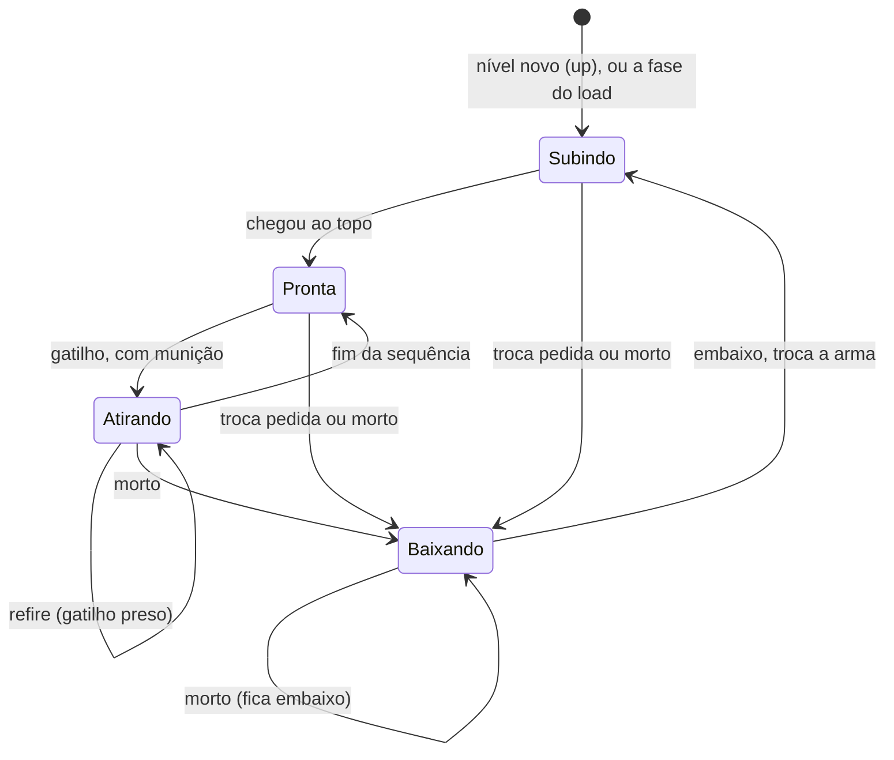
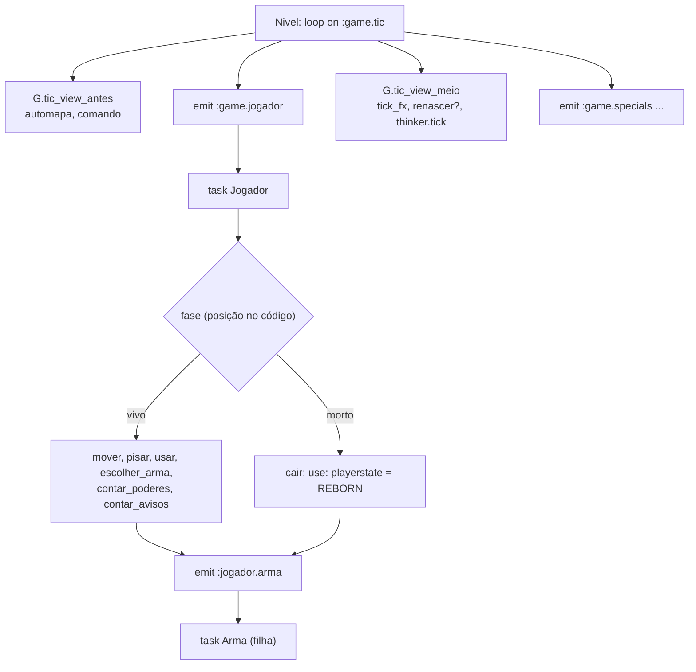

# Passo 4: a arma e o jogador em concorrência estruturada

- Branch: `atmos`
- Referência de equivalência: tag `passo1` (nenhum subpasso muda o
  comportamento)
- Linhas citadas como "antes": tag `passo3`
- Resultado: tag `passo4` (ao fim do passo)

Este registro cresce a cada commit do passo 4: uma seção por subpasso.

| Subpasso | Commit | Situação |
|---|---|---|
| 4a. Arma por equivalência | `903e023` | concluído |
| 4b. Fidelidade ao `p_pspr.c` | – | opcional; muda o jogo de propósito (fica para a fase de correções, `docs/DIFERENCAS_DOOM.md`) |
| 4c. O jogador como task | (este commit) | concluído; acrescentado ao plano durante o passo |

---

## Subpasso 4a: a arma como task, por equivalência

### Resumo

A máquina de estados da arma (`weapon_think`, chamada no meio de
`player.think`) virou a task `Arma` (`arma.atm`). O `Nivel` emite um evento
novo, `:game.arma`, entre as duas metades de `player.think`, no ponto exato
em que `weapon_think` era chamada, e a task acorda nele. Cada fase da arma
(subir, pronta, atirar, baixar) é uma função que roda um tic por vez até a
fase mudar, e o clarão do tiro é um ramo paralelo. A fase continua em
`player.psprite_state`, pelos mesmos motivos da porta (passo 3b). O replay é
idêntico nos 9 roteiros, mas o resultado de expressividade é **negativo** em
tamanho: é o caso em que a task rende menos (seção "Métricas").

### Situação antes (tag `passo3`)

- `weapon_think` (`player.lua:761`): a cada tic, na ordem:
  1. jogador morto: só `lower_weapon` e sai;
  2. sem munição: pede a troca em `pendingweapon`;
  3. conta o clarão (`flash_tics`; no fim apaga `psprite_flash` e
     `extralight`);
  4. despacha por `psprite_state`: `"atk"` (um passo da sequência
     `WEAPON_ATK` a cada `psprite_tics`); troca pedida ou `"down"`
     (`lower_weapon`); `"up"` (`raise_weapon`); gatilho (começa o tiro);
     senão, `"ready"` (balanço, `tick_ready`).

  São 7 `return` no meio do tic.
- `player.think` (`player.lua:877`) chama `weapon_think` depois do "use" e
  da troca de arma pelo teclado, e antes dos poderes (`player.lua:910`). O
  jogador morto chama pelo `death_think` (`player.lua:871`).
- As partes de um tic (`start_ready`, `tick_ready`, `enter_atk_step`,
  `lower_weapon`, `raise_weapon`, `player.lua:647` a `749`) e as tabelas
  (`WEAPON_PATCH`, `WEAPON_ATK`, `WEAPON_READY`…) leem e escrevem os campos
  `psprite_*` do jogador.
- Quem mais lê esses campos: o renderer (`psprite_body`, `psprite_flash`,
  `psprite_sy`), a barra de status (`attackdown`), o save (todos os
  `psprite_*`, `flash_tics`, `refire`, `extralight`) e o hash de estado
  (`psprite_state`, `psprite_sy`).
- Quem escreve `pendingweapon` de fora, no meio do tic: o teclado
  (`player.think`), os itens apanhados (`touch_special`, nos mobjs) e a
  falta de munição.

### Solução

**O ponto do tic.** `player.think` virou `think_antes` (até a troca de arma
pelo teclado; o morto faz o `death_think` sem a arma) e `think_depois`
(poderes, contadores; o morto só testa o "use" para renascer). No `game.lua`,
`G.tic_view_antes` termina em `think_antes`, e `G.tic_view_meio` (novo)
começa em `think_depois`. O `Nivel` fica:

```
val antes = G.tic_view_antes()    ;; "segue" | "parado"
val fim = ifs {
    (antes == :segue) => {
        emit :game.arma           ;; passo 4a: task Arma
        val meio = G.tic_view_meio()  ;; "segue" | "morte"
        ifs {
            (meio == :morte) => :morte
            else => {
                emit :game.specials
                G.tic_view_depois()   ;; nil | "saida"
            }
        }
    }
    else => nil
}
```

A task nasce no `Nivel` depois de montar o nível
(`spawn arma.Arma(G.game.player, G.game)`): o jogador é o do nível, e o load
já restaurou a fase.

**A task.**

```
val func tic (p, game) {          ;; morto: baixa e devolve nil
    await :game.arma
    A.arma_comeco(p, game)        ;; vivo: [firing, ammo_type, can_fire]
}

val func atirar (p, game) {       ;; fase "atk"
    loop {
        val c = tic(p, game)
        if c {
            if c.firing { set p.attackdown = true }
            if p.psprite_tics > 0 { set p.psprite_tics = p.psprite_tics - 1 }
            if p.psprite_tics <= 0 {
                set p.psprite_step = p.psprite_step + 1
                A.arma_passo(p, game, c.ammo_type, c.firing, c.can_fire)
            }
        }
        until (p.psprite_state != :atk)
    }
}
;; subir, baixar e pronta: o mesmo molde

val task Arma (p, game) {
    set pub = p
    par {
        clarao(p)                 ;; ramo 1: conta flash_tics
    } with {
        loop {                    ;; ramo 2: a fase
            val st = p.psprite_state
            ifs {
                (st == :up) => subir(p, game)
                (st == :down) => baixar(p, game)
                (st == :atk) || (st == :fire) => atirar(p, game)
                else => pronta(p, game)
            }
        }
    }
}
```

**Por que a fase continua no registro.** Três leitores de fora (renderer,
save, hash) e um escritor de fora no meio do tic (`pendingweapon`). É o
mesmo quadro da porta e do elevador, e pela regra registrada nas notas
(`docs/NOTAS_MONOGRAFIA.md`, seção 7), a fase fica no registro. O
`watching :arma.trocar` do plano não serve: um evento emitido de dentro do
Lua quebraria a regra 4.3 (`CLAUDE.md`), e um evento emitido depois mudaria
o tic em que a troca começa.

**O clarão.** O plano previa uma task que "termina sozinha". Não é
equivalente: o clarão novo sobrescreve o antigo (`flash_tics` é reescrito no
passo do tiro e no plasma), o save grava `flash_tics`, e o morto não conta.
Ficou um ramo do `par` que conta o campo. A ordem entre os ramos importa (P6):
o clarão conta **antes** da fase, porque o tiro deste tic liga um clarão novo
que só começa a contar no próximo. A mutação `clarao-depois-da-fase`
inverte os ramos e é detectada.

### Diagramas

**Fluxo em Lua, antes (tag `passo3`):**



**Fluxo depois:**



**Máquina de estados da task `Arma`** (a fase é `psprite_state`):



O ramo do clarão não tem estados: conta `flash_tics` até zero, a cada tic,
com o jogador vivo.

### Validação

**Hash de estado.** Com `DOOM_REPLAY_SIDES=1`, o hash passou a incluir o
resto do que a arma escreve: `psprite_body`, `psprite_flash`, `flash_tics`,
`psprite_tics`, `psprite_step`, `pendingweapon`, `attackdown`, `refire` e
`extralight`. O mesmo trecho entrou na referência (`tests/ref-passo1.patch`).
Antes, só `psprite_state` e `psprite_sy` entravam.

**Roteiro `arma`** (`-warp 1 1`):

1. pistola atirando até acabar a munição: troca sozinha para o punho;
2. `iddqd`, `idkfa`, e cada arma atirando com o gatilho preso (pistola,
   escopeta, metralhadora, foguete, plasma, BFG, motosserra, punho);
3. troca no meio do tiro (a escopeta termina a sequência e só então baixa)
   e troca durante a subida;
4. a trava do lança-foguetes: trocar para ele atirando com a metralhadora
   (gatilho ainda preso desde a arma anterior) não atira até soltar; com o
   gatilho preso depois, ele atira em sequência (refire);
5. save no meio do tiro do BFG (slot 5: `psprite_state` `"atk"`, passo 3,
   arma 6) e load;
6. o jogador morre atirando (a arma baixa e fica embaixo) e renasce.

A cobertura foi conferida com prints numa cópia de `arma.atm` (cada fase,
com a arma e a troca pedida; um print na troca durante a subida). Dois
problemas apareceram assim:

- **toques perdidos:** duas trocas de arma não aconteciam. O toque de um
  quadro numa tecla de arma pode ser solto antes de algum tic o ver, porque a
  partir de certo ponto os quadros do replay alternam 0 e 2 tics (o mesmo
  efeito do passo 3d). As teclas de arma passaram a ficar presas por 3
  quadros;
- **troca na descida, não na subida:** a segunda tecla vinha cedo demais.
  Com 22 tics de espera, ela cai na subida (conferido pelo print);
- **a trava do lança-foguetes mal entendida:** o roteiro segurava o gatilho
  com o lança-foguetes já pronto, supondo que ele atirasse uma vez só. Ele
  atira em sequência (o refire acontece dentro de `enter_atk_step`, sem
  voltar à fase pronta). A trava (`arma_pode_atirar`, o `A_WeaponReady` do
  Doom) só vale ao chegar à fase pronta com o gatilho preso desde a arma
  anterior. A mutação `foguete-sem-soltar` sobreviveu e apontou isso; o
  roteiro passou a trocar para o lança-foguetes atirando com a metralhadora.

**Equivalência.** `make test-drivers`, idêntico à tag `passo1` nos 9
roteiros (incluindo `arma`: 2.993 quadros, 2.181 estados distintos); saves
iguais byte a byte. Os roteiros `fluxo` e semente 1 deram idêntico na
primeira execução.

**Mutações do 4a** (roteiro `arma`):

| Mutação | Erro simulado | 1º quadro | Quadros dif. | Save |
|---|---|---|---|---|
| `arma-depois-do-jogador` | a arma acorda depois do resto do jogador e dos mobjs | 45 | 843 | difere |
| `clarao-depois-da-fase` | o ramo do clarão depois da fase | 45 | 904 | – |
| `clarao-conta-morto` | o clarão conta com o jogador morto | 2.738 | 256 | – |
| `troca-ignorada-na-subida` | trocar durante a subida não baixa a arma | 1.906 | 37 | – |
| `tiro-sem-gatilho-preso` | no tiro, o gatilho não marca `attackdown` | – | 0 | **equivalente** |
| `pronta-nao-zera-refire` | soltar o gatilho não zera `refire` | 1.698 | 297 | – |
| `foguete-sem-soltar` | lança-foguetes e BFG sem a trava do gatilho | 1.785 | 1.209 | difere |
| `load-perde-fase-da-arma` | o load não restaura a fase da arma | 2.371 | 17 | – |

`tiro-sem-gatilho-preso` é **equivalente**: durante o tiro, `attackdown` já
é verdadeiro (ligado ao começar o tiro e por `do_shot`; só desligado na
saída para a fase pronta), e o save o grava verdadeiro no meio do tiro. A
linha é redundante na task como era no `weapon_think`; a justificativa está
em `EQUIVALENTES`.

`make test-mutacoes` (todas as mutações do projeto): **51/53 não equivalentes detectadas**, 5 equivalentes justificadas, 2 pendentes.

### Métricas

`python3 tools/metricas_passo4.py` (novo; compara `weapon_think` com a task
`Arma` mais `arma_comeco` e `arma_pode_atirar`; as partes de um tic que não
mudaram ficam de fora dos dois lados):

| Métrica | Antes | Depois |
|---|---|---|
| Linhas de código (Lua) | 79 | 31 |
| Linhas de código (Atmos) | – | 104 |
| Linhas de código (total) | 79 | 135 |
| Campos do jogador lidos ou escritos | 16 | 16 |
| Comparações com a fase | 4 | 12 |
| Decrementos de contador | 2 | 2 |
| `return` no meio do tic (Lua) | 7 | 3 |

**O resultado é negativo em tamanho**, e a monografia deve dizer isso com
clareza. A arma reúne tudo o que, pelas notas, devolve a fase para os dados:
é interrompível a qualquer momento (troca pedida, morte), tem um escritor de
fora no meio do tic e é lida por três consumidores. A task não guarda
nenhum estado a menos (os 16 campos são os mesmos), e cada fase precisa
testar a própria saída (`until (p.psprite_state != :atk)`), o que triplica
as comparações com a fase. O ganho é só de organização: cada fase é uma
função com um laço, sem os 7 `return` do despacho, e o clarão é um ramo
separado em vez de um trecho no meio do tic. Comparado com as luzes (3a),
em que a fase sumiu para dentro do código, a arma é o outro extremo da
mesma régua.

### Custo

`python3 tools/custo_drivers.py 5 [roteiro]` (ms por quadro):

Com `CUSTO_TAGS=passo2,passo3` (o script passou a aceitar as tags
intermediárias; antes só media a `passo2`):

| Driver | `fluxo` | `arma` |
|---|---|---|
| `passo1` `main.lua` | 0,748 | 0,700 |
| `passo1` `main.atm` | 0,803 | 0,687 |
| `passo2` `main.atm` | 0,836 | 0,744 |
| `passo3` `main.atm` | 0,875 | 0,777 |
| atual (4a) | 0,904 | 0,812 |

O custo do 4a sozinho (atual contra `passo3`) é de +3,3% no `fluxo` e +4,5%
no `arma`: um `emit` a mais por tic (`:game.arma`), que acorda dois ramos
(clarão e fase), e uma tabela nova por tic em `arma_comeco`. Contra o
`passo1` `main.lua`, o atual custa +20,8% no `fluxo`; esse é o custo
acumulado dos passos 1 a 4.

### Diferenças conhecidas

Nenhuma no comportamento. Do Doom original: a arma usa tabelas próprias, e
não os estados de `info.STATES` e as ações do `p_pspr.c`
(`docs/DIFERENCAS_DOOM.md`, seção 4). Corrigir isso é o 4b, que pela decisão
registrada no topo do `DIFERENCAS_DOOM.md` fica para a fase de correções,
depois de todos os passos, nas duas branches.

### Como reproduzir

```sh
make test-drivers                  # P1-P9 + 9 roteiros; saves comparados byte a byte
make test-mutacoes
python3 tools/metricas_passo4.py
sh tests/test_drivers.sh 0 1 arma -warp 1 1 >/dev/null
CUSTO_TAGS=passo2,passo3 python3 tools/custo_drivers.py 5
CUSTO_TAGS=passo2,passo3 python3 tools/custo_drivers.py 5 build/drivers/replay_1arma.txt -warp 1 1
python3 tools/diagramas.py
```

### Arquivos alterados

| Arquivo | Mudança |
|---|---|
| `arma.atm` | novo: task `Arma`, fases `subir`, `pronta`, `atirar`, `baixar`, ramo `clarao` |
| `player.lua` | `think_antes` e `think_depois` (com `M.think` para os testes unitários); `arma_comeco`, `arma_pode_atirar` e as partes de um tic expostas; saiu o despacho de `weapon_think` |
| `game.lua` | `G.tic_view_meio`; campos da arma no hash de estado |
| `main.atm` | `emit :game.arma` no `Nivel`; a task `Arma` nasce depois de montar o nível |
| `tests/ref-passo1.patch` | campos da arma no hash da referência |
| `tools/make_replay.lua` | roteiro `arma` |
| `tests/test_drivers.sh` | cobertura do roteiro `arma` |
| `tools/mutacoes.py` | roteiro `arma`; 8 mutações do 4a (1 equivalente); trecho de `specials-no-fim-do-tic` com a indentação nova |
| `tools/metricas_passo4.py` | novo |
| `tools/custo_drivers.py` | `CUSTO_TAGS`: mede outras tags intermediárias além da `passo2` |
| `Makefile` | roteiro `arma` |

---

## Subpasso 4c: o jogador como task

### Resumo

O jogador virou a task `Jogador` (`jogador.atm`), com a `Arma` como filha.
O `Nivel` emite `:game.jogador` no ponto do antigo `player.think`, e a task
faz o tic chamando partes com nomes do domínio: mover, pisar, usar,
escolher a arma, contar os poderes, contar os avisos. As fases vivo e morto
são dois laços em sequência. A arma é avisada com `:jogador.arma`, que só
alcança a subárvore do `Jogador`, **depois** de todas as partes: um
experimento mostrou que a posição dela no meio do tic, herdada do
`P_PlayerThink` do Doom, não é semântica. Com isso sumiram as duas metades
sem significado do 4a (`think_antes`, `think_depois`) e a variável
`morto_no_tic`, que só existia para atravessar o `emit`.

### Por que este subpasso (situação no 4a, commit `903e023`)

No 4a, para encaixar a arma no ponto exato do tic, `player.think` foi
dividido em `think_antes` e `think_depois`, com `emit :game.arma` entre os
dois, e o `game.lua` ganhou `morto_no_tic` para passar de uma metade à
outra se o jogador estava morto. O autor apontou que os nomes não diziam
**o que** o jogador faz, só **onde** o corte caiu: o thinker continuava
existindo como uma função chamada pelo motor, partida em dois pedaços. A
discussão está em `docs/NOTAS_MONOGRAFIA.md`, seção 9 (corte por posição:
aceitável entre as etapas do tic do motor; sintoma, dentro de uma
entidade).

### O experimento: a arma precisa ficar no meio?

O que vinha depois da arma em `player.think` (tag `passo3`,
`player.lua:877`) era: contar os poderes, o efeito de tela deles
(`fixedcolormap`), os clarões de dano e de item e a mensagem. Nada disso
parece interagir com a arma:

- a força só cresce, e o soco só pergunta se ela é diferente de zero;
- tirar `MF_SHADOW` (fim da invisibilidade) não afeta o tiro do jogador;
- a arma não lê `damagecount`, `bonuscount`, a mensagem nem
  `fixedcolormap`;
- nenhuma dessas partes consome `P_Random`.

Teste: as duas metades juntas antes do `emit` (a arma depois de todo o
jogador), nos roteiros `arma`, `fluxo`, semente 1 e semente 2 com saídas.
**Idêntico nos quatro.** A mutação `arma-no-meio-do-jogador` (a arma de
volta ao meio, como no Doom) ficou registrada como **equivalente**, com essa
justificativa. A mutação `jogador-depois-dos-mobjs` (o jogador inteiro
depois dos monstros) continua detectada: essa ordem **é** semântica, por
causa do `P_Random`.

### Solução

```
val task Jogador (p, game) {
    set pub = p
    spawn arma.Arma(p, game)              ;; filha: termina com o Jogador
    loop {                                ;; vivo
        await :game.jogador
        until (p.playerstate == J.PST_DEAD)   ;; morreu: este tic já é de morto
        val w = game.world
        val t = game.leveltime || 0
        J.mover(w, p, game, t)            ;; girar, andar, altura da câmera
        J.pisar(w, p, game, t)            ;; dano e segredo do setor
        J.usar(w, p, game)                ;; linhas
        J.escolher_arma(p)                ;; pedido pelo teclado
        J.contar_poderes(p)               ;; e o efeito de tela
        J.contar_avisos(p)                ;; clarões e mensagem
        emit :jogador.arma
    }
    loop {                                ;; morto (o tic corrente já chegou)
        J.cair(game.world, p, game, game.leveltime || 0)
        emit :jogador.arma                ;; a arma continua descendo
        val renasce = J.usou(p)
        if renasce {
            set p.playerstate = J.PST_REBORN  ;; o Nivel lê e recomeça
        }
        until (renasce)
        await :game.jogador
    }
}
```

As partes (`M.mover`, `M.pisar`, `M.usar`, `M.escolher_arma`,
`M.contar_poderes`, `M.contar_avisos`, `M.cair`, `M.usou`) estão no
`player.lua`; algumas já existiam (`special_sector`, `death_think`) e só
ganharam o nome. `M.think` continua existindo para os testes unitários sem
`main.atm`, compondo as partes sem a arma.

**Os dois laços.** A morte vem de fora, no meio do tic (o dano de um
monstro, ou o chão do próprio `pisar`). No Doom, o tic em que o jogador
morre continua inteiro como "vivo" (usar, trocar, a arma já vê o morto e
baixa), e só o tic seguinte é de morto. Por isso o teste da morte fica no
começo do tic de vivo, e o laço do morto começa agindo no tic corrente,
sem esperar. A mutação `morto-perde-o-tic-da-morte` (o laço do morto
esperando antes de agir) é detectada.

**O que não ficou como no plano idiomático.** A morte não aborta a `Arma`:
neste port a arma continua descendo depois da morte, e isso aparece na tela
(mutação `morto-sem-arma`). Então a `Arma` é filha do `Jogador`, não da fase
vivo. E o `Nivel` ainda percebe o renascimento lendo `playerstate`
(`G.tic_view_meio`), porque no tic de renascer o `tick_fx` roda antes de o
nível recomeçar; trocar isso por `await` no fim da task mudaria a ordem
daquele tic.

### Diagramas

**Fluxo depois do 4c:**



**Máquina de estados da task `Jogador`:**

```mermaid
stateDiagram-v2
    [*] --> Vivo: nível novo ou load
    Vivo --> Vivo: tic (mover ... avisos, arma)
    Vivo --> Morto: playerstate DEAD no começo do tic
    Morto --> Morto: tic (cair, arma)
    Morto --> Fim: use (playerstate REBORN)
    Fim --> [*]: o Nivel recomeça; a Arma termina junto
```



### Validação

**Equivalência.** `make test-drivers`, idêntico à tag `passo1` nos 9
roteiros. O roteiro `arma` ganhou uma checagem de cobertura: o jogador
renasce (três vistas do E1M1). Ela pegou um problema: depois do ajuste do
lança-foguetes no 4a, o toque em "use" para renascer caía num quadro sem
tic (tics aos pares) e se perdia, e o roteiro terminava com o jogador
morto. A tecla passou a ficar presa por 3 quadros.

**Mutações do 4c:**

| Mutação | Erro simulado | Roteiro | 1º quadro | Quadros dif. |
|---|---|---|---|---|
| `jogador-depois-dos-mobjs` | o jogador (e a arma) depois dos monstros | `arma` | 45 | 1.028 (save difere) |
| `arma-no-meio-do-jogador` | a arma no meio do tic, como no Doom | `arma` | – | 0: **equivalente** |
| `morto-perde-o-tic-da-morte` | o laço do morto espera antes de agir | `arma` | 2.738 | 253 |
| `morto-sem-arma` | com o jogador morto, a arma para | `arma` | 2.738 | 72 |
| `renasce-sem-use` | o morto renasce sem apertar "use" | `arma` | 2.738 | 257 |
| `usar-antes-de-mover` | usar as linhas antes de girar e andar | `fluxo` | – | 0: **pendente** |

`usar-antes-de-mover` não é equivalente: `use_lines` usa a posição e o
ângulo do jogador, e a ordem importa quando o movimento do tic põe uma
linha ao alcance. Nenhum roteiro aperta "use" exatamente nesse tic; está em
`PENDENTES`, com o cenário que falta.

`make test-mutacoes` (todas as mutações do projeto): **54/57 não
equivalentes detectadas**, 6 equivalentes justificadas, 3 pendentes.
`make test`: o mesmo de antes (12 passam, as mesmas 8 falhas).

### Métricas

`python3 tools/metricas_passo4.py` (seção "4c", contra `player.think` da
tag `passo3`):

| Métrica | Antes | Depois |
|---|---|---|
| Linhas de código (Lua) | 82 | 89 |
| Linhas de código (Atmos) | – | 29 |
| Linhas de código (total) | 82 | 118 |
| Testes de fase (`playerstate ==`) | 1 | 1 |
| Funções com nome do domínio | 1 | 6 |
| Estado só para atravessar o `emit` (`morto_no_tic`, 4a → 4c) | 3 | 0 |

O código cresceu (as partes viraram funções, e há a task). O que mudou foi
a forma: uma função de 82 linhas com um `if` de fase virou seis partes com
nome e uma task de 29 linhas que lê como a descrição do tic. A fase vivo e
morto é a posição no código; `playerstate` continua existindo porque
monstros, renderer e save o leem (régua, notas, seção 8), mas a task só o
consulta uma vez por tic, para perceber a morte que vem de fora.

### Custo

`CUSTO_TAGS=passo3 python3 tools/custo_drivers.py 5 [roteiro]` (ms por
quadro): `passo3` 0,875 e atual 0,904 no `fluxo` (+3,3%); `passo3` 0,783 e
atual 0,829 no `arma` (+5,9%). É o custo do passo 4 inteiro (4a e 4c): um
`emit` do `Nivel` e um do `Jogador` por tic.

### Diferenças conhecidas

Nenhuma no comportamento. A ordem da arma dentro do tic do jogador mudou em
relação ao Doom (agora depois dos poderes e contadores), com a equivalência
provada pelo replay e justificada em `EQUIVALENTES`. Do Doom original,
continua a lista de `docs/DIFERENCAS_DOOM.md`.

### Como reproduzir

```sh
make test-drivers
make test-mutacoes
python3 tools/metricas_passo4.py
CUSTO_TAGS=passo3 python3 tools/custo_drivers.py 5
python3 tools/diagramas.py docs/registro/04-arma.md
```

### Arquivos alterados

| Arquivo | Mudança |
|---|---|
| `jogador.atm` | novo: task `Jogador` (fases vivo e morto; cria a `Arma`) |
| `arma.atm` | acorda com `:jogador.arma` |
| `player.lua` | partes nomeadas (`mover`, `pisar`, `usar`, `escolher_arma`, `contar_poderes`, `contar_avisos`, `cair`, `usou`); saíram `think_antes` e `think_depois` |
| `game.lua` | `tic_view_antes` sem o jogador; `tic_view_meio` sem `think_depois`; saiu `morto_no_tic` |
| `main.atm` | `emit :game.jogador`; a task `Jogador` nasce depois de montar o nível |
| `tools/make_replay.lua`, `tests/test_drivers.sh` | "use" para renascer preso por 3 quadros; cobertura do renascimento |
| `tools/mutacoes.py` | 6 mutações do 4c (1 equivalente, 1 pendente) |
| `tools/metricas_passo4.py` | seção 4c |
| `docs/PLANO_ATMOS.md` | andamento; 4c e passo 6 acrescentados |

