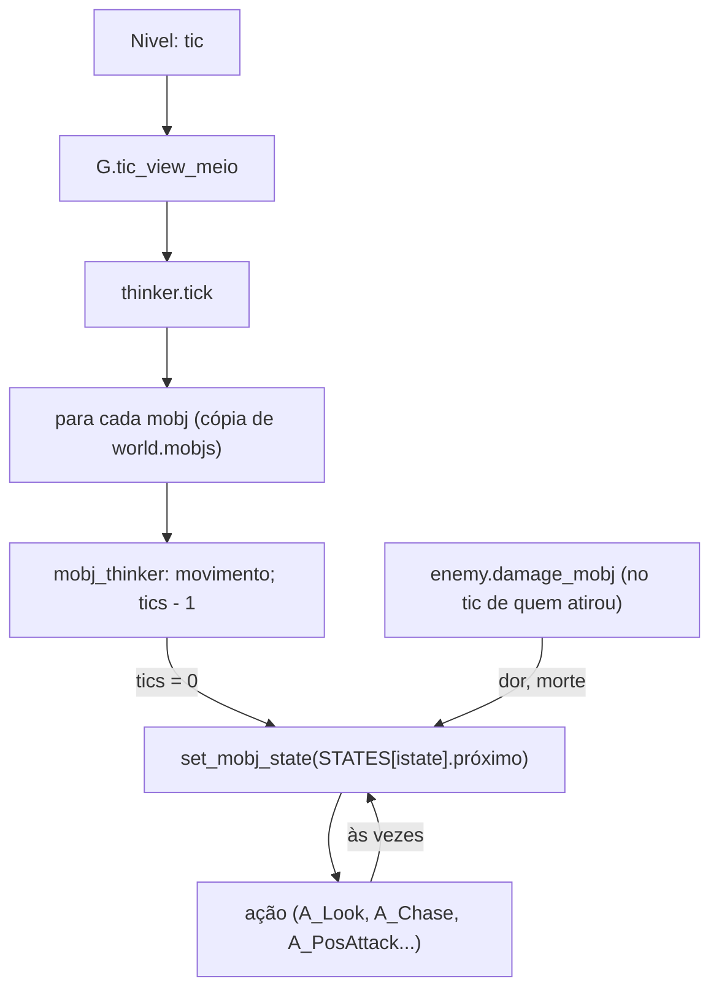
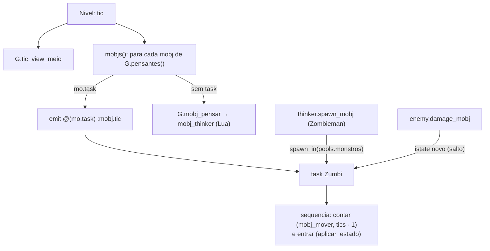
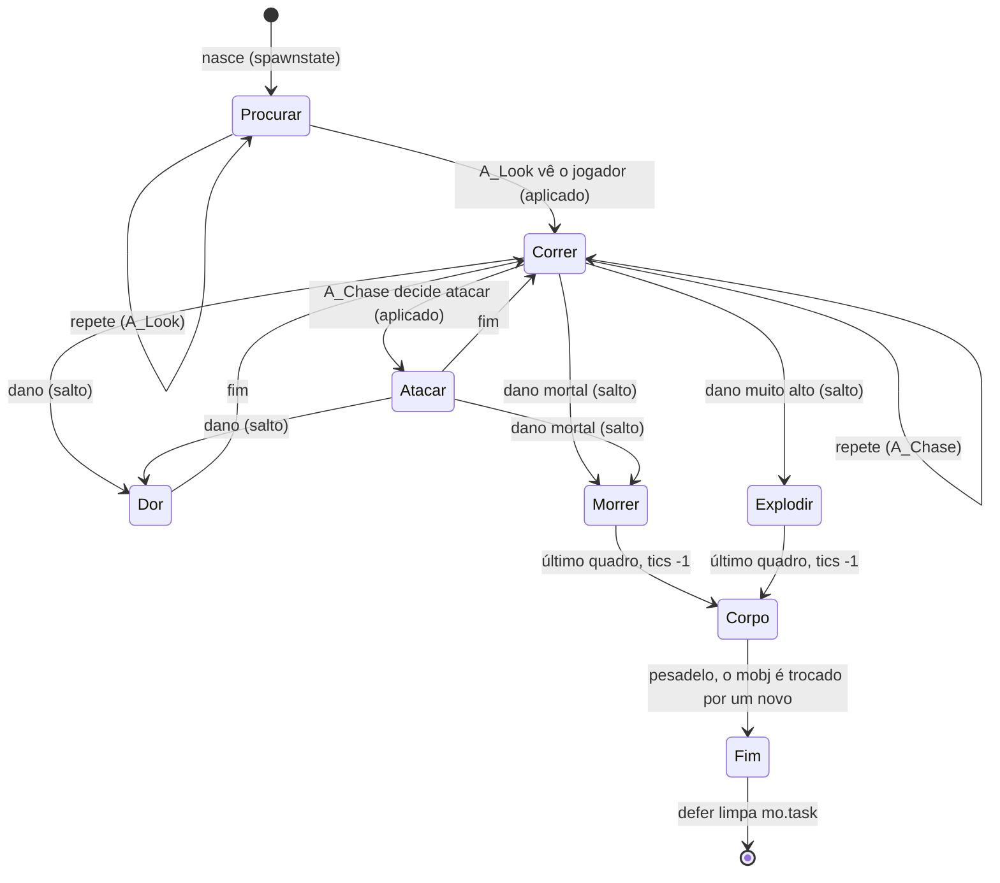

# Passo 5: um monstro em concorrência estruturada

- Branch: `atmos`
- Referência de equivalência: tag `passo1` (o passo não muda o
  comportamento)
- Linhas citadas como "antes": tag `passo4`
- Resultado: tag `passo5`

## Resumo

O Zombieman (`MT_POSSESSED`) virou a task `Zumbi` (`monstro.atm`). Os
outros mobjs continuam como thinkers Lua, e as duas formas convivem na mesma
lista `world.mobjs`. O laço dos mobjs, que era `thinker.tick` em Lua, foi
para o `Nivel`: na posição de cada mobj, um zumbi recebe `:mobj.tic` por
**emit direcionado** (só ele acorda), e os outros chamam `mobj_thinker`. A
ordem do `P_Random` não muda.

A task "descompila" as 33 linhas de `info.STATES` do Zombieman em sete
**comportamentos com nome** (procurar, correr, atacar, dor, morrer,
explodir, levantar) e escreve no código as transições entre eles. Cada
quadro continua vindo da tabela, e as ações (`A_Look`, `A_Chase`, o dano)
continuam trocando o estado de fora, no meio do tic: a task percebe esses
**saltos** e vai para o comportamento do estado novo. O replay é idêntico
nos 10 roteiros. Pela régua da fase (`docs/NOTAS_MONOGRAFIA.md`, seção 8), o
monstro está no extremo da arma: o resultado em tamanho é negativo, e o
ganho é dar nome ao comportamento que antes só existia nos ponteiros da
tabela.

## Situação antes (tag `passo4`)

- `info.STATES` (`info.lua:405` a `437`, estados 174 a 206): cada linha é um
  quadro (sprite, quadro, tics, ação, próximo estado). O Zombieman tem
  procurar (`S_POSS_STND`, `STND2`: `A_Look`), correr (`RUN1` a `RUN8`:
  `A_Chase`), atacar (`ATK1` a `ATK3`: `A_FaceTarget`, `A_PosAttack`), dor
  (`PAIN`, `PAIN2`: `A_Pain`), morrer (`DIE1` a `DIE5`), explodir (`XDIE1` a
  `XDIE9`) e levantar (`RAISE1` a `RAISE4`, só com o Arch-vile do Doom 2).
- `thinker.tick` (`thinker.lua:320`): copia `world.mobjs` e chama
  `mobj_thinker` para cada mobj, menos o jogador e os efeitos.
- `mobj_thinker` (`thinker.lua:159`): movimento por momento e gravidade;
  depois desconta `tics` e, no fim, `set_mobj_state(próximo)`; com `tics`
  −1 (um corpo), o pesadelo (`-respawn`) pode trazer o monstro de volta.
- `set_mobj_state` (`thinker.lua:126`): aplica o estado (campos e ação) e
  encadeia os de 0 tics. As ações também o chamam: `A_Look` põe o monstro a
  correr quando vê o jogador; `A_Chase` decide atacar; o dano
  (`enemy.damage_mobj`) põe em dor ou morte, no meio do tic de quem atirou.
- O renderer lê `sprite` e `frame`; o save grava `istate` e `tics`; o hash
  de estado lê `istate` e `tics`.

## Solução

**O laço dos mobjs no `Nivel`.** O Lua nunca emite (regra 4.3), então o
emit direcionado precisa sair do Atmos. `thinker.tick` virou
`thinker.pensantes` (a cópia da lista, já filtrada), e o laço ficou no
`main.atm`, chamado pelo `Nivel` depois de `G.tic_view_meio`:

```
func mobjs () {
    loop _, mo in G.pensantes() {
        if mo.task {
            emit @(mo.task) (:mobj.tic)
        } else {
            G.mobj_pensar(mo)
        }
    }
}
```

**A task nasce com o mobj.** `thinker.spawn_mobj` cria a task para o
Zombieman, com `spawn_in` na pool `monstros` do `Nivel`, e guarda
`mo.task`. Vale para os zumbis do mapa e para os que voltam no pesadelo. O
spawn é síncrono (P8), e a task só se move no primeiro `:mobj.tic`.

**Os comportamentos.** As partes de um tic de mobj foram separadas em
`thinker.lua`: `mobj_mover` (momento e gravidade), `aplicar_estado` (uma
volta de `set_mobj_state`, sem encadear) e `mobj_parado` (o corpo no
pesadelo). A task:

```
val PROCURAR = [info.S_POSS_STND, info.S_POSS_STND2]          ;; (A_Look) x2
val CORRER   = [info.S_POSS_RUN1, ..., info.S_POSS_RUN8]       ;; (A_Chase) x8
val ATACAR   = [info.S_POSS_ATK1, info.S_POSS_ATK2, info.S_POSS_ATK3]
val DOR      = [info.S_POSS_PAIN, info.S_POSS_PAIN2]
;; MORRER, EXPLODIR e LEVANTAR do mesmo jeito

val task Zumbi (mo, game) {
    set pub = mo
    defer { set mo.task = nil }
    var vencido = false
    loop {
        val st = mo.istate
        val r = ifs {                     ;; o comportamento do estado atual
            (indice(PROCURAR, st) > 0) => sequencia(mo, game, PROCURAR, vencido, true)
            (indice(CORRER, st) > 0)   => sequencia(mo, game, CORRER, vencido, true)
            (indice(ATACAR, st) > 0)   => sequencia(mo, game, ATACAR, vencido, false)
            (indice(DOR, st) > 0)      => sequencia(mo, game, DOR, vencido, false)
            ...
            else => estranho(mo, game, vencido)  ;; outro tipo (load por índice)
        }
        set vencido = (r == :salto) && (mo.tics <= 0)
        val prox = ifs {
            (r == :fim) => entrar(mo, game, info.S_POSS_RUN1)  ;; atacar, dor e levantar voltam a correr
            else => r                     ;; :salto, :aplicado: segue o estado novo
        }
        until (prox == :fora)
    }
}
```

`sequencia` roda os quadros de um comportamento em ordem, um `contar` (os
tics do quadro, um `:mobj.tic` por vez, movimento primeiro) e um `entrar`
(aplica o próximo quadro) por vez. Ela volta ao comportamento seguinte em
três casos:

- `:fim`: o comportamento acabou (atacar, dor, levantar) e o zumbi volta a
  correr;
- `:aplicado`: a ação do quadro pulou para outro estado, já aplicado (o
  `A_Look` viu o jogador; o `A_Chase` decidiu atacar);
- `:salto`: alguém trocou o estado de fora antes deste tic (o dano). O tic
  já descontou os tics do estado novo; se eles acabaram (`vencido`), o
  comportamento novo avança na hora, como o thinker faria.

**Por que a fase continua no registro.** O renderer (`sprite`, `frame`), o
save (`istate`, `tics`) e o hash leem o estado; as ações e o dano o
escrevem no meio do tic; e qualquer comportamento pode ser interrompido
(dor, morte). São as quatro exigências da régua (notas, seção 8), como na
arma. A task tem de descobrir **em que comportamento está** a partir de
`istate` depois de cada salto, o que é um despacho pelo estado: a mesma
forma do interpretador, só que com os comportamentos nomeados.

## Diagramas

**Fluxo em Lua, antes (tag `passo4`):**



**Fluxo depois:**



**Os comportamentos da task `Zumbi`:**



## Validação

**Roteiro `monstro`** (`-warp 1 2 -respawn`). Contagem por script dos
`THINGS` do `doom.wad`: o E1M1 tem 9 Zombieman, longe da entrada; o E1M2
tem vários perto dela. O roteiro: `iddqd` e `idkfa`; escopeta atirando com
o jogador andando (o barulho acorda os zumbis); save e load no meio da
briga (slot 5); lança-foguetes (despedaça); espera para os corpos voltarem
(`-respawn`, 12 s).

A cobertura foi conferida com prints numa cópia de `monstro.atm` (cada
volta do despacho, com o comportamento de saída e o de entrada; o
nascimento e o fim de cada task). Numa execução:

| Transição | Vezes |
|---|---|
| procurar → correr (`A_Look`, aplicado) | 10 |
| correr → atacar (`A_Chase`, aplicado) | 51 |
| atacar → correr (fim) | 52 |
| correr → dor (salto) | 2 |
| dor → correr (fim) | 2 |
| correr ou atacar → morrer (salto) | 5 |
| correr → explodir (salto) | 3 |
| procurar → procurar (salto: o load aplica o estado gravado) | 15 |
| corpo removido pelo pesadelo (task termina) | 3 |

Levantar não aparece: só o Arch-vile, do Doom 2, ressuscita monstros.

**Equivalência.** `make test-drivers`, idêntico à tag `passo1` nos 10
roteiros (incluindo `monstro`: 2.755 quadros, 2.045 estados distintos);
saves iguais byte a byte. Os roteiros `fluxo` e semente 1, que passam por
zumbis no E1M1 e no E1M2, também deram idêntico.

**Mutações do passo 5** (roteiro `monstro`):

| Mutação | Erro simulado | 1º quadro | Quadros dif. | Save |
|---|---|---|---|---|
| `zumbi-age-no-spawn` | o zumbi dá um tic do thinker no próprio spawn | 1 | 2.755 | difere |
| `dor-volta-a-procurar` | depois de atacar ou da dor, volta a procurar (não a correr) | 192 | 2.564 | difere |
| `salto-sem-vencido` | depois de um salto com os tics já no fim, espera mais um tic | 955 | 1.801 | – |
| `corpo-nao-volta` | o corpo nunca volta no pesadelo | 1.201 | 1.555 | difere |
| `zumbi-sem-movimento` | o zumbi não se move por momento (empurrão, queda) | 586 | 2.170 | difere |
| `monstros-depois-dos-outros` | os zumbis pensam depois de todos os outros mobjs | 1.527 | 1.229 | – |
| `estranho-congela` | o zumbi com o estado de outro tipo para de pensar (roteiro `arma`) | 2.372 | 438 | – |

`make test-mutacoes` (todas as mutações do projeto): **61/64 não equivalentes detectadas**, 6 equivalentes justificadas, 3 pendentes. Duas mutações antigas (`portas-fora-de-movers`) deixaram de aplicar quando a linha `G.set_pools` ganhou `monstros`; o trecho foi atualizado e elas voltaram a ser pendentes, como antes.

## Problemas encontrados

1. **O valor do `until` com `nil` ou `false`.** O primeiro `indice`
   devolvia `until (i > #seq, nil)` quando o estado não estava na
   sequência. `until (c, v)` devolve `c` quando `v` é `nil` ou `false`, e o
   `indice` "achava" todo estado na primeira sequência. O replay divergiu no
   E1M2 com um erro de aritmética; o `indice` passou a usar uma variável.
2. **Um zumbi com o estado de outro tipo de mobj.** Com o roteiro
   `monstro` passando, a rodada completa divergiu no roteiro `arma`: a task
   parou com "estado fora dos comportamentos: 825". O load (`saveg.apply`)
   aplica os registros gravados **por índice** aos mobjs que o nível acabou
   de criar; se a ordem de `world.mobjs` mudou entre o save e o load (itens
   apanhados, projéteis no ar), um zumbi recebe o registro de outro tipo. O
   thinker Lua só segue a tabela a partir dali, e a referência faz isso. A
   task ganhou o caso `estranho`: conta os tics e segue o ponteiro "próximo"
   da tabela até cair num comportamento conhecido. É um defeito do port,
   preservado e registrado em `docs/DIFERENCAS_DOOM.md`, seção 5 (mutação
   `estranho-congela`).
3. **O laço dos mobjs tinha de sair do Lua.** O plano previa `thinker.tick`
   emitindo para a task do mobj, mas o Lua não pode emitir (regra 4.3). O
   laço foi para o `Nivel`, com o Lua só montando a lista.

## Métricas

`python3 tools/metricas_passo5.py` (novo):

| Métrica | Antes | Depois |
|---|---|---|
| Linhas de código (Lua: interpretador e laço) | 87 | 120 |
| Linhas de código (Atmos: `Zumbi` e laço do `Nivel`) | – | 101 |
| Linhas de código (total) | 87 | 221 |
| Linhas da tabela `STATES` do Zombieman (continuam usadas) | 33 | 33 |
| Comportamentos com nome | 0 | 7 |
| Transições escritas no código | 0 | 5 |
| Comparações com `istate` (perceber saltos) | 0 | 2 |
| Campos do mobj escritos | 6 | 7 (`task`) |

O código mais que dobrou. Uma parte é estrutural: o interpretador Lua
continua inteiro, porque os outros mobjs ainda o usam, e o zumbi ganhou um
segundo mecanismo ao lado dele. A outra parte é o custo dos saltos: como as
ações e o dano trocam o estado de fora, a task precisa de `contar`,
`entrar`, `sequencia` e do despacho por `istate` para voltar ao
comportamento certo.

O ganho é de **nome e forma**: o comportamento do Zombieman, que antes só
existia nos ponteiros "próximo" de 33 linhas de tabela, agora está escrito
em sete sequências com nome e cinco transições legíveis ("atacar, dor e
levantar voltam a correr"). É o que a seção 6 das notas previa: com a
tabela descompilada, o comportamento aparece; mas a exigência de
equivalência (saltos de fora, campos lidos por renderer, save e hash)
devolve a fase para os dados, e a task fica com a forma de um interpretador
com nomes. Migrar uma família (Zombieman e Shotgun Guy compartilham os
comportamentos) mostraria o reuso; a régua prevê o mesmo custo por monstro
na equivalência.

## Custo

`CUSTO_TAGS=passo4 python3 tools/custo_drivers.py 5 [roteiro]` (ms por
quadro):

| Driver | `fluxo` | `monstro` |
|---|---|---|
| `passo1` `main.lua` | 0,740 | 1,522 |
| `passo1` `main.atm` | 0,797 | 1,594 |
| `passo4` `main.atm` | 0,915 | 1,904 |
| atual (passo 5) | 1,071 | 2,443 |

**O passo 5 é o mais caro até aqui:** +17,0% no `fluxo` e +28,3% no
`monstro` em relação à `passo4`. A primeira versão do laço dos mobjs
chamava o Lua uma vez por mobj a partir do Atmos e custava ainda mais
(+19,4% no `fluxo`); com `G.pensar_ate_task`, o Lua roda os mobjs comuns em
sequência e o laço do Atmos só dá uma volta por zumbi. O que sobra é o custo
por zumbi:

- um `emit` direcionado com o despertar da task custa cerca de 3,5 µs
  (medido à parte, com 30 tasks numa pool e 300 em outra, como no `Nivel`);
- no `monstro`, o E1M2 tem 33 Zombieman na dificuldade padrão; a diferença
  de 0,54 ms por tic dá cerca de 16 µs por zumbi por tic: o `emit` mais o
  corpo da task (o `await`, as chamadas a `mobj_mover`, os testes de salto).

O custo cresce com o número de monstros com task: cerca de 16 µs por
monstro por tic, pequeno diante dos 28,6 ms de um tic a 35 Hz, mas é a
primeira vez no projeto que o custo da task aparece de forma clara na
medição.

## Diferenças conhecidas

Nenhuma no comportamento. Do Doom original, continua a lista de
`docs/DIFERENCAS_DOOM.md`.

## Como reproduzir

```sh
make test-drivers
make test-mutacoes
python3 tools/metricas_passo5.py
sh tests/test_drivers.sh 0 1 monstro -warp 1 2 -respawn >/dev/null
CUSTO_TAGS=passo4 python3 tools/custo_drivers.py 5 build/drivers/replay_1monstro.txt -warp 1 2 -respawn
python3 tools/diagramas.py docs/registro/05-monstro.md
```

## Arquivos alterados

| Arquivo | Mudança |
|---|---|
| `monstro.atm` | novo: task `Zumbi` (comportamentos, `contar`, `entrar`, `sequencia`, `estranho`) |
| `thinker.lua` | `mobj_mover`, `aplicar_estado`, `mobj_parado` (partes de `mobj_thinker`), `seguir_tabela`; `pensantes`; a task nasce em `spawn_mobj` |
| `main.atm` | pool `monstros`; laço dos mobjs (`mobjs()`) com emit direcionado |
| `game.lua` | `G.pensantes`, `G.mobj_pensar`; `tic_view_meio` sem `thinker.tick` |
| `tools/make_replay.lua` | roteiro `monstro` |
| `tests/test_drivers.sh` | cobertura do roteiro `monstro` |
| `tools/mutacoes.py` | roteiro `monstro`; mutações do passo 5 |
| `tools/metricas_passo5.py` | novo |
| `Makefile` | roteiro `monstro` |
