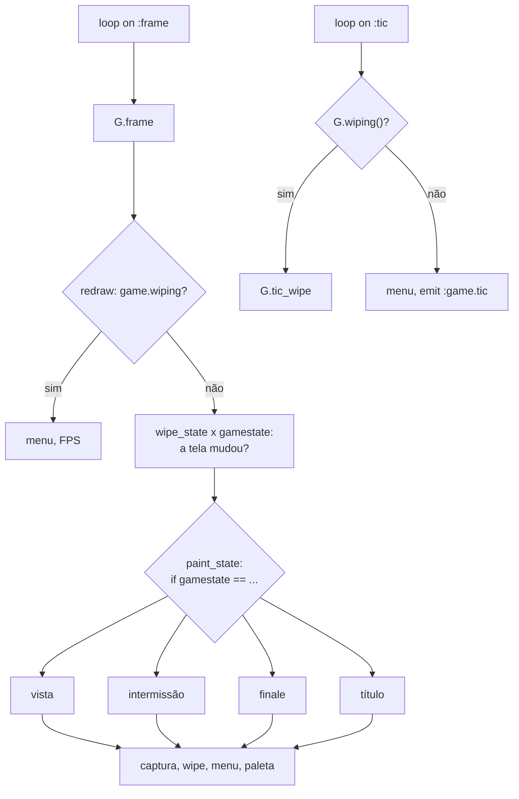
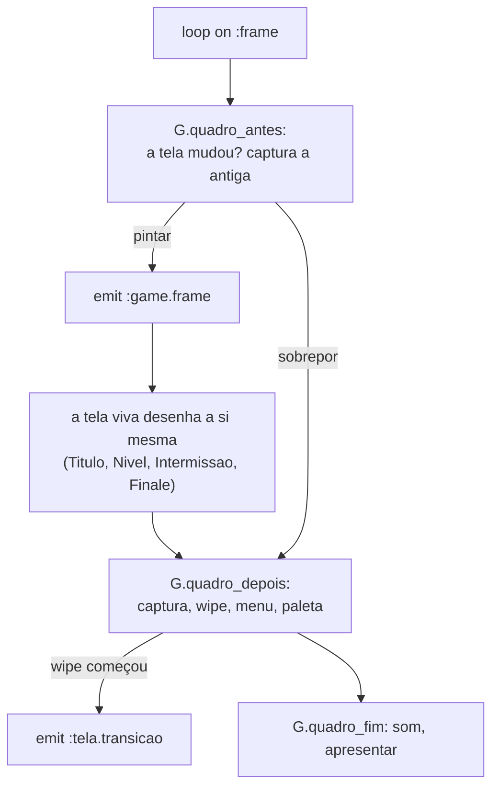
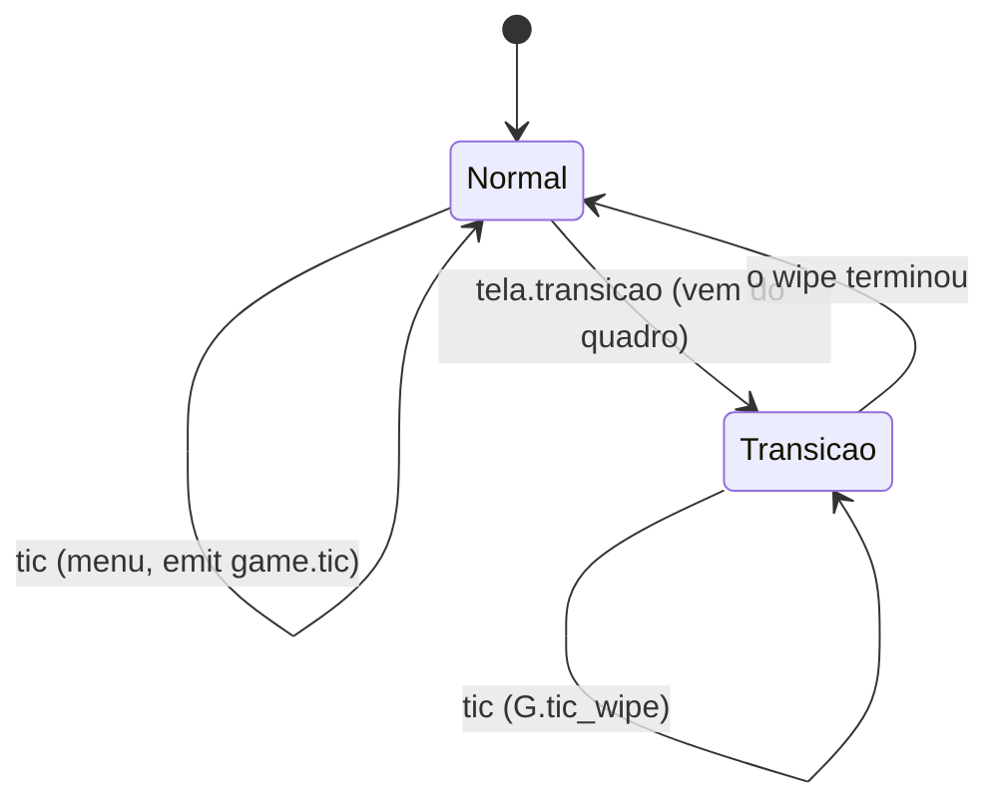

# Passo 6 (opcional): o wipe como fase do relógio e o quadro por evento

- Branch: `atmos`
- Referência de equivalência: tag `passo1` (o passo não muda o
  comportamento)
- Linhas citadas como "antes": tag `passo5`
- Resultado: tag `passo6`

## Resumo

Dois ajustes na metade "apresentação" do laço do jogo, propostos na seção 2
de `docs/NOTAS_MONOGRAFIA.md`:

1. **O wipe como fase do relógio.** O relógio do `main.atm` perguntava a
   cada tic `if G.wiping()`. Agora são duas fases em sequência: o tic normal,
   até o quadro avisar que uma transição de tela começou
   (`:tela.transicao`); depois só a transição, até ela terminar. A fase saiu
   do teste de todo tic e foi para a posição no código.
2. **O quadro por evento.** O redesenho escolhia a tela com
   `if game.gamestate == ...` (`paint_state`). Agora o quadro emite
   `:game.frame`, e a tela viva desenha a si mesma (`Titulo`, `Nivel`,
   `Intermissao`, `Finale`, cada uma com um ramo `loop on :game.frame`). O
   despacho por `gamestate` no desenho sumiu.

O replay é idêntico nos 10 roteiros. O renderer 3D em C não mudou: ele não
tem dimensão de tempo, e uma task sem `await` seria só uma função.

## Situação antes (tag `passo5`)

- `redraw` (`game.lua:640`): se `game.wiping`, só o menu e o FPS por cima;
  senão, compara a tela do quadro anterior (`game.wipe_state`) com a atual
  (`game.gamestate`) para descobrir se a tela mudou (com a exceção "do
  título para o jogo, sem wipe"), captura a tela antiga, chama
  `paint_state`, captura a nova e liga `game.wiping`.
- `paint_state` (`game.lua:613`): `if game.gamestate == "view" ... elseif
  "intermission" ... elseif "finale" ... else` (título).
- O relógio (`main.atm`): `loop on :tic { if G.wiping() { G.tic_wipe() }
  else { menu, pedidos, emit :game.tic, pedidos } }`.
- `G.frame`: redesenha se algo mudou, toca o som, apresenta e conta o FPS.

## Solução

**O quadro**, no `main.atm`:

```
loop on :frame {
    val modo = G.quadro_antes()       ;; "pintar" | "sobrepor" | nil
    if modo {
        if modo == :pintar {
            emit :game.frame          ;; a tela viva desenha a si mesma
        }
        if G.quadro_depois(modo == :pintar) {
            emit :tela.transicao      ;; começou um wipe: o relógio troca de fase
        }
    }
    G.quadro_fim()
}
```

`G.quadro_antes` decide se o quadro precisa ser redesenhado e, se a tela
mudou, captura a tela antiga; `G.quadro_depois` captura a nova, começa o
wipe, desenha o menu e o FPS e aplica a paleta; `G.quadro_fim` é o resto do
antigo `G.frame`. Cada tela ganhou um ramo como este:

```
task Intermissao (nxt) {
    G.make_intermission(nxt)
    spawn {
        loop on :game.frame { G.pintar_intermissao() }
    }
    G.enter(:intermission)
    ...
}
```

**O relógio:**

```
spawn {
    loop {
        watching :tela.transicao {
            loop on :tic {
                G.tic_menu()
                pedidos()
                emit :game.tic
                pedidos()
            }
        }
        loop on :tic {                    ;; só a transição anda
            until (G.tic_wipe())          ;; true quando termina
        }
    }
}
```

O tic em que a transição termina é consumido pela fase da transição, e os
tics seguintes do mesmo quadro já voltam ao normal, como com o
`if G.wiping()` de antes.

**O que ficou.** `game.wiping` continua existindo, porque o hash de estado e
o `quadro_antes` o leem. `game.gamestate` também: o wipe ainda detecta a
troca de tela comparando a tela anterior com a atual, no quadro. Fazer a
tela que sai e a que entra chamarem o wipe explicitamente
(`await Wipe(antes, depois)` entre as telas) mudaria o ponto em que o wipe
começa: hoje ele começa no quadro seguinte à troca, e só se a tela mudou
entre dois quadros. Pela equivalência, a detecção ficou no quadro.

**Sempre há uma tela viva.** A primeira versão manteve o `paint_state` como
reserva, para o caso de um quadro sem nenhuma tela desenhando, com um
contador. No roteiro `fluxo` (todas as transições de tela, 9 wipes) o
contador ficou em zero, e sem a reserva os 10 roteiros continuaram
idênticos. A reserva foi removida.

## Diagramas

**O quadro, antes (tag `passo5`):**



**O quadro, depois:**



**O relógio, depois:**



## Validação

**Cobertura.** O roteiro `fluxo` passa por todas as transições de tela.
Numa cópia instrumentada do `main.atm`, ele disparou 9 wipes (para o
título, para a vista, para a intermissão e para o finale), e nenhum quadro
ficou sem tela viva.

**Equivalência.** `make test-drivers`, idêntico à tag `passo1` nos 10
roteiros, com saves iguais byte a byte.

**Mutações do passo 6** (roteiro `fluxo`):

| Mutação | Erro simulado | 1º quadro | Quadros dif. |
|---|---|---|---|
| `transicao-sem-evento` | o quadro não avisa o relógio do wipe | 253 | 4.226 (save difere) |
| `wipe-um-tic-depois` | a transição só começa a andar um tic depois do aviso | 253 | 2.785 (save difere) |
| `vista-nao-se-desenha` | o `Nivel` não desenha a vista | 50 | 3.942 (save difere) |
| `intermissao-nao-se-desenha` | a intermissão não desenha a si mesma | 253 | 880 |

Duas mutações antigas usavam o texto do relógio velho e foram reescritas
para a forma nova, com o mesmo erro simulado: `wipe-nao-pausa` (durante a
transição, menu e tela continuam andando) continua detectada, e
`menu-depois-da-tela` continua equivalente.

`make test-mutacoes` (todas as mutações do projeto): **65/68 não
equivalentes detectadas**, 6 equivalentes justificadas, 3 pendentes.
`make test`: o mesmo de antes (12 passam, as mesmas 8 falhas).

## Métricas

`python3 tools/metricas_passo6.py` (novo):

| Métrica | Antes | Depois |
|---|---|---|
| Linhas de código (Lua: redesenho) | 44 | 52 |
| Linhas de código (Atmos: relógio, quadro, telas) | 15 | 39 |
| Linhas de código (total) | 59 | 91 |
| Despacho por `gamestate` no desenho | 4 | 1 |
| Pergunta por tic "está no wipe?" | 1 | 0 |
| Telas que desenham a si mesmas | 0 | 4 |

O código cresceu, mas o desenho deixou de depender de uma string consultada
num lugar central: cada tela desenha a si mesma enquanto está viva, e o
fim da tela encerra o desenho dela, pelo escopo. O `gamestate ==` que sobra
é a regra "do título para o jogo, sem wipe", na detecção da troca de tela.
O relógio, pela régua da fase (notas, seção 8), é um caso do lado bom:
ninguém de fora lê a fase dele (normal ou transição), ela não vai para o
save e o Lua não escreve nela no meio do tic; por isso ela pôde ir para a
posição no código.

## Custo

`CUSTO_TAGS=passo5 python3 tools/custo_drivers.py 5` (ms por quadro, roteiro
`fluxo`): `passo1` `main.lua` 0,741; `passo5` 1,078; atual 1,122 (+4,1% em
relação à `passo5`). Os dois `emit` a mais por quadro redesenhado
(`:game.frame` e, raramente, `:tela.transicao`) e o ramo de desenho de cada
tela. Contra o `passo1` `main.lua`, o atual custa +51,6%: o custo acumulado
dos passos 1 a 6, em que o passo 5 (o monstro) é a maior parte.

## Diferenças conhecidas

Nenhuma no comportamento.

## Como reproduzir

```sh
make test-drivers
make test-mutacoes
python3 tools/metricas_passo6.py
CUSTO_TAGS=passo5 python3 tools/custo_drivers.py 5
python3 tools/diagramas.py docs/registro/06-wipe-e-quadro.md
```

## Arquivos alterados

| Arquivo | Mudança |
|---|---|
| `game.lua` | `quadro_antes`, `quadro_depois`, `quadro_fim` e os pintores (`pintar_vista`, `pintar_intermissao`, `pintar_finale`, `pintar_titulo`); saíram `redraw`, `paint_state`, `G.frame` e `G.wiping`; `tic_wipe` devolve o fim da transição |
| `main.atm` | o quadro emite `:game.frame` e `:tela.transicao`; o relógio em duas fases; cada tela desenha a si mesma |
| `tools/mutacoes.py` | 4 mutações do passo 6; `wipe-nao-pausa` e `menu-depois-da-tela` reescritas para o relógio novo |
| `tools/metricas_passo6.py` | novo |
