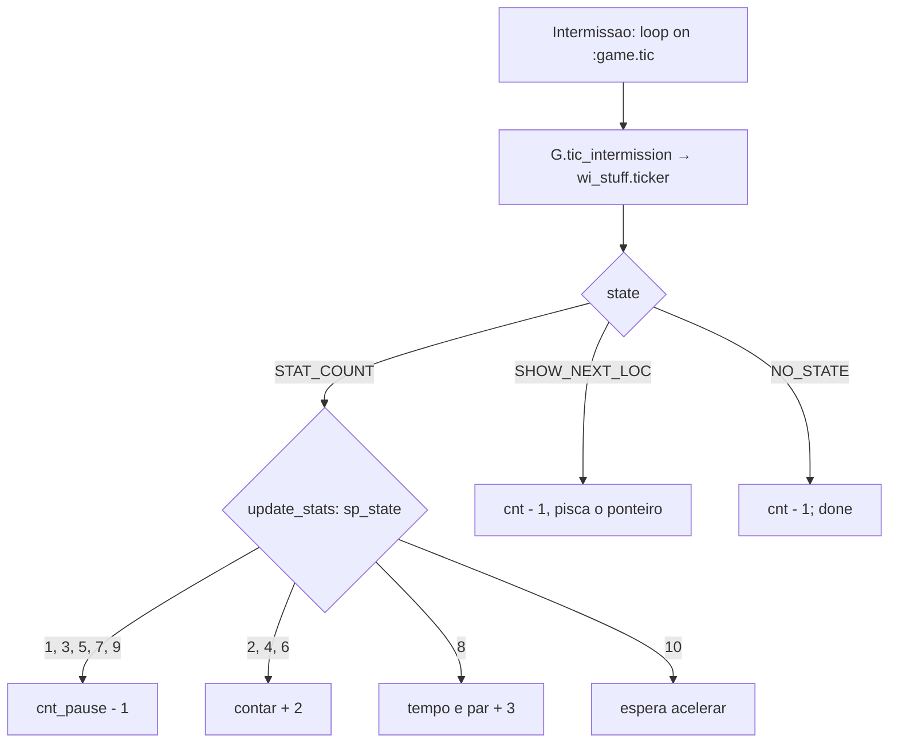
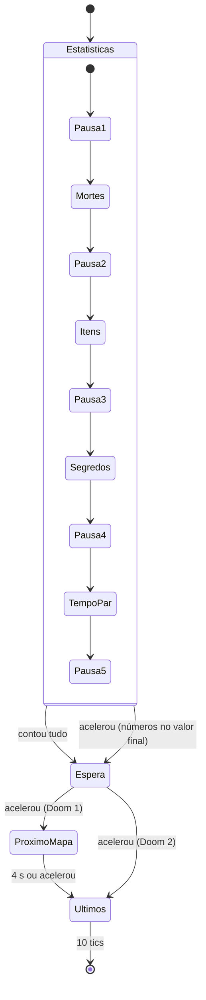
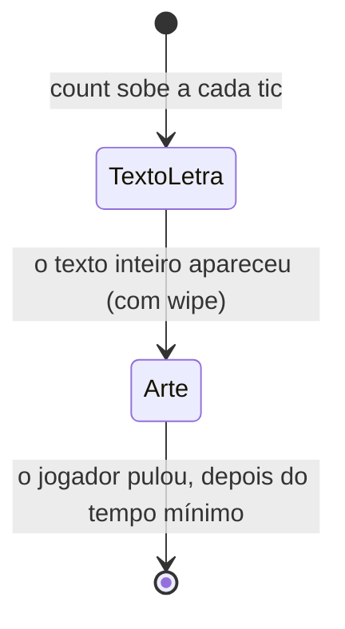

# Passo 7: a intermissão e o finale em concorrência estruturada

- Branch: `atmos`
- Referência de equivalência: tag `passo1` (e a branch `lua`, por
  `make test-branches`)
- Linhas citadas como "antes": tag `passo6`
- Resultado: tag `passo7`

## Resumo

A intermissão (a contagem entre os níveis) virou a task `Contagem`, e o
finale do Doom 1 (o texto e a arte do fim do episódio), a task `Texto`, as
duas em `telas.atm`. Cada tela é agora uma sequência escrita na ordem em que
acontece. A fase da tela, que antes vivia em cinco campos (`state`,
`sp_state` de 1 a 10, `cnt_pause`, `cnt`, `stage`) e era despachada a cada
tic, foi para a posição no código; ficaram como campos só `state` e
`stage`, porque o desenho os lê, e os números exibidos.

Pela régua da fase (`docs/NOTAS_MONOGRAFIA.md`, seção 8), as duas telas
estavam do lado bom: ninguém de fora lê a fase (só o próprio desenho), elas
não vão para o save, o Lua não escreve nelas no meio do tic, e a única
interrupção ("acelerar") é entrada do jogador. O resultado confirma a
previsão: o mesmo tamanho de código, 17 comparações com a fase a menos e
nenhum contador guardado em campo. É o contraponto, no próprio Doom, da arma
e do monstro.

## Situação antes (tag `passo6`)

- `wi_stuff.ticker` (`wi_stuff.lua:452`): a cada tic, conta `bcnt`, toca a
  música no primeiro tic, lê "acelerar" do teclado (`check_accelerate`) e
  despacha por `state`: `STAT_COUNT` (`update_stats`), `SHOW_NEXT_LOC`
  (`update_show_next`), `NO_STATE` (`update_no_state`).
- `update_stats` (`wi_stuff.lua:330`): despacha por `sp_state`. Os ímpares
  são pausas de um segundo (`cnt_pause`); 2, 4 e 6 contam mortes, itens e
  segredos de 2 em 2; 8 conta tempo e par de 3 em 3; 10 espera acelerar.
  Acelerar em qualquer ponto antes do 10 põe todos os números no valor final.
- `update_show_next` (`wi_stuff.lua:434`): o mapa do episódio com o próximo
  nível, por `cnt` tics (4 s) ou até acelerar; `update_no_state`, mais 10
  tics.
- `finale.ticker` (`finale.lua:350`): `count` a cada tic; no texto
  (`stage` 0), passa para a arte quando o texto inteiro apareceu; na arte
  (`stage` 1), termina quando o jogador pula, depois de um tempo mínimo.
  O Doom 2 tem ainda o elenco (`stage` 2), que não existe no `doom.wad`.
- Quem lê: `wi_stuff.draw` (`state`, os números, `snl_pointeron`, as
  animações) e `finale.draw` (`stage`, `count`).

## Solução

```
;; As estatisticas, linha por linha. :fim | :acelerou
val func estatisticas (w, G) {
    val s = w.wbs
    loop {
        val r1 = pausa(w, G)
        until (r1 == :acelerou, :acelerou)
        set w.cnt_kills = 0
        val r2 = contar(w, G, :cnt_kills, WI.pct(s.skills, s.maxkills))
        until (r2 == :acelerou, :acelerou)
        ...                               ;; itens, segredos, tempo e par
        val r9 = pausa(w, G)
        until (r9 == :acelerou, :acelerou)
        until (true, :fim)
    }
}

val task Contagem (w, G) {
    if estatisticas(w, G) == :acelerou {
        WI.acelerar_tudo(w)               ;; todos os números no valor final
    }
    loop {                                ;; espera acelerar
        tic(w, G)
        until (w.accelerate != 0)
    }
    som(w, "wpnup")
    if !w.wbs.commercial {
        WI.mostrar_proximo(w)
        var n = WI.SHOWNEXTLOCDELAY * WI.TICRATE
        loop {
            tic(w, G)
            set n = n - 1
            until ((n == 0) || (w.accelerate != 0))
            set w.snl_pointeron = (compat.band(n, 31) < 20)
        }
    }
    WI.sem_estado(w)
    loop in 10 {
        tic(w, G)
    }
}

val task Texto (f, G) {                   ;; Doom 1
    val total = (#f.text * F.TEXTSPEED) + F.TEXTWAIT
    loop {                                ;; o texto
        await :game.tic
        set f.count = f.count + 1
        G.redesenhar()
        until (f.count > total)
    }
    F.para_arte(f)
    val depois = if (f.pfub1 && f.pfub2) => 1130 => 10
    loop {                                ;; a arte, até pular
        await :game.tic
        set f.count = f.count + 1
        G.redesenhar()
        until (F.quer_pular(f) && (f.count > depois))
    }
    ...
}
```

`tic` é o começo comum de todo tic da intermissão (`WI.tic`: contador,
música, acelerar, animações do mapa) e o pedido de redesenho. `pausa`,
`contar` e `contar_tempo` devolvem `:acelerou` quando o jogador acelera, e
`estatisticas` sai na hora. As telas do `main.atm` só esperam a task:

```
task Intermissao (nxt) {
    G.make_intermission(nxt)
    spawn { loop on :game.frame { G.pintar_intermissao() } }
    G.enter(:intermission)
    await telas.Contagem(G.game.wi, G)
    G.fim_intermissao()
}
```

**O que ficou como estava.** "Acelerar" e "pular" continuam lidos do
teclado a cada tic, em Lua (`check_accelerate`, `want_skip`): o Doom faz o
mesmo, e um evento mudaria o tic em que a tela reage. O elenco do Doom 2
continua no `finale.ticker`, chamado pela task; não há como testá-lo com o
`doom.wad`.

## Diagramas

**Antes (tag `passo6`):**



**Máquina de estados da task `Contagem`** (a fase é a posição no código):



**Máquina de estados da task `Texto`** (Doom 1):



## Validação

**Roteiro `telas`** (`-warp 1 1`). Os roteiros antigos passavam pelas duas
telas, mas com lacunas (conferidas com prints numa cópia de `telas.atm`): as
três intermissões do `fluxo` eram aceleradas logo no começo da contagem, e
nenhuma contava até o fim nem deixava o mapa seguinte passar pelo tempo. O
roteiro novo tem três partes:

1. E1M1: o jogador visita os 3 setores secretos (`goto`), sai, e acelera no
   **meio** da contagem dos segredos, que dura dezenas de tics (os
   segredos registrados contam de 2 em 2 até 66%);
2. E1M2: a contagem vai até o fim (tempo e par incluídos), ele acelera na
   espera, e o mapa seguinte termina pelo tempo (4 s);
3. E1M8 (`idclev18`): sai e, no finale, segura "use" na passagem do texto
   para a arte; pular só vale depois de 10 tics de arte, e ele pula no tic
   11.

| Caminho | Roteiro |
|---|---|
| contagem até o fim (tempo e par incluídos), espera, acelerar | `telas` (E1M2) |
| acelerar no meio de uma linha que dura vários tics | `telas` (E1M1) |
| acelerar numa pausa ou numa linha de um tic só | `fluxo` |
| mapa seguinte terminando pelo tempo (4 s) | `telas` |
| mapa seguinte terminando por acelerar | `fluxo` |
| texto do finale até o fim, arte, pular no primeiro tic permitido | `telas` (E1M8), `exits` |

**As telas no hash de estado.** Na primeira rodada completa, três mutações
sobreviveram, e uma delas (`finale-texto-um-tic-a-menos`) mostrou o motivo:
o que as telas escrevem não estava no hash. O texto acabando um tic antes
muda o `count` da arte, mas a arte do episódio 1 não depende de `count`, e
a troca de tela caía num tic que não vira quadro. É a lição do passo 3e de
novo ("confira que o que o tipo migrado escreve está no hash"). O hash
(com `DOOM_REPLAY_SIDES=1`) passou a incluir, da intermissão, `state`, os
números exibidos, `snl_pointeron`, `bcnt` e `accelerate`, e do finale,
`stage` e `count`, nos três lugares: a `atmos`, a referência
(`tests/ref-passo1.patch`) e a branch `lua`. As outras duas mutações
(`contar-ignora-acelerar`, `finale-pula-sem-esperar`) precisavam de
cenários que nenhum roteiro montava, e o roteiro `telas` ganhou as partes 1
e 3 acima. As três passaram a ser detectadas.

**Equivalência.** `make test-drivers`, idêntico à tag `passo1` nos 11
roteiros; `make test-branches`, idêntico entre as branches `lua` e `atmos`
nos 11 roteiros. Os roteiros `fluxo` e `exits` deram idêntico na primeira
execução, e continuaram idênticos com as telas no hash.

**Mutações do passo 7:**

| Mutação | Erro simulado | Roteiro | 1º quadro | Quadros dif. |
|---|---|---|---|---|
| `pausa-um-tic-a-menos` | a pausa entre as linhas dura um tic a menos | `telas` | 198 | 73 |
| `contagem-sem-tempo` | a contagem pula o tempo e o par | `telas` | 1.089 | 565 |
| `intermissao-nao-espera` | depois da contagem, segue sem esperar acelerar | `telas` | 266 | 1.563 |
| `proximo-mapa-mais-longo` | o mapa com o próximo nível fica 1 s a mais | `telas` | 342 | 1.385 |
| `contar-ignora-acelerar` | acelerar no meio de uma linha é ignorado | `telas` | 266 | 3 |
| `finale-texto-um-tic-a-menos` | o texto do finale termina um tic antes | `telas` | 3.504 | 96 |
| `finale-pula-sem-esperar` | a arte do finale pode ser pulada logo no começo | `telas` | 3.506 | 98 |

As três últimas sobreviveram na primeira rodada, e as três foram resolvidas
pelo hash e pelo roteiro (acima): nenhuma é equivalente.

`make test-mutacoes` (todas as mutações do projeto): **72/75 não
equivalentes detectadas**, 6 equivalentes justificadas, 3 pendentes.
`make test`: o mesmo de antes (12 passam, as mesmas 8 falhas).

## Métricas

`python3 tools/metricas_passo7.py` (novo):

| Métrica | Antes | Depois |
|---|---|---|
| Linhas de código (Lua) | 185 | 40 |
| Linhas de código (Atmos) | – | 144 |
| Linhas de código (total) | 185 | 184 |
| Campos de fase escritos | 5 (`cnt`, `cnt_pause`, `sp_state`, `stage`, `state`) | 2 (`stage`, `state`) |
| Comparações com a fase | 17 | 0 |
| Contadores guardados em campo (`x.c = x.c - 1`) | 3 | 0 |

O tamanho empatou, mas o código mudou de natureza: a contagem lê como a
descrição da tela ("pausa, conta as mortes, pausa, conta os itens..."), sem
nenhum despacho por fase, e os contadores de espera viraram variáveis locais
ou `loop in 10`. Os dois campos de fase que restam existem porque o desenho
os lê, que é a única exigência da régua presente aqui. Na tabela 1 das
métricas finais, as duas telas ficam ao lado das luzes, no extremo bom da
régua.

## Custo

`CUSTO_TAGS=passo6 python3 tools/custo_drivers.py 5 [roteiro]` (ms por
quadro): no `fluxo`, `passo6` 1,101 e atual 1,111 (+0,9%); no `telas`,
`passo6` 0,613 e atual 0,617 (+0,7%). Uma task por tela, acordando a cada
tic, não pesa: o custo da concorrência estruturada só apareceu de forma
clara com dezenas de tasks por tic (o passo 5).

## Diferenças conhecidas

Nenhuma no comportamento.

## Como reproduzir

```sh
make test-drivers
make test-branches
make test-mutacoes
python3 tools/metricas_passo7.py
sh tests/test_drivers.sh 0 1 telas -warp 1 1 >/dev/null
python3 tools/diagramas.py docs/registro/09-intermissao-e-finale.md
```

## Arquivos alterados

| Arquivo | Mudança |
|---|---|
| `telas.atm` | novo: tasks `Contagem` (intermissão) e `Texto` (finale) |
| `wi_stuff.lua` | `tic`, `acelerar_tudo`, `mostrar_proximo`, `sem_estado` e as constantes expostas (`M.ticker` continua para os testes sem `main.atm`) |
| `finale.lua` | `para_arte`, `quer_pular` e as constantes expostas |
| `game.lua` | `G.redesenhar`, `G.fim_intermissao`, `G.fim_finale`; saíram `G.tic_intermission` e `G.tic_finale` |
| `main.atm` | `Intermissao` e `Finale` esperam as tasks de `telas.atm` |
| `tools/make_replay.lua`, `tests/test_drivers.sh` | roteiro `telas` e a sua cobertura |
| `game.lua`, `tests/ref-passo1.patch`; branch `lua`: `main.lua` | a intermissão e o finale no hash de estado |
| `tools/mutacoes.py` | roteiros `telas` e `exits`; 7 mutações do passo 7 |
| `tools/metricas_passo7.py`, `tools/metricas_finais.py` | métricas do passo 7; a entidade nova na tabela final |
| `Makefile` | roteiro `telas` em `test-drivers`, `test-mutacoes` e `test-branches` |
