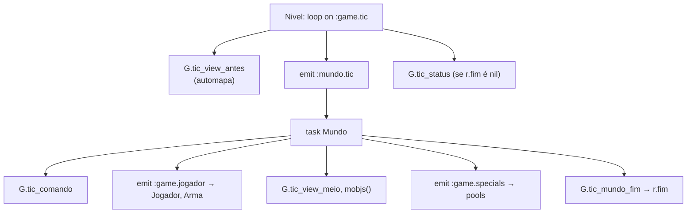

# Passo 8: a task `Mundo`, a barra de status, o menu e o automapa

- Branch: `atmos`
- Referência de equivalência: tag `passo1` (e a branch `lua`, por
  `make test-branches`)
- Linhas citadas como "antes": tag `passo7`
- Resultado: tag `passo8` (ao fim do passo)

Itens A5, A2, A1 e A3 da lista "Depois do passo 7" do
`docs/PLANO_ATMOS.md`. O A4 (família de monstros) ficou de fora, por decisão
do autor (o mais custoso). Este registro cresce a cada commit do passo 8.

| Subpasso | Commit | Situação |
|---|---|---|
| 8a. Task `Mundo` (A5) | (este commit) | concluído |
| 8b. Barra de status, o rosto (A2) | – | próximo |
| 8c. Menu (A1) | – | planejado |
| 8d. Automapa (A3) | – | planejado |

---

## Subpasso 8a: a task `Mundo`

### Resumo

O tic do mundo (o que o Doom chama de `P_Ticker`) virou a task `Mundo`,
filha do `Nivel`. Ela contém as pools dos specials e dos monstros e o
`Jogador`, acorda com `:mundo.tic` e devolve o resultado do tic (nada,
`"morte"` ou `"saida"`) numa tabela compartilhada. O automapa e a barra de
status ficaram fora dela, no `Nivel`, na mesma posição de antes no tic, como
o `AM_Ticker` e o `ST_Ticker` do Doom ficam fora do `P_Ticker`. É uma mudança
só de estrutura, que prepara a pausa (C2 do plano): pausar o mundo passa a
ser um `toggle` numa subárvore (`docs/NOTAS_MONOGRAFIA.md`, seção 11).

### Situação antes (tag `passo7`)

O laço do `Nivel` (`main.atm`) fazia o tic inteiro: `G.tic_view_antes`
(automapa e comando do jogador), `emit :game.jogador`, `G.tic_view_meio`, os
mobjs, `emit :game.specials` e `G.tic_view_depois` (texturas, saída,
`leveltime` e a barra de status). As pools e o `Jogador` eram declarados no
próprio `Nivel`.

### Solução

```
task Mundo (r) {
    pin luzes = tasks()
    spawn { loop on :game.specials { G.specials_resto() } }
    pin movers = tasks()
    pin botoes = tasks()
    pin monstros = tasks()
    G.set_pools(...)
    defer { G.set_pools(nil) }
    await :mundo.pronto                   ;; o Nivel montou o nível
    spawn jogador.Jogador(G.game.player, G.game)
    loop {
        await :mundo.tic
        G.tic_comando()
        emit :game.jogador
        val meio = G.tic_view_meio()
        set r.fim = ifs {
            (meio == :morte) => :morte
            else => {
                mobjs()
                emit :game.specials
                G.tic_mundo_fim()         ;; nil | "saida"
            }
        }
    }
}

task Nivel (save) {
    val r = [fim=nil]
    spawn Mundo(r)                        ;; pools prontas antes de montar
    ...                                   ;; monta ou carrega o nível
    emit :mundo.pronto
    ...
        loop on :game.tic {
            val antes = G.tic_view_antes()    ;; "segue" | "parado" (automapa)
            val fim = ifs {
                (antes == :segue) => {
                    emit :mundo.tic           ;; o tic do mundo
                    if !r.fim {
                        G.tic_status()        ;; a barra, fora do mundo
                    }
                    r.fim
                }
                else => nil
            }
            ...
```

No `game.lua`, `G.tic_view_antes` ficou com o automapa; o comando do
jogador virou `G.tic_comando`, e `G.tic_view_depois` se dividiu em
`G.tic_mundo_fim` (texturas, saída, `leveltime`) e `G.tic_status` (a barra).

**As pools precisam existir antes de montar o nível** (o `build_level` cria
as luzes, o load recria botões, portas e elevadores). O `spawn Mundo(r)` roda
a task até o primeiro `await`, então as pools e o `G.set_pools` ficam prontos
antes de o `Nivel` montar o nível. O `Jogador` nasce depois, quando o
`Nivel` avisa com `:mundo.pronto`.

**O resultado do tic volta por uma tabela.** O `emit :mundo.tic` roda o
`Mundo` inteiro antes de retornar (P1), então o `Nivel` lê `r.fim` logo
depois.

### Diagrama



### Validação

`make test-drivers`: idêntico à tag `passo1` nos 11 roteiros. Duas
mutações antigas citavam o tic do `Nivel` e foram reescritas para a forma
nova, com o mesmo erro simulado: `specials-no-fim-do-tic` (agora com duas
edições: os specials depois do fim do mundo e da barra) e
`jogador-depois-dos-mobjs`. As duas continuam detectadas. Mutação nova:

| Mutação | Erro simulado | Roteiro | 1º quadro | Quadros dif. |
|---|---|---|---|---|
| `status-antes-do-mundo` | a barra de status roda antes do mundo no tic | `arma` | 110 | 41 |

### Arquivos alterados

| Arquivo | Mudança |
|---|---|
| `main.atm` | task `Mundo` (pools, `Jogador`, o tic do mundo); o `Nivel` emite `:mundo.pronto` e `:mundo.tic` e chama a barra |
| `game.lua` | `G.tic_comando`, `G.tic_mundo_fim`, `G.tic_status`; saiu `G.tic_view_depois` |
| `tools/mutacoes.py` | `specials-no-fim-do-tic` e `jogador-depois-dos-mobjs` no tic novo; `status-antes-do-mundo` |
