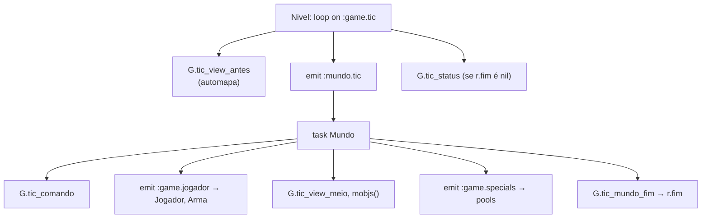

# Passo 8: a task `Mundo`, a barra de status, o menu e o automapa

- Branch: `atmos`
- Referência de equivalência: tag `passo1` (e a branch `lua`, por
  `make test-branches`)
- Linhas citadas como "antes": tag `passo7`
- Resultado: tag `passo8` (ao fim do passo)

Itens A5, A2, A1 e A3 da lista "Depois do passo 7" do
`docs/PLANO_ATMOS.md`. O A4 (família de monstros) ficou de fora, por decisão
do autor (o mais custoso). Este registro cresce a cada commit do passo 8.

| Subpasso | Commit | Situação |
|---|---|---|
| 8a. Task `Mundo` (A5) | `b15f4e8` | concluído |
| 8b. Barra de status, o rosto (A2) | (este commit) | concluído; inclui o B1 (o rosto no hash) |
| 8c. Menu (A1) | – | próximo |
| 8d. Automapa (A3) | – | planejado |

---

## Subpasso 8a: a task `Mundo`

### Resumo

O tic do mundo (o que o Doom chama de `P_Ticker`) virou a task `Mundo`,
filha do `Nivel`. Ela contém as pools dos specials e dos monstros e o
`Jogador`, acorda com `:mundo.tic` e devolve o resultado do tic (nada,
`"morte"` ou `"saida"`) numa tabela compartilhada. O automapa e a barra de
status ficaram fora dela, no `Nivel`, na mesma posição de antes no tic, como
o `AM_Ticker` e o `ST_Ticker` do Doom ficam fora do `P_Ticker`. É uma mudança
só de estrutura, que prepara a pausa (C2 do plano): pausar o mundo passa a
ser um `toggle` numa subárvore (`docs/NOTAS_MONOGRAFIA.md`, seção 11).

### Situação antes (tag `passo7`)

O laço do `Nivel` (`main.atm`) fazia o tic inteiro: `G.tic_view_antes`
(automapa e comando do jogador), `emit :game.jogador`, `G.tic_view_meio`, os
mobjs, `emit :game.specials` e `G.tic_view_depois` (texturas, saída,
`leveltime` e a barra de status). As pools e o `Jogador` eram declarados no
próprio `Nivel`.

### Solução

```
task Mundo (r) {
    pin luzes = tasks()
    spawn { loop on :game.specials { G.specials_resto() } }
    pin movers = tasks()
    pin botoes = tasks()
    pin monstros = tasks()
    G.set_pools(...)
    defer { G.set_pools(nil) }
    await :mundo.pronto                   ;; o Nivel montou o nível
    spawn jogador.Jogador(G.game.player, G.game)
    loop {
        await :mundo.tic
        G.tic_comando()
        emit :game.jogador
        val meio = G.tic_view_meio()
        set r.fim = ifs {
            (meio == :morte) => :morte
            else => {
                mobjs()
                emit :game.specials
                G.tic_mundo_fim()         ;; nil | "saida"
            }
        }
    }
}

task Nivel (save) {
    val r = [fim=nil]
    spawn Mundo(r)                        ;; pools prontas antes de montar
    ...                                   ;; monta ou carrega o nível
    emit :mundo.pronto
    ...
        loop on :game.tic {
            val antes = G.tic_view_antes()    ;; "segue" | "parado" (automapa)
            val fim = ifs {
                (antes == :segue) => {
                    emit :mundo.tic           ;; o tic do mundo
                    if !r.fim {
                        G.tic_status()        ;; a barra, fora do mundo
                    }
                    r.fim
                }
                else => nil
            }
            ...
```

No `game.lua`, `G.tic_view_antes` ficou com o automapa; o comando do
jogador virou `G.tic_comando`, e `G.tic_view_depois` se dividiu em
`G.tic_mundo_fim` (texturas, saída, `leveltime`) e `G.tic_status` (a barra).

**As pools precisam existir antes de montar o nível** (o `build_level` cria
as luzes, o load recria botões, portas e elevadores). O `spawn Mundo(r)` roda
a task até o primeiro `await`, então as pools e o `G.set_pools` ficam prontos
antes de o `Nivel` montar o nível. O `Jogador` nasce depois, quando o
`Nivel` avisa com `:mundo.pronto`.

**O resultado do tic volta por uma tabela.** O `emit :mundo.tic` roda o
`Mundo` inteiro antes de retornar (P1), então o `Nivel` lê `r.fim` logo
depois.

### Diagrama



### Validação

`make test-drivers`: idêntico à tag `passo1` nos 11 roteiros. Duas
mutações antigas citavam o tic do `Nivel` e foram reescritas para a forma
nova, com o mesmo erro simulado: `specials-no-fim-do-tic` (agora com duas
edições: os specials depois do fim do mundo e da barra) e
`jogador-depois-dos-mobjs`. As duas continuam detectadas. Mutação nova:

| Mutação | Erro simulado | Roteiro | 1º quadro | Quadros dif. |
|---|---|---|---|---|
| `status-antes-do-mundo` | a barra de status roda antes do mundo no tic | `arma` | 110 | 41 |

### Arquivos alterados

| Arquivo | Mudança |
|---|---|
| `main.atm` | task `Mundo` (pools, `Jogador`, o tic do mundo); o `Nivel` emite `:mundo.pronto` e `:mundo.tic` e chama a barra |
| `game.lua` | `G.tic_comando`, `G.tic_mundo_fim`, `G.tic_status`; saiu `G.tic_view_depois` |
| `tools/mutacoes.py` | `specials-no-fim-do-tic` e `jogador-depois-dos-mobjs` no tic novo; `status-antes-do-mundo` |

---

## Subpasso 8b: o rosto da barra de status

### Resumo

O rosto da barra de status virou a task `Rosto` (`barra.atm`), no `Nivel`,
fora do `Mundo` (a barra continua andando numa pausa, como o `ST_Ticker` do
Doom). Ela acorda com `:barra.tic`, que o `Nivel` emite na mesma posição do
tic de antes, quando o tic do mundo seguiu. A prioridade do rosto, o tempo
que ele ainda fica, o contador da "fúria" e a vida do tic anterior viraram
variáveis da task; só `face_index`, que o desenho lê, continua campo.
Resultado médio, como a régua previa: os campos sumiram, mas a arbitragem
por prioridade continua reavaliada a cada tic.

### Situação antes (tag `passo7`)

`status.ticker` (`status.lua:269`) sorteava o olhar e chamava
`update_face` (`status.lua:176`), que reavaliava, a cada tic, as expressões
em ordem de prioridade (morte, sorriso por arma nova, dor com atacante, dor,
fúria, modo deus) e, quando o tempo do rosto acabava, punha o olhar parado.
O estado ficava em cinco campos: `face_index`, `face_count`,
`face_priority`, `last_attackdown` e `old_health`. O desenho só lê
`face_index`.

### Solução

```
val task Rosto (st, p) {
    var prioridade = 0                    ;; antes: face_priority
    var conta = 0                         ;; antes: face_count
    var furia = -1                        ;; antes: last_attackdown
    var vida_antes = -1                   ;; antes: old_health
    loop {
        await :barra.tic
        val sorteio = S.sortear(st)
        if (prioridade < 10) && ((p.health || 0) <= 0) {        ;; morto
            set prioridade = 9
            set st.face_index = R.DEAD
            set conta = 1
        }
        ...                                ;; sorriso, dor, fúria, modo deus
        if conta == 0 {                    ;; olhar parado
            set st.face_index = S.olhar(st, p, sorteio)
            set conta = R.STRAIGHTFACECOUNT
            set prioridade = 0
        }
        set conta = conta - 1
        set vida_antes = p.health
    }
}
```

Os cálculos que dependem do jogador ficaram em Lua (`status.lua`): o
sorteio, o nível de dor, a arma nova, o rosto virado para o atacante e o
modo deus. A task nasce com o nível, depois de o `status.reset` do
`build_level` (ou do load) zerar o rosto, e as variáveis começam com os
mesmos valores do reset.

**Por que não virou sequência.** A regra do rosto é "a expressão de maior
prioridade vence, e fica por um tempo": a cada tic, uma expressão mais
importante pode tomar o lugar da atual. Isso é uma arbitragem reativa, não
uma sequência no tempo, e a task ainda testa tudo a cada tic, como o ticker.
O ganho é de estado (quatro campos viraram variáveis, porque só o próprio
rosto os usa), não de forma.

**O rosto no hash (o item B1 do plano).** Com `DOOM_REPLAY_SIDES=1`, o hash
de estado passou a incluir `face_index`, nos três lugares (`atmos`,
`tests/ref-passo1.patch` e a branch `lua`). É o que a task escreve e o
desenho lê, a lição do passo 3e. Isso também fecha o ponto cego do passo 3d
(notas, seção 7): um efeito de um tic no rosto não depende mais de cair num
quadro desenhado.

### Validação

`make test-drivers`: idêntico à tag `passo1` nos 11 roteiros, com o rosto
no hash. Mutações do 8b:

| Mutação | Erro simulado | Roteiro | 1º quadro | Quadros dif. |
|---|---|---|---|---|
| `rosto-sem-furia` | o rosto nunca mostra a fúria (gatilho preso por 2 s) | `arma` | 110 | 1.050 |
| `rosto-olhar-mais-longo` | o olhar parado fica um tic a mais | `arma` | 18 | 197 |
| `rosto-esquece-a-vida` | a vida do tic anterior não é guardada | `fluxo` | 813 | 266 |
| `rosto-sem-deus` | o rosto ignora o modo deus | `arma` | 1.095 | 1.567 |

`rosto-esquece-a-vida` sobreviveu no roteiro `monstro`, em que o jogador
está em modo deus e não sofre dano (o caminho que usa a vida anterior nunca
roda), e foi detectada no `fluxo`, em que ele sofre dano sem `iddqd`. As
mutações `specials-no-fim-do-tic` e `status-antes-do-mundo` foram reescritas
para emitir `:barra.tic` (no primeiro caso, de dentro do `Mundo`, com
`emit @1`, que alcança o irmão `Rosto` no `Nivel`) e continuam detectadas.

### Métricas

`python3 tools/metricas_passo8.py` (novo; seção "8b"):

| Métrica | Antes | Depois |
|---|---|---|
| Linhas de código (Lua) | 101 | 47 |
| Linhas de código (Atmos) | – | 68 |
| Linhas de código (total) | 101 | 115 |
| Campos de estado escritos por tic | 5 | 1 (`face_index`) |

### Arquivos alterados

| Arquivo | Mudança |
|---|---|
| `barra.atm` | novo: task `Rosto` |
| `status.lua` | `ROSTO`, `sortear`, `dor`, `olhar`, `arma_nova`, `rosto_dano`, `deus` (`M.ticker` continua para os testes sem `main.atm`) |
| `main.atm` | o `Nivel` cria o `Rosto` e emite `:barra.tic` |
| `game.lua` | saiu `G.tic_status`; `face_index` no hash de estado |
| `tests/ref-passo1.patch`; branch `lua`: `main.lua` | `face_index` no hash de estado |
| `tools/mutacoes.py` | 4 mutações do 8b; `specials-no-fim-do-tic` e `status-antes-do-mundo` com `:barra.tic` |
| `tools/metricas_passo8.py` | novo |

