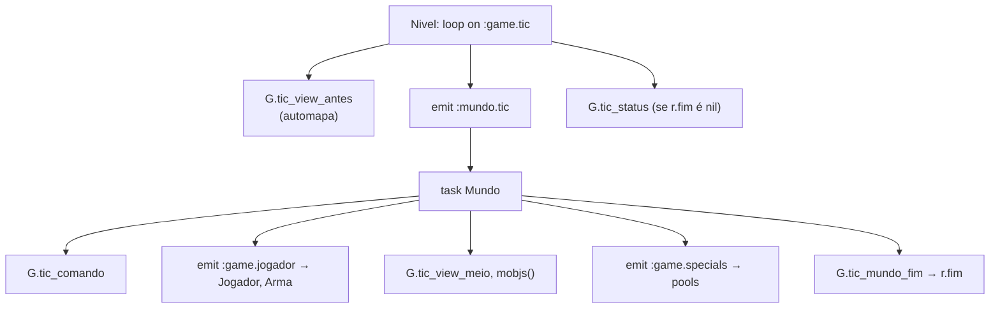

# Passo 8: a task `Mundo`, a barra de status, o menu e o automapa

- Branch: `atmos`
- Referência de equivalência: tag `passo1` (e a branch `lua`, por
  `make test-branches`)
- Linhas citadas como "antes": tag `passo7`
- Resultado: tag `passo8` (ao fim do passo)

Itens A5, A2, A1 e A3 da lista "Depois do passo 7" do
`docs/PLANO_ATMOS.md`. O A4 (família de monstros) ficou de fora, por decisão
do autor (o mais custoso). Este registro cresce a cada commit do passo 8.

| Subpasso | Commit | Situação |
|---|---|---|
| 8a. Task `Mundo` (A5) | `b15f4e8` | concluído |
| 8b. Barra de status, o rosto (A2) | `0797733` | concluído; inclui o B1 (o rosto no hash) |
| 8c. Menu (A1) | `0f1b752` | concluído |
| 8d. Automapa (A3) | (este commit) | concluído; fecha o passo 8 |

---

## Subpasso 8a: a task `Mundo`

### Resumo

O tic do mundo (o que o Doom chama de `P_Ticker`) virou a task `Mundo`,
filha do `Nivel`. Ela contém as pools dos specials e dos monstros e o
`Jogador`, acorda com `:mundo.tic` e devolve o resultado do tic (nada,
`"morte"` ou `"saida"`) numa tabela compartilhada. O automapa e a barra de
status ficaram fora dela, no `Nivel`, na mesma posição de antes no tic, como
o `AM_Ticker` e o `ST_Ticker` do Doom ficam fora do `P_Ticker`. É uma mudança
só de estrutura, que prepara a pausa (C2 do plano): pausar o mundo passa a
ser um `toggle` numa subárvore (`docs/NOTAS_MONOGRAFIA.md`, seção 11).

### Situação antes (tag `passo7`)

O laço do `Nivel` (`main.atm`) fazia o tic inteiro: `G.tic_view_antes`
(automapa e comando do jogador), `emit :game.jogador`, `G.tic_view_meio`, os
mobjs, `emit :game.specials` e `G.tic_view_depois` (texturas, saída,
`leveltime` e a barra de status). As pools e o `Jogador` eram declarados no
próprio `Nivel`.

### Solução

```
task Mundo (r) {
    pin luzes = tasks()
    spawn { loop on :game.specials { G.specials_resto() } }
    pin movers = tasks()
    pin botoes = tasks()
    pin monstros = tasks()
    G.set_pools(...)
    defer { G.set_pools(nil) }
    await :mundo.pronto                   ;; o Nivel montou o nível
    spawn jogador.Jogador(G.game.player, G.game)
    loop {
        await :mundo.tic
        G.tic_comando()
        emit :game.jogador
        val meio = G.tic_view_meio()
        set r.fim = ifs {
            (meio == :morte) => :morte
            else => {
                mobjs()
                emit :game.specials
                G.tic_mundo_fim()         ;; nil | "saida"
            }
        }
    }
}

task Nivel (save) {
    val r = [fim=nil]
    pin mundo = spawn Mundo(r)            ;; pools prontas antes de montar
    ...                                   ;; monta ou carrega o nível
    emit @(mundo) (:mundo.pronto)
    ...
        loop on :game.tic {
            val antes = G.tic_view_antes()    ;; "segue" | "parado" (automapa)
            val fim = ifs {
                (antes == :segue) => {
                    emit @(mundo) (:mundo.tic)  ;; o tic do mundo
                    if !r.fim {
                        G.tic_status()        ;; a barra, fora do mundo
                    }
                    r.fim
                }
                else => nil
            }
            ...
```

No `game.lua`, `G.tic_view_antes` ficou com o automapa; o comando do
jogador virou `G.tic_comando`, e `G.tic_view_depois` se dividiu em
`G.tic_mundo_fim` (texturas, saída, `leveltime`) e `G.tic_status` (a barra).

**As pools precisam existir antes de montar o nível** (o `build_level` cria
as luzes, o load recria botões, portas e elevadores). O `spawn Mundo(r)` roda
a task até o primeiro `await`, então as pools e o `G.set_pools` ficam prontos
antes de o `Nivel` montar o nível. O `Jogador` nasce depois, quando o
`Nivel` avisa com `:mundo.pronto`.

**O resultado do tic volta por uma tabela.** O `emit :mundo.tic` roda o
`Mundo` inteiro antes de retornar (P1), então o `Nivel` lê `r.fim` logo
depois.

### Diagrama



### Validação

`make test-drivers`: idêntico à tag `passo1` nos 11 roteiros. Duas
mutações antigas citavam o tic do `Nivel` e foram reescritas para a forma
nova, com o mesmo erro simulado: `specials-no-fim-do-tic` (agora com duas
edições: os specials depois do fim do mundo e da barra) e
`jogador-depois-dos-mobjs`. As duas continuam detectadas. Mutação nova:

| Mutação | Erro simulado | Roteiro | 1º quadro | Quadros dif. |
|---|---|---|---|---|
| `status-antes-do-mundo` | a barra de status roda antes do mundo no tic | `arma` | 110 | 41 |

### Arquivos alterados

| Arquivo | Mudança |
|---|---|
| `main.atm` | task `Mundo` (pools, `Jogador`, o tic do mundo); o `Nivel` emite `:mundo.pronto` e `:mundo.tic` e chama a barra |
| `game.lua` | `G.tic_comando`, `G.tic_mundo_fim`, `G.tic_status`; saiu `G.tic_view_depois` |
| `tools/mutacoes.py` | `specials-no-fim-do-tic` e `jogador-depois-dos-mobjs` no tic novo; `status-antes-do-mundo` |

---

## Subpasso 8b: o rosto da barra de status

### Resumo

O rosto da barra de status virou a task `Rosto` (`barra.atm`), no `Nivel`,
fora do `Mundo` (a barra continua andando numa pausa, como o `ST_Ticker` do
Doom). Ela acorda com `:barra.tic`, que o `Nivel` emite na mesma posição do
tic de antes, quando o tic do mundo seguiu. A prioridade do rosto, o tempo
que ele ainda fica, o contador da "fúria" e a vida do tic anterior viraram
variáveis da task; só `face_index`, que o desenho lê, continua campo.
Resultado médio, como a régua previa: os campos sumiram, mas a arbitragem
por prioridade continua reavaliada a cada tic.

### Situação antes (tag `passo7`)

`status.ticker` (`status.lua:269`) sorteava o olhar e chamava
`update_face` (`status.lua:176`), que reavaliava, a cada tic, as expressões
em ordem de prioridade (morte, sorriso por arma nova, dor com atacante, dor,
fúria, modo deus) e, quando o tempo do rosto acabava, punha o olhar parado.
O estado ficava em cinco campos: `face_index`, `face_count`,
`face_priority`, `last_attackdown` e `old_health`. O desenho só lê
`face_index`.

### Solução

```
val task Rosto (st, p) {
    var prioridade = 0                    ;; antes: face_priority
    var conta = 0                         ;; antes: face_count
    var furia = -1                        ;; antes: last_attackdown
    var vida_antes = -1                   ;; antes: old_health
    loop {
        await :barra.tic
        val sorteio = S.sortear(st)
        if (prioridade < 10) && ((p.health || 0) <= 0) {        ;; morto
            set prioridade = 9
            set st.face_index = R.DEAD
            set conta = 1
        }
        ...                                ;; sorriso, dor, fúria, modo deus
        if conta == 0 {                    ;; olhar parado
            set st.face_index = S.olhar(st, p, sorteio)
            set conta = R.STRAIGHTFACECOUNT
            set prioridade = 0
        }
        set conta = conta - 1
        set vida_antes = p.health
    }
}
```

Os cálculos que dependem do jogador ficaram em Lua (`status.lua`): o
sorteio, o nível de dor, a arma nova, o rosto virado para o atacante e o
modo deus. A task nasce com o nível, depois de o `status.reset` do
`build_level` (ou do load) zerar o rosto, e as variáveis começam com os
mesmos valores do reset.

**Por que não virou sequência.** A regra do rosto é "a expressão de maior
prioridade vence, e fica por um tempo": a cada tic, uma expressão mais
importante pode tomar o lugar da atual. Isso é uma arbitragem reativa, não
uma sequência no tempo, e a task ainda testa tudo a cada tic, como o ticker.
O ganho é de estado (quatro campos viraram variáveis, porque só o próprio
rosto os usa), não de forma.

**O rosto no hash (o item B1 do plano).** Com `DOOM_REPLAY_SIDES=1`, o hash
de estado passou a incluir `face_index`, nos três lugares (`atmos`,
`tests/ref-passo1.patch` e a branch `lua`). É o que a task escreve e o
desenho lê, a lição do passo 3e. Isso também fecha o ponto cego do passo 3d
(notas, seção 7): um efeito de um tic no rosto não depende mais de cair num
quadro desenhado.

### Validação

`make test-drivers`: idêntico à tag `passo1` nos 11 roteiros, com o rosto
no hash. Mutações do 8b:

| Mutação | Erro simulado | Roteiro | 1º quadro | Quadros dif. |
|---|---|---|---|---|
| `rosto-sem-furia` | o rosto nunca mostra a fúria (gatilho preso por 2 s) | `arma` | 110 | 1.050 |
| `rosto-olhar-mais-longo` | o olhar parado fica um tic a mais | `arma` | 18 | 197 |
| `rosto-esquece-a-vida` | a vida do tic anterior não é guardada | `fluxo` | 813 | 266 |
| `rosto-sem-deus` | o rosto ignora o modo deus | `arma` | 1.095 | 1.567 |

`rosto-esquece-a-vida` sobreviveu no roteiro `monstro`, em que o jogador
está em modo deus e não sofre dano (o caminho que usa a vida anterior nunca
roda), e foi detectada no `fluxo`, em que ele sofre dano sem `iddqd`. As
mutações `specials-no-fim-do-tic` e `status-antes-do-mundo` foram reescritas
para emitir `:barra.tic` (no primeiro caso, de dentro do `Mundo`, com
`emit @1`, que alcança o irmão `Rosto` no `Nivel`) e continuam detectadas.

### Métricas

`python3 tools/metricas_passo8.py` (novo; seção "8b"):

| Métrica | Antes | Depois |
|---|---|---|
| Linhas de código (Lua) | 101 | 47 |
| Linhas de código (Atmos) | – | 68 |
| Linhas de código (total) | 101 | 115 |
| Campos de estado escritos por tic | 5 | 1 (`face_index`) |

### Arquivos alterados

| Arquivo | Mudança |
|---|---|
| `barra.atm` | novo: task `Rosto` |
| `status.lua` | `ROSTO`, `sortear`, `dor`, `olhar`, `arma_nova`, `rosto_dano`, `deus` (`M.ticker` continua para os testes sem `main.atm`) |
| `main.atm` | o `Nivel` cria o `Rosto` e emite `:barra.tic` |
| `game.lua` | saiu `G.tic_status`; `face_index` no hash de estado |
| `tests/ref-passo1.patch`; branch `lua`: `main.lua` | `face_index` no hash de estado |
| `tools/mutacoes.py` | 4 mutações do 8b; `specials-no-fim-do-tic` e `status-antes-do-mundo` com `:barra.tic` |
| `tools/metricas_passo8.py` | novo |

---

## Subpasso 8c: o menu

### Resumo

O menu virou a task `Menu` (`interface.atm`), que vive o programa inteiro.
A entrada do `main.atm` oferece a ela as teclas que o menu pode usar
(`:menu.tecla`); a task decide (`menu.responder`) e marca no evento se usou
a tecla, e `G.handle_input` só lê essa marca. A caveira que pisca é um ramo
da task, com o contador numa variável. A navegação (telas, itens,
mensagens) continua em `menu.lua`. Resultado neutro, como a régua previa:
`menu.active` é lido de fora (o comando do jogador, o mouse, a intermissão,
o finale, o hash) e escrito de fora (as ações do menu, o fim de jogo), então
a fase fechado/aberto não pode ser só a posição no código.

### Situação antes (tag `passo7`)

- `menu.ticker` (`menu.lua:136`), chamado pelo relógio a cada tic
  (`G.tic_menu`): com o menu aberto, desconta `skull_tics` e troca a caveira
  (`which_skull`) a cada 8 tics.
- `menu.responder` (`menu.lua:321`), chamado de dentro de
  `G.handle_input`: mensagens (sim/não), a ajuda (F1), abrir (Escape,
  Enter), navegar, fechar. Devolve se usou a tecla, e só então ela não vai
  para o jogo.

### Solução

```
val task Menu (m, G) {
    var caveira = m.skull_tics            ;; antes: skull_tics (só anda aberto)
    par {
        loop {                            ;; a caveira pisca a cada 8 tics
            await :menu.tic
            if m.active {
                set caveira = caveira - 1
                if caveira <= 0 {
                    set m.which_skull = 1 - m.which_skull
                    set caveira = 8
                    G.redesenhar()
                }
            }
        }
    } with {
        loop {                            ;; as teclas que a entrada oferece
            val e = await :menu.tecla
            set e.ev.menu_usado = MENU.responder(m, e.ev.key)
        }
    }
}
```

Na entrada (`main.atm`):

```
loop ev on :input {
    if G.tecla_para_menu(ev) {
        emit @(menu) ([tag="menu.tecla", ev=ev])
    }
    G.handle_input(ev)
    pedidos()
}
```

**A tecla consumida.** Antes, `G.handle_input` calculava se o Enter na
intermissão estava bloqueado e chamava o menu no meio. Agora
`G.tecla_para_menu` faz esse mesmo cálculo antes de a tecla chegar ao menu,
com o menu ainda no estado anterior, e marca o evento (`menu_oferecida`);
`G.handle_input` não recalcula, porque o menu já pode ter mudado (Escape
abre o menu). O `emit` roda a task antes de retornar (P1), então a marca
`menu_usado` está pronta quando `G.handle_input` a lê. A mutação
`menu-depois-da-entrada` (oferecer a tecla depois do resto da entrada) é
detectada.

**O menu no hash.** Com `DOOM_REPLAY_SIDES=1`, o hash passou a incluir a
caveira, a tela e o item do menu, nos três lugares.

### Validação

`make test-drivers`: idêntico à tag `passo1` nos 11 roteiros (o roteiro
`fluxo` passa pelo menu inteiro: jogo novo, save, load, fim de jogo, sair).
Mutações do 8c (roteiro `fluxo`):

| Mutação | Erro simulado | 1º quadro | Quadros dif. |
|---|---|---|---|
| `menu-caveira-lenta` | a caveira pisca a cada 9 tics | 1.955 | 2.372 |
| `menu-caveira-fechado` | a caveira conta os tics com o menu fechado | 8 | 2.260 |
| `menu-depois-da-entrada` | o menu recebe a tecla depois do resto da entrada | 41 | 443 |

Duas mutações antigas citavam `G.tic_menu` e foram reescritas com
`emit :menu.tic`: `wipe-nao-pausa` continua detectada e
`menu-depois-da-tela` continua equivalente (a caveira e a tela do jogo não
dependem uma da outra dentro do tic, mesmo com a caveira no hash).

### Métricas

`python3 tools/metricas_passo8.py` (seção "8c"): o ticker do menu (12
linhas de Lua) virou a task `Menu` (22 linhas de Atmos), e os campos de
estado escritos por tic caíram de 2 para 1 (`skull_tics` virou variável;
`which_skull`, que o desenho lê, continua campo). No `game.lua`, saiu
`G.tic_menu` (5 linhas) e entrou `G.tecla_para_menu` (16), o custo de
decidir antes, fora do `G.handle_input`, quais teclas o menu recebe. O menu
cresceu em código e não ganhou forma: é o resultado neutro da régua.

### Arquivos alterados

| Arquivo | Mudança |
|---|---|
| `interface.atm` | novo: task `Menu` |
| `main.atm` | a entrada oferece as teclas ao menu; o relógio emite `:menu.tic` |
| `game.lua` | `G.tecla_para_menu`; `G.handle_input` lê a marca do menu; saiu `G.tic_menu`; o menu no hash |
| `tests/ref-passo1.patch`; branch `lua`: `main.lua` | o menu no hash de estado |
| `tools/mutacoes.py` | 3 mutações do 8c; `menu-depois-da-tela` e `wipe-nao-pausa` com `:menu.tic` |
| `tools/metricas_passo8.py` | seção 8c |

---

## Subpasso 8d: o automapa

### Resumo

O tic do automapa virou a task `Automapa` (`interface.atm`), no `Nivel`,
fora do `Mundo` (o automapa continua andando numa pausa, como o `AM_Ticker`
do Doom). Ela acorda com `:automapa.tic`, que o `Nivel` emite no mesmo ponto
do tic de antes (logo antes do mundo). Aberto, o automapa conta o seu
relógio, segue o jogador e aplica zoom e deslocamento. Resultado modesto,
como a régua previa: tudo o que o tic muda (posição, escala) é lido pelo
desenho, e o automapa é aberto e fechado de fora (Tab, troca de nível), então
nenhum campo virou variável.

### Situação antes (tag `passo7`)

`am_map.ticker` (`am_map.lua:383`), chamado em `G.tic_view_antes`: com o
automapa aberto, `amclock + 1`, segue o jogador (`do_follow`), aplica o zoom
(`change_window_scale`) e o deslocamento (`change_window_loc`). O desenho
lê `active`, a posição e a escala. `amclock` é escrito e não é lido por
ninguém (também no Doom, onde só serve a um efeito que este port não tem).

### Solução

```
val task Automapa (a, game) {
    set pub = a
    loop {
        await :automapa.tic
        if a.active {
            set a.amclock = a.amclock + 1  ;; ninguém lê (como no Doom)
            AM.passo(a, game)
        }
    }
}
```

`AM.passo` é o resto do antigo ticker (seguir, zoom, deslocamento).
`G.tic_view_antes` ficou só com "está na vista?", e o `Nivel` emite
`:automapa.tic` antes de `:mundo.tic`. O hash (com `DOOM_REPLAY_SIDES=1`)
passou a incluir `active`, `followplayer`, a posição e a escala do
automapa, nos três lugares.

### Validação

O automapa é aberto, com o jogador andando, no roteiro pseudoaleatório da
semente 1, que entrou na lista do `tools/mutacoes.py` (`semente1`).

| Mutação | Erro simulado | Roteiro | 1º quadro | Quadros dif. |
|---|---|---|---|---|
| `automapa-depois-do-mundo` | o automapa anda depois do mundo no tic (segue a posição nova) | `semente1` | 3.182 | 10 |
| `automapa-parado` | o automapa aberto não segue o jogador nem aplica zoom | `semente1` | 246 | 3.753 |

### Métricas

`python3 tools/metricas_passo8.py` (seção "8d"): o ticker (15 linhas de
Lua) virou `AM.passo` (11) mais a task (10 de Atmos), 15 → 21 linhas; o
único campo escrito pelo próprio tic, `amclock`, continua campo (é o que o
`am_map` reinicia ao abrir).

---

## Fechamento do passo 8

| Subpasso | Exigências da régua | Linhas | Campos escritos por tic | Resultado |
|---|---|---|---|---|
| 8a. `Mundo` | (estrutura) | – | – | estrutura para a pausa; nada muda no comportamento |
| 8b. Rosto | só o desenho lê (`face_index`) | 101 → 115 | 5 → 1 | médio: os campos viraram variáveis, a arbitragem continua por tic |
| 8c. Menu | lido e escrito de fora (`menu.active`) | 12 → 22 (+ 16 em `G.tecla_para_menu`) | 2 → 1 | neutro |
| 8d. Automapa | lido pelo desenho; aberto e fechado de fora | 15 → 21 | 1 → 1 | modesto |

Os três subpassos de interface confirmam a régua pelo lado do meio: o
rosto, em que só o desenho lê um campo, perdeu quatro campos; o menu e o
automapa, lidos e escritos de fora, só mudaram de lugar. Nenhum dos três
tem a forma de sequência que a intermissão e o finale tinham (passo 7), e é
isso que separa os resultados: a régua mede o estado, e a forma de sequência
mede se há tempo para a task contar.

## Validação do passo 8

- `make test-drivers`: idêntico à tag `passo1` nos 11 roteiros, com o
  rosto, o menu e o automapa no hash de estado.
- `make test-branches`: idêntico entre as branches `lua` e `atmos` nos 11
  roteiros (os três campos novos do hash entraram também na branch `lua`).
- `make test-mutacoes`: **82/85 não equivalentes detectadas**, 6
  equivalentes justificadas, 3 pendentes; nenhuma sobrevivente.
- `make test`: o mesmo de antes (12 passam, as mesmas 8 falhas).

## Custo, e um achado sobre o alcance do `emit`

`CUSTO_TAGS=passo7 python3 tools/custo_drivers.py 5` (ms por quadro, roteiro
`fluxo`). A primeira versão do passo 8 custava **+13%** em relação à
`passo7` (1,104 → 1,249): ela emitia quatro eventos novos por tic
(`:menu.tic`, `:automapa.tic`, `:mundo.tic`, `:barra.tic`) com o alcance
padrão, e um `emit` comum percorre a subárvore inteira de quem emite. O
`:menu.tic`, emitido do relógio, percorria o programa todo (as pools de
luzes, portas e monstros incluídas), e o `:mundo.tic`, o `Nivel` inteiro.
Com **emits direcionados** (`emit @(menu) (:menu.tic)`,
`emit @(mundo) (:mundo.tic)`, e o mesmo para o rosto, o automapa e
`:menu.tecla`), o custo caiu para **+3,4%** (1,124 → 1,162), com o replay
idêntico. As referências às tasks ficam em `pin` (o Atmos exige `pin`, não
`val`, para guardar o resultado de um `spawn`).

Para a monografia: o custo de um evento no Atmos é proporcional ao tamanho
da subárvore que ele percorre. Eventos de "relógio" que só uma task escuta
devem ser direcionados; é a mesma técnica do passo 5 (o `:mobj.tic` de cada
zumbi), agora por custo e não por ordem.

## Como reproduzir

```sh
make test-drivers
make test-branches
make test-mutacoes
python3 tools/metricas_passo8.py
CUSTO_TAGS=passo7 python3 tools/custo_drivers.py 5
python3 tools/diagramas.py docs/registro/10-interface-e-mundo.md
```

## Arquivos alterados no 8d

| Arquivo | Mudança |
|---|---|
| `interface.atm` | task `Automapa` |
| `am_map.lua` | `M.passo` (`M.ticker` continua para os testes sem `main.atm`) |
| `game.lua` | `G.tic_view_antes` sem o automapa; o automapa no hash |
| `main.atm` | o `Nivel` cria o `Automapa` e emite `:automapa.tic`; todos os emits novos do passo 8 direcionados (`emit @(t)`), com as tasks em `pin` |
| `tests/ref-passo1.patch`; branch `lua`: `main.lua` | o automapa no hash de estado |
| `tools/mutacoes.py`, `Makefile` | roteiro `semente1` nas mutações; 2 mutações do 8d |
| `tools/metricas_passo8.py` | seção 8d |

