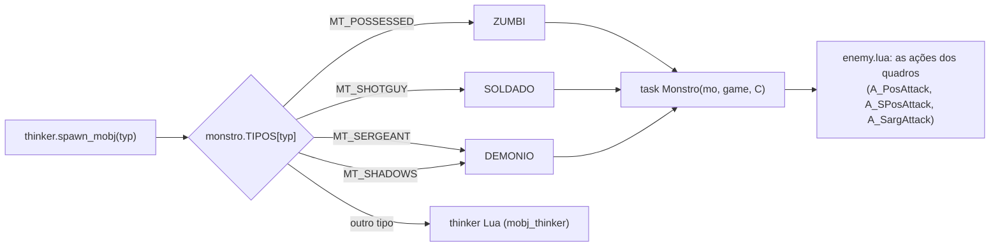
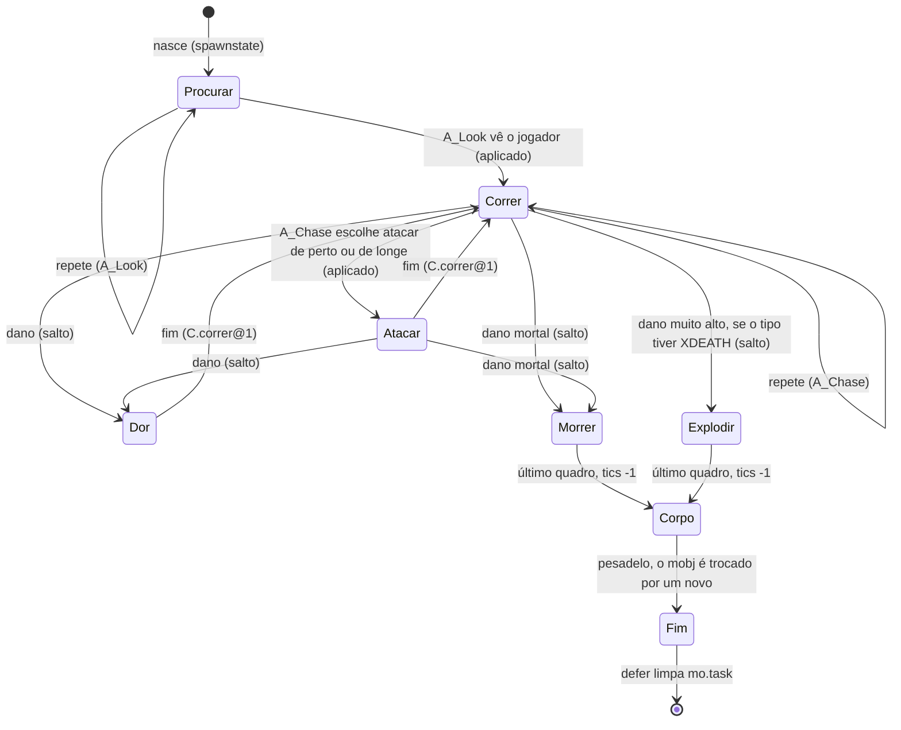

# Passo 9: a família de monstros (soldados e demônios)

Item A4 do `docs/PLANO_ATMOS.md` (seção 6, "Depois do passo 7"). Tag de
referência anterior: `passo8`. Referências de equivalência: a tag `passo1`
(com `tests/ref-passo1.patch`) e a branch `lua`.

## Resumo

A task `Zumbi` do passo 5 virou a task **`Monstro(mo, game, C)`**, que
recebe a tabela de comportamentos do tipo. Quatro tipos têm task agora:

| Tipo | `MT_*` | Sprite | Tabela |
|---|---|---|---|
| Zombieman | `MT_POSSESSED` | `POSS` | `ZUMBI` |
| Shotgun Guy | `MT_SHOTGUY` | `SPOS` | `SOLDADO` |
| Demon | `MT_SERGEANT` | `SARG` | `DEMONIO` |
| Spectre | `MT_SHADOWS` | `SARG` | `DEMONIO` (a mesma) |

A parte genérica da task (`indice`, `contar`, `entrar`, `sequencia`,
`estranho` e o despacho) **não mudou uma linha**: 83 linhas de código antes e
depois. Cada tipo novo custa uma tabela de 9 linhas e uma linha em `TIPOS`;
o Spectre, que reaproveita a tabela do Demon, custa uma linha. O jogo
continua idêntico às duas referências, num roteiro novo (`familia`, E1M5)
que passa pelos quatro tipos em todos os comportamentos alcançáveis no
Doom 1.

O reuso existe, mas é o **mesmo** reuso do Lua: o `mobj_thinker` já servia
a todos os tipos sem uma linha por tipo, porque o comportamento era dado
(`info.STATES`). A task genérica reproduz isso com nomes. O custo por
monstro não cai: cada monstro com task custa o mesmo que um zumbi no
passo 5.

## Por que uma task só para soldados e demônios

Pergunta do autor durante o passo: se soldados e demônios se comportam de
forma diferente, por que compartilham a task (e a pool `monstros`)?

**A pool é só um lugar.** Uma pool prende as tasks ao tempo de vida do
`Nivel`; não define comportamento. A pool `movers` já guarda tasks
diferentes (`Porta`, `Elevador`, `Piso`, `Teto`). A ordem em que os
monstros pensam também não vem da pool, e sim do laço `mobjs()` do
`Mundo`, que manda `:mobj.tic` a cada um na sua posição em `world.mobjs`.

**A task descreve a forma, e a forma é a mesma.** Na tabela, o que
diferencia os tipos não está na sequência dos quadros:

| Diferença | Onde está |
|---|---|
| atirar com pistola ou espingarda × morder | nas ações dos quadros (`A_PosAttack`, `A_SPosAttack`, `A_SargAttack`), funções de `enemy.lua` |
| atacar de longe × de perto | em `A_Chase` (`enemy.lua`), que escolhe `MI_MISSILESTATE` ou `MI_MELEESTATE` |
| velocidade, vida, chance de dor, tics | em `MOBJINFO` e nas linhas de `STATES` (dados) |
| despedaçar | só Zombieman e Shotgun Guy têm `XDEATH`; o Demon não |

A forma, lida nas linhas 174–206 (POSS), 207–240 (SPOS) e 475–501 (SARG)
de `info.lua`, é igual nos quatro tipos: procurar e correr se repetem;
atacar, dor e levantar voltam a correr; morrer e explodir terminam no
corpo. A task do passo 5 escreve justamente essa forma.

**Quando tasks separadas fariam sentido.** Se o comportamento fosse
escrito como código, e não descompilado da tabela. Um exemplo é um
`Demonio` com "corre até ficar perto; morde; volta a correr" num laço de
`await`s, com a decisão dentro da task. Isso tiraria a decisão de `A_Chase`
e mudaria a ordem do `P_Random`: é uma reescrita do tipo do 4b, que só cabe
na fase de correções.

## Situação antes (tag `passo8`)

- `monstro.atm`: a task `Zumbi(mo, game)` com sete vetores de estados
  escritos à mão (`PROCURAR`, `CORRER`, `ATACAR`, `DOR`, `MORRER`,
  `EXPLODIR`, `LEVANTAR`) e o estado de voltar a correr fixo
  (`info.S_POSS_RUN1`).
- `thinker.lua`, `spawn_mobj`: a task nasce só para `MT_POSSESSED`.
- Os outros monstros (Shotgun Guy, Demon, Spectre e os demais) seguem com o
  thinker Lua (`mobj_thinker`), na mesma lista e na mesma ordem.

## Solução

**Tabelas por tipo.** Cada comportamento ocupa uma faixa contínua de
`info.STATES`, na ordem de `info.c`. A função `faixa(a, b)` monta a
sequência; a tabela do tipo nomeia as faixas:

```
val SOLDADO = [
    procurar = faixa(info.S_SPOS_STND, info.S_SPOS_STND2),   ;; (A_Look) x2
    correr   = faixa(info.S_SPOS_RUN1, info.S_SPOS_RUN8),    ;; (A_Chase) x8
    atacar   = faixa(info.S_SPOS_ATK1, info.S_SPOS_ATK3),    ;; (A_FaceTarget), (A_SPosAttack), ()
    dor      = faixa(info.S_SPOS_PAIN, info.S_SPOS_PAIN2),   ;; (), (A_Pain)
    morrer   = faixa(info.S_SPOS_DIE1, info.S_SPOS_DIE5),    ;; DIE5 sem fim
    explodir = faixa(info.S_SPOS_XDIE1, info.S_SPOS_XDIE9),  ;; XDIE9 sem fim
    levantar = faixa(info.S_SPOS_RAISE1, info.S_SPOS_RAISE5),
]
```

O Demon tem `explodir = []` (sem `XDEATH`): o `indice` de um vetor vazio é
0, e o despacho nunca escolhe esse ramo. O tipo de cada mobj vem de
`TIPOS`, indexado pelo `MT_*`; o Spectre aponta para `DEMONIO`.

**A task.** Só duas coisas mudaram no `Zumbi`: os vetores viraram campos de
`C` (`C.procurar`, `C.correr`…) e o estado de voltar a correr virou
`C.correr@1` (o primeiro quadro de correr, que é o `MI_SEESTATE` dos quatro
tipos).

```
val task Monstro (mo, game, C) {
    ...
        val r = ifs {
            (indice(C.procurar, st) > 0) => sequencia(mo, game, C.procurar, vencido, true)
            (indice(C.correr, st) > 0)   => sequencia(mo, game, C.correr, vencido, true)
            ...
            (indice(C.explodir, st) > 0) => sequencia(mo, game, C.explodir, vencido, false)
            else => estranho(mo, game, vencido)  ;; outro tipo (load por indice)
        }
        set vencido = (r == :salto) && (mo.tics <= 0)
        val prox = ifs {
            (r == :fim) => entrar(mo, game, C.correr@1)  ;; atacar, dor e levantar voltam a correr
            else => r
        }
    ...
}
```

**O nascimento.** `thinker.spawn_mobj` não cita mais nenhum tipo: pergunta a
`monstro.TIPOS` e cria a task com a tabela, se houver.

```lua
if game and game.pools and game.pools.monstros then
  monstro = monstro or require("monstro")
  local tipo = monstro.TIPOS[typ]
  if tipo ~= nil then
    mo.task = spawn_in(game.pools.monstros, monstro.Monstro, mo, game, tipo)
  end
end
```

**Comparação lado a lado** (o que muda por tipo):

| Lua (thinker, tag `passo8`) | Atmos (task `Monstro`) |
|---|---|
| nada: `mobj_thinker` segue `STATES[istate].próximo` para qualquer tipo | uma tabela de 9 linhas por desenho de comportamento |
| o tipo só aparece nos dados (`MOBJINFO`, `STATES`) | e uma linha em `TIPOS` por tipo |
| o Spectre é um `MOBJINFO` com `MF_SHADOW` | o Spectre é uma linha (`TIPOS@(MT_SHADOWS) = DEMONIO`) |

## Diagramas

**Uma task, uma tabela por tipo:**



**Os comportamentos (os mesmos para os quatro tipos):**



## Validação

**Roteiro `familia`** (`-warp 1 5 -respawn`). Contagem por script dos
`THINGS` do `doom.wad` (dificuldade 3, sem os de multijogador): o E1M5 é o
primeiro mapa com os quatro tipos (28 Zombieman, 24 Shotgun Guy, 4 Demon e
9 Spectre). O roteiro: `iddqd` e `idkfa`; o jogador vai (`goto 432 784`) à
sala do Demon com um Shotgun Guy e zumbis; lança-foguetes (despedaça) e
depois escopeta; vai aos Spectres (`goto 144 1056`); save e load no meio da
briga (slot 5); espera os corpos voltarem (`-respawn`). Os pontos do `goto`
foram escolhidos por script, dentro do setor de cada monstro.

A cobertura foi conferida com prints numa cópia de `monstro.atm` (cada
entrada num comportamento, com o tipo). Numa execução (3.226 quadros):

| Comportamento | Zombieman | Shotgun Guy | Demon | Spectre |
|---|---|---|---|---|
| procurar | 61 | 51 | 10 | 19 |
| correr | 37 | 36 | 15 | 5 |
| atacar | 25 | 27 | 13 | 5 |
| dor | 9 | 8 | 8 | 3 |
| morrer | 5 | 5 | 1 | 1 |
| explodir | 2 | 1 | (não tem) | (não tem) |

Levantar não aparece: só o Arch-vile, do Doom 2, ressuscita monstros.

**O caso `estranho` domina depois do load.** A primeira versão do roteiro
fazia o save e o load no meio da primeira briga, e quase nada depois dele
caía num comportamento com nome. O load aplica os registros gravados **por
índice** aos mobjs recém-criados; no E1M5, com itens apanhados e armas
soltas pelos mortos, a ordem muda, e os monstros recebem estados de outros
tipos. O Shotgun Guy fica com os quadros de procurar do Demon (475, 476), o
Spectre com os do Shotgun Guy (207, 208), e assim por diante. Na execução
acima, o caso `estranho` não acontece nenhuma vez antes do load e acontece
3.485 vezes depois dele. O roteiro passou a brigar (morrer e explodir)
antes do save. É o mesmo defeito do port registrado no passo 5
(`docs/DIFERENCAS_DOOM.md`, seção 5), fora do escopo por decisão do autor
(o save no formato do Doom).

**Equivalência.** `make test-drivers`: idêntico à tag `passo1` nos 12
roteiros (o `familia`: 3.226 quadros, 2.313 estados distintos); saves
iguais byte a byte. `make test-branches`: idêntico à branch `lua` nos 12.
Os roteiros antigos que passam por soldados e demônios também deram
idêntico (por exemplo, `pisos`, com 11 Demon no E2M2, e `luzes`, com
Shotgun Guy e Spectre no E4M1). `make test`: 12
passam, as 8 falhas conhecidas.

**Mutações do passo 9** (roteiro `familia`):

| Mutação | Erro simulado | 1º quadro | Quadros dif. | Save |
|---|---|---|---|---|
| `tipo-volta-como-zumbi` | depois de atacar ou da dor, todo tipo volta a correr como Zombieman (a generalização esqueceu um estado) | 192 | 3.035 | difere |
| `demonio-nao-morde` | a sequência de ataque do Demon termina antes da mordida | 244 | 2.983 | difere |
| `demonio-dor-curta` | a dor do Demon tem um quadro só (sem `A_Pain`) | 190 | 3.037 | difere |
| `soldado-levanta-morto` | a morte do Shotgun Guy termina antes do corpo (ele volta a correr) | 254 | 2.973 | difere |
| `spectre-com-tabela-do-soldado` | o Spectre recebe a tabela do Shotgun Guy | – | 0 | equivalente |

A mutação `dor-volta-a-procurar`, do passo 5, foi reescrita para a task
genérica (`C.procurar@1` no lugar de `C.correr@1`) e continua detectada no
roteiro `monstro`. A `tipo-volta-como-zumbi` só aparece no `familia`: no
`monstro` (E1M2) só há Zombieman, e o estado fixo é o certo.

`make test-mutacoes` (todas as mutações do projeto): **86/89 não
equivalentes detectadas**, 7 equivalentes justificadas, 3 pendentes (as
mesmas de antes).

## Um achado: o caso `estranho` cala erros de tabela

A mutação `spectre-com-tabela-do-soldado` dá ao Spectre a tabela do Shotgun
Guy, e **sobrevive**. Nenhum estado do Spectre está na tabela errada, então
toda volta do despacho cai no caso `estranho`, que segue o ponteiro
"próximo" de `info.STATES`, exatamente como o thinker Lua. O Spectre anda
pela tabela quadro a quadro, sem comportamentos com nome, e faz o mesmo.

O caso `estranho` foi criado no passo 5 para o load por índice, e é ele que
garante a equivalência nesse defeito. O efeito colateral: um erro de
cobertura na tabela de um tipo (um estado que falta, uma tabela trocada)
não muda o jogo, e o teste de equivalência não o vê. Só erros que **mudam
uma transição** aparecem: uma faixa que termina antes do fim
(`demonio-nao-morde`, `soldado-levanta-morto`) ou o estado de voltar a
correr (`tipo-volta-como-zumbi`). Para a monografia, é um exemplo do limite
do oráculo de equivalência: ele prova que o jogo é o mesmo, não que a task
"entendeu" o comportamento. A cobertura dos comportamentos com nome só foi
conferida com prints.

## Métricas

`python3 tools/metricas_passo9.py` (novo):

| Métrica | Antes (`passo8`) | Depois |
|---|---|---|
| Linhas de código de `monstro.atm` (total) | 100 | 127 |
| Parte genérica (`indice` até a task) | 83 | 83 |
| `faixa` (monta as sequências) | – | 10 |
| Tabelas `ZUMBI`, `SOLDADO`, `DEMONIO` | (vetores do Zumbi) | 9 cada |
| `TIPOS` (tipo → tabela) | – | 5 |
| Tipos com task | 1 | 4 |
| Linhas para acrescentar um tipo (Atmos) | – | 10 (o mesmo desenho: 1) |
| Linhas para acrescentar um tipo (Lua) | 0 | 0 |
| Tipos citados em `spawn_mobj` | 1 | 0 |
| Linhas de `info.STATES` usadas pelas tasks | 33 | 94 (33 + 34 + 27) |
| Monstros com task no E1M5 | 28 | 65 |

Três tipos novos custaram 27 linhas no `monstro.atm`, e a parte genérica
não mudou. É o reuso que o passo 5 previa ("migrar uma família mostraria o
reuso"), e ele vem de a task descrever a forma, comum a todos os tipos, e
deixar as diferenças para as ações e os dados.

Mas o Lua tinha o mesmo reuso, e de graça: o `mobj_thinker` não tem uma
linha por tipo. Na comparação, a família não muda o saldo do passo 5. O
Atmos ganha nome e forma (sete comportamentos com nome, cinco transições
escritas) e paga a infraestrutura dos saltos, uma vez só; a família dilui
esse custo fixo por quatro tipos (o `monstro.atm` passa de 100 linhas para
um tipo a 127 para quatro), mas não o elimina.

## Custo

`CUSTO_TAGS=passo8 python3 tools/custo_drivers.py 5 build/drivers/replay_1familia.txt -warp 1 5 -respawn`
(ms por quadro, mínimo de 5 execuções):

| Driver | `familia` | vs. `passo1` Lua |
|---|---|---|
| `passo1` `main.lua` | 1,790 | – |
| `passo1` `main.atm` | 1,855 | +3,6% |
| `passo8` `main.atm` | 2,654 | +48,2% |
| atual (passo 9) | 3,280 | +83,2% |

O passo 9 custa **+23,6%** sobre a `passo8` no `familia`. São 37 monstros
novos com task no E1M5 (24 Shotgun Guy, 4 Demon, 9 Spectre); a diferença de
0,626 ms por quadro (no replay, cerca de um tic por quadro) dá cerca de
17 µs por monstro por tic. É o mesmo custo por zumbi medido no passo 5
(cerca de 16 µs): o reuso economiza código, não tempo. Cada monstro com task
paga o `emit` direcionado, o despertar e o corpo da task, inclusive os
corpos parados (no `-respawn`, o corpo espera o pesadelo).

É a maior diferença de custo do projeto contra o `passo1` em Lua num
roteiro: +83%. Ela cresce com o número de monstros com task, como o passo 5
previa. Ainda assim, 3,3 ms por tic cabem com folga nos 28,6 ms de um tic a
35 Hz.

## Diferenças conhecidas

Nenhuma no comportamento. O load por índice (`docs/DIFERENCAS_DOOM.md`,
seção 5) agora atinge os quatro tipos com task, e o caso `estranho` cobre
todos; continua fora do escopo.

## Como reproduzir

```sh
make test-drivers
make test-branches
make test-mutacoes
python3 tools/metricas_passo9.py
sh tests/test_drivers.sh 0 1 familia -warp 1 5 -respawn >/dev/null
CUSTO_TAGS=passo8 python3 tools/custo_drivers.py 5 build/drivers/replay_1familia.txt -warp 1 5 -respawn
python3 tools/diagramas.py docs/registro/11-familia-de-monstros.md
```

## Arquivos alterados

| Arquivo | Mudança |
|---|---|
| `monstro.atm` | task `Zumbi` → `Monstro(mo, game, C)`; `faixa`; tabelas `ZUMBI`, `SOLDADO`, `DEMONIO`; `TIPOS` |
| `thinker.lua` | `spawn_mobj` cria a task para os tipos de `monstro.TIPOS` |
| `tools/make_replay.lua` | roteiro `familia` |
| `tests/test_drivers.sh` | cobertura do roteiro `familia` |
| `Makefile` | roteiro `familia` em `test-drivers`, `test-branches` e `test-mutacoes` |
| `tools/mutacoes.py` | roteiro `familia`; mutações do passo 9; `dor-volta-a-procurar` com `C.procurar@1`; uma equivalente nova |
| `tools/metricas_passo9.py` | novo |
| `tools/metricas_passo5.py` | lê a tag `passo5` por padrão (o `Zumbi` virou `Monstro`) |
