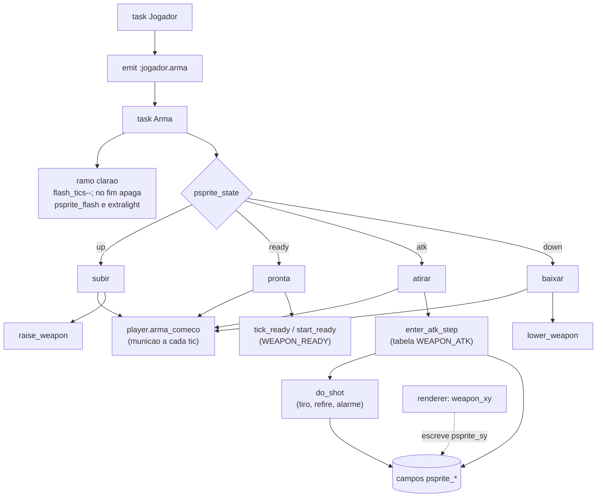
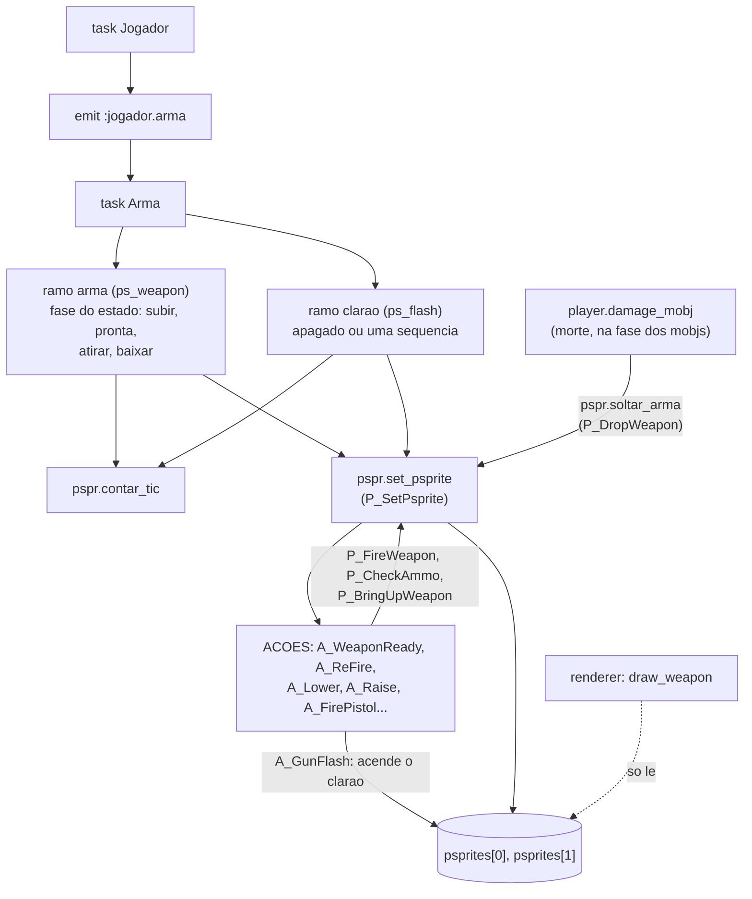
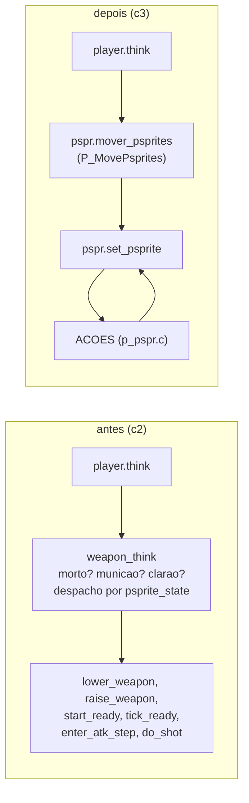
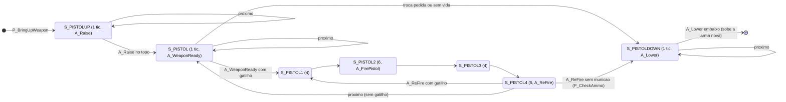
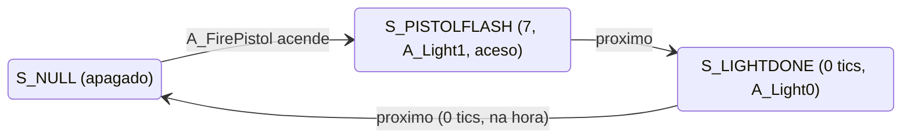
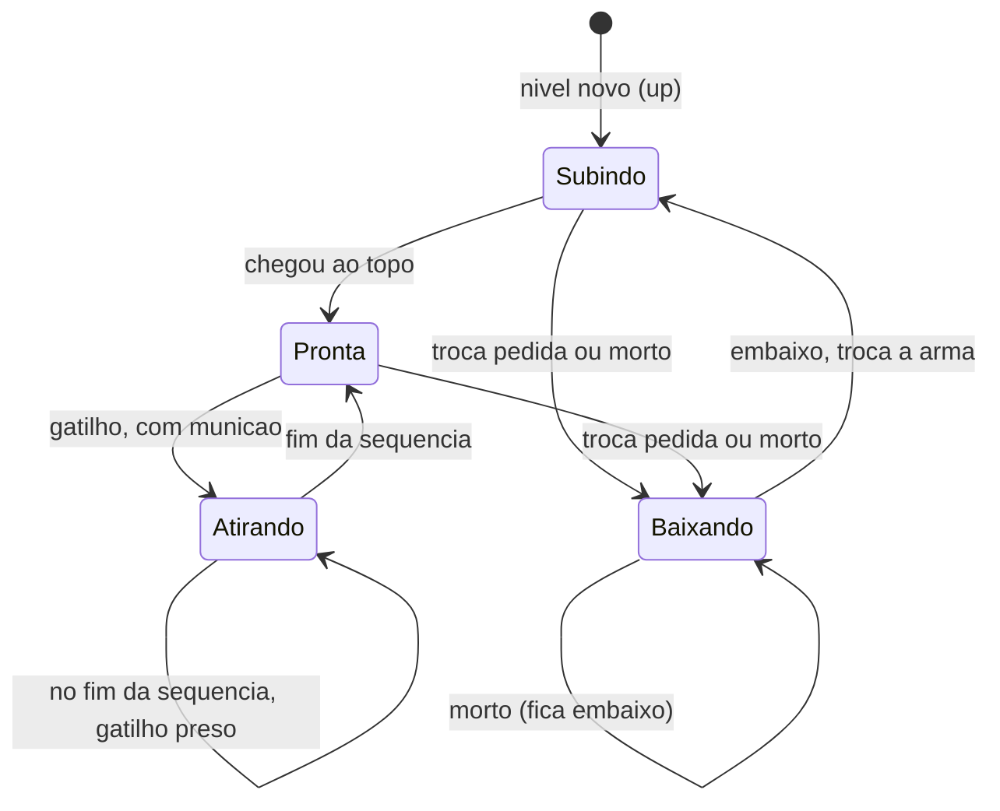
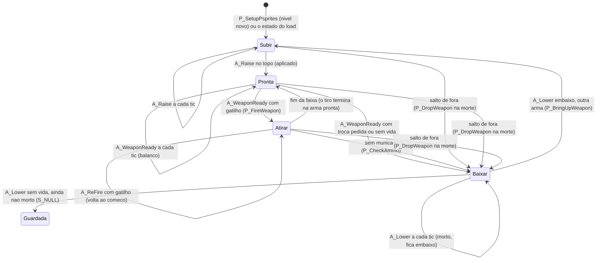
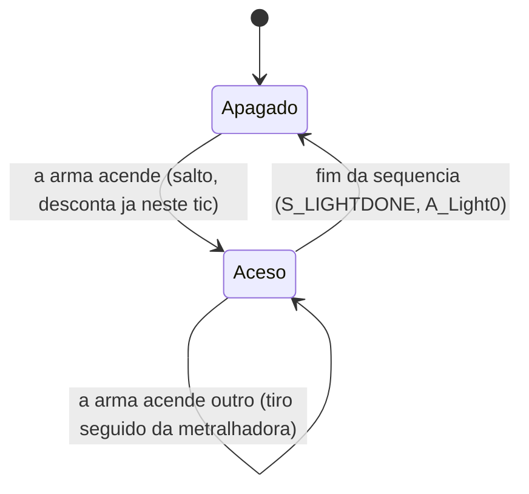

# C3: a arma como no Doom (estados de `info.STATES` e o `p_pspr.c`)

Terceiro item da fase de correções (`docs/PLANO_ATMOS.md`, seção 6, "C"); é
o antigo subpasso 4b, adiado no passo 4 porque muda o jogo. Feito nas duas
branches, com a referência nova **`c3`** (a branch `lua` com o C3).

- Linhas citadas como "antes": `atmos` no commit `895d635` (C2), branch
  `lua` na tag `c2`.
- Referência anterior: `c2`. Referência nova: `c3`.

| Parte | Commit | Situação |
|---|---|---|
| C3 na branch `lua` | `4ce5ebb` (tag `c3`) | concluído |
| C3 na branch `atmos` | (este commit) | concluído |

## Resumo

Até o C2, a arma deste port era uma imitação: tabelas próprias em
`player.lua` (`WEAPON_PATCH`, `WEAPON_FIRE_BODY`, `WEAPON_ATK`,
`WEAPON_READY`), quatro fases por nome (`psprite_state` = `"up"`,
`"ready"`, `"atk"`, `"down"`) e o clarão do tiro como um contador
(`flash_tics`). O C3 troca isso pelo mecanismo do Doom:

- o jogador tem **dois psprites**, a arma (`psprites[0]`, `ps_weapon`) e o
  clarão (`psprites[1]`, `ps_flash`), cada um num estado de `info.STATES`
  (sprite, quadro, tics, ação, próximo), com os tics que faltam e a posição
  na tela (`sx`, `sy`);
- entrar num estado chama a ação dele (`P_SetPsprite`), e as ações são as
  do `p_pspr.c`, traduzidas para `pspr.lua` (arquivo novo, igual nas duas
  branches): `A_WeaponReady`, `A_ReFire`, `A_Lower`, `A_Raise`, `A_GunFlash`,
  `A_Light0/1/2`, os tiros (`A_FirePistol`, `A_FireShotgun`, `A_FireCGun`,
  `A_FireMissile`, `A_FirePlasma`, `A_BFGsound`, `A_FireBFG`, `A_Punch`,
  `A_Saw`, e as do cano duplo do Doom 2), `P_CheckAmmo`, `P_FireWeapon`,
  `P_BringUpWeapon`, `P_DropWeapon`, `P_SetupPsprites`, `P_MovePsprites`;
- o desenho só lê os psprites (`R_DrawPlayerSprites`). Antes, o desenho
  calculava o balanço da arma e **escrevia** `psprite_sy` no jogador
  (`sprites.lua:201` na `c2`): o renderer mexia no estado do jogo.

Na branch `atmos`, a task `Arma` (`arma.atm`) foi reescrita no desenho da
task `Monstro` (passos 5 e 9): uma tabela por arma com as fases do Doom
"descompiladas" (subir, pronta, atirar, baixar, clarão) e os dois psprites
como dois ramos do `par`. Na branch `lua`, `weapon_think` virou uma chamada a
`pspr.mover_psprites` (o `P_MovePsprites`, 13 linhas).

Junto, o que o `p_pspr.c` e o `P_PlayerThink` fazem em volta da arma: a
arma desce na morte (`P_DropWeapon`, chamado de `player.damage_mobj`); a
tecla 1 resolve a motosserra como no `P_PlayerThink`; a motosserra que
acerta puxa o jogador para a frente no tic seguinte (`MF_JUSTATTACKED`); o
soco e a motosserra viram o jogador para o alvo; a posição horizontal da
arma passa de um nível ao outro (o `player_t` do Doom sobrevive ao nível).

## Situação antes

### Os campos (tag `c2`)

| Campo | Papel | Quem lia |
|---|---|---|
| `psprite_state` | a fase: `"up"`, `"ready"`, `"atk"`, `"down"` | task `Arma`, renderer (`weapon_xy`, `weapon_body`), save, hash |
| `psprite_step` | o passo dentro de `WEAPON_ATK` ou `WEAPON_READY` | task, save, hash |
| `psprite_tics` | os tics do passo | task, save, hash |
| `psprite_body` | o patch da arma (`"PISGA0"`) | renderer, save, hash |
| `psprite_flash` | o patch do clarão | renderer, save, hash |
| `flash_tics` | o contador do clarão | ramo `clarao` da task, renderer, save, hash |
| `psprite_sy` | a altura da arma | task, **renderer (escrevia)**, save, hash |

### O fluxo na branch `atmos` (`895d635`)

- `arma.atm:121`: a task `Arma` tinha dois ramos: `clarao` (`arma.atm:107`,
  conta `flash_tics` e apaga o clarão e o `extralight`) e a fase
  (`subir`, `baixar`, `atirar`, `pronta`, `arma.atm:27` a `76`), escolhida
  por `psprite_state`.
- Cada tic começava em `player.arma_comeco` (`player.lua:769`): morto, só
  baixa a arma; vivo, confere a munição **a cada tic** (e já pede a troca
  em `pendingweapon`) e devolve `firing`, `ammo_type`, `can_fire`.
- O tiro andava pela tabela `WEAPON_ATK` (`player.lua:150`) em
  `enter_atk_step` (`player.lua:685`); cada linha dizia o patch, os tics, se
  atira, o clarão e o `extralight`. O disparo (`do_shot`, `player.lua:553`)
  fazia o tiro de cada arma, somava `refire`, ligava `attackdown` e chamava o
  alarme de barulho a cada tiro.
- O tiro contínuo só era decidido **no fim da sequência**: `if
  player.psprite_step >= #seq` (`player.lua:688`), depois dos tics do
  último passo.

### O fluxo na branch `lua` (tag `c2`)

`player.think` chamava `weapon_think` (`player.lua:761`), que fazia o mesmo
que a task, com `return` no meio: morto, `lower_weapon`; sem munição, a
troca; o clarão; e o despacho por `psprite_state`.

## Solução

### `pspr.lua`: o `p_pspr.c`

```lua
-- P_SetPsprite: entra no estado stnum; segue pelos estados de 0 tics,
-- chamando a acao de cada um. Uma acao pode trocar o estado (de novo
-- P_SetPsprite) ou apagar o psprite (S_NULL).
function M.set_psprite(player, position, stnum, game)
  local psp = player.psprites[position]
  repeat
    if stnum == 0 then
      psp.state = 0                      -- o psprite se apagou
      break
    end
    local s = estado(stnum)
    psp.state = stnum
    psp.tics = s[2]                      -- pode ser 0
    local acao = ACOES[info.ACTIONS[s[3]]]
    if acao then
      acao(player, psp, game)
      if psp.state == 0 then
        break
      end
    end
    stnum = estado(psp.state)[4]
  until psp.tics ~= 0
end
```

As ações ficam numa tabela pelo nome que `info.ACTIONS` dá a cada número
(`"WeaponReady"`, `"FirePistol"`...). A tabela `WEAPONINFO` é o
`weaponinfo[]` do `d_items.c`: a munição e os estados de subir, baixar,
pronta, atirar e clarão de cada arma.

### Branch `lua`: o `P_MovePsprites`

```lua
-- P_MovePsprites: um tic dos dois psprites, a arma e depois o clarao.
function M.mover_psprites(player, game)
  for position = PS_WEAPON, PS_FLASH do
    local psp = player.psprites[position]
    if psp.state ~= 0 and psp.tics ~= -1 then
      psp.tics = psp.tics - 1
      if psp.tics == 0 then
        M.set_psprite(player, position, M.proximo(player, position), game)
      end
    end
  end
  player.psprites[PS_FLASH].sx = player.psprites[PS_WEAPON].sx
  player.psprites[PS_FLASH].sy = player.psprites[PS_WEAPON].sy
end
```

`player.think` chama `pspr.mover_psprites(player, game)` onde chamava
`weapon_think` (e o mesmo no `death_think`).

### Branch `atmos`: a task `Arma` com as fases do Doom

A tabela de cada arma diz as faixas de `info.STATES` de cada fase, com as
ações nos comentários, como os tipos da task `Monstro`:

```
val PISTOLA = [
    subir  = [info.S_PISTOLUP],
    baixar = [info.S_PISTOLDOWN],
    pronta = [info.S_PISTOL],
    atirar = faixa(info.S_PISTOL1, info.S_PISTOL4),    ;; (), (A_FirePistol), (), (A_ReFire)
    clarao = [[info.S_PISTOLFLASH]],                   ;; (A_Light1)
]
val METRALHADORA = [
    ...
    atirar = faixa(info.S_CHAIN1, info.S_CHAIN3),      ;; (A_FireCGun) x2, (A_ReFire) com 0 tics
    clarao = [[info.S_CHAINFLASH1], [info.S_CHAINFLASH2]],   ;; (A_Light1), (A_Light2)
]
```

O clarão é uma **lista** de sequências: a metralhadora e o plasma têm dois
claroes alternativos (o da metralhadora acompanha o quadro do tiro; o do
plasma sai de `P_Random`), e cada um vai direto a `S_LIGHTDONE`. Não dá para
andar por índice de `S_CHAINFLASH1` a `S_CHAINFLASH2`, porque o próximo de
`S_CHAINFLASH1` é `S_LIGHTDONE`.

A task tem dois ramos, na ordem do `P_MovePsprites` (P6):

```
val task Arma (p, game) {
    set pub = p
    par {
        arma(p, game)                                  ;; ps_weapon
    } with {
        clarao(p, game)                                ;; ps_flash, depois da arma
    }
}
```

O ramo da arma escreve no código o que vem depois de que:

```
val func arma (p, game) {
    val pos = P.PS_WEAPON
    var venc = false
    loop {
        val W = ARMAS@(p.readyweapon)
        val st = (p.psprites@pos).state
        val r = ifs {
            (st == 0) => contar(p, pos)                ;; guardada (morte sem corpo)
            (indice(W.subir, st) > 0)  => sequencia(p, pos, game, W.subir, venc, true)
            (indice(W.pronta, st) > 0) => sequencia(p, pos, game, W.pronta, venc, true)
            (indice(W.baixar, st) > 0) => sequencia(p, pos, game, W.baixar, venc, true)
            (indice(W.atirar, st) > 0) => sequencia(p, pos, game, W.atirar, venc, false)
            else => error("arma: estado ... fora da tabela da arma ...")
        }
        set venc = vencido(p, pos, r)
        if r == :fim {
            entrar(p, pos, game, W.pronta@1)           ;; o tiro termina na arma pronta
        }
    }
}
```

`contar`, `entrar` e `sequencia` são os da task `Monstro`, para psprites:
`contar` espera um `:jogador.arma` por vez e desconta os tics
(`pspr.contar_tic`), devolvendo `:fim` ou `:salto` (o estado foi trocado de
fora; o tic já descontou o estado novo); `entrar` chama `pspr.set_psprite` e
diz se a ação levou a outro estado (`:aplicado`); `sequencia` anda pela
faixa, repetindo ou não. O ramo do clarão é igual, com `S_LIGHTDONE` no fim.

**Um estado fora da tabela é erro.** A task `Monstro` tem o caso
`estranho`, que segue a tabela quando um monstro recebe o estado de outro
tipo (o load por índice). O passo 9 mostrou que esse caso calava um erro de
tabela (a mutação `spectre-com-tabela-do-soldado` ficou equivalente). A
arma não passa pelo load por índice (o save grava os dois psprites), então
aqui um estado desconhecido para o jogo com `error`, em vez de seguir em
silêncio.

**Saltos de fora.** Três fontes trocam o estado de um psprite sem a task
pedir:

1. as ações do próprio psprite (o `A_WeaponReady` começa o tiro ou a
   descida; o `A_Raise` chega a pronta; o `A_ReFire` volta ao começo do
   tiro; o `A_Lower` sobe outra arma): a task percebe em `entrar`;
2. as ações da arma que acendem o clarão (`A_GunFlash`, `A_FirePistol`...):
   o ramo do clarão, que acorda depois no mesmo tic, percebe em `contar` e
   desconta o primeiro tic do clarão novo ali mesmo, como no Doom;
3. a morte, no meio do tic (`P_DropWeapon`, de `player.damage_mobj`, quando
   um monstro mata o jogador na fase dos mobjs): no tic seguinte, `contar`
   desconta o estado novo, devolve `:salto`, e se os tics acabaram
   (`vencido`), a fase nova avança na hora.

## Diagramas

**Fluxo antes, branch `atmos` (`895d635`):**



**Fluxo depois, branch `atmos`:**



**Fluxo antes e depois, branch `lua`:**



**A tabela do Doom para a pistola** (o que `info.STATES` diz; é a máquina
de estados que as duas branches seguem):





**Fases da task `Arma`, antes (passo 4a, `895d635`):**



**Fases da task `Arma`, depois (C3), ramo da arma:**



**Ramo do clarão:**



A diferença entre as duas máquinas da task está nas setas: antes, as
transições eram decididas por `if` na task (o gatilho, a troca, o fim da
sequência) e o tiro contínuo era um laço no fim da sequência; agora as
setas são ações da tabela do Doom (`A_WeaponReady`, `A_ReFire`, `A_Lower`,
`A_Raise`), e a task só reconhece em que fase o estado caiu. As únicas
transições escritas na task são as do fim de uma faixa: o tiro termina na
arma pronta, o clarão termina apagado, e subir, pronta e baixar repetem.

## O que muda no jogo

| Comportamento | Antes (`c2`) | Depois (`c3`), como no Doom |
|---|---|---|
| Tiro contínuo | decidido depois do último quadro do tiro | `A_ReFire` é a ação do último estado e roda ao entrar nele: pistola 19 → 14 tics por tiro, escopeta 44 → 37, BFG 60 → 40, punho 22 → 17 (metralhadora, lança-foguetes, plasma e motosserra não mudam: o último estado tem 0 tics, ou o port já tratava à parte) |
| Falta de munição | conferida a cada tic, no começo da arma | conferida ao atirar (`P_FireWeapon`) e no `A_ReFire`/`A_CheckReload`; a escolha segue a ordem do `P_CheckAmmo` (plasma, cano duplo, metralhadora, escopeta, pistola, motosserra, lança-foguetes, BFG, punho; antes: pistola, escopeta, metralhadora, lança-foguetes, plasma, BFG, punho) |
| Balanço da arma | calculado no **desenho**, com o `leveltime` do quadro, e escrito em `psprite_sy` | calculado no `A_WeaponReady`, no tic; o desenho só lê |
| Posição horizontal | `sx = 1.0` fixo subindo, descendo e atirando | o `sx` fica onde o último `A_WeaponReady` o deixou (o jogador novo começa em 0); passa de um nível ao outro |
| Clarão | contador; um `extralight` fixo por linha da tabela | um psprite com estados: `A_Light1` e `A_Light2` em quadros diferentes (o clarão do lança-foguetes acende 1, depois 2); desconta o primeiro tic no tic em que acende; o do plasma sorteia entre dois com `P_Random` |
| Alarme de barulho | a cada tiro | ao começar o tiro (`P_FireWeapon`), inclusive no `A_ReFire` |
| Som do BFG | ao lançar a bola | no começo do tiro (`A_BFGsound`, 20 tics antes) |
| Morte | a arma descia porque cada tic começava baixando | `P_DropWeapon` na morte; o `A_Lower` deixa a arma embaixo; o desenho mostra os psprites acesos (antes, escondia a arma com o jogador morto) |
| Tecla 1 | com a motosserra na mão, voltava ao punho | só com o berserk (`P_PlayerThink`) |
| Motosserra | não virava nem puxava | vira para o alvo (até 1/20 de 90° por tic) e puxa o jogador para a frente no tic seguinte (`MF_JUSTATTACKED`) |
| Soco | não virava | vira o jogador para o alvo |

## O hash de estado e o save

- **Hash** (`G.state_string` e o `state_string` da branch `lua`): o
  estado e a altura da arma (antes, `psprite_state` e `psprite_sy`) e, com
  `DOOM_REPLAY_SIDES=1`, os tics e o `sx` da arma, os quatro campos do
  clarão, `pendingweapon`, `attackdown`, `refire`, `extralight` e as flags
  do mobj do jogador (o `MF_JUSTATTACKED`). O formato mudou: contra a `c2`,
  todos os hashes de estado diferem, e a comparação com a referência
  anterior usa só o hash do framebuffer (abaixo).
- **Save**: os oito campos dos psprites (`psp0_state`, `psp0_tics`,
  `psp0_sx`, `psp0_sy`, e os do clarão), como o `P_ArchivePlayers`. Um save
  de antes do C3 não tem esses campos; o load deixa a arma como o nível a
  montou (subindo). A cobertura do roteiro `arma` agora procura o estado do
  tiro do BFG no slot 5 (`"psp0_state":84` a `87`).

## Roteiros

O roteiro `arma` continua valendo (cada arma atirando com o gatilho preso,
trocas no meio do tiro e da subida, a trava do lança-foguetes, save no tiro
do BFG, a morte atirando). O roteiro `correcoes` ganhou o C3, no E1M3,
depois do C2:

1. `iddqd`, `idkfa`; a tecla 1 (a motosserra) e a tecla 1 de novo (fica a
   motosserra, sem o berserk);
2. o `goto` ao lado de um zumbi e o gatilho preso: a motosserra o serra,
   vira o jogador e o puxa para a frente;
3. `idbeholds` (berserk) e a tecla 1: o punho; o `goto` ao lado de um barril
   e o soco (vira para o barril, que explode). O alvo é um barril porque os
   monstros já acordaram com a motosserra e saíram do lugar;
4. o BFG com o gatilho preso até faltar célula: 7 tiros, e a troca vai para
   o plasma (no código antigo, iria para a pistola).

Conferido com prints numa cópia de `G.state_string`: a segunda tecla 1
mantém a arma 7 (motosserra); serrando, o ângulo vai de 1.073.741.824 a
1.168.866.424 e o `y` de −2930 a −2898; com o berserk, a arma 0; o soco
muda o ângulo para 1.272.849.076; o BFG passa de 300 a 20 células em 7
tiros, baixa (estado 82) e sobe o plasma (estado 76).

## Validação

**Contra a referência nova** (`make test-drivers`, tag `c3`): idêntico nos
14 roteiros, com os saves iguais byte a byte, e a cobertura de todos.
`make test-branches`: idêntico à branch `lua` nos 14 (antes de criar a tag,
com a branch `lua` ainda sem commit). `make test`: 12 passam, as 8 falhas
conhecidas (`test_player.lua` continua falhando: ele já testava
`psprite_state`, entre outras coisas que não existiam). A janela abre e
fecha limpo nas duas branches. Os quadros do roteiro `arma` conferidos em
imagem (`DOOM_REPLAY_DUMP`): a pistola subindo, atirando com o clarão
`PISFA0` aceso, a escopeta depois do `idkfa`.

**Contra a referência anterior** (`REF_TAG=c2`). O hash de estado mudou de
formato (os psprites no lugar dos campos antigos), então todos os quadros
diferem nele; a tabela compara só o hash do **framebuffer**:

| Roteiro | Quadros | Diferentes | Faixas | 1º quadro |
|---|---|---|---|---|
| `botoes` | 861 | 16 | 2 | 8 |
| `luzes` | 2.619 | 16 | 2 | 8 |
| `elevadores` | 2.098 | 15 | 2 | 8 |
| `portas` | 2.958 | 25 | 3 | 8 |
| `ordem` | 815 | 40 | 17 | 8 |
| `pisos` | 2.618 | 78 | 6 | 8 |
| `telas` | 4.732 | 454 | 31 | 8 |
| `exits` (6000, semente 2) | 6.000 | 576 | 60 | 88 |
| `fluxo` | 4.478 | 849 | 116 | 57 |
| `correcoes` | 2.134 | 1.179 | 10 | 8 |
| `familia` | 3.226 | 2.359 | 61 | 8 |
| `monstro` | 2.755 | 2.549 | 22 | 8 |
| `arma` | 2.994 | 2.678 | 15 | 8 |
| pseudoaleatório (4000, semente 1) | 4.000 | 3.038 | 85 | 88 |

Todos começam a divergir quando a arma sobe pela primeira vez: o jogador
novo do Doom tem `sx = 0` (o `G_PlayerReborn` zera o `player_t`), e a arma
sobe 1 pixel à esquerda da posição antiga (`sx = 1.0` fixo). Nos roteiros
sem tiro e sem andar (`botoes`, `luzes`, `elevadores`), a divergência é só
essa subida (cerca de 16 quadros, os 96 pixels a 6 por tic) e a do nível
seguinte. Onde o jogador anda, o balanço passou a ser calculado no tic; onde
atira, a cadência e o clarão mudaram (o roteiro `arma` diverge em 89% dos
quadros).

## Mutações

`make test-mutacoes` rodou num worktree fixo no commit do C3
(`build/mut-c3`), para que o trabalho do C4 na árvore principal não
interferisse.

**As mutações da task `Arma` do 4a saíram** com o código que testavam:
`clarao-depois-da-fase`, `clarao-conta-morto` (no Doom o clarão também
conta com o jogador morto: deixou de ser erro), `troca-ignorada-na-subida`
(no Doom o `A_Raise` não olha a troca pedida: o comportamento "mutado"
virou o do Doom), `tiro-sem-gatilho-preso` (equivalente),
`pronta-nao-zera-refire`, `foguete-sem-soltar` e `load-perde-fase-da-arma`.
As do 4c (`arma-no-meio-do-jogador`, equivalente, e
`morto-perde-o-tic-da-morte`) foram refeitas com o texto novo do
`jogador.atm`.

**As do C3:**

| Mutação | Erro simulado | Roteiro | 1º quadro | Quadros dif. |
|---|---|---|---|---|
| `clarao-antes-da-arma` | o ramo do clarão antes do da arma (o clarão aceso no tic não desconta) | `arma` | 1 | 1.102 |
| `tiro-volta-ao-comeco` | o fim do tiro volta ao começo do tiro | `arma` | 1.047 | 1.817 (save difere) |
| `salto-vencido-espera` | o salto de fora sem tics (a arma solta na morte) espera um tic | `arma` | 2.738 | 72 |
| `clarao-nao-apaga` | o fim do clarão volta ao começo do clarão | `arma` | 50 | 2.656 (save difere) |
| `subida-nao-repete` | a subida termina no primeiro quadro (vai direto à pronta) | `arma` | 1 | 2.081 (save difere) |
| `pronta-nao-repete` | a pronta termina no primeiro quadro | `arma` | – | 0: **equivalente** |
| `foguete-sem-soltar` | lança-foguetes e BFG atiram de novo sem soltar o gatilho | `arma` | 1.781 | 1.029 (save difere) |
| `refire-nao-zera` | soltar o gatilho não zera `refire` | `arma` | 1.043 | 1.826 (save difere) |
| `subida-mais-lenta` | a arma sobe 5 por tic | `arma` | 1 | 626 |
| `sem-balanco` | a arma pronta não balança | semente 1 | 179 | 2.917 |
| `clarao-sem-primeiro-tic` | o clarão não desconta no tic em que acende | `arma` | 45 | 2.950 (save difere) |
| `load-perde-a-arma` | o load não restaura os psprites | `arma` | 2.371 | 624 |
| `punho-sem-virar` | o soco não vira para o alvo | `correcoes` | 1.606 | 529 |
| `motosserra-sem-arrancada` | a motosserra não puxa o jogador | `correcoes` | 1.444 | 691 |
| `tecla-1-como-antes` | a tecla 1 com a motosserra volta ao punho | `correcoes` | 1.394 | 741 |
| `sem-municao-ordem-antiga` | sem munição, o plasma não é a primeira escolha | `correcoes` | 2.003 | 132 |
| `carry-sem-sx` | o nível seguinte começa com `sx` 0 | `fluxo` | 508 | 170 |

`pronta-nao-repete` é equivalente, e a razão diz algo sobre a task: o fim
de qualquer faixa volta ao primeiro quadro da arma pronta, e o próximo da
pronta é ela mesma; para a pronta, "repetir" e "terminar" levam ao mesmo
estado. A mesma mutação na subida (`subida-nao-repete`) é detectada.

**Uma mutação antiga perdeu o cenário.** `salto-sem-vencido` (passo 5, task
`Monstro`: um salto de fora com os tics já no fim espera um tic a mais),
detectada no roteiro `monstro` até a `c2` (quadro 955), sobreviveu: com a
cadência e o clarão novos da arma, a briga do roteiro mudou e o caso não
acontece mais num quadro desenhado. No roteiro `familia` (os quatro tipos
com a task `Monstro`, passo 9) ela é detectada (quadro 2.046, 1.181
quadros), e passou a usá-lo. É o segundo caso, depois do `botoes` no C2, em
que uma correção de comportamento tira a sensibilidade de um roteiro
antigo.

Resultado, com os ajustes: **107/107 não equivalentes detectadas**, 7
equivalentes, nenhuma pendente (na rodada antes dos ajustes: 105/107, 6
equivalentes).

## Métricas

Linhas de código (sem comentários e linhas em branco), contadas por script
sobre `895d635` (antes, `atmos`), `c2` (antes, `lua`) e os arquivos atuais:

| | Antes | Depois |
|---|---|---|
| `atmos`: task `Arma` (`arma.atm`) | 105 | 186 (73 das tabelas das armas, 10 da `faixa`, 101 da lógica) |
| `atmos`: a arma em `player.lua` (tabelas, fases, tiro, `weapon_body`) | 88 + 254 + 9 | 0 |
| `lua`: a arma em `player.lua` (tabelas, `weapon_think` e partes) | 88 + 297 | 0 |
| `pspr.lua` (as duas branches) | – | 424 (`mover_psprites`, 13, só a `lua` usa; `contar_tic` e `proximo`, 15, só a `atmos`) |

Campos de fase: antes, 7 campos soltos no jogador (`psprite_state`,
`psprite_step`, `psprite_tics`, `psprite_body`, `psprite_flash`,
`flash_tics`, `psprite_sy`); depois, 2 registros de 4 campos (`state`,
`tics`, `sx`, `sy`), o `pspdef_t` do Doom.

**Leitura.** Com a tabela do Doom, o comportamento da arma está nos dados
(os estados e as ações), e as duas branches os seguem do mesmo jeito: a
`lua` em 13 linhas (`P_MovePsprites`), a `atmos` numa task de 101 linhas de
lógica mais 73 de tabelas. A task ganha o que a task `Monstro` já tinha
ganho: as fases com nome, os dois psprites como dois ramos paralelos (a
ordem arma → clarão é a ordem do código, P6) e as transições de fim de
faixa escritas. Perde em tamanho, e mais que no 4a, porque o que era uma
fase com `if` (por exemplo, "pronta: troca, gatilho ou balanço") virou uma
ação na tabela, e a task só pode reconhecer a fase pelo estado. É o mesmo
resultado do passo 5: quando o próprio jogo descreve o comportamento como
uma tabela com saltos feitos pelas ações, a task não tem como escrever
esses saltos sem duplicar a tabela, e fica com a forma (o que vem depois de
que) e com os nomes. Para a monografia, o C3 mostra o caso inverso do C2:
lá a concorrência estruturada já tinha a estrutura certa (o `Mundo`) e a
correção foi um `toggle`; aqui a estrutura certa é a do Doom (a tabela), e
a task se adapta a ela.

## Diferenças que ficam

- **Os estados do mobj do jogador.** O `p_pspr.c` põe o mobj do jogador em
  `S_PLAY_ATK1` e `S_PLAY_ATK2` ao atirar e volta a `S_PLAY` no
  `A_WeaponReady`; o `P_MovePlayer` o põe em `S_PLAY_RUN1` ao andar. O mobj
  do jogador deste port não tem estados (não tem `istate`), e no single
  player ele não aparece; acrescentado a `docs/DIFERENCAS_DOOM.md`, seção 4.
- O `misc1`/`misc2` dos estados (`P_SetPsprite` muda `sx`/`sy` quando o
  estado define coordenadas) não existe em `info.STATES` deste port; nenhum
  estado de arma do Doom usa.

## Como reproduzir

```sh
make test-drivers                 # contra a tag c3
make test-branches                # contra a branch lua
make test-mutacoes
sh tests/test_drivers.sh 0 1 arma -warp 1 1
sh tests/test_drivers.sh 0 1 correcoes -warp 1 1
python3 tools/diagramas.py docs/registro/15-correcoes-c3.md
```

## Arquivos alterados

| Arquivo | Branch | Mudança |
|---|---|---|
| `pspr.lua` | as duas (novo) | o `p_pspr.c`: `set_psprite`, as ações, `WEAPONINFO`, `P_CheckAmmo`, `P_FireWeapon`, `P_DropWeapon`, `P_SetupPsprites`, `mover_psprites`, `contar_tic` |
| `arma.atm` | `atmos` | a task `Arma` com as tabelas das armas e os dois psprites |
| `jogador.atm` | `atmos` | `J.arrancada(p)` no começo de cada tic; `escolher_arma(p, game)` |
| `player.lua` | as duas | saem as tabelas e as fases da arma; `psprites` no jogador; `P_DropWeapon` na morte; `escolher_arma` e `arrancada` do `P_PlayerThink`; a tecla 1 só manda "punho"; na `lua`, `pspr.mover_psprites` no lugar de `weapon_think` |
| `sprites.lua` | as duas | `draw_weapon` desenha os psprites acesos; sai `weapon_xy` |
| `collision.lua` | as duas | `aim_line` (a inclinação e o alvo do `P_AimLineAttack`) |
| `game.lua` / `main.lua` | `atmos` / `lua` | `pspr.preparar_psprites` ao montar o nível; o `sx` no `carry`; o desenho; o hash |
| `saveg.lua` | as duas | os psprites no save |
| `tools/make_replay.lua` | `atmos` | o C3 no roteiro `correcoes` |
| `tests/test_drivers.sh` | `atmos` | referência padrão `c3`; a cobertura do roteiro `arma` pelos psprites |
| `tools/mutacoes.py` | `atmos` | as mutações do 4a trocadas pelas do C3 |
