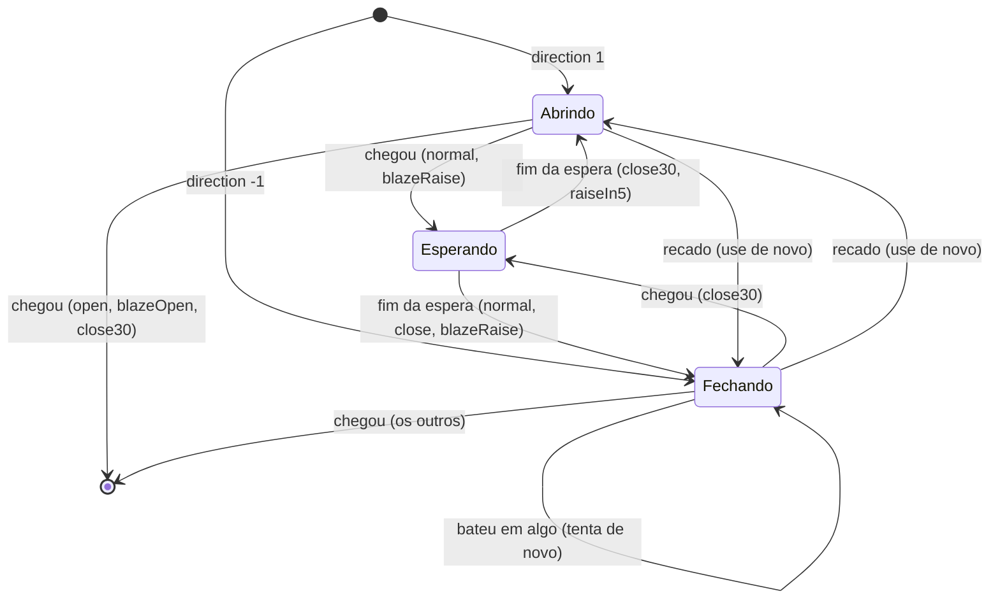

# C4: o resto do DIFERENCAS (specials e a descrição do save)

Quarto item da fase de correções (`docs/PLANO_ATMOS.md`, seção 6, "C"): as
diferenças de specials de setor guardadas em `docs/DIFERENCAS_DOOM.md`
(seção 1) e a descrição do save (seção 2). Fora do escopo, por decisão do
autor: o conteúdo do save no formato do Doom (gravar tetos, luzes e pisos
inteiros) e o som posicional.

O C4 é feito em grupos, um por sistema. Cada grupo é um commit em cada
branch, conferido com os roteiros do sistema contra a branch `lua` (`REF_TAG=lua
REF_DIR=build/branch-lua`); a bateria inteira (`make test-drivers`,
`make test-branches`, `make test-mutacoes`) e a tag nova **`c4`** vêm no fim
do C4. Este registro cresce a cada grupo.

- Linhas citadas como "antes": `atmos` no commit `1ab5725` (C3), branch `lua`
  na tag `c3`.
- Referência anterior: `c3`.

| Grupo | O que corrige | Commits (`atmos` / `lua`) | Situação |
|---|---|---|---|
| C4a. Portas | a porta que bate em algo fechando volta a abrir; as rápidas batem ao fechar | (este) | concluído |
| C4b. Tetos | linha 40, esmagador que só desce, desaceleração, linhas 57 e 74, reativação, limite | – | a fazer |
| C4c. Esmagamento | a cada 4 tics, com sangue; corpos viram restos; itens largados somem | – | a fazer |
| C4d. Elevadores | volta ao bater subindo; parado de verdade (estase) e reativação; limite | – | a fazer |
| C4e. Pisos | troca do special; escada; sons de piso e teto | – | a fazer |
| C4f. Botões | não duplica; som ao voltar; limite | – | a fazer |
| C4g. Save | a descrição digitada | – | a fazer |

---

## C4a: a porta que bate em algo volta a abrir

### Resumo

No Doom, uma porta fechando que bate em algo que não cabe embaixo dela
volta a abrir (`T_VerticalDoor`, `res == crushed`), exceto as que só fecham
(`close` e `blazeClose`, "DO NOT GO BACK UP!"). Este port deixava a porta
tentando fechar a cada tic, parada na altura do que estava embaixo. Junto,
do mesmo `switch` do Doom: as portas rápidas (`blazeRaise`, `blazeClose`)
tocam `bdcls` ao terminar de fechar.

### Antes

- `atmos` (`setores.atm`, `1ab5725`): a função `mover` da task `Porta`
  só saía do laço com `:chegou` (`RESULT_PASTDEST`) ou `:troca` (o recado);
  o `RESULT_CRUSHED` de `move_plane` era ignorado e o laço tentava de novo
  no tic seguinte.
- `lua` (`specials.lua`, `tick_door`, tag `c3`): `if res ~= RESULT_PASTDEST
  then return end`, o mesmo efeito.

### Solução

```
;; atmos (setores.atm): mover devolve :esmagou
val r = S.move_plane(sp.world, porta.sector, porta.speed, destino, 1, dir, false)
until (r == S.RESULT_PASTDEST, :chegou)
val reabre = (porta.type != S.VLD.CLOSE) && (porta.type != S.VLD.BLAZECLOSE)
until ((dir == -1) && (r == S.RESULT_CRUSHED) && reabre, :esmagou)
...
;; na task Porta
(r == :esmagou) => {          ;; C4a: bateu em algo: volta a abrir
    set porta.direction = 1
    S.play(sp, "doropn")
}
```

```lua
-- lua (specials.lua, tick_door)
if res == RESULT_CRUSHED and door.direction == -1
    and door.type ~= VLD_CLOSE and door.type ~= VLD_BLAZECLOSE then
  door.direction = 1
  play(self, "doropn")
  return
end
```

Na `atmos`, a fase nova é mais um resultado de `mover`, ao lado de
`:chegou` e `:troca`, e a reação fica no mesmo `ifs` das outras; na `lua`, é
mais um `if` no começo do tick, antes do teste de chegada.

### Diagramas

**Máquina de estados da task `Porta`, antes (`1ab5725`):**



**Depois (C4a):**

```mermaid
stateDiagram-v2
    [*] --> Abrindo: direction 1
    [*] --> Fechando: direction -1
    Abrindo --> Esperando: chegou (normal, blazeRaise)
    Abrindo --> [*]: chegou (open, blazeOpen, close30)
    Esperando --> Fechando: fim da espera (normal, close, blazeRaise)
    Esperando --> Abrindo: fim da espera (close30, raiseIn5)
    Fechando --> Abrindo: bateu em algo (menos close e blazeClose), doropn
    Fechando --> Fechando: bateu em algo (close, blazeClose)
    Fechando --> Esperando: chegou (close30)
    Fechando --> [*]: chegou (os outros; as rapidas tocam bdcls)
    Abrindo --> Fechando: recado (use de novo)
    Fechando --> Abrindo: recado (use de novo)
```



### Validação

**Roteiro.** O roteiro `correcoes` ganhou, no E1M3, a porta da linha 329
(setor 97, tipo 1, "DR"): `use 329`, e o jogador fica dentro da porta. O
setor da porta é uma faixa diagonal fina, e os monstros, acordados pela
motosserra, empurram o jogador; neste port o `change_sector` só reajusta
quem tem o **centro** no setor (registro do B2), então um jogador empurrado
para a borda deixava a porta fechar inteira por cima dele. O `goto` o
devolve ao centro da porta a cada 5 quadros. Conferido com prints numa cópia
de `G.state_string` (o teto do setor 97 e a direção da porta): a porta abre
até 132, espera 150 tics, desce até 120 (o jogador tem 56 de altura, no
chão 64), volta a abrir e espera de novo, duas vezes.

**Contra a branch `lua`:** `correcoes` (2.636 quadros) e `portas` (2.958)
idênticos.

**Os sons** (`doropn` ao reabrir, `bdcls` das rápidas) não aparecem no
replay, que roda sem som; foram conferidos pela leitura do código.
