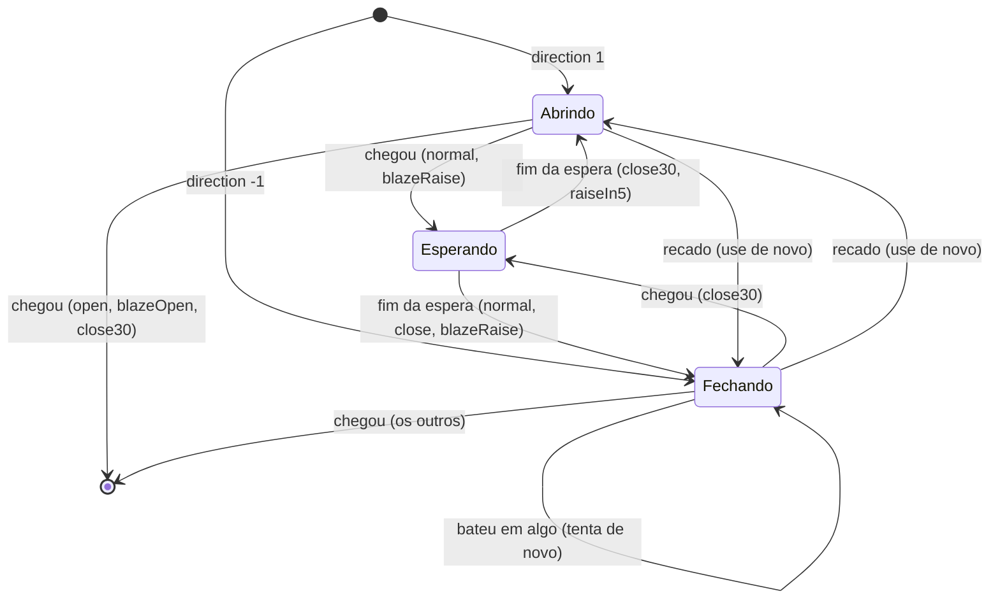
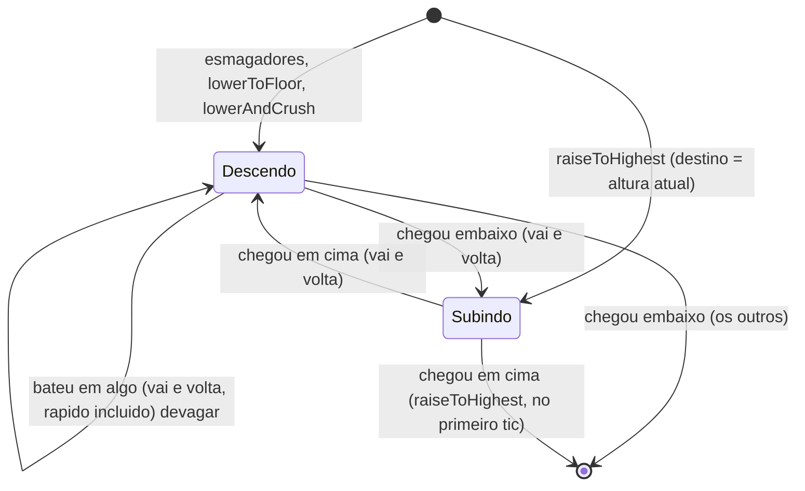
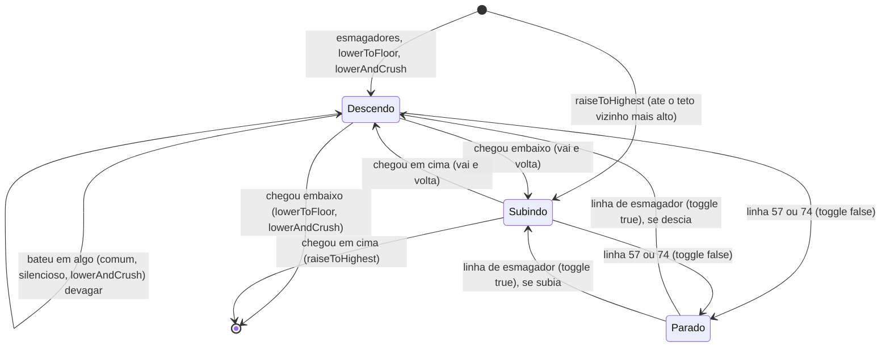
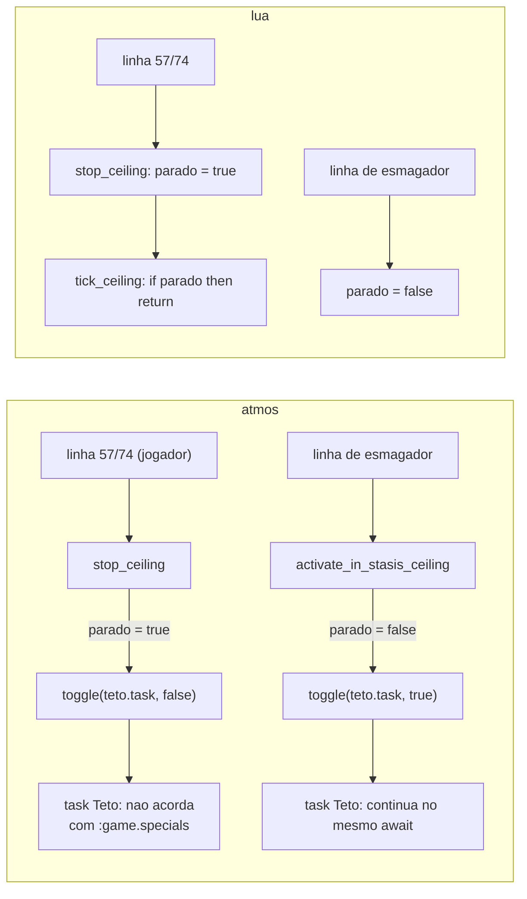
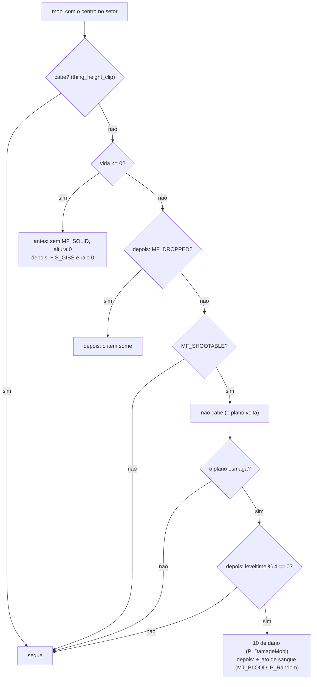

# C4: o resto do DIFERENCAS (specials e a descrição do save)

Quarto item da fase de correções (`docs/PLANO_ATMOS.md`, seção 6, "C"): as
diferenças de specials de setor guardadas em `docs/DIFERENCAS_DOOM.md`
(seção 1) e a descrição do save (seção 2). Fora do escopo, por decisão do
autor: o conteúdo do save no formato do Doom (gravar tetos, luzes e pisos
inteiros) e o som posicional.

O C4 é feito em grupos, um por sistema. Cada grupo é um commit em cada
branch, conferido com os roteiros do sistema contra a branch `lua` (`REF_TAG=lua
REF_DIR=build/branch-lua`); a bateria inteira (`make test-drivers`,
`make test-branches`, `make test-mutacoes`) e a tag nova **`c4`** vêm no fim
do C4. Este registro cresce a cada grupo.

- Linhas citadas como "antes": `atmos` no commit `1ab5725` (C3), branch `lua`
  na tag `c3`.
- Referência anterior: `c3`.

| Grupo | O que corrige | Commits (`atmos` / `lua`) | Situação |
|---|---|---|---|
| C4a. Portas | a porta que bate em algo fechando volta a abrir; as rápidas batem ao fechar | `6424c62` / `040d82b` | concluído |
| C4b. Tetos | linha 40, esmagador que só desce, desaceleração, linhas 57 e 74, reativação, limite | `66f3b67` / `278a16c` | concluído |
| C4c. Esmagamento | a cada 4 tics, com sangue; corpos viram restos; itens largados somem | (este) | concluído |
| C4d. Elevadores | volta ao bater subindo; parado de verdade (estase) e reativação; limite | – | a fazer |
| C4e. Pisos | troca do special; escada; sons de piso e teto | – | a fazer |
| C4f. Botões | não duplica; som ao voltar; limite | – | a fazer |
| C4g. Save | a descrição digitada | – | a fazer |

---

## C4a: a porta que bate em algo volta a abrir

### Resumo

No Doom, uma porta fechando que bate em algo que não cabe embaixo dela
volta a abrir (`T_VerticalDoor`, `res == crushed`), exceto as que só fecham
(`close` e `blazeClose`, "DO NOT GO BACK UP!"). Este port deixava a porta
tentando fechar a cada tic, parada na altura do que estava embaixo. Junto,
do mesmo `switch` do Doom: as portas rápidas (`blazeRaise`, `blazeClose`)
tocam `bdcls` ao terminar de fechar.

### Antes

- `atmos` (`setores.atm`, `1ab5725`): a função `mover` da task `Porta`
  só saía do laço com `:chegou` (`RESULT_PASTDEST`) ou `:troca` (o recado);
  o `RESULT_CRUSHED` de `move_plane` era ignorado e o laço tentava de novo
  no tic seguinte.
- `lua` (`specials.lua`, `tick_door`, tag `c3`): `if res ~= RESULT_PASTDEST
  then return end`, o mesmo efeito.

### Solução

```
;; atmos (setores.atm): mover devolve :esmagou
val r = S.move_plane(sp.world, porta.sector, porta.speed, destino, 1, dir, false)
until (r == S.RESULT_PASTDEST, :chegou)
val reabre = (porta.type != S.VLD.CLOSE) && (porta.type != S.VLD.BLAZECLOSE)
until ((dir == -1) && (r == S.RESULT_CRUSHED) && reabre, :esmagou)
...
;; na task Porta
(r == :esmagou) => {          ;; C4a: bateu em algo: volta a abrir
    set porta.direction = 1
    S.play(sp, "doropn")
}
```

```lua
-- lua (specials.lua, tick_door)
if res == RESULT_CRUSHED and door.direction == -1
    and door.type ~= VLD_CLOSE and door.type ~= VLD_BLAZECLOSE then
  door.direction = 1
  play(self, "doropn")
  return
end
```

Na `atmos`, a fase nova é mais um resultado de `mover`, ao lado de
`:chegou` e `:troca`, e a reação fica no mesmo `ifs` das outras; na `lua`, é
mais um `if` no começo do tick, antes do teste de chegada.

### Diagramas

**Máquina de estados da task `Porta`, antes (`1ab5725`):**



**Depois (C4a):**

```mermaid
stateDiagram-v2
    [*] --> Abrindo: direction 1
    [*] --> Fechando: direction -1
    Abrindo --> Esperando: chegou (normal, blazeRaise)
    Abrindo --> [*]: chegou (open, blazeOpen, close30)
    Esperando --> Fechando: fim da espera (normal, close, blazeRaise)
    Esperando --> Abrindo: fim da espera (close30, raiseIn5)
    Fechando --> Abrindo: bateu em algo (menos close e blazeClose), doropn
    Fechando --> Fechando: bateu em algo (close, blazeClose)
    Fechando --> Esperando: chegou (close30)
    Fechando --> [*]: chegou (os outros; as rapidas tocam bdcls)
    Abrindo --> Fechando: recado (use de novo)
    Fechando --> Abrindo: recado (use de novo)
```



### Validação

**Roteiro.** O roteiro `correcoes` ganhou, no E1M3, a porta da linha 329
(setor 97, tipo 1, "DR"): `use 329`, e o jogador fica dentro da porta. O
setor da porta é uma faixa diagonal fina, e os monstros, acordados pela
motosserra, empurram o jogador; neste port o `change_sector` só reajusta
quem tem o **centro** no setor (registro do B2), então um jogador empurrado
para a borda deixava a porta fechar inteira por cima dele. O `goto` o
devolve ao centro da porta a cada 5 quadros. Conferido com prints numa cópia
de `G.state_string` (o teto do setor 97 e a direção da porta): a porta abre
até 132, espera 150 tics, desce até 120 (o jogador tem 56 de altura, no
chão 64), volta a abrir e espera de novo, duas vezes.

**Contra a branch `lua`:** `correcoes` (2.636 quadros) e `portas` (2.958)
idênticos.

**Os sons** (`doropn` ao reabrir, `bdcls` das rápidas) não aparecem no
replay, que roda sem som; foram conferidos pela leitura do código.

---

## C4b: tetos e esmagadores

### Resumo

Cinco diferenças do `EV_DoCeiling` e do `T_MoveCeiling`, todas do mesmo
sistema:

| Diferença | Antes | Depois (como no Doom) |
|---|---|---|
| Teto que sobe (linha 40, `raiseToHighest`) | `do_crusher` calculava o teto vizinho mais alto em `dest`, mas o tick usava `topheight` (a altura atual): o teto não se movia | `topheight` é o teto vizinho mais alto; o teto sobe e acaba |
| Esmagador que só desce (44, 72, `lowerAndCrush`) e teto que desce até o chão (41, 43, `lowerToFloor`) | `crush = true` | `crush = false`: não tiram vida; o que só desce, ao bater em algo, desce devagar e continua tentando |
| Desaceleração ao bater | o comum, o rápido e o silencioso | o comum, o silencioso e o que só desce (`CEILSPEED/8`); o rápido não desacelera |
| Linhas 57 e 74 | paravam elevadores (`stop_plat`) | param os tetos da tag (`EV_CeilingCrushStop`) |
| Reativar um esmagador parado | não existia | as linhas de esmagador (6, 25, 49, 73, 77, 141) reativam os parados da tag antes de criar os novos (`P_ActivateInStasisCeiling`) |

E o limite do Doom: a lista de tetos ativos (`activeceilings`) tem 30
lugares; um teto criado com ela cheia anda, mas não pode ser parado nem
reativado (o Doom não dá erro aqui; dá nos elevadores e nos botões).

Também do `T_MoveCeiling`: subindo, o Doom chama `T_MovePlane` com `crush =
false`; o port passava `teto.crush` nos dois sentidos.

### Antes

- `atmos` (`setores.atm`, task `Teto`, `1ab5725`): o destino era
  `teto.dest` só para `LOWERTOFLOOR` e `topheight`/`bottomheight` para os
  outros; `if vai_e_volta && (r == S.RESULT_CRUSHED) { set vel = devagar }`.
  O comentário da task dizia: "Os tetos não são gravados no save e ninguém
  escreve no registro de fora (as linhas 57 e 74 deste port param
  elevadores, não esmagadores)". Por isso a fase ficava só no código.
- `lua` (`specials.lua`, `tick_ceiling`, tag `c3`): o mesmo, no tick.

### Solução

**O parar e o reativar, e o `toggle`.** No Doom, `EV_CeilingCrushStop`
guarda a direção (`olddirection`), põe a direção em 0 e **tira a função do
thinker** (`thinker.function.acv = NULL`): o teto deixa de pensar. O
`P_ActivateInStasisCeiling` devolve a direção e a função. Na branch
`atmos`, isso é exatamente o `toggle` de uma task:

```lua
-- specials.lua (atmos)
function M.stop_ceiling(self, line)
  local ok = false
  for i = 1, MAXCEILINGS do
    local teto = self.tetos_ativos[i]
    if teto and teto.sector.tag == line.tag and not teto.parado then
      teto.parado = true
      if teto.task then
        toggle(teto.task, false)
      end
      ok = true
    end
  end
  return ok
end
```

A task `Teto` não precisou de nenhuma linha para isso: desligada, ela não
acorda com o `:game.specials`; ligada de novo, continua no mesmo `await`,
com a direção e a velocidade que tinha nas variáveis locais. O
`olddirection` do Doom some, porque a continuação da task guarda a fase.
O registro ganhou só `parado` (o "direction != 0" com que o Doom decide quem
parar e quem reativar) e `task` (para o `toggle`).

É o contraste anunciado no passo 3c: lá, parar o elevador com `toggle`
**não** era equivalente, porque o elevador parado deste port continuava
descontando o contador. Aqui o teto parado do Doom não pensa, e o `toggle`
corresponde ao original. Na branch `lua`, o mesmo é um `if ceil.parado then
return end` no começo de `tick_ceiling`.

**A desaceleração** ficou num valor calculado uma vez na task:

```
val desacelera = (t == C.CRUSHANDRAISE) || (t == C.SILENTCRUSH) || (t == C.LOWERANDCRUSH)
...
val destino = if dir == 1 => teto.topheight => teto.bottomheight
val esmaga = (dir == -1) && teto.crush    ;; subindo, nunca esmaga
```

### Diagramas

**Máquina de estados da task `Teto`, antes (`1ab5725`):**



**Depois (C4b):**



**Fluxo do parar e reativar, nas duas branches:**



### Validação

**Roteiros.**

- `pisos` (sem mudança no roteiro): no E3M5, a linha 40 agora sobe o teto da
  tag 6 de 64 a 128 (antes, ele ficava em 64), e o teto da linha 44 (tag 14)
  desce com o jogador embaixo sem lhe tirar vida e, depois de bater nele,
  desce a 1/8 da velocidade (prints numa cópia de `G.state_string`).
- `correcoes`, no E2M2 (novo): o esmagador da tag 16 (linha 728, tipo 73)
  desce; a linha 687 (tipo 74) o para em 74; a 728 de novo o reativa, e ele
  continua (chega embaixo, em 72, e sobe).

**Contra a branch `lua`:** `correcoes` (2.998 quadros) e `pisos` (2.618)
idênticos.

---

## C4c: o esmagamento (a cada 4 tics, com sangue e restos)

### Resumo

O `PIT_ChangeSector` do Doom, chamado para cada mobj quando um piso ou um
teto se move, decide quatro casos para quem não cabe: o corpo vira restos
(`S_GIBS`, sem raio nem altura); o item largado por um monstro
(`MF_DROPPED`) some; quem não é atingível (`MF_SHOOTABLE`) é ignorado; os
outros não cabem (o plano volta) e, se o plano esmaga, levam 10 de dano
**a cada 4 tics** (`!(leveltime&3)`), com um jato de sangue (`MT_BLOOD`, com
`P_Random`). O C1 já tinha posto o dano no `P_DamageMobj`; faltavam a
cadência, o sangue, os restos e os itens.

### Antes (`collision.change_sector`, igual nas duas branches)

```lua
if (thing.health or 0) <= 0 then
  thing.flags = band(thing.flags or 0, bnot(MF_SOLID))
  thing.height = 0
elseif has(thing.flags, MF_SHOOTABLE) then
  nofit = true
  if crush and M.dano_esmagar then
    M.dano_esmagar(thing, 10)          -- a cada tic, sem sangue
  ...
```

### Solução

`collision.lua` (igual nas duas branches) tem os quatro casos, na ordem do
Doom, e percorre uma cópia da lista de mobjs (o esmagamento cria sangue e
remove itens). O gancho do C1 virou `collision.esmagar(world, thing)`,
ligado pelo jogo, porque precisa do `leveltime` e do dano do jogo; o jato de
sangue é `collision.jato_de_sangue` (um `MT_BLOOD` no meio da altura, com
`(P_Random() - P_Random()) << 12` em cada eixo, depois do sorteio do
`lastlook` que o `P_SpawnMobj` também faz):

```lua
-- game.lua (atmos) e main.lua (lua), o mesmo texto
collision.esmagar = function(world, thing)
  if (game.leveltime or 0) % 4 == 0 then
    game.damage_mobj(thing, nil, 10, nil)
    collision.jato_de_sangue(world, thing, game)
  end
end
```

O corpo de um monstro com task (a task `Monstro`) vira restos por
`set_mobj_state(S_GIBS)`, de fora; a task percebe o salto e, como `S_GIBS`
não é de nenhum comportamento do tipo, segue a tabela pelo caso `estranho`
(um quadro sem fim: `mobj_parado`). O mobj do jogador e os efeitos (`fx`,
o puff e o sangue de tiro deste port) não têm estados: perdem raio e
altura, sem o `S_GIBS`.

### Diagrama

**O `change_sector` para cada mobj com o centro no setor, antes e depois:**



### Validação

**Roteiro `pisos`** (sem mudança): no E2M2, o jogador sem o modo deus
embaixo do esmagador da tag 16 perde 10 de vida a cada 4 tics, com um
`MT_BLOOD` a cada dano, e morre 36 tics depois do primeiro (prints numa
cópia de `G.state_string`: vida 90, 80... 0 nos tics 682, 685, 689... 717;
até 6 mobjs de sangue vivos ao mesmo tempo). Antes, perdia 10 por tic.

**Contra a branch `lua`:** `pisos` (2.618 quadros) e `correcoes` (2.998)
idênticos.

**Fica diferente.** No Doom, um mobj criado por um thinker de setor entra
no fim da lista de thinkers e pensa no mesmo tic; neste port, os mobjs
pensam antes dos specials (fase 6 do tic, antes da 7), e o sangue do
esmagamento só pensa no tic seguinte. É a separação entre mobjs e specials
que o port tem desde antes da migração; não muda nada visível além do
primeiro tic do sangue.
