# C4: o resto do DIFERENCAS (specials e a descrição do save)

Quarto item da fase de correções (`docs/PLANO_ATMOS.md`, seção 6, "C"): as
diferenças de specials de setor guardadas em `docs/DIFERENCAS_DOOM.md`
(seção 1) e a descrição do save (seção 2). Fora do escopo, por decisão do
autor: o conteúdo do save no formato do Doom (gravar tetos, luzes e pisos
inteiros) e o som posicional.

O C4 é feito em grupos, um por sistema. Cada grupo é um commit em cada
branch, conferido com os roteiros do sistema contra a branch `lua` (`REF_TAG=lua
REF_DIR=build/branch-lua`); a bateria inteira (`make test-drivers`,
`make test-branches`, `make test-mutacoes`) e a tag nova **`c4`** vêm no fim
do C4. Este registro cresceu a cada grupo; o fechamento, no fim, tem a
bateria, as mutações e as métricas.

- Linhas citadas como "antes": `atmos` no commit `1ab5725` (C3), branch `lua`
  na tag `c3`.
- Referência anterior: `c3`.

| Grupo | O que corrige | Commits (`atmos` / `lua`) | Situação |
|---|---|---|---|
| C4a. Portas | a porta que bate em algo fechando volta a abrir; as rápidas batem ao fechar | `6424c62` / `040d82b` | concluído |
| C4b. Tetos | linha 40, esmagador que só desce, desaceleração, linhas 57 e 74, reativação, limite | `66f3b67` / `278a16c` | concluído |
| C4c. Esmagamento | a cada 4 tics, com sangue; corpos viram restos; itens largados somem | `029e48e` / `54c5bf8` | concluído |
| C4d. Elevadores | volta ao bater subindo; parado de verdade (estase) e reativação; limite | `9efd93d` / `9339673` | concluído |
| C4e. Pisos | troca do special; escada; sons de piso e teto | `eb75953` / `21f9219` | concluído |
| C4f. Botões | não duplica; som ao voltar; limite | `5b4b42f` / `7b06b63` | concluído |
| C4g. Save | a descrição digitada | `8a52fcd` / `c70af1d` | concluído |

---

## C4a: a porta que bate em algo volta a abrir

### Resumo

No Doom, uma porta fechando que bate em algo que não cabe embaixo dela
volta a abrir (`T_VerticalDoor`, `res == crushed`), exceto as que só fecham
(`close` e `blazeClose`, "DO NOT GO BACK UP!"). Este port deixava a porta
tentando fechar a cada tic, parada na altura do que estava embaixo. Junto,
do mesmo `switch` do Doom: as portas rápidas (`blazeRaise`, `blazeClose`)
tocam `bdcls` ao terminar de fechar.

### Antes

- `atmos` (`setores.atm`, `1ab5725`): a função `mover` da task `Porta`
  só saía do laço com `:chegou` (`RESULT_PASTDEST`) ou `:troca` (o recado);
  o `RESULT_CRUSHED` de `move_plane` era ignorado e o laço tentava de novo
  no tic seguinte.
- `lua` (`specials.lua`, `tick_door`, tag `c3`): `if res ~= RESULT_PASTDEST
  then return end`, o mesmo efeito.

### Solução

```
;; atmos (setores.atm): mover devolve :esmagou
val r = S.move_plane(sp.world, porta.sector, porta.speed, destino, 1, dir, false)
until (r == S.RESULT_PASTDEST, :chegou)
val reabre = (porta.type != S.VLD.CLOSE) && (porta.type != S.VLD.BLAZECLOSE)
until ((dir == -1) && (r == S.RESULT_CRUSHED) && reabre, :esmagou)
...
;; na task Porta
(r == :esmagou) => {          ;; C4a: bateu em algo: volta a abrir
    set porta.direction = 1
    S.play(sp, "doropn")
}
```

```lua
-- lua (specials.lua, tick_door)
if res == RESULT_CRUSHED and door.direction == -1
    and door.type ~= VLD_CLOSE and door.type ~= VLD_BLAZECLOSE then
  door.direction = 1
  play(self, "doropn")
  return
end
```

Na `atmos`, a fase nova é mais um resultado de `mover`, ao lado de
`:chegou` e `:troca`, e a reação fica no mesmo `ifs` das outras; na `lua`, é
mais um `if` no começo do tick, antes do teste de chegada.

### Diagramas

**Máquina de estados da task `Porta`, antes (`1ab5725`):**

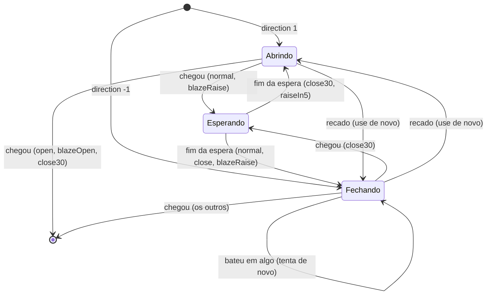

**Depois (C4a):**

```mermaid
stateDiagram-v2
    [*] --> Abrindo: direction 1
    [*] --> Fechando: direction -1
    Abrindo --> Esperando: chegou (normal, blazeRaise)
    Abrindo --> [*]: chegou (open, blazeOpen, close30)
    Esperando --> Fechando: fim da espera (normal, close, blazeRaise)
    Esperando --> Abrindo: fim da espera (close30, raiseIn5)
    Fechando --> Abrindo: bateu em algo (menos close e blazeClose), doropn
    Fechando --> Fechando: bateu em algo (close, blazeClose)
    Fechando --> Esperando: chegou (close30)
    Fechando --> [*]: chegou (os outros; as rapidas tocam bdcls)
    Abrindo --> Fechando: recado (use de novo)
    Fechando --> Abrindo: recado (use de novo)
```

### Validação

**Roteiro.** O roteiro `correcoes` ganhou, no E1M3, a porta da linha 329
(setor 97, tipo 1, "DR"): `use 329`, e o jogador fica dentro da porta. O
setor da porta é uma faixa diagonal fina, e os monstros, acordados pela
motosserra, empurram o jogador; neste port o `change_sector` só reajusta
quem tem o **centro** no setor (registro do B2), então um jogador empurrado
para a borda deixava a porta fechar inteira por cima dele. O `goto` o
devolve ao centro da porta a cada 5 quadros. Conferido com prints numa cópia
de `G.state_string` (o teto do setor 97 e a direção da porta): a porta abre
até 132, espera 150 tics, desce até 120 (o jogador tem 56 de altura, no
chão 64), volta a abrir e espera de novo, duas vezes.

**Contra a branch `lua`:** `correcoes` (2.636 quadros) e `portas` (2.958)
idênticos.

**Os sons** (`doropn` ao reabrir, `bdcls` das rápidas) não aparecem no
replay, que roda sem som; foram conferidos pela leitura do código.

---

## C4b: tetos e esmagadores

### Resumo

Cinco diferenças do `EV_DoCeiling` e do `T_MoveCeiling`, todas do mesmo
sistema:

| Diferença | Antes | Depois (como no Doom) |
|---|---|---|
| Teto que sobe (linha 40, `raiseToHighest`) | `do_crusher` calculava o teto vizinho mais alto em `dest`, mas o tick usava `topheight` (a altura atual): o teto não se movia | `topheight` é o teto vizinho mais alto; o teto sobe e acaba |
| Esmagador que só desce (44, 72, `lowerAndCrush`) e teto que desce até o chão (41, 43, `lowerToFloor`) | `crush = true` | `crush = false`: não tiram vida; o que só desce, ao bater em algo, desce devagar e continua tentando |
| Desaceleração ao bater | o comum, o rápido e o silencioso | o comum, o silencioso e o que só desce (`CEILSPEED/8`); o rápido não desacelera |
| Linhas 57 e 74 | paravam elevadores (`stop_plat`) | param os tetos da tag (`EV_CeilingCrushStop`) |
| Reativar um esmagador parado | não existia | as linhas de esmagador (6, 25, 49, 73, 77, 141) reativam os parados da tag antes de criar os novos (`P_ActivateInStasisCeiling`) |

E o limite do Doom: a lista de tetos ativos (`activeceilings`) tem 30
lugares; um teto criado com ela cheia anda, mas não pode ser parado nem
reativado (o Doom não dá erro aqui; dá nos elevadores e nos botões).

Também do `T_MoveCeiling`: subindo, o Doom chama `T_MovePlane` com `crush =
false`; o port passava `teto.crush` nos dois sentidos.

### Antes

- `atmos` (`setores.atm`, task `Teto`, `1ab5725`): o destino era
  `teto.dest` só para `LOWERTOFLOOR` e `topheight`/`bottomheight` para os
  outros; `if vai_e_volta && (r == S.RESULT_CRUSHED) { set vel = devagar }`.
  O comentário da task dizia: "Os tetos não são gravados no save e ninguém
  escreve no registro de fora (as linhas 57 e 74 deste port param
  elevadores, não esmagadores)". Por isso a fase ficava só no código.
- `lua` (`specials.lua`, `tick_ceiling`, tag `c3`): o mesmo, no tick.

### Solução

**O parar e o reativar, e o `toggle`.** No Doom, `EV_CeilingCrushStop`
guarda a direção (`olddirection`), põe a direção em 0 e **tira a função do
thinker** (`thinker.function.acv = NULL`): o teto deixa de pensar. O
`P_ActivateInStasisCeiling` devolve a direção e a função. Na branch
`atmos`, isso é exatamente o `toggle` de uma task:

```lua
-- specials.lua (atmos)
function M.stop_ceiling(self, line)
  local ok = false
  for i = 1, MAXCEILINGS do
    local teto = self.tetos_ativos[i]
    if teto and teto.sector.tag == line.tag and not teto.parado then
      teto.parado = true
      if teto.task then
        toggle(teto.task, false)
      end
      ok = true
    end
  end
  return ok
end
```

A task `Teto` não precisou de nenhuma linha para isso: desligada, ela não
acorda com o `:game.specials`; ligada de novo, continua no mesmo `await`,
com a direção e a velocidade que tinha nas variáveis locais. O
`olddirection` do Doom some, porque a continuação da task guarda a fase.
O registro ganhou só `parado` (o "direction != 0" com que o Doom decide quem
parar e quem reativar) e `task` (para o `toggle`).

É o contraste anunciado no passo 3c: lá, parar o elevador com `toggle`
**não** era equivalente, porque o elevador parado deste port continuava
descontando o contador. Aqui o teto parado do Doom não pensa, e o `toggle`
corresponde ao original. Na branch `lua`, o mesmo é um `if ceil.parado then
return end` no começo de `tick_ceiling`.

**A desaceleração** ficou num valor calculado uma vez na task:

```
val desacelera = (t == C.CRUSHANDRAISE) || (t == C.SILENTCRUSH) || (t == C.LOWERANDCRUSH)
...
val destino = if dir == 1 => teto.topheight => teto.bottomheight
val esmaga = (dir == -1) && teto.crush    ;; subindo, nunca esmaga
```

### Diagramas

**Máquina de estados da task `Teto`, antes (`1ab5725`):**

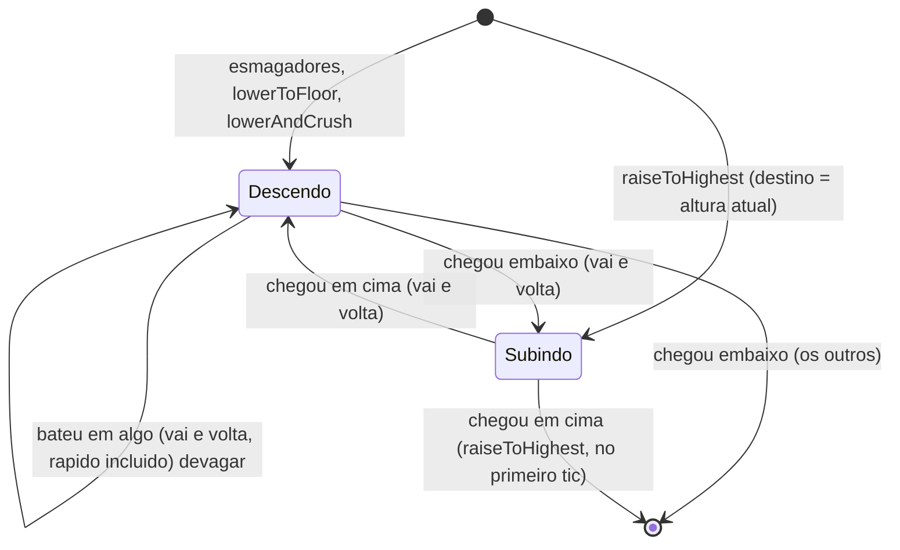

**Depois (C4b):**

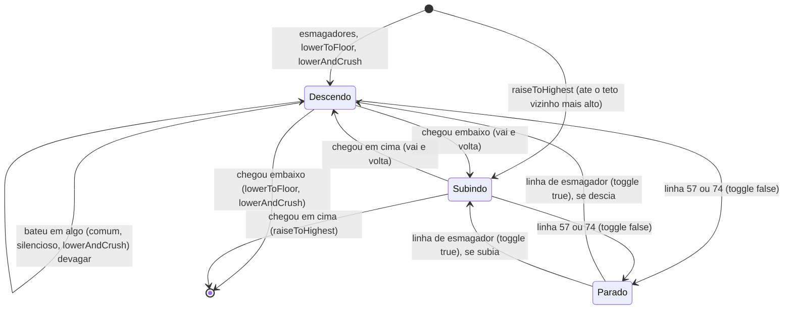

**Fluxo do parar e reativar, nas duas branches:**

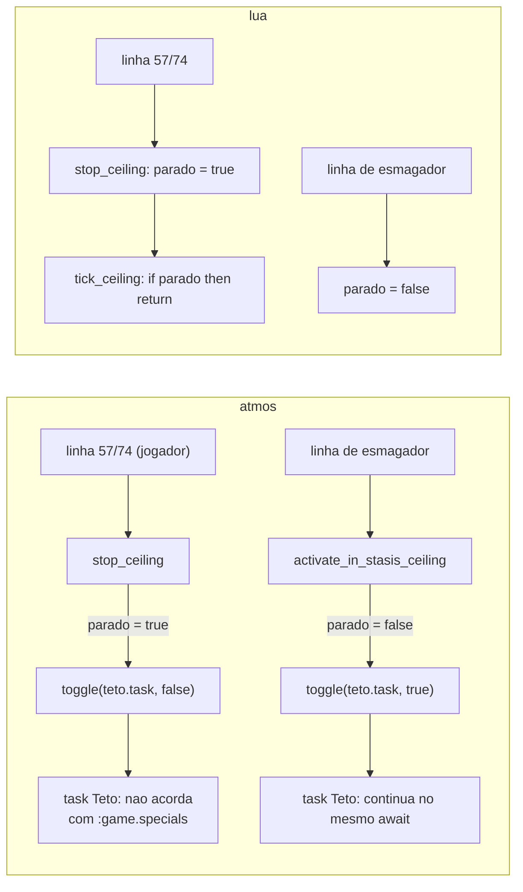

### Validação

**Roteiros.**

- `pisos` (sem mudança no roteiro): no E3M5, a linha 40 agora sobe o teto da
  tag 6 de 64 a 128 (antes, ele ficava em 64), e o teto da linha 44 (tag 14)
  desce com o jogador embaixo sem lhe tirar vida e, depois de bater nele,
  desce a 1/8 da velocidade (prints numa cópia de `G.state_string`).
- `correcoes`, no E2M2 (novo): o esmagador da tag 16 (linha 728, tipo 73)
  desce; a linha 687 (tipo 74) o para em 74; a 728 de novo o reativa, e ele
  continua (chega embaixo, em 72, e sobe).

**Contra a branch `lua`:** `correcoes` (2.998 quadros) e `pisos` (2.618)
idênticos.

---

## C4c: o esmagamento (a cada 4 tics, com sangue e restos)

### Resumo

O `PIT_ChangeSector` do Doom, chamado para cada mobj quando um piso ou um
teto se move, decide quatro casos para quem não cabe: o corpo vira restos
(`S_GIBS`, sem raio nem altura); o item largado por um monstro
(`MF_DROPPED`) some; quem não é atingível (`MF_SHOOTABLE`) é ignorado; os
outros não cabem (o plano volta) e, se o plano esmaga, levam 10 de dano
**a cada 4 tics** (`!(leveltime&3)`), com um jato de sangue (`MT_BLOOD`, com
`P_Random`). O C1 já tinha posto o dano no `P_DamageMobj`; faltavam a
cadência, o sangue, os restos e os itens.

### Antes (`collision.change_sector`, igual nas duas branches)

```lua
if (thing.health or 0) <= 0 then
  thing.flags = band(thing.flags or 0, bnot(MF_SOLID))
  thing.height = 0
elseif has(thing.flags, MF_SHOOTABLE) then
  nofit = true
  if crush and M.dano_esmagar then
    M.dano_esmagar(thing, 10)          -- a cada tic, sem sangue
  ...
```

### Solução

`collision.lua` (igual nas duas branches) tem os quatro casos, na ordem do
Doom, e percorre uma cópia da lista de mobjs (o esmagamento cria sangue e
remove itens). O gancho do C1 virou `collision.esmagar(world, thing)`,
ligado pelo jogo, porque precisa do `leveltime` e do dano do jogo; o jato de
sangue é `collision.jato_de_sangue` (um `MT_BLOOD` no meio da altura, com
`(P_Random() - P_Random()) << 12` em cada eixo, depois do sorteio do
`lastlook` que o `P_SpawnMobj` também faz):

```lua
-- game.lua (atmos) e main.lua (lua), o mesmo texto
collision.esmagar = function(world, thing)
  if (game.leveltime or 0) % 4 == 0 then
    game.damage_mobj(thing, nil, 10, nil)
    collision.jato_de_sangue(world, thing, game)
  end
end
```

O corpo de um monstro com task (a task `Monstro`) vira restos por
`set_mobj_state(S_GIBS)`, de fora; a task percebe o salto e, como `S_GIBS`
não é de nenhum comportamento do tipo, segue a tabela pelo caso `estranho`
(um quadro sem fim: `mobj_parado`). O mobj do jogador e os efeitos (`fx`,
o puff e o sangue de tiro deste port) não têm estados: perdem raio e
altura, sem o `S_GIBS`.

### Diagrama

**O `change_sector` para cada mobj com o centro no setor, antes e depois:**

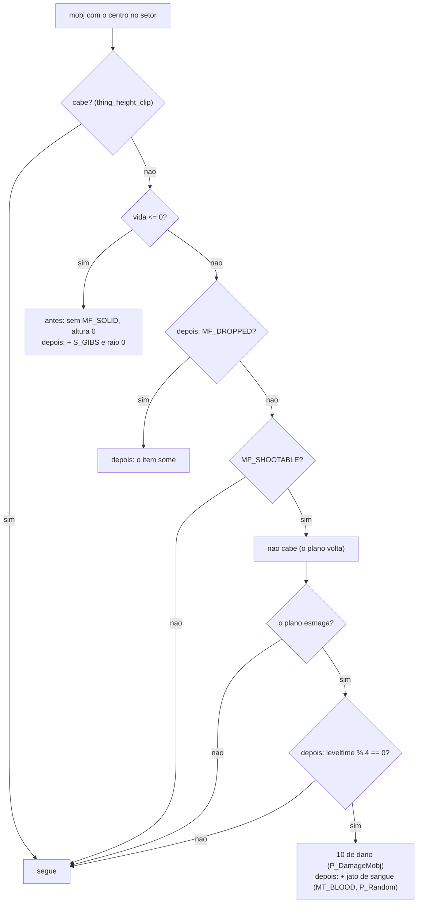

### Validação

**Roteiro `pisos`** (sem mudança): no E2M2, o jogador sem o modo deus
embaixo do esmagador da tag 16 perde 10 de vida a cada 4 tics, com um
`MT_BLOOD` a cada dano, e morre 36 tics depois do primeiro (prints numa
cópia de `G.state_string`: vida 90, 80... 0 nos tics 682, 685, 689... 717;
até 6 mobjs de sangue vivos ao mesmo tempo). Antes, perdia 10 por tic.

**Contra a branch `lua`:** `pisos` (2.618 quadros) e `correcoes` (2.998)
idênticos.

**Fica diferente.** No Doom, um mobj criado por um thinker de setor entra
no fim da lista de thinkers e pensa no mesmo tic; neste port, os mobjs
pensam antes dos specials (fase 6 do tic, antes da 7), e o sangue do
esmagamento só pensa no tic seguinte. É a separação entre mobjs e specials
que o port tem desde antes da migração; não muda nada visível além do
primeiro tic do sangue.

---

## C4d: elevadores (volta ao bater, parado de verdade, reativação, limite)

### Resumo

| Diferença | Antes | Depois (como no Doom) |
|---|---|---|
| Elevador subindo que bate em algo | ficava tentando subir | volta a descer (`T_PlatRaise`: `res == crushed && !plat->crush`), com `pstart` |
| Parar (linhas 54 e 89) | `stop_plat` escrevia `status = WAITING` e `count` enorme: o elevador continuava descontando o `count` | `EV_StopPlat`: `status = in_stasis`, o status de antes em `oldstatus`, e o thinker deixa de pensar |
| Reativar (linhas 53 e 87, elevador perpétuo) | não existia: um elevador parado ficava parado | `P_ActivateInStasis` devolve o status de antes |
| Limite | sem limite | 30 elevadores ativos (`MAXPLATS`); cheia, o Doom para com erro (`P_AddActivePlat: no more plats!`), e aqui também |

### Antes

**`atmos`** (`setores.atm`, task `Elevador`, `1ab5725`). A fase ficava em
`plat.status` por dois motivos: o save e o recado. `stop_plat` escrevia
`status = WAITING` no meio do tic; `mover_plat` e `esperar_plat` testavam
`until (plat.status != st, :troca)` a cada tic, e a fase nova começava
agindo no mesmo tic (`direto`). No passo 3c, parar com `toggle` foi testado
e não era equivalente (mutação `parar-com-toggle`, detectada só pela
comparação dos saves), porque o elevador parado deste port continuava
descontando o `count`.

**`lua`** (`specials.lua`, `tick_plat` e `stop_plat`, tag `c3`): o mesmo, no
tick.

### Solução

O Doom tira a função do thinker do elevador parado, e no C4d o parar virou
`toggle`, como os tetos no C4b. `start_plat` (usado na criação e no load)
guarda a task no registro e põe o elevador na lista de ativos; um elevador
gravado parado nasce no status de antes e é desligado em seguida:

```lua
-- specials.lua (atmos)
function M.start_plat(self, plat)
  local parado = plat.status == PLAT_INSTASIS
  if parado then
    plat.status = plat.oldstatus
  end
  plat.task = spawn_task(self, "movers", "Elevador", self, plat)
  if parado then
    plat.status = PLAT_INSTASIS
    if plat.task then
      toggle(plat.task, false)
    end
  end
  add_active_plat(self, plat)
  return plat.task
end
```

**O recado do elevador sumiu.** Com o parar fora da task (desligada antes
de o status mudar, e religada depois de o status voltar), ninguém mais
escreve `plat.status` com a task ligada. A task `Elevador` perdeu o
`:troca`, o `direto` e os testes de status a cada tic; ganhou o `:bateu`:

```
val func mover_plat (sp, plat, st) {
    val P = S.PLAT
    val destino = if st == P.UP => plat.high => plat.low
    val dir = if st == P.UP => 1 => -1
    loop {
        await :game.specials
        val r = S.move_plane(sp.world, plat.sector, plat.speed, destino, 0, dir, false)
        until (r == S.RESULT_PASTDEST, :chegou)
        until ((st == P.UP) && (r == S.RESULT_CRUSHED), :bateu)
    }
}
```

O status continua no registro, mas agora só porque o save o grava e o Lua
precisa dele para decidir quem parar e quem reativar (o `in_stasis`).

**Save.** O registro do elevador ganhou `oldstatus` (o `plat_t` do Doom o
grava); a cobertura do roteiro `elevadores` agora procura, no slot 2, um
elevador com `"status":3` (antes, `count` enorme).

### Diagramas

**Máquina de estados da task `Elevador`, antes (`1ab5725`):**

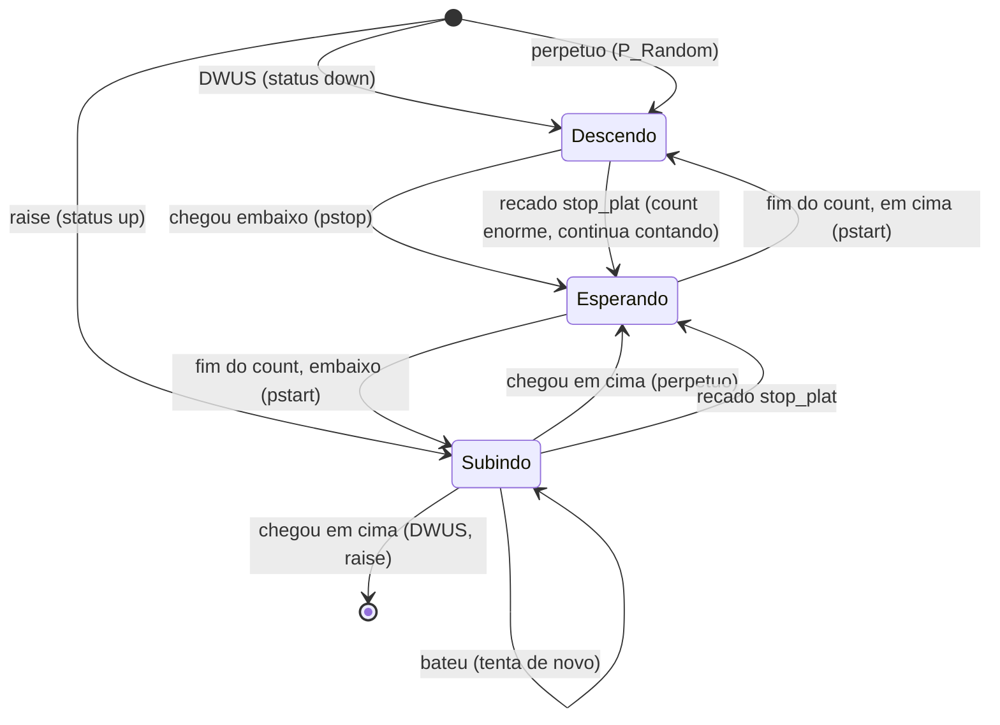

**Depois (C4d):**

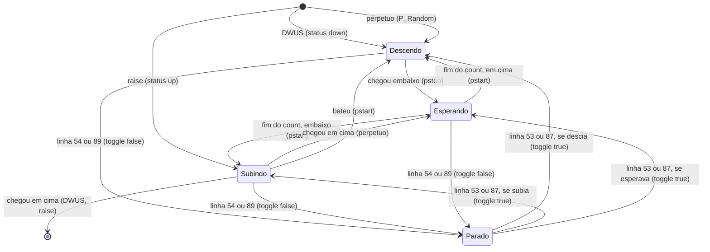

### Validação

**Roteiros.**

- `elevadores` (sem mudança nos eventos): no E2M3, o elevador perpétuo é
  parado (linha 324, tipo 89), gravado parado (slot 2, `status` 3,
  `oldstatus` gravado) e carregado; a linha 114 (tipo 87) agora o reativa
  (o comentário do roteiro dizia "não reativa").
- `correcoes`, no E1M3 (novo): o elevador do setor 40 (linha 800, tipo 62)
  desce; o jogador fica nele, com o centro em (−1088, −1336), a 8 unidades
  da linha 800, e o corpo sobre o setor 35, de teto 192. Subindo com o
  jogador, o elevador bate quando o piso passa de 136 (192 − 56) e volta a
  descer (prints numa cópia de `G.state_string`: o piso vai de 64 a 133,
  o status passa de 1 a 0 e o piso volta a 64). Antes, ele ficaria em 136
  tentando subir. O setor foi achado por um script que procura, em todos os
  mapas, elevadores com um vizinho de teto entre a altura de baixo + 56 e a
  de cima + 56.

**Contra a branch `lua`:** `correcoes` (3.480 quadros), `elevadores`
(2.098) e `ordem` (815) idênticos.

**Achado: a velocidade do elevador "desce, espera, sobe".** No Doom, o
`downWaitUpStay` anda a `PLATSPEED * 4` (4 unidades por tic); neste port,
`do_plat_dwus` usa `PLATSPEED` (1 por tic). O registro do B2 já mencionava
"neste port, 1 unidade por tic" sem marcar como diferença. Acrescentado a
`docs/DIFERENCAS_DOOM.md`; não foi corrigido aqui porque muda o cenário do
roteiro `ordem` (a porta e o elevador vizinhos andando juntos por 10 tics,
que detecta a mutação `portas-fora-de-movers`).

---

## C4e: pisos (o special, a escada) e os sons de piso e teto

### Resumo

| Diferença | Antes | Depois (como no Doom) |
|---|---|---|
| Piso não troca o special | o donut e o "baixar e trocar" trocavam só a textura do chão | trocam também o `special` do setor (`newspecial`): o donut zera o do anel que sobe; o "baixar e trocar" copia o do vizinho na altura de destino |
| Escada | seguia linhas pelos dois lados, somava a altura só no degrau escolhido e percorria todos os setores da tag | `EV_BuildStairs`: o próximo degrau é o setor de trás de uma linha de dois lados cuja frente é o degrau atual; a altura soma a cada linha com a mesma textura, antes de testar se o setor está ocupado; a busca pela tag continua a partir do último degrau (`P_FindSectorFromLineTag(line, secnum)`) |
| Sons | silenciosos | pisos e tetos tocam `stnmov` a cada 8 tics andando (`!(leveltime&7)`; o esmagador silencioso não); o piso toca `pstop` ao chegar |

O `special` do setor entrou no hash de estado (com `DOOM_REPLAY_SIDES=1`,
ao lado das texturas de chão e teto), nas duas branches: sem isso, a troca
do special não aparecia no oráculo (a lição do passo 3e: o que o código
novo escreve tem de estar no hash).

### Antes e depois

**A task `Piso`** ganhou duas linhas no fim e uma no laço:

```
loop {
    await :game.specials
    val r = S.move_plane(sp.world, piso.sector, piso.speed, piso.dest, 0, piso.direction, piso.crush)
    S.som_de_pedra(sp)                ;; C4e: a cada 8 tics andando
    until (r == S.RESULT_PASTDEST)
}
if piso.floorpic {
    set piso.sector.floorpic = piso.floorpic
    if piso.newspecial {              ;; C4e: e o special (donut, baixar e trocar)
        set piso.sector.special = piso.newspecial
    }
}
S.play(sp, "pstop")                   ;; C4e: chegou
```

Na branch `lua`, o mesmo em `tick_floor`. Os sons precisam do `leveltime`:
o jogo passou a guardar a si mesmo em `specials.game` ao montar o nível.

**A escada** (`do_stairs`, o mesmo texto nas duas branches, com a criação
do degrau diferente: `M.start_floor` na `atmos`, um registro em
`self.thinkers` na `lua`):

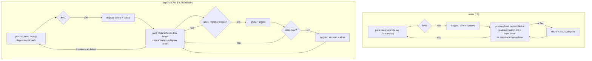

### Validação

**Roteiro `pisos`** (sem mudança): o donut do E2M2 (`use 220`) agora zera o
special do anel que sobe; o hash o mostra. As escadas dos roteiros (E2M2,
linha 638, tipo 8; E2M4, `use 65`, tipo 7) dão os mesmos degraus pelas duas
regras: conferido com prints numa cópia de `G.state_string` (a `atmos`
atual) e numa cópia do `state_string` da tag `c3` (o código antigo), os
mesmos setores (93 a 98 no E2M2, 76 a 81 no E2M4) com as mesmas alturas de
destino. Os mapas do `doom.wad` foram feitos de um jeito em que as duas
regras concordam; a correção vale para mapas em que elas diferem.

**Contra a branch `lua`:** `pisos` (2.618 quadros) e `correcoes` (3.480)
idênticos.

**Os sons** não aparecem no replay; foram conferidos pela leitura.

---

## C4f: botões (sem duplicar, com som, com limite)

### Resumo

| Diferença | Antes | Depois (como no Doom) |
|---|---|---|
| Botão duplicado | apertar de novo antes de voltar criava outro botão, que devolvia a textura trocada 35 tics depois | `P_StartButton` não cria um segundo botão para a mesma linha (a textura ainda troca, como no `P_ChangeSwitchTexture`) |
| Som ao voltar | silencioso | `swtchn` quando o botão devolve a textura (`P_UpdateSpecials`) |
| Limite | sem limite | 16 botões ativos (`MAXBUTTONS`); mais é erro (`P_StartButton: no button slots left!`) |

### Solução

Na `atmos`, `start_button` (usado pelo `change_switch` e pelo load) olha a
pool `botoes`: um botão com timer e a mesma linha impede outro; e a task
`Botao` ganhou o `sp` (para o som) e uma linha no fim:

```
val task Botao (sp, linha, attr, textura, timer) {
    set pub = [linha=linha, attr=attr, textura=textura, timer=timer]
    loop {
        await :game.specials
        set pub.timer = pub.timer - 1
        until (pub.timer <= 0)
    }
    val lado = linha.sides@1
    if lado {
        set lado@attr = textura
    }
    S.play(sp, "swtchn")                  ;; C4f: o botao volta com som
}
```

Na `lua`, o mesmo `start_button` sobre a lista `self.buttons`, e o som no
tick dos botões.

### Diagrama

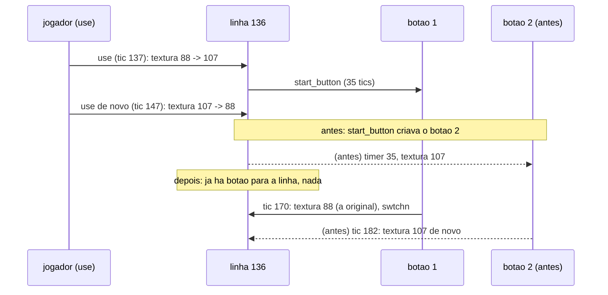

### Validação

**Roteiro `botoes`** (sem mudança): o segundo "use" na linha 136 do E1M1,
10 tics depois do primeiro, já existia ("2º uso com o botão ativo"). Prints
numa cópia de `G.state_string` (as texturas do lado da linha e os botões
ativos na pool): no tic 137 a textura vai a 107 com um botão; no 147 o
segundo "use" a devolve a 88 e continua um botão só; no 170 o botão vence.
Antes, um segundo botão a trocaria de novo para 107 no tic 182.

**Contra a branch `lua`:** `botoes` (861 quadros) e `correcoes` (3.480)
idênticos.

---

## C4g: a descrição do save

### Resumo

No Doom, escolher um slot no menu de save começa a digitação da descrição
(`M_SaveSelect`): um slot vazio começa em branco, um gravado começa com a
descrição antiga; as letras entram em maiúsculas, `backspace` apaga,
`escape` desiste e devolve a descrição antiga, `enter` grava, mas só se a
descrição não estiver vazia (`M_Responder`, `saveStringEnter`). Este port
gravava na hora, com o nome do mapa como descrição.

### Antes e depois (`menu.lua`, igual nas duas branches nesta parte)

```lua
-- antes (c3): a acao "saveslot" grava na hora
elseif action == "saveslot" then
  local name = "save"
  if self.game.world and self.game.world.mapname then
    name = self.game.world.mapname
  end
  if self.game.save_game and self.game.save_game(self.game, choice, name) then
  ...

-- depois (C4g): a acao comeca a digitacao; o responder a trata antes de
-- qualquer outra tecla (o saveStringEnter vem primeiro no M_Responder)
elseif action == "saveslot" then
  self.save_string_enter = true
  self.save_slot = choice
  self.save_old = self.save_strings[choice + 1]
  if self.save_old == LOADSAVEEMPTY then
    self.save_strings[choice + 1] = ""
  end
```

A digitação aceita letras e dígitos (em maiúsculas) e espaço, `-`, `=`,
`,`, `.`; no máximo 23 caracteres e 176 pixels de largura (`SAVESTRINGSIZE -
1` e `(SAVESTRINGSIZE - 2) * 8`, com a largura medida pela fonte do HUD,
como o `M_StringWidth`). O desenho põe o cursor `_` depois do texto do slot
(`M_DrawSave`).

### Diagrama

**O menu de save, antes e depois:**

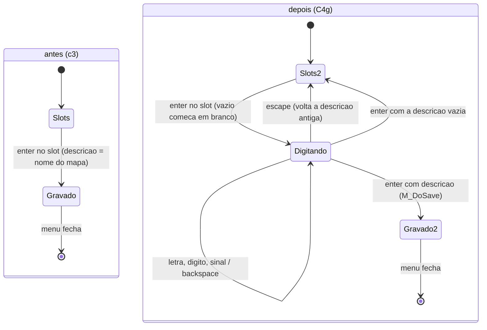

### Os roteiros

Todo save dos roteiros passava por "enter no slot". Agora, depois desse
`enter`, o slot vazio espera a descrição, e sem ela o `enter` seguinte não
grava. `tools/make_replay.lua` ganhou `descricao()` (a letra "s" e
`enter`), chamada depois dos 13 saves dos roteiros (`elevadores`, 4;
`portas`, 3; `monstro`, `familia`, `arma`, `pisos`, `botoes`, `fluxo`, 1
cada). São 6 quadros, um número par: as entradas seguintes continuam caindo
no começo de um par de tics (seção 2.5 do `CLAUDE.md`). Com o menu aberto o
mundo está parado (C2), então o estado gravado é o mesmo; só os números dos
quadros depois de cada save andam 6.

### Validação

Um quadro gravado (`DOOM_REPLAY_DUMP`) mostra o slot com o texto e o cursor
`_` antes e depois da letra; os saves dos testes têm a descrição `S`.
`make test-branches`: idêntico à branch `lua` nos 14 roteiros, com a
cobertura de todos (os saves e loads dos roteiros continuam acontecendo).

---

## Fechamento do C4

### A bateria e a tag

Com os sete grupos commitados nas duas branches, a branch `lua` ganhou a
tag **`c4`** (`c70af1d`), que virou a referência padrão de
`tests/test_drivers.sh`.

**Contra a referência nova** (`make test-drivers`, tag `c4`): idêntico nos
14 roteiros, com os saves iguais byte a byte e a cobertura de todos.
`make test-branches` (no C4g, com todos os grupos): idêntico à branch `lua`
nos 14. `make test`: 12 passam, as 8 falhas conhecidas. A janela abre e
fecha limpo nas duas branches.

**Contra a referência anterior** (`REF_TAG=c3`, com os roteiros novos). A
tabela compara o hash do framebuffer. Ela mistura dois efeitos: os
specials corrigidos e a descrição do save (C4g), porque os roteiros novos
digitam a descrição depois de escolher o slot, e o código da `c3` grava na
hora e recebe a letra e o `enter` com o menu já fechado (o `enter` abre o
menu de novo). Por isso alguns roteiros com save têm até outro número de
quadros na referência.

| Roteiro | Quadros (`c4` / `c3`) | Diferentes | 1º quadro | O que diverge |
|---|---|---|---|---|
| `ordem`, `telas`, `luzes`, pseudoaleatório, `exits` | iguais | 0 | – | sem save e sem os specials corrigidos num quadro desenhado |
| `correcoes` | 3.480 / 3.480 | 137 | 2.358 | a porta do E1M3 (C4a), o elevador (C4d), o esmagador do E2M2 (C4b); antes disso, idêntico (C1 a C3) |
| `arma` | 3.000 / 3.000 | 677 | 2.324 | o save do BFG (C4g) |
| `botoes` | 867 / 867 | 583 | 285 | o save (C4g) e o segundo botão (C4f) |
| `monstro` | 2.761 / 2.761 | 1.855 | 907 | o save (C4g) |
| `familia` | 3.232 / 3.232 | 1.234 | 1.999 | o save (C4g) |
| `pisos` | 2.624 / 2.624 | 2.474 | 151 | o donut e o special, o esmagamento a cada 4 tics (C4c, C4e), o save |
| `portas` | 2.976 / 2.976 | 2.607 | 370 | os saves (C4g) |
| `elevadores` | 2.122 / 1.798 | 1.998 | 125 | os saves (C4g; a referência sai do roteiro), o parado (C4d) |
| `fluxo` | 4.484 / 4.707 | 2.719 | 1.989 | o save (C4g) |

Cada grupo já tinha sido conferido no seu commit, com prints e contra a
branch `lua` nos roteiros do sistema (seções acima).

### Mutações

`make test-mutacoes` (todas as mutações do projeto, 127): **119/120 não
equivalentes detectadas**, 7 equivalentes, 1 pendente de cobertura.

**As que saíram ou mudaram.** `parar-ignorado` e `parar-um-tic-depois`
(passo 3c) testavam o recado do elevador, que sumiu no C4d. `parar-com-toggle`
(passo 3c) simulava parar com `toggle` e era detectada porque o elevador
parado deste port descontava o contador; no C4d o `toggle` virou o
comportamento certo, e a mutação deixou de ser um erro. `teto-vai-ate-o-mais-alto`
(passo 3d) simulava o teto da linha 40 subindo, como no Doom, e virou o
código; a mutação inversa é `teto-40-parado`. Quatro foram refeitas com o
texto novo (`elevador-sem-espera-inicial`, `espera-um-tic-a-menos`,
`piso-sem-espera-inicial`, `piso-nao-troca-textura`), todas detectadas.

**As do C4:**

| Mutação | Erro simulado | Roteiro | 1º quadro | Quadros dif. |
|---|---|---|---|---|
| `porta-nao-reabre` | a porta que bate fica tentando | `correcoes` | 2.306 | 53 |
| `teto-40-parado` | o teto da linha 40 fica na altura atual | `pisos` | 2.235 | 390 |
| `so-desce-esmaga` | o esmagador que só desce esmaga | `pisos` | 2.300 | 325 |
| `teto-sem-desacelerar` | o teto que bate não desacelera | `pisos` | 774 | 990 |
| `teto-parar-sem-toggle` | as linhas 57 e 74 marcam o teto, mas não desligam a task | `correcoes` | 3.258 | 223 |
| `teto-sem-reativar` | as linhas de esmagador não reativam | `correcoes` | 3.340 | 141 |
| `esmagar-todo-tic` | o esmagamento a cada tic | `pisos` | 772 | 675 |
| `esmagar-sem-sangue` | sem o jato de sangue | `pisos` | 774 | 673 |
| `corpo-sem-restos` | o corpo esmagado não vira restos | `pisos` | – | 0: **pendente** |
| `elevador-nao-volta` | o elevador que bate subindo fica tentando | `correcoes` | 2.923 | 196 |
| `elevador-parar-sem-toggle` | as linhas 54 e 89 marcam o elevador, mas não desligam a task | `elevadores` | 1.654 | 469 (save difere) |
| `elevador-sem-reativar` | as linhas 53 e 87 não reativam | `elevadores` | 1.901 | 222 |
| `load-perde-oldstatus` | o load perde o status de antes de parar | `elevadores` | 1.901 | 222 |
| `piso-nao-troca-special` | o donut e o "baixar e trocar" não trocam o special | `pisos` | 1.960 | 197 |
| `escada-dois-lados` | a escada segue linhas pelos dois lados | `pisos` | 267 | 1.406 (save difere) |
| `botao-duplicado` | um segundo botão para a mesma linha | `botoes` | 182 | 370 (save difere) |
| `save-grava-na-hora` | escolher o slot grava na hora | `botoes` | 1 | 867 (save difere) |

Duas observações. `escada-dois-lados` é detectada, embora as escadas dos
roteiros tenham dado os mesmos degraus pelo código antigo e pelo novo
(C4e): a mutação mistura a regra antiga dos lados com a soma nova da altura
(a cada linha com a mesma textura), uma combinação que nenhuma das duas
versões tem, e os degraus mudam (a divergência começa no quadro 267). Ela
mostra que o roteiro passa pela regra dos lados, mas não que a regra antiga
inteira daria outro jogo nesses mapas. E
`corpo-sem-restos` ficou pendente: nenhum roteiro esmaga o corpo de um
monstro; os esmagadores dos roteiros (E2M2 e E2M4) não têm monstros nos
setores, conferido com prints, e o jogador morto, que é esmagado, não tem
estados neste port. Falta um cenário: matar um monstro dentro de um setor
de esmagador e ligar o esmagador.

### Métricas

Linhas de código (sem comentários e linhas em branco), contadas por script
sobre `1ab5725` (antes, `atmos`), `c3` (antes, `lua`) e os arquivos atuais:

| `atmos`: task (`setores.atm`) | Antes | Depois | O que mudou |
|---|---|---|---|
| `Porta` (com `mover` e `esperar_porta`) | 66 | 75 | `:esmagou` e a reação (C4a); `bdcls` |
| `Elevador` (com `mover_plat` e `esperar_plat`) | 55 | **49** | ganhou `:bateu` (C4d) e **perdeu o recado** (`:troca`, `direto`, os testes de status) |
| `Piso` | 16 | 21 | `newspecial`, os sons (C4e) |
| `Teto` | 38 | 40 | a desaceleração por tipo, o `esmaga` só descendo, os sons; o parar e o reativar **sem nenhuma linha** (C4b) |
| `Botao` | 12 | 13 | o som (C4f) |

| `lua`: função (`specials.lua`) | Antes | Depois |
|---|---|---|
| `tick_door` | 46 | 55 |
| `tick_plat` | 33 | **43** |
| `tick_floor` | 11 | 16 |
| `tick_ceiling` | 41 | 43 |

`specials.lua` inteiro: 1.241 → 1.361 na `atmos`, 1.465 → 1.590 na `lua`
(as listas de ativos, `stop_ceiling`, `start_button`, a escada, os sons).

**Leitura.** Nas correções que só acrescentam um caso (a porta que reabre,
o piso que troca o special, os sons), as duas formas crescem parecido: um
resultado novo no laço da task, um `if` a mais no tick. A diferença está
no parar. Na `lua`, o elevador parado é um estado a mais que o tick testa
(`if plat.status == PLAT_INSTASIS then return end`), e a volta ao bater é
mais um ramo: o tick cresce de 33 para 43 linhas. Na `atmos`, o parar saiu
da task (o Lua a desliga) e levou junto o recado que o passo 3c tinha posto
nela: a task encolhe de 55 para 49 linhas mesmo ganhando a volta ao bater.
No teto, o parar e o reativar não custaram nenhuma linha na task. É o
mesmo resultado do C2, em escala menor: quando o original congela uma
parte, o `toggle` é a tradução exata, e quem perde código é a forma
estruturada.

### Diferenças que ficam

- **A velocidade do elevador "desce, espera, sobe"** (`PLATSPEED` em vez de
  `PLATSPEED * 4`), achada no C4d; está em `docs/DIFERENCAS_DOOM.md`.
- **O mobj do jogador sem estados** (C3): não vira restos ao ser esmagado
  morto.
- **O sangue do esmagamento pensa no tic seguinte** (C4c): os mobjs pensam
  antes dos specials neste port.
- **Fora do escopo**: o conteúdo do save no formato do Doom (tetos, luzes,
  pisos inteiros; o load por índice) e o som posicional.
- **Os sons** (`doropn`, `bdcls`, `pstart`, `stnmov`, `pstop`, `swtchn`) não
  aparecem no replay, que roda sem som; foram conferidos pela leitura do
  código e não têm mutação.

### Como reproduzir

```sh
make test-drivers                 # contra a tag c4
make test-branches                # contra a branch lua
make test-mutacoes
sh tests/test_drivers.sh 0 1 correcoes -warp 1 1   # C4a, C4b, C4d (E1M3, E2M2)
sh tests/test_drivers.sh 0 1 pisos -warp 2 2       # C4b, C4c, C4e
sh tests/test_drivers.sh 0 1 elevadores -warp 1 3  # C4d (parar, gravar parado, reativar)
sh tests/test_drivers.sh 0 1 botoes -warp 1 1      # C4f, C4g
python3 tools/diagramas.py docs/registro/16-correcoes-c4.md
```

### Arquivos alterados

| Arquivo | Branch | Grupos |
|---|---|---|
| `setores.atm` | `atmos` | C4a (`Porta`), C4b (`Teto`), C4d (`Elevador`), C4e (`Piso`, `Teto`), C4f (`Botao`) |
| `specials.lua` | as duas | C4a (`tick_door`, só `lua`), C4b, C4d, C4e, C4f |
| `collision.lua` | as duas | C4c (`change_sector`, `jato_de_sangue`, o gancho `esmagar`) |
| `game.lua` / `main.lua` | `atmos` / `lua` | C4c (o gancho), C4e (`specials.game`, o special no hash) |
| `saveg.lua` | as duas | C4d (`oldstatus`; na `lua`, os elevadores carregados entram na lista de ativos) |
| `menu.lua` | as duas | C4g |
| `tools/make_replay.lua` | `atmos` | os cenários do C4a, C4b e C4d no `correcoes`; `descricao()` nos 13 saves (C4g); o comentário da reativação no `elevadores` |
| `tests/test_drivers.sh` | `atmos` | a cobertura do `elevadores` pelo `status` 3; a referência padrão `c4` |
| `tools/mutacoes.py` | `atmos` | as mutações do C4; as do recado do elevador e a do teto da linha 40 saíram; quatro refeitas com o texto novo |
| `Makefile` | `atmos` | a referência nos comentários |
