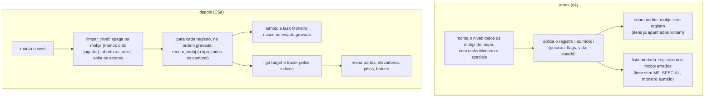
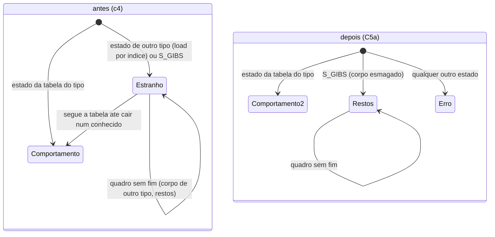

# C5: o save no formato do Doom

Item que estava fora do escopo (decisão de 2026-11-20) e voltou por decisão
do autor em 2026-11-21, depois de um teste com o jogo: um load na segunda
fase do episódio 4 deixou itens que não se deixavam apanhar e monstros que
sumiam. O defeito estava em `docs/DIFERENCAS_DOOM.md`, seção 5 ("Load aplica
os mobjs por índice").

"Formato do Doom" quer dizer o **conteúdo** do save do Doom
(`p_saveg.c`): o load apaga o que o nível acabou de criar e recria tudo a
partir do save (`P_UnArchiveThinkers`, `P_UnArchiveSpecials`), e o save
grava os tetos, as luzes e os pisos inteiros. O arquivo continua no formato
de texto deste port. Por decisão do autor, o save **não** copia as perdas do
Doom original: o fogo das luzes, os botões apertados e o alvo dos monstros
continuam gravados (o Doom não grava o `T_FireFlicker` nem a lista de
botões, e zera o `target` no load).

Feito nas duas branches, em grupos, com a referência nova **`c5`** no fim.

- Linhas citadas como "antes": `atmos` no commit `b6cd853` (C4), branch
  `lua` na tag `c4`.

| Grupo | O que muda | Commits (`atmos` / `lua`) | Situação |
|---|---|---|---|
| C5a. Mobjs | o save grava o mobj inteiro, com o tipo; o load apaga os mobjs do nível montado e recria os gravados, na ordem gravada; a task `Monstro` sem o caso `estranho` | (este) | concluído |
| C5b. Specials | o save grava os tetos, as luzes (com o fogo) e os pisos inteiros; o load os recria | – | a fazer |

---

## C5a: os mobjs recriados a partir do save

### Resumo

O load deste port montava o nível do zero (todos os mobjs do mapa, como no
começo) e aplicava os registros gravados **por posição na lista**: o
registro 1 no mobj 1, o 2 no 2. Cada item apanhado, projétil disparado ou
monstro removido antes do save mudava a lista, e dali em diante os registros
caíam nos mobjs errados: um item recebia as flags de outro mobj e perdia o
`MF_SPECIAL` (não se deixava apanhar), um monstro recebia o registro de um
item apanhado ou de um corpo e sumia, e os mobjs que sobravam no fim da
lista (os itens já apanhados) voltavam.

Agora o save grava o mobj inteiro, com o tipo, como o `P_ArchiveThinkers`
grava o `mobj_t`; o load apaga os mobjs do nível montado (menos o do
jogador) e recria cada mobj gravado, na ordem gravada, sem sortear nada (o
`P_SpawnMobj` sortearia o `lastlook`).

### Antes (`b6cd853` e `c4`, `saveg.lua`)

```lua
local recs = data.mobjs or {}
local n = #recs
if n > #world.mobjs then
  n = #world.mobjs
end
for i = 1, n do
  apply_mobj(world.mobjs[i], recs[i])          -- o registro i no mobj i
  collision.set_thing_position(world, world.mobjs[i])
end
```

O registro gravado tinha posição, flags, vida, estado e alguns campos que
ninguém mais usava (`info`, `ai_state`, `chase_tics`, `attack_kind`); não
tinha `lastlook`, `threshold`, `tracer` nem o `spawnpoint` (o pesadelo,
`-respawn`, o usa para fazer o monstro renascer no lugar de origem).

### Solução

**O save.** `CAMPOS_MOBJ` lista os campos do mobj (o tipo, `doomednum`,
`lastlook`, `threshold`, `fx` para os efeitos deste port...), e o registro
ganha `target` e `tracer` (índices na lista) e o `spawnpoint`. O mesmo texto
nas duas branches.

**O load.** Logo depois de montar o nível, `limpar_nivel` apaga o que ele
criou; os mobjs são recriados um a um, na ordem gravada, e só depois
`target` e `tracer` são ligados (um mobj pode apontar para um que vem
depois na lista):

```lua
-- saveg.lua (as duas branches)
for i = 1, #recs do
  local campos = campos_mobj(recs[i])
  if recs[i].is_player then
    local mo = game.player.mo          -- o do jogador e o mesmo, com os campos
    for k, v in pairs(campos) do
      mo[k] = v
    end
    world.mobjs[#world.mobjs + 1] = mo
    collision.set_thing_position(world, mo)
    novos[i] = mo
  else
    novos[i] = thinker.recriar_mobj(world, campos, game)
  end
end
```

`thinker.recriar_mobj` monta o mobj com os campos do save e o põe no
blockmap. **Aqui as duas branches diferem**, e é o ponto que as notas da
monografia anotaram (seção 7): na `lua`, recriar o mobj basta, porque o
thinker é a tabela; na `atmos`, o mobj de um monstro precisa também da sua
task `Monstro`, criada já no comportamento do estado gravado:

```lua
-- thinker.lua (atmos)
function M.recriar_mobj(world, campos, game)
  local mo = {}
  for k, v in pairs(campos) do
    mo[k] = v
  end
  world.mobjs[#world.mobjs + 1] = mo
  collision.set_thing_position(world, mo)
  criar_task(mo, game)                 -- a task Monstro, se o tipo tiver uma
  return mo
end
```

A task nasce no estado gravado: a primeira classificação já cai no
comportamento certo (um zumbi gravado no meio do ataque continua o ataque,
um corpo continua corpo), e o primeiro `:mobj.tic` desconta os tics gravados,
como o thinker Lua faria. `criar_task` é a parte do `spawn_mobj` que já
criava a task (passos 5 e 9), separada para servir aos dois.

**Limpar o nível montado** (`limpar_nivel`). Na `atmos`, as tasks dos
mobjs apagados e as das pools `movers` e `botoes` são **abortadas**
(`abort`, chamado do Lua no load, fora das tasks abortadas: roda os `defer`,
que soltam os setores e tiram os tetos e elevadores das listas de ativos, e
não emite evento). Na `lua`, as listas são esvaziadas. As luzes ficam para o
C5b (elas ainda não são gravadas).

### A task `Monstro` sem o caso `estranho`

O caso `estranho` existia por causa do load por índice: um monstro podia
receber o estado de outro tipo de mobj, e a task seguia a tabela até cair
num comportamento conhecido. No passo 9, ele calou um erro de tabela (a
mutação `spectre-com-tabela-do-soldado` ficou equivalente). Com o load
recriando cada mobj pelo tipo gravado, um estado fora da tabela do tipo só
aparece por um caminho: o corpo esmagado vira restos (`S_GIBS`, C4c), de
fora. Esse caso ganhou nome, e o resto virou erro, como na task `Arma` (C3):

```
;; antes
else => estranho(mo, game, vencido)  ;; outro tipo (load por indice)

;; depois
(indice(RESTOS, st) > 0)     => sequencia(mo, game, RESTOS, vencido, false)
else => error("monstro: estado " ++ tostring(st) ++ " fora da tabela do tipo " ++ tostring(mo.type))
```

### Diagramas

**O load, antes e depois:**



**A task `Monstro`, a parte que mudou:**



### Validação

**Roteiro `familia`** (mudado): a briga com os quatro tipos continua antes
do save; agora, antes do save, o jogador apanha dois bônus perto dos
Spectres (em (128, 992) e (256, 992); a lista de mobjs muda), grava no meio
da briga, carrega, e apanha outro bônus (em (128, 1152)). O "goto" põe o
jogador em cima do item e "andar" faz o movimento que encosta nele: a
primeira montagem punha o jogador 32 unidades ao sul, mas "andar" segue o
ângulo do jogador, e depois do load ele estava virado para o sudeste e se
afastou do item. Conferido com prints numa cópia de `G.state_string` (a
vida, a armadura e a contagem de bônus no mapa):

| | Antes do save | Depois do load | O bônus depois do load |
|---|---|---|---|
| C5a | 22 bônus no mapa (3 apanhados) | 22 | apanhado (vida 103, 21 bônus) |
| `c4` (o load antigo, rodado com o mesmo roteiro) | 22 | **25**: os 3 apanhados voltam | **não apanhado** |

É o defeito do E4M2, reproduzido no E1M5 com o código antigo e corrigido
com o novo. Os roteiros `familia` e `monstro` rodaram sem nenhum estado fora
da tabela (o `error` da task `Monstro` não disparou).

**Contra a branch `lua`** (`make test-branches`, com os dois lados do
C5a): idêntico nos 14 roteiros, com os saves iguais byte a byte e a
cobertura de todos (os roteiros com save: `elevadores`, `portas`, `monstro`,
`familia`, `arma`, `pisos`, `botoes`, `fluxo`).
