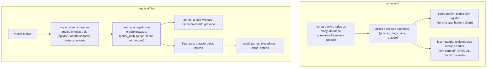
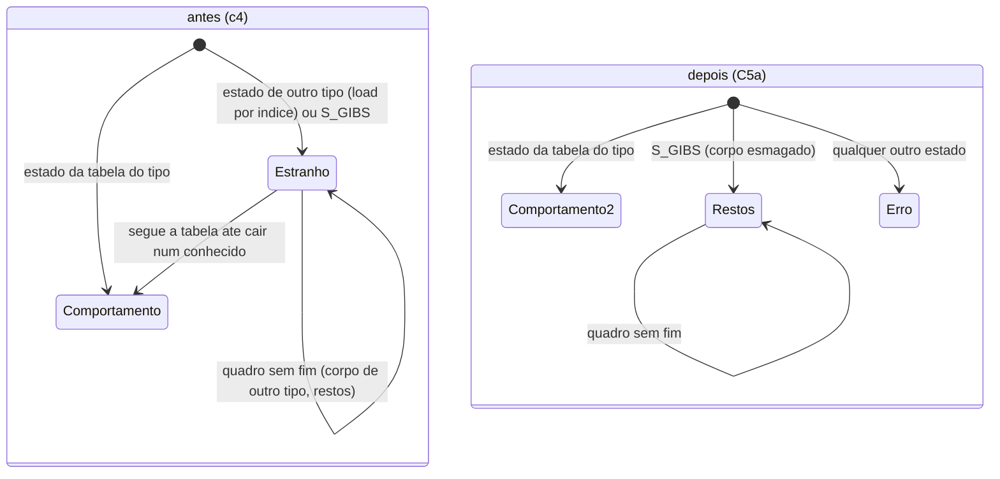
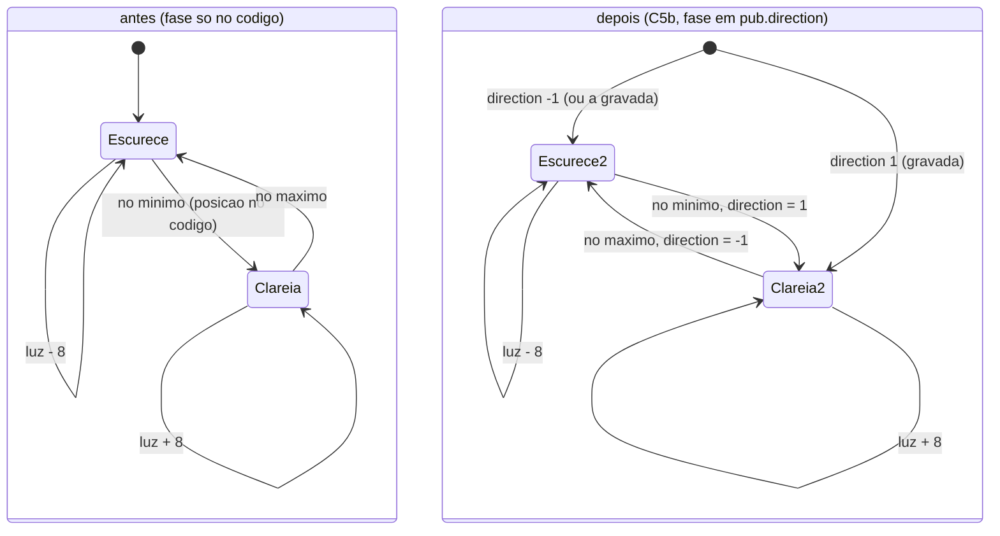
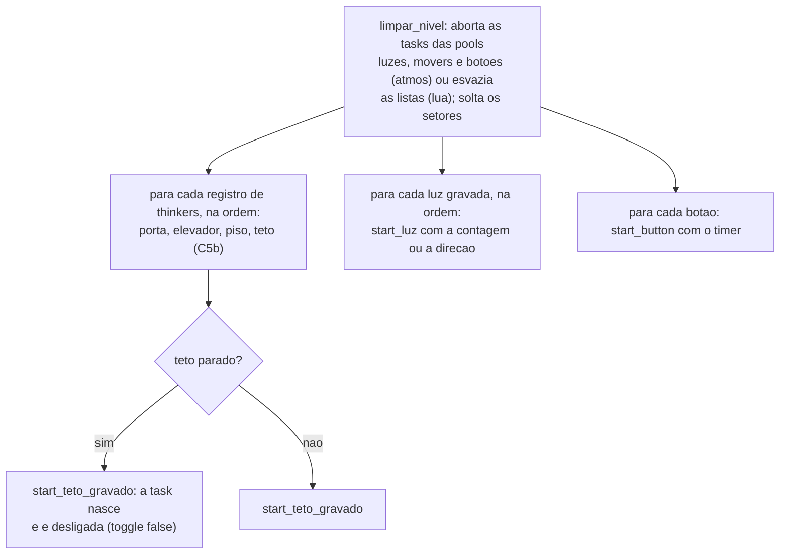

# C5: o save no formato do Doom

Item que estava fora do escopo (decisão de 2026-11-20) e voltou por decisão
do autor em 2026-11-21, depois de um teste com o jogo: um load na segunda
fase do episódio 4 deixou itens que não se deixavam apanhar e monstros que
sumiam. O defeito estava em `docs/DIFERENCAS_DOOM.md`, seção 5 ("Load aplica
os mobjs por índice").

"Formato do Doom" quer dizer o **conteúdo** do save do Doom
(`p_saveg.c`): o load apaga o que o nível acabou de criar e recria tudo a
partir do save (`P_UnArchiveThinkers`, `P_UnArchiveSpecials`), e o save
grava os tetos, as luzes e os pisos inteiros. O arquivo continua no formato
de texto deste port. Por decisão do autor, o save **não** copia as perdas do
Doom original: o fogo das luzes, os botões apertados e o alvo dos monstros
continuam gravados (o Doom não grava o `T_FireFlicker` nem a lista de
botões, e zera o `target` no load).

Feito nas duas branches, em grupos, com a referência nova **`c5`** no fim.

- Linhas citadas como "antes": `atmos` no commit `b6cd853` (C4), branch
  `lua` na tag `c4`.

| Grupo | O que muda | Commits (`atmos` / `lua`) | Situação |
|---|---|---|---|
| C5a. Mobjs | o save grava o mobj inteiro, com o tipo; o load apaga os mobjs do nível montado e recria os gravados, na ordem gravada; a task `Monstro` sem o caso `estranho` | `bc8d848` / `18782bc` | concluído |
| C5b. Specials | o save grava os tetos, as luzes (com o fogo) e os pisos inteiros; o load os recria | `27de943` / `8b0e3fa` | concluído |

---

## C5a: os mobjs recriados a partir do save

### Resumo

O load deste port montava o nível do zero (todos os mobjs do mapa, como no
começo) e aplicava os registros gravados **por posição na lista**: o
registro 1 no mobj 1, o 2 no 2. Cada item apanhado, projétil disparado ou
monstro removido antes do save mudava a lista, e dali em diante os registros
caíam nos mobjs errados: um item recebia as flags de outro mobj e perdia o
`MF_SPECIAL` (não se deixava apanhar), um monstro recebia o registro de um
item apanhado ou de um corpo e sumia, e os mobjs que sobravam no fim da
lista (os itens já apanhados) voltavam.

Agora o save grava o mobj inteiro, com o tipo, como o `P_ArchiveThinkers`
grava o `mobj_t`; o load apaga os mobjs do nível montado (menos o do
jogador) e recria cada mobj gravado, na ordem gravada, sem sortear nada (o
`P_SpawnMobj` sortearia o `lastlook`).

### Antes (`b6cd853` e `c4`, `saveg.lua`)

```lua
local recs = data.mobjs or {}
local n = #recs
if n > #world.mobjs then
  n = #world.mobjs
end
for i = 1, n do
  apply_mobj(world.mobjs[i], recs[i])          -- o registro i no mobj i
  collision.set_thing_position(world, world.mobjs[i])
end
```

O registro gravado tinha posição, flags, vida, estado e alguns campos que
ninguém mais usava (`info`, `ai_state`, `chase_tics`, `attack_kind`); não
tinha `lastlook`, `threshold`, `tracer` nem o `spawnpoint` (o pesadelo,
`-respawn`, o usa para fazer o monstro renascer no lugar de origem).

### Solução

**O save.** `CAMPOS_MOBJ` lista os campos do mobj (o tipo, `doomednum`,
`lastlook`, `threshold`, `fx` para os efeitos deste port...), e o registro
ganha `target` e `tracer` (índices na lista) e o `spawnpoint`. O mesmo texto
nas duas branches.

**O load.** Logo depois de montar o nível, `limpar_nivel` apaga o que ele
criou; os mobjs são recriados um a um, na ordem gravada, e só depois
`target` e `tracer` são ligados (um mobj pode apontar para um que vem
depois na lista):

```lua
-- saveg.lua (as duas branches)
for i = 1, #recs do
  local campos = campos_mobj(recs[i])
  if recs[i].is_player then
    local mo = game.player.mo          -- o do jogador e o mesmo, com os campos
    for k, v in pairs(campos) do
      mo[k] = v
    end
    world.mobjs[#world.mobjs + 1] = mo
    collision.set_thing_position(world, mo)
    novos[i] = mo
  else
    novos[i] = thinker.recriar_mobj(world, campos, game)
  end
end
```

`thinker.recriar_mobj` monta o mobj com os campos do save e o põe no
blockmap. **Aqui as duas branches diferem**, e é o ponto que as notas da
monografia anotaram (seção 7): na `lua`, recriar o mobj basta, porque o
thinker é a tabela; na `atmos`, o mobj de um monstro precisa também da sua
task `Monstro`, criada já no comportamento do estado gravado:

```lua
-- thinker.lua (atmos)
function M.recriar_mobj(world, campos, game)
  local mo = {}
  for k, v in pairs(campos) do
    mo[k] = v
  end
  world.mobjs[#world.mobjs + 1] = mo
  collision.set_thing_position(world, mo)
  criar_task(mo, game)                 -- a task Monstro, se o tipo tiver uma
  return mo
end
```

A task nasce no estado gravado: a primeira classificação já cai no
comportamento certo (um zumbi gravado no meio do ataque continua o ataque,
um corpo continua corpo), e o primeiro `:mobj.tic` desconta os tics gravados,
como o thinker Lua faria. `criar_task` é a parte do `spawn_mobj` que já
criava a task (passos 5 e 9), separada para servir aos dois.

**Limpar o nível montado** (`limpar_nivel`). Na `atmos`, as tasks dos
mobjs apagados e as das pools `movers` e `botoes` são **abortadas**
(`abort`, chamado do Lua no load, fora das tasks abortadas: roda os `defer`,
que soltam os setores e tiram os tetos e elevadores das listas de ativos, e
não emite evento). Na `lua`, as listas são esvaziadas. As luzes ficam para o
C5b (elas ainda não são gravadas).

### A task `Monstro` sem o caso `estranho`

O caso `estranho` existia por causa do load por índice: um monstro podia
receber o estado de outro tipo de mobj, e a task seguia a tabela até cair
num comportamento conhecido. No passo 9, ele calou um erro de tabela (a
mutação `spectre-com-tabela-do-soldado` ficou equivalente). Com o load
recriando cada mobj pelo tipo gravado, um estado fora da tabela do tipo só
aparece por um caminho: o corpo esmagado vira restos (`S_GIBS`, C4c), de
fora. Esse caso ganhou nome, e o resto virou erro, como na task `Arma` (C3):

```
;; antes
else => estranho(mo, game, vencido)  ;; outro tipo (load por indice)

;; depois
(indice(RESTOS, st) > 0)     => sequencia(mo, game, RESTOS, vencido, false)
else => error("monstro: estado " ++ tostring(st) ++ " fora da tabela do tipo " ++ tostring(mo.type))
```

### Diagramas

**O load, antes e depois:**



**A task `Monstro`, a parte que mudou:**



### Validação

**Roteiro `familia`** (mudado): a briga com os quatro tipos continua antes
do save; agora, antes do save, o jogador apanha dois bônus perto dos
Spectres (em (128, 992) e (256, 992); a lista de mobjs muda), grava no meio
da briga, carrega, e apanha outro bônus (em (128, 1152)). O "goto" põe o
jogador em cima do item e "andar" faz o movimento que encosta nele: a
primeira montagem punha o jogador 32 unidades ao sul, mas "andar" segue o
ângulo do jogador, e depois do load ele estava virado para o sudeste e se
afastou do item. Conferido com prints numa cópia de `G.state_string` (a
vida, a armadura e a contagem de bônus no mapa):

| | Antes do save | Depois do load | O bônus depois do load |
|---|---|---|---|
| C5a | 22 bônus no mapa (3 apanhados) | 22 | apanhado (vida 103, 21 bônus) |
| `c4` (o load antigo, rodado com o mesmo roteiro) | 22 | **25**: os 3 apanhados voltam | **não apanhado** |

É o defeito do E4M2, reproduzido no E1M5 com o código antigo e corrigido
com o novo. Os roteiros `familia` e `monstro` rodaram sem nenhum estado fora
da tabela (o `error` da task `Monstro` não disparou).

**Contra a branch `lua`** (`make test-branches`, com os dois lados do
C5a): idêntico nos 14 roteiros, com os saves iguais byte a byte e a
cobertura de todos (os roteiros com save: `elevadores`, `portas`, `monstro`,
`familia`, `arma`, `pisos`, `botoes`, `fluxo`).

---

## C5b: tetos, luzes e pisos inteiros no save

### Resumo

O `P_ArchiveSpecials` do Doom grava os tetos (`tc_ceiling`), as portas, os
pisos, os elevadores e as luzes (`tc_flash`, `tc_strobe`, `tc_glow`). Este
port gravava as portas, os elevadores, os pisos pela metade (sem `crush`,
textura e special do fim) e os botões, e **não gravava** tetos nem luzes: um
esmagador em movimento sumia no load, e as luzes recomeçavam do zero (o
nível as criava de novo). Agora o save grava os tetos (com o `parado` do
C4b), as luzes (o fogo também, que o Doom não grava, por decisão do autor) e
os pisos inteiros, e o load os recria.

### A régua da fase, de novo

As notas da monografia (seção 8) chamam de "régua da fase" o critério de
onde a fase de uma entidade pode ficar: só na posição do código, ou num
campo. Uma das exigências que a devolvem aos dados é o save. As luzes e o
teto eram os casos em que a fase ficava só no código, porque nada de fora
a lia:

- as luzes contavam o tempo com `espera(n)`, um `loop in n`: a contagem era
  o contador do laço; o brilho sabia se escurecia ou clareava pelo laço em
  que estava;
- o teto guardava a direção e a velocidade em variáveis da task (C4b
  mostrou a vantagem: parar com `toggle` não custou nenhuma linha).

Com o save, cada luz expõe os campos do registro do Doom no `pub` (`kind`,
`maxlight`, `minlight`, `count` e os do tipo), `espera` desconta
`luz.count`, e o brilho tem `pub.direction`; o teto voltou a usar
`teto.direction` e `teto.speed`. No load, a task nasce com a contagem (ou a
direção) gravada, sem sortear:

```
;; antes (bc8d848)
val func espera (n) {
    loop in n {
        await :game.specials
    }
}
val task Pisca (setor, maxl, minl) {
    espera(band(rng.p_random(), 64) + 1)
    ...

;; depois (C5b)
val func espera (luz, n) {
    set luz.count = n
    loop {
        await :game.specials
        set luz.count = luz.count - 1
        until (luz.count <= 0)
    }
}
val task Pisca (setor, maxl, minl, contagem) {
    set pub = [kind="flash", setor=setor, maxlight=maxl, minlight=minl,
               maxtime=64, mintime=7, count=0]
    defer {
        set pub.dead = true               ;; C5: abortada no load, nao e gravada
    }
    espera(pub, contagem || (band(rng.p_random(), 64) + 1))
    ...
```

Na branch `lua`, nada mudou nas luzes: o registro de cada luz já tinha a
contagem e a direção, porque o `tick_lights` despacha por elas. O load só
acrescenta o registro gravado à lista (`start_luz`).

| | Antes | Depois |
|---|---|---|
| `atmos`: `espera` | 5 | 8 |
| `atmos`: `Pisca`, `Strobe`, `Brilho`, `Fogo` | 12, 13, 16, 7 (48) | 17, 22, 26, 13 (78) |
| `atmos`: `Teto` | 40 | 39 |
| `lua`: `tick_lights` | 51 | 51 |

(linhas de código, sem comentários, contadas por script sobre `bc8d848` e
`18782bc`). É o mesmo resultado das portas e dos elevadores no passo 3: a
exigência do save devolve a fase aos dados, e o ganho da task (a fase como
posição no código) some; as luzes, que eram o melhor caso da régua, viraram
um caso como os outros. O teto ficou do mesmo tamanho porque a direção e a
velocidade só trocaram de lugar.

### Um tropeço: as tasks abortadas continuam na pool

A primeira rodada deu saves diferentes nas duas branches nos roteiros
`elevadores` e `portas`: a `atmos` gravava 12 luzes no E1M3, onde há 4. A
pool `luzes` crescia a cada load (12, 24, 36 tasks no E1M3, com prints do
tamanho da pool): as tasks abortadas pelo `limpar_nivel` continuam na lista
da pool (o runtime desta versão não as recolhe), e o save, que percorre a
pool, gravava também o `pub` das mortas. As portas não tinham o problema,
porque o `defer` delas já marcava `dead` e o save as pulava. As luzes e o
botão ganharam o mesmo `defer` (`pub.dead = true`), e o save e o
`start_button` pulam as mortas. As tasks mortas ficam na pool até o fim do
nível; não acordam (a corrotina está fechada), mas cada `emit` na pool passa
por elas. Fica registrado como custo do load na versão `atmos`.

### Diagramas

**A task `Brilho`, antes e depois:**



**O load dos specials, depois do C5:**



### Validação

**Roteiros.**

- `luzes` (mudado): um save e um load com as luzes andando no E4M1 (o fogo
  e o flash) e outro no E1M2 (o brilho e os strobes), cada um seguido de
  300 quadros olhando em volta.
- `correcoes`, no E2M2 (mudado): um save e um load com o esmagador da tag 16
  descendo, e outro com ele parado (linha 687); a linha 728 o reativa
  depois do segundo load. Conferido com prints (o teto do setor 2 e o
  `parado`): depois do primeiro load, o esmagador continua de onde estava;
  depois do segundo, volta parado em 99, e a 728 o põe para andar.

**Contra a branch `lua`** (`make test-branches`): idêntico nos 14
roteiros, com os saves iguais byte a byte.

---

## Fechamento do C5

Com os dois grupos commitados nas duas branches, a branch `lua` ganhou a
tag **`c5`** (`8b0e3fa`), a referência padrão nova. A cobertura de
`tests/test_drivers.sh` passou a exigir os loads novos (2 no `luzes`, 2 no
`correcoes`).

### Validação

**Contra a referência nova** (`make test-drivers`, tag `c5`): idêntico nos
14 roteiros, com os saves iguais byte a byte e a cobertura de todos.
`make test-branches` (no C5b, com os dois grupos): idêntico à branch `lua`
nos 14. `make test`: 12 passam, as 8 falhas conhecidas. A janela abre e
fecha limpo nas duas branches.

**O caso do E4M2.** Um roteiro à parte (`-warp 4 2`): o jogador apanha três
itens perto do início, grava, carrega e apanha mais três. Com prints numa
cópia de `G.state_string` (os mobjs, os itens no mapa, a armadura): antes
do save, de 84 itens para 81; depois do load, 81 (o load antigo traria de
volta os três apanhados, como no E1M5 do `familia`); depois do load, os
três seguintes são apanhados (de 81 para 78, armadura de 2 para 5).

**Contra a referência anterior** (`REF_TAG=c4`, hash do framebuffer):

| Roteiro | Quadros | Diferentes | 1º quadro | O que diverge |
|---|---|---|---|---|
| `botoes`, `portas`, `ordem`, `telas`, pseudoaleatório, `exits` | iguais | 0 | – | sem load, ou com um load em que a lista de mobjs não tinha mudado |
| `fluxo` | 4.484 | 26 | 2.462 | o load do roteiro |
| `arma` | 3.000 | 14 | 2.404 | o load no tiro do BFG |
| `elevadores` | 2.122 | 78 | 1.824 | os loads (as luzes do E1M3 não recomeçam) |
| `luzes` | 3.479 | 250 | 1.725 | os loads novos (as luzes continuam de onde estavam) |
| `correcoes` | 3.696 | 346 | 3.351 | os loads novos com o esmagador do E2M2 (antes, ele sumia no load) |
| `pisos` | 2.624 | 531 | 204 | o load com os pisos do E2M2 (o piso inteiro, e as luzes) |
| `familia` | 3.326 | 1.228 | 2.099 | o load no meio da briga (os mobjs recriados) |
| `monstro` | 2.761 | 1.634 | 1.061 | o load no meio da briga |

Antes do primeiro load de cada roteiro, idêntico: o C5 só muda o load.

### Mutações

`make test-mutacoes` (todas, 131): **122/123 não equivalentes detectadas**,
8 equivalentes, 1 pendente (`corpo-sem-restos`, do C4c). Na primeira rodada,
121/125 com 6 equivalentes; os ajustes estão abaixo.

**Refeitas com o texto novo** (as luzes e o teto mudaram): `pisca-sem-espera-inicial`,
`fogo-intervalo-3`, `strobe-sincronizado-sorteia`, `brilho-nao-volta`,
`save-esquece-botoes`, `esmagador-nao-desacelera`, `esmagador-sobe-devagar`,
todas detectadas. `estranho-congela` saiu, com o caso `estranho`.

**A do passo 9 que voltou a ser detectada.** `spectre-com-tabela-do-soldado`
(o Spectre recebe a tabela do Shotgun Guy) era equivalente desde o passo 9:
o caso `estranho` seguia a tabela em silêncio. Agora o estado do Spectre
fora da tabela do Shotgun Guy é erro, e a mutação é detectada no primeiro
quadro do roteiro `familia`.

**As do C5:**

| Mutação | Erro simulado | Roteiro | 1º quadro | Quadros dif. |
|---|---|---|---|---|
| `load-perde-spawnpoint` | o load não restaura o `spawnpoint` | `familia` | 2.237 | 1.090 |
| `load-luz-sorteia` | o load recria a luz que pisca sorteando de novo | `luzes` | 1.381 | 752 |
| `save-grava-luz-morta` | o save grava as luzes abortadas no load | `elevadores` | 424 | 821 (saves diferem) |
| `load-teto-andando` | o load recria o teto parado andando | `correcoes` | 3.522 | 175 |
| `load-sem-task-monstro` | o load recria o monstro sem a task `Monstro` | `familia` | – | 0: **equivalente** |

`save-grava-luz-morta` só aparece com um save depois de um load no mesmo
nível; o `luzes` não tem isso (o segundo save vem depois de um `idclev`), e
a mutação passou a usar o `elevadores`, onde o tropeço foi achado.

**Duas equivalências que dizem algo.**

- `load-sem-task-monstro`: o monstro recriado sem a task cai no thinker
  Lua (`G.pensar_ate_task` roda o `mobj_thinker` para os mobjs sem task),
  que interpreta a mesma tabela, e o jogo é o mesmo. É o que o teste de
  equivalência prova desde o passo 5: a task muda a forma, não o
  comportamento.
- `salto-sem-vencido` (passo 5), detectada até o C4: o salto de fora que
  já vence no mesmo tic só acontecia no load por índice, que aplicava tics
  arbitrários aos mobjs. Os estados que podem ser postos de fora num
  monstro (dor, perseguição, morte, explosão, restos) têm 2 tics ou mais,
  ou −1 (conferido em `info.STATES` para os quatro tipos), e o salto
  desconta um tic sem vencer. Com o load recriando a task no estado
  gravado, o "vencido" da task `Monstro` ficou sem caminho: era mais uma
  complexidade que existia por causa do bug. O da task `Arma` continua (a
  arma solta na morte tem 1 tic; mutação `salto-vencido-espera`, detectada).
  O código ficou como estava: tirá-lo é uma refatoração à parte.

### Métricas

| | Antes | Depois |
|---|---|---|
| `saveg.lua`, `atmos` | 745 | 831 |
| `saveg.lua`, `lua` | 741 | 810 |
| `atmos`: tasks de luz (com `espera`) | 53 | 86 |
| `atmos`: task `Teto` | 40 | 39 |
| `atmos`: `monstro.atm` (o caso `estranho`, 8 linhas, saiu; `RESTOS` e o `error` entraram) | 128 | 122 |
| `lua`: `tick_lights` | 51 | 51 |
| `thinker.recriar_mobj` | – | 9 (`lua`), 10 (`atmos`: mais a task) |

(linhas de código sem comentários, por script, sobre `b6cd853` e `c4`.)

**Leitura para a monografia.** O C5 mediu, nas duas formas, o custo de
recriar as entidades a partir do save (notas, seção 7):

- **Os mobjs.** Na `lua`, recriar o mobj basta (`recriar_mobj`, 9 linhas):
  o thinker é a tabela, e o mobj recriado no estado gravado continua
  dali. Na `atmos`, recriar o mobj de um monstro é também recriar a task
  `Monstro` no comportamento do estado gravado (uma linha a mais, porque a
  task já sabia reconhecer o comportamento de qualquer estado: o desenho do
  passo 5 pagou isso adiantado). O ganho veio do outro lado: sem o load por
  índice, a task perdeu o caso `estranho`, e um estado fora da tabela virou
  erro (a mutação `spectre-com-tabela-do-soldado`, equivalente desde o
  passo 9, passou a ser detectada).
- **Os specials.** Recriar uma luz ou um teto gravado exigiu que a fase,
  que a task guardava só na posição do código, virasse campo: as tasks de
  luz cresceram de 53 para 86 linhas, e o `tick_lights` da `lua`, onde a
  fase sempre foi dado, não mudou. É a régua da fase (notas, seção 8): o
  save é uma das exigências que devolvem a fase aos dados.
- **Abortar no load.** Na `atmos`, apagar o que o nível montou é abortar
  tasks; as abortadas continuam na pool nesta versão do runtime, e tudo o
  que o save percorre precisou marcar `dead` num `defer`.

### Diferenças que ficam

- O arquivo é o do port (texto), não o binário do Doom.
- **Não copia as perdas do Doom original**, por decisão do autor: o fogo
  das luzes, os botões apertados e o alvo dos monstros continuam gravados.
- `corpo-sem-restos` (C4c) continua pendente: nenhum roteiro esmaga o corpo
  de um monstro.

### Como reproduzir

```sh
make test-drivers                 # contra a tag c5
make test-branches                # contra a branch lua
make test-mutacoes
sh tests/test_drivers.sh 0 1 familia -warp 1 5 -respawn   # itens antes do save e depois do load
sh tests/test_drivers.sh 1200 1 luzes -warp 4 1           # luzes gravadas
sh tests/test_drivers.sh 0 1 correcoes -warp 1 1          # esmagador gravado andando e parado
python3 tools/diagramas.py docs/registro/17-save-formato-doom.md
```

### Arquivos alterados

| Arquivo | Branch | Grupo | Mudança |
|---|---|---|---|
| `saveg.lua` | as duas | C5a, C5b | o mobj inteiro; `limpar_nivel`; a recriação dos mobjs; tetos, luzes e pisos inteiros; pula as tasks mortas (`atmos`) |
| `thinker.lua` | as duas | C5a | `recriar_mobj`; na `atmos`, `criar_task` separada do `spawn_mobj` |
| `monstro.atm` | `atmos` | C5a | o caso `estranho` sai; `RESTOS` e `error` |
| `setores.atm` | `atmos` | C5b | as luzes com a fase no `pub` e a contagem gravada; o `Teto` com a direção e a velocidade no registro; `dead` no `defer` das luzes e do botão |
| `specials.lua` | as duas | C5b | `start_luz`, `start_teto_gravado`; o `start_button` pula botões mortos (`atmos`) |
| `tools/make_replay.lua` | `atmos` | C5a, C5b | os itens antes do save e depois do load no `familia`; saves e loads no `luzes` e no E2M2 do `correcoes` |
| `tests/test_drivers.sh` | `atmos` | fechamento | a cobertura dos loads novos; a referência padrão `c5` |
| `tools/mutacoes.py` | `atmos` | fechamento | sete refeitas com o texto novo; `estranho-congela` sai; `spectre-com-tabela-do-soldado` deixa de ser equivalente; as do C5 |
