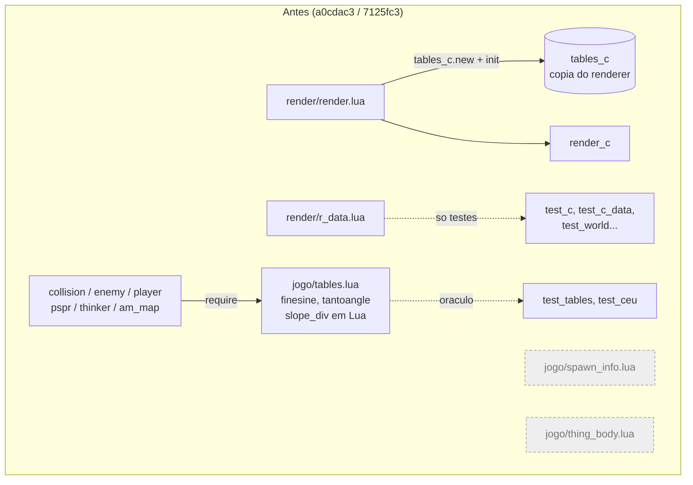
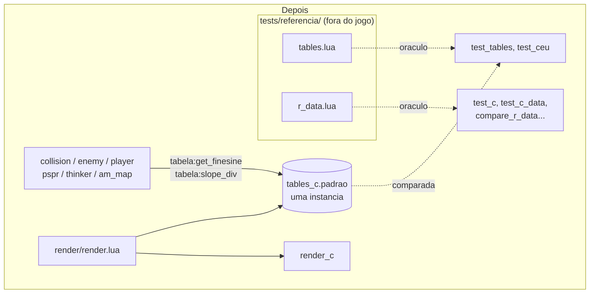
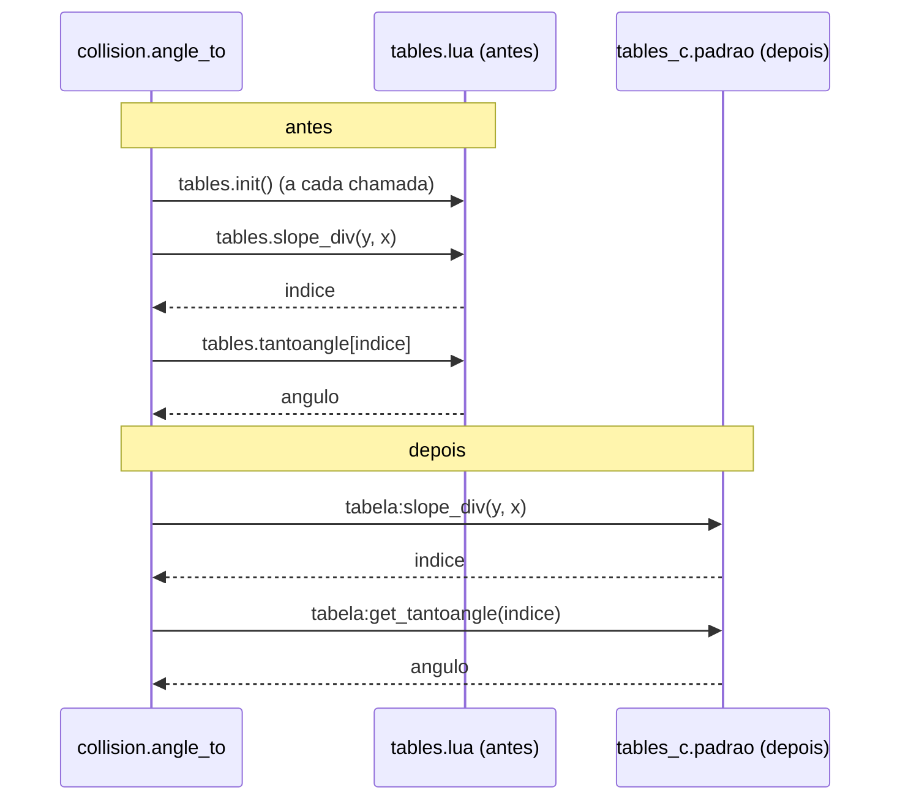

# Menos módulos Lua no jogo: código morto e as tabelas em C

Pedido do autor em 2026-11-22, depois da organização em pastas: tirar do
jogo os módulos Lua que sobraram da migração do renderer para C. É uma
refatoração **sem mudança de comportamento**, feita nas duas branches
(`atmos` e `lua`), com a mesma referência de antes (`c5`).

- Linhas citadas como "antes": `atmos` em `a0cdac3`, branch `lua` em
  `7125fc3` (a organização em pastas).

| Módulo | Situação antes | O que foi feito |
|---|---|---|
| `jogo/spawn_info.lua` (132 linhas) | ninguém fazia `require` (nem o jogo, nem os testes, nem as ferramentas) | apagado |
| `jogo/thing_body.lua` (132 linhas) | idem | apagado |
| `jogo/tables.lua` (107 linhas) | a lógica usava as tabelas em Lua; o renderer já usava as mesmas tabelas em C (`tables_c`), com uma cópia própria | a lógica passa a usar `tables_c.padrao`; o arquivo vai para `tests/referencia/`, como oráculo do `test_tables` e do `test_ceu` |
| `render/r_data.lua` (490 linhas) | o jogo não usava (o `r_data_c` o substituiu); dez testes e o `compare_r_data` o usavam | vai para `tests/referencia/`, como oráculo do `test_c`, do `test_c_data` e do `compare_r_data` |

Por que mover e não apagar os dois últimos: eles são a versão Lua que
provou o porte para C (`test_tables` compara as três tabelas inteiras e
20.000 chamadas; `test_c` e `test_c_data` comparam as texturas). Apagar
deixaria os módulos em C sem oráculo. Em `tests/referencia/` eles não fazem
parte do jogo e o `Makefile` os acha (`LUA_PATH`).

## Números (medidos por script)

Arquivos `.lua` em `jogo/`, `render/` e `ponte/` e as suas linhas
(`git ls-tree` em `a0cdac3` contra a árvore nova):

| Pasta | Antes | Depois |
|---|---|---|
| `jogo/` | 22 arquivos, 16.367 linhas | 19 arquivos, 15.996 linhas |
| `render/` | 5 arquivos, 983 linhas | 4 arquivos, 492 linhas |
| `ponte/` | 5 arquivos, 1.009 linhas | 5 arquivos, 1.009 linhas |
| **total** | **32 arquivos, 18.359 linhas** | **28 arquivos, 17.497 linhas** |

As tasks `.atm` não mudam (7 arquivos).

## As dependências, antes e depois

Antes, duas cópias das mesmas tabelas viviam no processo: a Lua (lógica) e
a C (renderer), e dois módulos mortos ficavam ao lado.





## Uma chamada, antes e depois

O caminho de `collision.angle_to` (o `R_PointToAngle2` do Doom, chamado em
toda mira, visão e empurrão):



O `tables.init()` saiu de todas as funções que o chamavam (seis lugares):
a instância `padrao` nasce pronta quando o `tables_c` é carregado.

## Solução

### `src/tables_c.c`

1. A instância compartilhada, criada e inicializada ao abrir o módulo:

```c
    /* Uma instancia pronta, compartilhada pela logica do jogo
       (collision, player, pspr, thinker, enemy, am_map) e pelo renderer */
    lua_pushcfunction(L, l_new);
    lua_call(L, 0, 1);
    init_tables(check_table(L, -1));
    lua_setfield(L, -2, "padrao");
```

2. O `slope_div` com argumentos de 64 bits. Antes, `l_slope_div` cortava
   `num` e `den` para `int32_t`, e o Lua não cortava. Em `angle_to`, depois
   de `y = as_i32(...)`, o ramo `y = -y` dá 2^31 quando `y` vale -2^31, e o
   corte daria `den` negativo (resultado 2048, em vez do que o Lua calcula).
   O caso é raro (uma diferença de exatamente -2^31 em coordenadas fixas),
   mas a troca tem de ser exata:

```c
/* antes */
static int64_t slope_div(int32_t num, int32_t den)
...
    int32_t num = (int32_t)luaL_checkinteger(L, 2);
    int32_t den = (int32_t)luaL_checkinteger(L, 3);

/* depois */
static int64_t slope_div(int64_t num, int64_t den)
...
    int64_t num = (int64_t)luaL_checkinteger(L, 2);
    int64_t den = (int64_t)luaL_checkinteger(L, 3);
```

O `render_c` não usa essa função (tem a sua, interna), então o renderer não
muda.

### Os seis módulos da lógica

Uma troca mecânica, feita por script nas duas branches:

| Antes | Depois |
|---|---|
| `local tables = require("tables")` | `local tabela = require("tables_c").padrao` |
| `tables.init()` | (sai) |
| `tables.finesine[i]` | `tabela:get_finesine(i)` |
| `tables.tantoangle[tables.slope_div(y, x)]` | `tabela:get_tantoangle(tabela:slope_div(y, x))` |
| `tables.fine_sin(a)`, `tables.fine_cos(a)` | `tabela:fine_sin(a)`, `tabela:fine_cos(a)` |
| `tables.finesine[angle] or 0` (`player.lua`) | `tabela:get_finesine(angle)`: o índice é `band(..., FINEMASK)`, sempre dentro da tabela |

Uma diferença de contrato: a tabela Lua devolvia `nil` para um índice fora
da faixa, e o `tables_c` levanta erro. Todos os índices da lógica passam por
`band(..., FINEMASK)` ou saem de `slope_div` (0 a 2048), e a bateria de
replay não acusou nenhum erro.

### `render/render.lua`

```lua
-- antes
local native_tables = require("tables_c").new()
native_tables:init()
-- depois
local native_tables = require("tables_c").padrao
```

### Testes

`test_tables` ganhou um bloco: a instância `padrao` contra o Lua de
referência (as tabelas inteiras) e o `slope_div` no domínio de `angle_to`
(0 a 2^31, nas bordas e em 10.000 pares aleatórios).

## Validação

- `make`: compila; só o `tables_c` muda.
- `make test-drivers`: as 9 propriedades do Atmos e os 14 roteiros
  **idênticos à `c5`** (framebuffer, estado e saves byte a byte), de
  815 a 6.000 quadros cada.
- `make test-branches`: a branch `lua`, com a mesma troca, **idêntica** à
  `atmos` nos 14 roteiros.
- `make test-mutacoes`: 122/123 detectadas, 8 equivalentes, 1 pendente
  (`corpo-sem-restos`), o mesmo de antes. A mutação `sem-balanco` cita o
  trecho de `pspr.lua` e teve o trecho original trocado para
  `tabela:get_finesine(angle)`; sem isso, ela ficava "não aplicada" (o
  primeiro `make test-mutacoes` acusou).
- `make test`: 12 passam e as 8 falhas conhecidas, pelos mesmos motivos
  (o `test_c_data` cai no mesmo `sprite_frame` de antes, conferido num
  worktree de `a0cdac3`). O `test_tables` passa com o bloco novo.
- Jogo com janela nas duas branches (`lua5.4 main.lua -scale 2`, com e sem
  `-nosound`): fecha limpo com `kill -TERM` ("janela fechada").
- Os três diagramas deste registro: `tools/diagramas.py` e o preview
  "diagramas", `window.erros` vazio.

### Por que o replay basta aqui

As tabelas em C e em Lua são geradas pela mesma fórmula, e o `test_tables`
compara as três inteiras. O único ponto em que as duas implementações
podiam divergir era o corte para 32 bits no `slope_div` (seção
"Solução"), coberto pelo bloco novo do `test_tables`. O replay confirma o
resto: qualquer ângulo diferente mudaria a mira, a visão dos monstros e o
`P_Random` consumido, e apareceria no hash de estado.

## Arquivos alterados (nas duas branches)

- apagados: `jogo/spawn_info.lua`, `jogo/thing_body.lua`;
- movidos: `jogo/tables.lua` e `render/r_data.lua` → `tests/referencia/`;
- `src/tables_c.c` (instância `padrao`, `slope_div` em 64 bits);
- `jogo/collision.lua`, `enemy.lua`, `player.lua`, `pspr.lua`,
  `thinker.lua`, `am_map.lua`; `render/render.lua`;
- `Makefile` (`tests/referencia` no `LUA_PATH`);
- `tests/test_tables.lua`;
- `README.md`, `README.pt.md`; na `atmos`, também `CLAUDE.md` e este
  registro.
