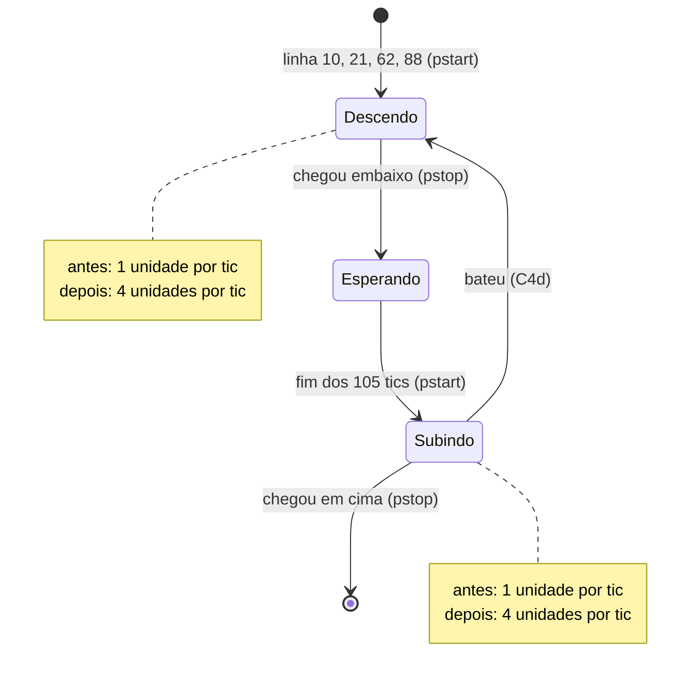

# C6: o elevador "desce, espera, sobe" a 4 unidades por tic

Último item da seção 1 (specials) do `docs/DIFERENCAS_DOOM.md`, achado no
C4d e deixado para depois porque mudava o roteiro `ordem`. Feito nas duas
branches, com a referência nova **`c6`**.

- Linhas citadas como "antes": `atmos` em `656a323`, branch `lua` em
  `d004f8c`.

| O que muda | Commits (`atmos` / `lua`) | Situação |
|---|---|---|
| `do_plat_dwus` anda a `PLATSPEED * 4`; o roteiro `ordem` (cenário 2) e o `elevadores` (save B e C) recalibrados | este commit / `9f08a93` | concluído |

## Resumo

O Doom cria o elevador "desce, espera, sobe" (`downWaitUpStay`, linhas 10,
21, 62 e 88) com `plat->speed = PLATSPEED * 4` (`p_plats.c`,
`EV_DoPlat`). Este port usava `PLATSPEED`: o elevador levava quatro vezes
mais tempo para descer e para subir. As versões rápidas (`blazeDWUS`,
linhas 120 a 123) já usavam `PLATSPEED * 8`.

A correção é uma linha em `specials.lua`, igual nas duas branches. As tasks
(`Elevador`, na `atmos`) não mudam: a velocidade é dado do registro do
elevador (`plat.speed`), lido a cada tic por `mover_plat`.

## Antes e depois

```lua
-- antes (656a323 / d004f8c), specials.lua
function M.do_plat_dwus(self, line, blaze)
  local ok = false
  local speed = PLATSPEED
  if blaze then
    speed = PLATSPEED * 8
  end

-- depois
function M.do_plat_dwus(self, line, blaze)
  local ok = false
  -- C6: EV_DoPlat (downWaitUpStay) anda a PLATSPEED * 4 (4 unidades por tic)
  local speed = PLATSPEED * 4
  if blaze then
    speed = PLATSPEED * 8
  end
```

### A máquina de estados do elevador DWUS (task `Elevador`)

A forma é a mesma antes e depois; só o tempo em cada fase de movimento muda
(o elevador da linha 116 do E1M3, setor 165, desce 48 unidades: 48 tics
antes, 12 depois; a espera continua 105 tics, `PLATWAIT * TICRATE`).



## Os roteiros recalibrados

### `ordem`, cenário 2 (porta e elevador vizinhos no mesmo tic)

O cenário põe o jogador com o centro na porta do setor 167 e o corpo sobre
o elevador do setor 165, enquanto os dois andam: quem anda primeiro no tic
decide a altura que o jogador vê. A mutação `portas-fora-de-movers` (portas
numa pool própria, depois dos outros movimentadores) inverte essa ordem e
só é detectada com os dois andando e o jogador na fronteira.

Antes, o elevador descia 48 unidades em 48 tics, e o jogador era posto 37
quadros depois do elevador começar. Com 4 por tic, o elevador chega
embaixo em 12 tics, antes de a porta (que sobe 2 por tic) abrir o bastante
para o jogador caber. A porta da linha 231 abre e **fica aberta** (não
fecha), então o único trecho em que ela anda é a abertura (54 tics).

A conta para o jogador caber (altura 56) com os dois andando: teto da
porta `128 + 2t`, chão do elevador cruzado em `t0`: `176 - 4(t - t0)`.
Cabe quando `6t ≥ 104 + 4·t0`. Com o elevador cruzado 40 quadros depois da
porta, os dois andam juntos de 40 a 52, e o jogador cabe a partir de ~44:
ele é posto aos 46 (6 quadros depois do elevador).

```mermaid
gantt
    title Cenario 2 do roteiro ordem (tics desde o cross 231)
    dateFormat X
    axisFormat %s
    section Antes (c5)
    porta sobe (128 -> 236)      :a1, 0, 54
    elevador desce (176 -> 128)  :a2, 1, 49
    jogador posto na fronteira   :a3, 38, 39
    section Depois (c6)
    porta sobe (128 -> 236)      :b1, 0, 54
    elevador desce (176 -> 128)  :b2, 40, 52
    jogador posto na fronteira   :b3, 46, 47
```



```lua
-- antes (tools/make_replay.lua)
cmd("cross 231")                               -- a porta abre (128 -> 236)
cmd("cross 116"); wait(37)                     -- o elevador desce (176 -> 128)
goto_xy(-2707, -1317)                          -- centro na porta, corpo no elevador

-- depois
cmd("cross 231")                               -- a porta abre (128 -> 236)
wait(ELEVADOR_DEPOIS)                          -- 40
cmd("cross 116")                               -- o elevador desce (176 -> 128)
wait(JOGADOR_DEPOIS)                           -- 6
goto_xy(-2707, -1317)                          -- centro na porta, corpo no elevador
```

A porta continua criada antes do elevador (anda antes dele na pool
`movers`), que é a ordem que a mutação inverte. As alturas foram conferidas
com uma sonda em `move_plane` (os setores 165 e 167 a cada tic), numa pasta
isolada. As duas constantes podem ser trocadas pelo ambiente
(`ELEVADOR_DEPOIS`, `JOGADOR_DEPOIS`) para recalibrar.

### `elevadores` (save em cada fase do elevador da linha 178)

O roteiro grava o slot 5 com o elevador descendo, o 4 esperando e o 3
subindo, e carrega cada um. Com o elevador 4 vezes mais rápido, as esperas
de 180 e 130 quadros passavam do ponto: o slot 4 e o 3 ficavam sem
elevador (já tinha acabado). As esperas novas foram escolhidas no meio das
janelas medidas, rodando só o driver Atmos com cada valor:

| Espera | Antes | Depois | Janela medida |
|---|---|---|---|
| até o save B (esperando) | 180 | `ESPERA_B` = 80 | de 40 a 130, pelo menos |
| até o save C (subindo), depois do load B | 130 | `ESPERA_C` = 75 | de ~55 a ~95 |

### Um defeito do script achado no caminho

A conferência de cobertura do `tests/test_drivers.sh` (o slot N tem um
elevador com status S) morria calada quando o slot não tinha nenhum: o
`grep -c` sem resultado devolve 1, e o `set -e` do script abortava antes
da mensagem `COBERTURA INCOMPLETA`. O `make test-drivers` falhava sem dizer
por quê. Agora as três conferências de save (portas, elevadores, pisos)
terminam em `|| true`, como a de telas já fazia.

## Validação

- `make`: compila.
- `make test-drivers`: as 9 propriedades do Atmos e os 14 roteiros
  **idênticos à `c6`** (framebuffer, estado e saves byte a byte), com as
  coberturas completas (no `elevadores`, save e load descendo, esperando,
  subindo e parado; no `ordem`, porta e elevador vizinhos).
- `make test-branches`: a branch `lua` idêntica à `atmos` nos 14 roteiros.
- `make test-mutacoes`: **123/124** detectadas, 8 equivalentes, 1 pendente
  (`corpo-sem-restos`). A nova `dwus-devagar` (`PLATSPEED` de volta) é
  detectada pelo `ordem` no quadro 676; a `portas-fora-de-movers`, que
  dependia do cenário 2, continua detectada (no quadro 683, o do `goto`).
- `make test`: 12 passam e as 8 falhas conhecidas.
- Jogo com janela nas duas branches: fecha limpo ("janela fechada").
- Os dois diagramas: `tools/diagramas.py` e o preview, `window.erros`
  vazio.

## Divergência esperada contra a `c5`

`REF_TAG=c5`, cada roteiro do `make test-drivers` (sem parar no primeiro
que diverge):

| Roteiro | Contra a `c5` | Por quê |
|---|---|---|
| `fluxo`, `exits`, `luzes`, `portas`, `pisos`, `arma`, `familia` | idêntico | nenhum DWUS é acionado |
| `semente1` (4000 quadros), `botoes`, `elevadores`, `monstro`, `ordem`, `correcoes`, `telas` | diverge | um DWUS anda (o `elevadores` e o `ordem` também mudaram o roteiro) |

A divergência é a esperada: só o tempo do elevador muda, e com ele o que
depende da sua posição (o jogador sobre ele, os monstros que o atravessam,
o `P_Random` que eles consomem).

## Arquivos alterados

- `jogo/specials.lua` (nas duas branches);
- `tools/make_replay.lua` (roteiros `ordem` e `elevadores`);
- `tests/test_drivers.sh` (`REF_TAG` padrão `c6`; `|| true` nas
  conferências de save);
- `tools/mutacoes.py` (mutação `dwus-devagar`);
- `docs/DIFERENCAS_DOOM.md`, `CLAUDE.md`, `docs/registro/README.md` e este
  registro.
