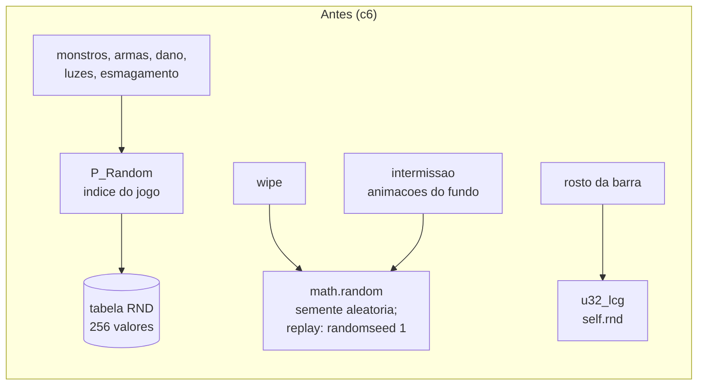
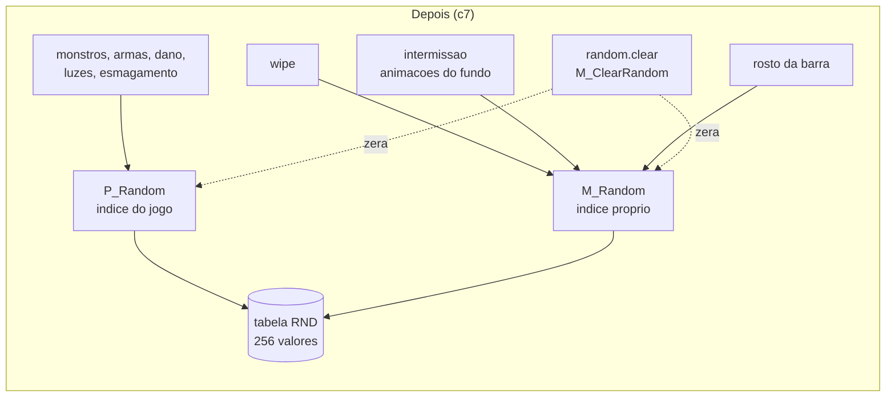
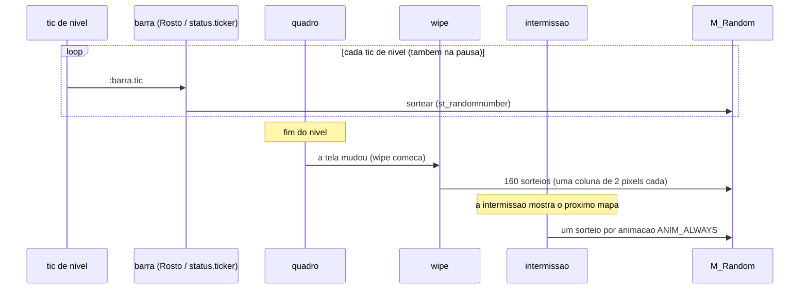

# C7: o wipe, a intermissão e o rosto da barra com `M_Random`

Item da seção 4 do `docs/DIFERENCAS_DOOM.md` ("Transição de tela (wipe)"):
o wipe sorteava com `math.random`, e só era determinístico porque o modo
replay fixava a semente. Ao corrigir, apareceram mais dois usos do mesmo
sorteio do Doom fora da tabela: as animações do fundo da intermissão
(também `math.random`) e o olhar do rosto da barra (um gerador próprio).
Os três passaram para o `M_Random`. Feito nas duas branches, com a
referência nova **`c7`**.

- Linhas citadas como "antes": `atmos` em `1e82643` (C6), branch `lua` em
  `9f08a93` (tag `c6`).

| O que muda | Commits (`atmos` / `lua`) | Situação |
|---|---|---|
| `random.m_random` (o `M_Random`); o wipe, a intermissão e o rosto o usam; `random.clear` zera os dois índices; o replay não fixa mais a semente | este commit / `4c70a0b` | concluído |

## Resumo

O Doom tem dois sorteios sobre a **mesma** tabela de 256 valores
(`m_random.c`): o `P_Random`, com o índice `prndindex`, que é o do jogo (o
que as demos e a sincronia de rede seguem), e o `M_Random`, com o índice
`rndindex`, para o resto: efeitos que não mudam o jogo. `M_ClearRandom`
zera os dois.

| Onde (Doom) | O que sorteia | Este port, antes | Depois |
|---|---|---|---|
| `wipe_initMelt` (`f_wipe.c`) | o atraso de cada coluna do derretimento | `math.random(0, n - 1)` | `rng.m_random() % n` |
| `WI_initAnimatedBack` (`wi_stuff.c`) | o primeiro quadro de cada animação do fundo da intermissão | `math.random(0, span - 1)` | `rng.m_random() % span` |
| `ST_Ticker` (`st_stuff.c`) | `st_randomnumber`, a cada tic da barra: o olhar do rosto (`% 3`) | um gerador congruencial próprio (`u32_lcg`, `self.rnd`) | `rng.m_random()` |

O `math.random` do Lua começa com uma semente aleatória a cada execução.
O wipe e a intermissão eram diferentes a cada jogo, e o replay só era
reprodutível porque `ponte/video.lua` fazia `math.randomseed(1)`. Agora o
jogo não usa `math.random` em lugar nenhum, e a semente saiu do replay: a
reprodutibilidade vem só da tabela, como no Doom.

## Antes e depois

```lua
-- random.lua, antes: so o P_Random
local index = 0
function M.clear()
  index = 0
end
function M.p_random()
  index = band(index + 1, 255)
  return RND[index]
end

-- depois: a mesma tabela, dois indices
local index = 0
local m_index = 0
-- M_ClearRandom: zera os dois indices.
function M.clear()
  index = 0
  m_index = 0
end
function M.p_random()
  index = band(index + 1, 255)
  return RND[index]
end
-- M_Random: a mesma tabela, com o indice do resto (C7).
function M.m_random()
  m_index = band(m_index + 1, 255)
  return RND[m_index]
end
```

```lua
-- wipe.lua, antes                         -- depois
rand = rand or function(n)                 rand = rand or function(n)
  return math.random(0, n - 1)               return rng.m_random() % n
end                                        end

-- wi_stuff.lua, antes
a.nexttic = self.bcnt + 1 + math.random(0, span - 1)
-- depois
a.nexttic = self.bcnt + 1 + (rng.m_random() % span)
```

O rosto, na `atmos` (a task `Rosto`, `barra.atm`, chama `S.sortear(st)` a
cada `:barra.tic`) e na `lua` (`status.ticker`):

```lua
-- status.lua, antes
local function u32_lcg(rnd)          -- rnd * 1103515245 + 12345, mod 2^32
  ...
end
function M.sortear(self)
  self.rnd = u32_lcg(self.rnd)
  return math.floor(self.rnd / 65536) % 256
end

-- depois
function M.sortear(self)
  return rng.m_random()
end
```

A task `Rosto` não muda: ela pede o sorteio no mesmo ponto, e só a fonte
do número muda.

## As fontes de sorteio, antes e depois





## Quem consome o `M_Random`, na ordem

Os três usos dividem um índice, então a ordem entre eles importa: um wipe
que começa num quadro desloca o olhar do rosto dos tics seguintes. A ordem
é a mesma nas duas branches (a equivalência prova isso):



## O que ainda difere do Doom (achados do C7)

Dois itens novos na seção 4 do `docs/DIFERENCAS_DOOM.md`, não corrigidos
aqui:

1. **Os sons não consomem o `M_Random`.** O `S_StartSound` do `linuxdoom`
   varia a altura de quase todo som com `M_Random` (um valor por som; a
   motosserra, outro intervalo). Sem altura variável neste port (som
   posicional fora do escopo), a sequência do `M_Random` não é a do Doom
   assim que um som toca.
2. **Os índices são zerados a cada nível.** `game.build_level` chama
   `rng.clear()`; o Doom só zera no jogo novo (`G_InitNew`). Vale para os
   dois sorteios, não só para o novo, e só aparece no alinhamento da
   sequência.

## Testes unitários

`test_hud` conferia o gerador antigo (`bar.rnd == 1103527590`) e que a
barra desenhada antes e depois do primeiro tic era a mesma (o rosto
continuava olhando para a frente). Agora o primeiro `M_Random` depois de
`clear` é 8, e `8 % 3 = 2`: o rosto olha para o lado. O teste confere o
olhar sorteado, que o desenho muda, e que, com o rosto de volta a 0, o
resto da barra é igual ao de antes do tic.

## Validação

- `make`: compila.
- `make test-drivers`: as 9 propriedades do Atmos e os 14 roteiros
  **idênticos à `c7`**, com as coberturas completas.
- `make test-branches`: a branch `lua` idêntica à `atmos` nos 14 roteiros.
- `make test-mutacoes`: **127/128** detectadas, 8 equivalentes, 1 pendente
  (`corpo-sem-restos`). As quatro novas:

  | Mutação | Roteiro | 1º quadro |
  |---|---|---|
  | `wipe-sem-m-random` (o wipe sem sorteio) | `fluxo` | 253 |
  | `intermissao-sem-m-random` (as animações sem sorteio) | `telas` | 98 |
  | `rosto-sem-m-random` (o olhar sempre o mesmo) | `semente1` | 81 |
  | `clear-sem-m-random` (o `clear` sem zerar o `M_Random`) | `fluxo` | 508 |

- `make test`: 12 passam e as 8 falhas conhecidas (o `test_hud` ajustado).
- Jogo com janela nas duas branches: fecha limpo ("janela fechada").
- Os três diagramas: `tools/diagramas.py` e o preview, `window.erros`
  vazio.

## Divergência esperada contra a `c6`

`REF_TAG=c6`, cada roteiro do `make test-drivers`: **os 14 divergem**. É
o esperado: o rosto da barra sorteia o olhar a cada tic de todo nível, e o
olhar novo (o primeiro `M_Random` depois do `clear` é 8, e `8 % 3 = 2`)
aparece no primeiro quadro desenhado do nível; os roteiros com transição
de tela mudam também o derretimento, e os com intermissão, as animações do
fundo. O jogo (o `P_Random`, os mobjs, os setores) não muda: as mutações
da lógica continuam detectadas, e só o rosto, o wipe e a intermissão
ficam diferentes no framebuffer e no hash.

## Arquivos alterados (nas duas branches, menos onde indicado)

- `jogo/random.lua` (`m_random`, `clear` com os dois índices);
- `render/wipe.lua`, `jogo/wi_stuff.lua`, `jogo/status.lua`;
- `ponte/video.lua` (sem `math.randomseed`);
- `tests/test_hud.lua`;
- só na `atmos`: `tests/test_drivers.sh` (`REF_TAG` padrão `c7`),
  `tools/mutacoes.py` (quatro mutações), `docs/DIFERENCAS_DOOM.md`,
  `CLAUDE.md`, `docs/registro/README.md` e este registro.
