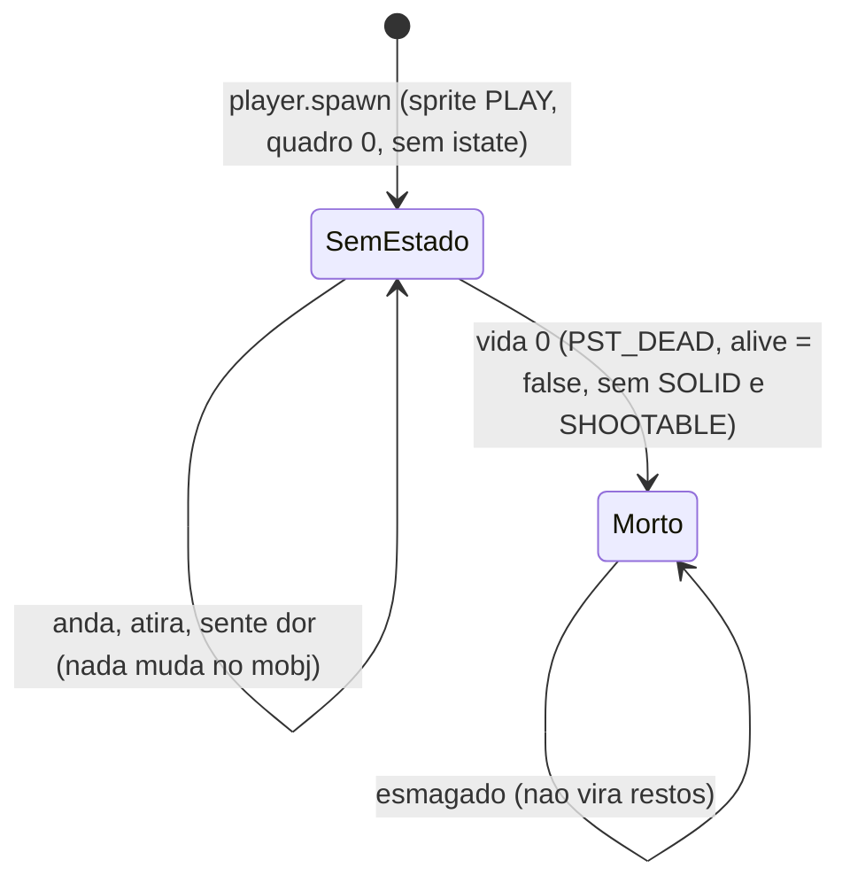
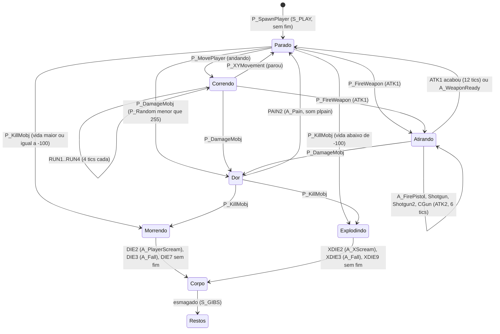
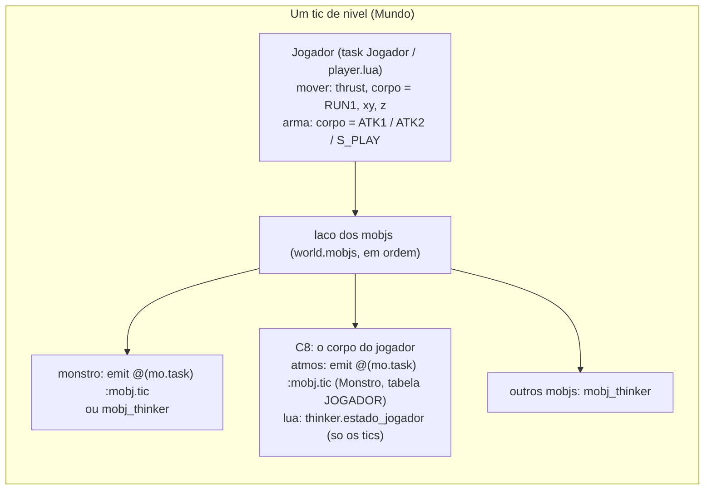

# C8: os estados do mobj do jogador

Item da seção 4 do `docs/DIFERENCAS_DOOM.md` ("Estados do mobj do
jogador"), visto no C3. O mobj do jogador deste port não tinha estado: não
corria, não atirava, não sentia dor nem morria como mobj. Na tela isso
quase não aparece (o corpo fica atrás da câmera), mas tinha três efeitos:

1. **Os sons da dor e da morte não tocavam.** No Doom eles vêm das ações
   dos estados: `A_Pain` em `S_PLAY_PAIN2` (`plpain`), `A_PlayerScream` em
   `S_PLAY_DIE2` (`pldeth`) e `A_XScream` em `S_PLAY_XDIE2` (`slop`).
2. **A sequência do `P_Random` não era a do Doom.** O `P_DamageMobj`
   sorteia a dor (`painchance`) também para o jogador, e o `P_KillMobj`
   desconta `P_Random() & 3` dos tics da morte. Aqui, nenhum dos dois: a
   partir do primeiro dano no jogador, todos os sorteios seguintes ficavam
   deslocados em relação ao Doom.
3. **O corpo do jogador esmagado não virava restos** (C4c), nem ficava
   com a altura de corpo (um quarto) e as flags de corpo.

Feito nas duas branches, com a referência nova **`c8`**.

- Linhas citadas como "antes": `atmos` em `7cc4b07` (C7), branch `lua` em
  `4c70a0b` (tag `c7`).

| O que muda | Commits (`atmos` / `lua`) | Situação |
|---|---|---|
| o corpo do jogador com os estados do `MT_PLAYER`; a dor e a morte do Doom; restos; o save | este commit / `07e3e72` | concluído |

## Antes e depois, em uma figura

**Antes:** o mobj do jogador nasce sem `istate` nem `tics`, fica fora do
laço dos mobjs (`thinker.pensantes` o pulava) e o dano só mexe nos números
do jogador.



**Depois:** os estados do `MT_PLAYER` (`info.STATES` 149 a 173), com as
transições do Doom. As setas de fora (em Lua) são as do `p_user.c`,
`p_mobj.c`, `p_pspr.c` e `p_inter.c`; as outras são o "próximo" da tabela.



(As setas de dor e morte valem de qualquer estado vivo; o diagrama mostra
as principais.)

## Onde o corpo pensa

No Doom, o `P_Ticker` roda primeiro os jogadores (`P_PlayerThink`) e
depois os thinkers, na ordem da lista; o mobj do jogador é um deles
(`P_MobjThinker`): move-se e conta os tics do estado ali. Este port move o
mobj do jogador no tic do jogador (`player.mover`), e isso não muda aqui.
O que muda é que o mobj do jogador **entra no laço dos mobjs** só para
contar os tics do estado, na posição dele em `world.mobjs`: a mesma do
Doom. As ações dos estados dele não consomem `P_Random`, então a posição
não altera a sequência; ela foi mantida por fidelidade.



## A dor e a morte (`player.damage_mobj`)

```lua
-- antes (7cc4b07 / 4c70a0b)
damage = damage - saved
player.health = player.health - damage
target.health = player.health
...
player.attacker = source
if player.health <= 0 then
  player.health = 0
  target.health = 0
  player.playerstate = PST_DEAD
  target.alive = false
  target.flags = band(target.flags, bnot(MF_SOLID + MF_SHOOTABLE))
  pspr.soltar_arma(player, nil)
end
return
```

```lua
-- depois
damage = damage - saved
player.health = player.health - damage
if player.health < 0 then player.health = 0 end
...
player.attacker = source
-- o mobj perde o dano inteiro (fica negativo na morte)
target.health = (target.health or 0) - damage
if target.health <= 0 then
  -- P_KillMobj
  target.flags = band(target.flags, bnot(MF_SHOOTABLE + MF_FLOAT + MF_SKULLFLY + MF_NOGRAVITY))
  target.flags = compat.bor(target.flags, MF_CORPSE + MF_DROPOFF)
  target.height = target.height // 4
  target.flags = band(target.flags, bnot(MF_SOLID))
  player.playerstate = PST_DEAD
  target.alive = false
  pspr.soltar_arma(player, nil)
  local st = row[info.MI_DEATHSTATE]
  if target.health < -row[info.MI_SPAWNHEALTH] and row[info.MI_XDEATHSTATE] ~= 0 then
    st = row[info.MI_XDEATHSTATE]                    -- explode
  end
  thinker.set_mobj_state(target, st, game and game.world, game)
  target.tics = target.tics - band(rng.p_random(), 3)  -- o 2o P_Random
  if target.tics < 1 then target.tics = 1 end
  return
end
-- a dor (painchance 255) e o alvo, como num monstro
if rng.p_random() < row[info.MI_PAINCHANCE] and not has(target.flags, MF_SKULLFLY) then
  target.flags = compat.bor(target.flags, MF_JUSTHIT)
  thinker.set_mobj_state(target, row[info.MI_PAINSTATE], game and game.world, game)
end
target.reactiontime = 0
if (target.threshold or 0) == 0 and source ~= nil and source ~= target then
  target.target = source
  target.threshold = BASETHRESHOLD
  if target.istate == row[info.MI_SPAWNSTATE] and row[info.MI_SEESTATE] ~= 0 then
    thinker.set_mobj_state(target, row[info.MI_SEESTATE], game and game.world, game)
  end
end
```

O bloco do alvo é o do `P_DamageMobj`, que vale também para o jogador: com
o `painchance` 255, só quando o sorteio dá 255 o corpo continua no `S_PLAY`
e passa a correr. O `threshold` do jogador nunca é descontado (só o
`A_Chase` o desconta), então isso só acontece no primeiro dano.
`player.damage_mobj` passou a receber `game` (5º argumento, passado por
`enemy.damage_mobj`), para os sons das ações e o mundo.

## Na `atmos`: o corpo é um `Monstro`

O corpo do jogador tem a mesma forma de um monstro: comportamentos em
sequência (correr em laço; atirar, dor, morrer e explodir até o fim) e
saltos de fora. A task `Monstro` (`monstro.atm`, passo 9) serve com uma
tabela nova e duas mudanças pequenas na parte genérica:

```
;; C8: o corpo do jogador (MT_PLAYER, sprite PLAY).
val JOGADOR = [
    procurar = [info.S_PLAY],                                ;; parado, sem fim
    correr   = faixa(info.S_PLAY_RUN1, info.S_PLAY_RUN4),    ;; () x4
    atacar   = [info.S_PLAY_ATK2, info.S_PLAY_ATK1],         ;; ATK2 (clarao) -> ATK1 -> S_PLAY
    dor      = faixa(info.S_PLAY_PAIN, info.S_PLAY_PAIN2),   ;; (), (A_Pain)
    morrer   = faixa(info.S_PLAY_DIE1, info.S_PLAY_DIE7),    ;; DIE2 (A_PlayerScream), DIE3 (A_Fall); DIE7 sem fim
    explodir = faixa(info.S_PLAY_XDIE1, info.S_PLAY_XDIE9),  ;; XDIE2 (A_XScream), XDIE3 (A_Fall); XDIE9 sem fim
    levantar = [],
    volta    = info.S_PLAY,
    sem_mover = true,
]
set TIPOS@(info.MT_PLAYER)    = JOGADOR   ;; C8
```

| Parte genérica | Antes | Depois |
|---|---|---|
| fim de atirar, dor e levantar | `entrar(mo, game, C.correr@1)` | `entrar(mo, game, C.volta \|\| (C.correr@1))`: o jogador volta ao `S_PLAY` (o "próximo" de `ATK1` e `PAIN2` na tabela) |
| `contar` | sempre `T.mobj_mover` antes de contar | `if !C.sem_mover { ... }`: o corpo do jogador se move no tic do jogador |

`contar` e `sequencia` passaram a receber a tabela `C`. A sequência de
atirar é `[ATK2, ATK1]` porque, na tabela, `ATK2` (o quadro do clarão, 6
tics) leva a `ATK1` (12 tics), e `ATK1` leva ao `S_PLAY`: começando em
`ATK1` (o `P_FireWeapon`), a sequência é só `ATK1`; começando em `ATK2`
(o `A_FirePistol`), `ATK2` e `ATK1`.

A task nasce no `spawn_map`, logo depois do `player.spawn`
(`criar_task`, agora exportado como `thinker.criar_task`), e de novo no
load (o `limpar_nivel` aborta a task do corpo com as outras). No load, um
save de antes do C8 traz o estado 0 (`S_NULL`) ou nenhum: o corpo fica no
`S_PLAY` do mobj novo. O seu `saves/doomsav0.dsg` (E4M2, de antes do C5)
carrega nas duas branches com o mesmo resultado (600 quadros, hashes
idênticos), numa pasta isolada.

**Medida de forma** (contada no `git diff` de `monstro.atm`, sem
comentários): o corpo do jogador custou 11 linhas de tabela e 1 no
`TIPOS`; na parte genérica, 2 linhas novas (o `if` do `sem_mover`) e 13
alteradas (passar `C` a `contar` e `sequencia`, em 12 lugares, e o
`volta`). Na `lua`, a função `estado_jogador` (8 linhas) e uma linha em
`mobj_thinker`. As transições (as mesmas nas duas) ficam no Lua, como os
saltos dos monstros.

## Validação

- `make`: compila.
- `make test-drivers`: as 9 propriedades do Atmos e os 14 roteiros
  **idênticos à `c8`**, com as coberturas completas.
- `make test-branches`: a branch `lua` idêntica à `atmos` nos 14 roteiros.
- `make test-mutacoes`: **136/136** detectadas, 8 equivalentes e **nenhuma
  pendente**. A `corpo-sem-restos` (pendente desde o C4c: nenhum roteiro
  esmagava o corpo de um monstro) passou a ser detectada no `pisos`,
  porque o corpo do jogador esmagado agora tem estados e vira restos. Duas
  mutações antigas da task `Monstro` (`dor-volta-a-procurar` e
  `tipo-volta-como-zumbi`) tiveram o trecho original atualizado para a
  linha do `volta`. As oito novas:

  | Mutação | Roteiro | 1º quadro |
  |---|---|---|
  | `jogador-dor-sem-random` (a dor sem o `P_Random`) | `semente1` | 1374 |
  | `jogador-morte-sem-random` (a morte sem `P_Random & 3`) | `pisos` | 810 |
  | `jogador-sem-explodir` (sempre o `deathstate`) | `arma` | 2744 |
  | `jogador-nao-corre` (`P_MovePlayer`) | `semente1` | 179 |
  | `jogador-nao-para` (`P_XYMovement`) | `semente1` | 233 |
  | `jogador-nao-atira` (`P_FireWeapon`) | `arma` | 41 |
  | `jogador-sem-restos` (o corpo esmagado) | `pisos` | 1102 |
  | `corpo-fora-do-laco` (o corpo fora do laço dos mobjs) | `arma` | 41 |

- Os estados aparecem nos roteiros (sonda em `set_mobj_state` para o mobj
  do jogador, numa pasta isolada): corrida, tiro (`ATK1`, `ATK2`) e dor (17
  vezes na `semente1`), morte e restos no esmagador (`pisos`), explosão no
  comando `die` (dano de 10.000, abaixo de -100; `arma`).
- O save antigo do usuário (`saves/doomsav0.dsg`, E4M2, de antes do C5)
  carrega nas duas branches, com os mesmos hashes (600 quadros). O primeiro
  teste achou o defeito: o save antigo grava o estado do jogador como 0, e
  a task parava com "estado 0 fora da tabela"; o load passou a tratar 0
  como ausente.
- `make test`: 12 passam e as 8 falhas conhecidas, nas duas branches.
- Jogo com janela nas duas branches: fecha limpo ("janela fechada").
- Os três diagramas: `tools/diagramas.py` e o preview, `window.erros`
  vazio (o primeiro teste pegou um `:` dentro de um rótulo).

## Divergência esperada contra a `c7`

`REF_TAG=c7`, cada roteiro do `make test-drivers`: **os 14 divergem**.
O hash de estado tem o `istate` e os `tics` de todo mobj, e o do jogador
passou de `nil` para `S_PLAY` desde o primeiro quadro de todo nível. Além
disso, onde o jogador leva dano ou morre, a sequência do `P_Random` muda
(os dois sorteios novos), e com ela o resto do jogo.

## Arquivos alterados

- nas duas branches: `jogo/player.lua` (spawn, `mover`, `xy_movement`,
  `damage_mobj`), `jogo/pspr.lua` (`corpo`), `jogo/thinker.lua`
  (`estado_jogador`, o corpo no laço), `jogo/collision.lua` (restos),
  `jogo/enemy.lua` (`game` para `player.damage_mobj`), `jogo/saveg.lua`
  (save antigo);
- só na `atmos`: `jogo/monstro.atm` (tabela `JOGADOR`, `volta`,
  `sem_mover`), `tests/test_drivers.sh` (`REF_TAG` padrão `c8`),
  `tools/mutacoes.py` (oito mutações), `docs/DIFERENCAS_DOOM.md` (o item
  corrigido e dois achados no `P_PlayerInSpecialSector`), `CLAUDE.md`,
  `docs/registro/README.md` e este registro.
